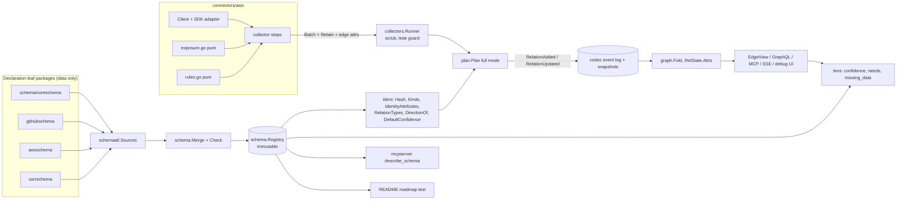

# Design Document: AWS Relationship Registry

## Overview

This feature does three things to the Unified Security Graph (`.kiro/specs/unified-security-graph`).

1. **Per-source registry.** Kinds and relation types are declared as plain data by each source (`core`, `github`, `aws`, `correlator`). A pure merge step checks them and produces the read-only registry that `ident` already exposes. The two global maps in `ident.go` go away.
2. **Edge attributes.** A relation can carry `evidence`, `confidence`, and `observed_at`. The log and snapshot formats gain an optional trailing section, so a relation without attributes encodes to the same bytes as today.
3. **AWS taxonomy and network slice.** The registry holds 5 AWS kinds, 59 AWS relation types, and 7 collection categories. The AWS collector collects the network slice (VPC to load balancer), reifies security group rules as nodes, derives internet exposure from a pure function, and keeps previously stored entities when a resource type fails.

### What exists today (read before designing)

| Area | Today | File |
| --- | --- | --- |
| Registry | Two maps `identityAttrs` and `relDirections`; `Hash`, `Kinds`, `IdentityAttributes`, `RelationTypes`, `DirectionOf`, `Label`, `IsSecretName` | `bellugraph/internal/bge/ident/ident.go` |
| Relation shape | `batch.Relation{Type, From, To, Attributes}`; `plan.Plan` rejects any non-empty `Attributes` | `internal/graph/batch/batch.go`, `bge/plan/plan.go` (loop over `b.Relations`) |
| Event | `RelationAdded` and `RelationRemoved` encode `type, from, to` and nothing else. `DecodeEvent` fails on trailing bytes | `bge/codec/event.go` |
| Snapshot record | `RelationRecord{Asserted, VTNS, RTNS, Seq}`; decode fails on trailing bytes | `bge/codec/snapshot.go` |
| Projection | `RelState{Key, Asserted, VT, RT, Seq}`; `foldRelAdded`; `Export`/`Import` | `bge/graph/graph.go`, `bge/graph/snapshot.go` |
| Reference model | A model of plan and fold used by property tests | `bge/internal/gen/model/model.go` |
| Apply mode | `facade.Ingest.Apply` always calls `Core.Apply(..., ModeFull)`. Full mode retracts everything the collector asserted before and the batch omits | `bellugraph/facade/ingest.go`, `plan.Plan` |
| Partial failure | `collectors.PartialError` applies the batch. A failed type is therefore **retired** today | `collectors/runner.go` (`tick`) |
| Change feed | `changeKindSubject` maps `RelationAdded` and `RelationRemoved` | `bge/engine/read.go` |
| Edge views | `EdgeView{Type, From, To, Direction, Hops, Derived}`; GraphQL `Edge`; MCP `EdgeOut`; SSE frame has `RelationType` | `engine/read.go`, `gql/schema.graphqls`, `mcpserver/views.go`, `sse/sse.go` |
| Redaction | `redact.Guard.Scrub/Leaks/FirstLeak` walk entity attributes; `connectors/redactor` walks `b.Relations` at line 223 | `internal/redact/guard.go`, `connectors/redactor/redactor.go` |
| AWS collector | `Client` has 9 methods. `exposed()` is a two-input function. Emits `owned_by`, `runs_on`, `attached_to` | `connectors/aws/{client,collector,manifest}.go` |
| Lens | `Confidence(relType)` hard-codes `likely_same_as`; `Budget`; `cloud` lens lists `aws_account`, `aws_resource` | `internal/lens/{slice,budget,catalog,engine}.go` |

### Decisions

| Decision | Choice | Why |
| --- | --- | --- |
| Where declarations live | Plain data in `internal/graph/schema` (types, merge, check) and one tiny leaf package per source: `schema/coreschema`, `connectors/github/githubschema`, `connectors/aws/awsschema`, `correlate/corrschema`. `internal/graph/schemaall` lists them. `ident` imports `schemaall` | `bge/internal/...` cannot be imported from `connectors/*` or `correlate`. Leaf packages import only `schema`, so `bellugraph` never pulls in the AWS SDK. `connectors/arch_test.go` is extended, not loosened |
| When the merge runs | `ident` builds the default registry lazily on first use. `facade.Open` calls `ident.Check()` first and returns a `ConfigError` before it opens any store | A failing merge never opens the engine and never applies part of a declaration (Req 2.12). Tests need no init order |
| One resource kind for most AWS types | Keep `aws_resource` with a `resource_type` discriminator (`ec2:subnet`). Dedicated kinds only where identity differs: `aws_sg_rule`, `aws_cidr`, `aws_policy_statement` | Req 9.2. Existing entity IDs and `canonical_key` stay valid |
| Relation endpoints are *type names* | `from`/`to` in the relation table are a kind (`aws_account`) or a discriminator value (`ec2:subnet`) | One `aws_resource` kind hides the real endpoint types. The registry holds them so the check can validate and docs can print them |
| Edge attribute encoding | Optional trailing section after the legacy bytes. A new event type `RelationUpdated` (8) carries attribute-only changes | Zero attributes keep the old bytes (Req 7.2). Re-emitting `RelationAdded` for an existing relation would look like a new relation in the change feed |
| Retaining entities of a failed type | New optional `batch.Batch.Retain []Retain`. `plan.Plan` in full mode skips retirement for entities and relations that match | The facade always applies full observations. Retention needs no new apply mode and no collector-side read of the graph |
| Direction of structural network edges | Containment and dependency edges are `Reverse`. Capability edges (credentials, routing, forwarding, assume, access, reads, writes) are `Forward`. Pure netreach (below) answers "what can an attacker reach from this instance" | `Impact` follows one direction per type. The ENI to security group to peer chain needs both directions, so a pure lens function walks it explicitly |
| `aws_allows_ingress_from`, `aws_allows_egress_to`, `aws_can_access` | Registered with `derived: true`. No connector collector asserts them. The lens synthesizes the first two when it collapses Rule_Nodes. Authorization_Analysis will produce the third | Stored rule nodes already carry the facts. A stored summary edge per (SG, peer) would collapse several rules into one key |
| Routes | A route is an entity `ec2:route` linked to its route table by `aws_route_of`, and the route table links to each target with `aws_routes_to` (evidence lists destinations) | Req 9.1 names routes as a resource and 9.7 fixes `aws_routes_to` from the route table |
| Existing `runs_on` and `attached_to` emission | The AWS collector keeps `owned_by` and `runs_on` (instance to VPC) and stops emitting `attached_to`. The type stays registered in `core` | Instance to security group is now `aws_has_eni` plus `aws_member_of_sg`. Old relations retire on the next full run |

### Out of scope

Authorization_Analysis, collectors for the six registered-only categories, UI rendering of evidence, any AWS write.

## Architecture



Import rules, enforced by `connectors/arch_test.go` and a new test next to it:

- `internal/graph/schema` and the four leaf packages import only the standard library and `schema`.
- `connectors/aws` and `connectors/github` import their own leaf package for constants. They never import `bellugraph` or `ident`.
- `ident` imports `schemaall`. `schemaall` imports leaf packages. No leaf package imports `bellugraph`, so there is no cycle.
- `lens` imports `schema` (public) for confidence defaults and categories. It never imports `bge/ident`.

## Components and Interfaces

### 1. Registry (`internal/graph/schema`)

```go
package schema

type Direction uint8 // numeric values equal ident.Direction: Reverse = 0, Forward = 1
const ( Reverse Direction = iota; Forward )

type Confidence string // "extracted" | "inferred"
type Status string     // "implemented" | "registered-only"
type Source string     // "core" | "github" | "aws" | "correlator"

type KindDeclaration struct {
    Name          string
    Identity      []string        // ordered, 1..16, unique, non-empty
    Description   string          // 1..500 chars, not blank
    Discriminator string          // optional attribute name that selects Types, e.g. "resource_type"
    Types         []TypeDeclaration
}
type TypeDeclaration struct {
    Name        string // value of the discriminator, e.g. "ec2:subnet"
    Category    string // CategoryDeclaration.ID
    Description string
}
type RelationDeclaration struct {
    Name        string
    Direction   Direction
    Confidence  Confidence // default confidence
    Description string
    From, To    []string   // kind names or type names; empty means "any"
    Derived     bool       // never asserted by a connector collector
    Category    string     // optional, AWS only
}
type CategoryDeclaration struct {
    ID      string   // "ownership", "network", "compute", "identity", "data", "controls", "dns"
    Name    string
    Status  Status
    ReadOps []string // AWS read operations a future collector needs (registered-only rows)
}
type SourceDeclaration struct {
    Source     Source
    Prefix     string // "" for core; "aws_" for aws; "github_" for github
    Kinds      []KindDeclaration
    Relations  []RelationDeclaration
    Categories []CategoryDeclaration
}

// Builder accumulates declarations. Add validates one SourceDeclaration alone
// and against everything accepted so far, and leaves the Builder unchanged on error.
type Builder struct{ /* accepted []SourceDeclaration */ }
func (b *Builder) Add(d SourceDeclaration) error
func (b *Builder) Build() (*Registry, error)

// Merge is Add for every declaration, then Build. It reports every failure in one error.
func Merge(ds ...SourceDeclaration) (*Registry, error)

var ErrImmutable = errors.New("schema: registry is immutable")

type Registry struct{ /* sorted slices and maps; no exported fields */ }
func (r *Registry) Register(SourceDeclaration) error                // always ErrImmutable
func (r *Registry) Kinds() []KindDeclaration                        // sorted by name
func (r *Registry) Kind(name string) (KindDeclaration, bool)
func (r *Registry) Relations() []RelationDeclaration                // sorted by name
func (r *Registry) Relation(name string) (RelationDeclaration, bool)
func (r *Registry) Categories() []CategoryDeclaration               // sorted by ID
func (r *Registry) Category(id string) (CategoryDeclaration, bool)
func (r *Registry) CategoryOfType(typeName string) (string, bool)
func (r *Registry) SourceOfKind(name string) (Source, bool)
func (r *Registry) SourceOfRelation(name string) (Source, bool)
func (r *Registry) RegisteredOnly(ids []string) []string            // sorted, unique; unknown id counts as registered-only
```

`Register` exists so Req 1.6 has an observable API. The `Builder` is the only mutable object and is dropped after `Build`.

**Check rules** (all collected, none short-circuit):

| Rule | Req |
| --- | --- |
| Kind name and relation name match `[a-z][a-z0-9_]*`, length 1..64 | 2.6, 2.7, 1.2, 1.3 |
| Identity list has 1..16 entries, no empty or duplicate name | 1.2, 2.9 |
| Description length 1..500 after trim, not blank | 1.2, 1.3, 2.10 |
| Confidence is exactly `extracted` or `inferred`; direction is `Forward` or `Reverse` | 1.3 |
| No attribute (identity or documented) is a secret name (`ident.IsSecretName`, moved into `schema.IsSecretName`) or equals `data` | 2.11 |
| Same name declared twice by one source | 2.3 |
| Same relation name, different direction, from two sources | 2.1 |
| Same kind name, different identity list (order matters), from two sources | 2.2 |
| Same generic relation, same direction, same confidence, two sources: accepted, one entry kept | 2.4 |
| Same generic relation, same direction, different confidence | 2.5 |
| A non-core source's name starts with its `Prefix`, unless it is a Generic_Relation or in the legacy allow-list (`package`, `vulnerability`, `affected_by`, `same_as`, `likely_same_as`) | 2.8 |
| `From`/`To` entries name a declared kind or type | design |
| Every `TypeDeclaration.Category` and `RelationDeclaration.Category` names a declared category | design |
| The `aws` declaration contains every required AWS kind, type, relation, and category (list in section 3.6) | 10.12 |

**Order independence (2.13).** `Add`/`Merge` sort the input by `Source` and each list by name before validation, and produce errors sorted by `(source, name, rule)`. Conflicts between two sources report the pair in sorted source order. The error is one `*schema.CheckError{Failures []Failure}` whose `Error()` joins all failures, so the same input set gives the same text for every ordering. `Builder.Add` of a bad declaration returns the failures for that declaration and keeps `accepted` unchanged (Req 1.8). A rejected `aws` declaration (10.12) reports each missing name.

**Source declarations.** Each leaf package exports one function and the constants its collector needs:

```go
// connectors/aws/awsschema
func Declaration() schema.SourceDeclaration
const ( KindAccount = "aws_account"; KindResource = "aws_resource"; KindSGRule = "aws_sg_rule"; KindCIDR = "aws_cidr"; KindPolicyStatement = "aws_policy_statement" )
const ( TypeSubnet = "ec2:subnet" /* ... one constant per resource type ... */ )
const ( RelInVPC = "aws_in_vpc" /* ... one constant per relation type ... */ )
```

`connectors/aws/collector.go` replaces its local `kindAccount`/`kindResource` with these constants.

**`ident` delegation (signatures unchanged).**

```go
func Hash(kind string, attrs map[string]string) (string, error)        // unchanged algorithm; reads identity list from the registry
func Kinds() []string                                                   // sorted
func IdentityAttributes(kind string) ([]string, bool)                   // copy, registered order
func RelationTypes() []string                                           // sorted
func DirectionOf(relType string) (d Direction, isDefault bool)         // unregistered: Reverse, true
func Label(kind string, identity map[string]string, attrs map[string]any) string

// new
func DefaultConfidence(relType string) (conf string, registered bool)  // unregistered: "extracted", false
func Registry() (*schema.Registry, error)                               // error when the merge failed
func Check() error                                                      // nil when the merge succeeded
func Use(r *schema.Registry) error                                      // tests only; first call wins, later different call returns ErrImmutable
```

`ident.Hash` keeps its byte layout. After a failed merge, lookups behave as if nothing is registered (every `Hash` returns `errs.Validation`) and `Check()` returns the aggregate error. The engine is never opened in that state.

**`bellugraph/facade.Open`** calls `ident.Check()` first. On error it returns `*ConfigError` wrapping the aggregate error. `cmd/bellud/main.go` `openGraph` already exits on a config error; the message lists every failure.

**MCP `describe_schema`** (`mcpserver/tools.go` `describeSchema`, types `kindInfo`, `relTypeInfo`, `describeSchemaOut`). Existing JSON fields keep their names and semantics (`kind`, `identity_attributes`, `count`, `type`, `impact_direction`, `default`). New fields: kind gets `description`, `source`, `discriminator`, `types[]`; relation gets `confidence`, `description`, `source`, `derived`, `from[]`, `to[]`; the response gets `categories[]` (`id`, `name`, `status`, `read_ops`). Kinds and relations are sorted by name with `sort.Strings` (byte order is code-point order for UTF-8). Empty categories return empty arrays. If `ident.Registry()` returns an error the tool returns `schema could not be read` and no partial result. `describe_type` (`describeType`) also lists the new kinds through the same lookups.

**Generators.** `bge/internal/gen/gen.go` samples `ident.Kinds()` and `ident.RelationTypes()`. They pick up new names automatically. `gen.RelAttrs()` is added (section 4).

### 2. Migration of existing names

| Declared by | Kinds | Relation types |
| --- | --- | --- |
| `core` | `host`, `process`, `listening_port`, `container`, `image`, `network`, `volume`, `repository`, `dependency`, `workflow`, `secret_ref`, `iac_resource`, `k8s_object`, `secret_finding`, `collector_status`, `endpoint` | `runs_on`, `on`, `owned_by`, `uses`, `attached_to`, `mounts`, `depends_on`, `resolves_to`, `found_in` (all `extracted`) |
| `github` | `github_org`, `github_repo`, `github_workflow`, `github_pull_request`, `github_alert`, `package` | none |
| `aws` | `aws_account`, `aws_resource`, plus the new kinds in section 3.2 | the 59 types in section 3.1 |
| `correlator` | `vulnerability` | `affected_by`, `same_as`, `likely_same_as` (`inferred`, others `extracted`) |

Generic relations are declared only by `core` (and by `correlator` for its three), so no generic relation has two declarers. Identity lists are copied character for character from the current map, including the order, which is the registered order that `Label` and `IdentityAttributes` return.

**Golden vectors.** Before any code moves, a one-off test on the unmodified tree writes `bge/ident/testdata/golden.json` containing, for every existing kind, one identity attribute map and its `Hash` output, every existing kind with its identity list, and every existing relation type with its direction. The file is committed in the first commit of the phase. `golden_test.go` asserts all three tables against the merged registry and fails on any difference. Adding kinds adds no vector to the existing set (the new kinds get their own vectors in the same file, written after the change).

**Legacy replay fixtures.** On the unmodified tree, a generator test writes `bge/engine/testdata/legacy/{log,snapshot}` plus `expected.json` (entities, relations, zero attributes). `legacy_test.go` loads both and compares. A second test flips one byte in a record of a copied log, opens it, and asserts the open aborts naming the record and that the original directory is unchanged (Req 3.6).

### 3. Direction_Rule, kinds, relation types, categories

**Direction_Rule** (Req 4). An edge reads `from <type> to`.

- `Forward`: compromise or failure of `from` gives an attacker or fault a capability over `to` (routing, forwarding, credentials, permission to act, protection removed).
- `Reverse`: `from` depends on, is contained in, or is owned by `to`, so failure of `to` impacts `from`.
- If both match, the edge is `Forward`, and the justification says "both matched".

#### 3.1 AWS relation types (59 rows)

Endpoint names are kinds or `resource_type` values. "any compute" = `ec2:instance`, `lambda:function`, `ecs:task`, `elbv2:load-balancer`, `ec2:nat-gateway`, `ec2:vpc-endpoint`. Default confidence is `E` (extracted) or `I` (inferred).

| # | Relation type | From | To | Dir | Conf | Justification |
| --- | --- | --- | --- | --- | --- | --- |
| 1 | `aws_member_of` | `aws_account` | `organizations:organization` | Reverse | E | The account is contained in the organization; an organization change impacts the account. |
| 2 | `aws_child_of` | `aws_account`, `organizations:ou` | `organizations:ou`, `organizations:root` | Reverse | E | The child sits under its parent in the hierarchy; a parent change impacts the child. |
| 3 | `aws_scp_attached` | `aws_account`, `organizations:ou`, `organizations:root` | `organizations:scp` | Reverse | E | The target depends on the SCP that governs it; a change to the SCP impacts the target. Not an identity policy attachment. |
| 4 | `aws_in_vpc` | `ec2:subnet`, `ec2:security-group`, `ec2:route-table`, `ec2:network-acl`, `ec2:vpc-endpoint` | `ec2:vpc` | Reverse | E | The resource is contained in the VPC. Containment alone gives no capability. |
| 5 | `aws_in_subnet` | `ec2:eni` | `ec2:subnet` | Reverse | E | The ENI is contained in the subnet. |
| 6 | `aws_has_eni` | any compute | `ec2:eni` | Reverse | E | The workload depends on its ENI for connectivity; ENI failure impacts the workload. Reach through the ENI is walked by netreach. |
| 7 | `aws_member_of_sg` | `ec2:eni` | `ec2:security-group` | Reverse | E | The ENI depends on its security group for filtering; a rule change impacts the ENI. |
| 8 | `aws_routes_to` | `ec2:route-table` | `ec2:internet-gateway`, `ec2:nat-gateway`, `ec2:transit-gateway`, `ec2:vpc-peering`, `ec2:vpc-endpoint`, `ec2:eni`, `ec2:vpc` | Forward | E | A route gives traffic a path to its target, so the route table gives reach over the target. Evidence lists destination CIDRs. |
| 9 | `aws_route_of` | `ec2:route` | `ec2:route-table` | Reverse | E | The route is contained in its route table. |
| 10 | `aws_associated_subnet` | `ec2:route-table`, `ec2:network-acl` | `ec2:subnet` | Forward | E | Failure or change of the table or ACL changes the subnet's routing or filtering. Direction fixed by Req 9.7. |
| 11 | `aws_attached_igw` | `ec2:internet-gateway` | `ec2:vpc` | Forward | E | Failure or compromise of the gateway changes the VPC's internet exposure. Not `attached_to`. |
| 12 | `aws_nat_in_subnet` | `ec2:nat-gateway` | `ec2:subnet` | Reverse | E | The NAT gateway is contained in the subnet. |
| 13 | `aws_peers_with` | `ec2:vpc` | `ec2:vpc` | Forward | E | A peering lets the first VPC reach the second. Emitted in both directions for an active peering. |
| 14 | `aws_tgw_attached` | `ec2:tgw-attachment` | `ec2:transit-gateway`, `ec2:vpc` | Forward | E | An attachment gives its network reach over the gateway and the attached VPC. |
| 15 | `aws_lb_forwards_to` | `elbv2:listener` | `elbv2:target-group` | Forward | E | A listener sends traffic to the target group, so an attacker at the listener reaches the targets. |
| 16 | `aws_lb_listener_of` | `elbv2:listener` | `elbv2:load-balancer` | Reverse | E | The listener belongs to its load balancer; load balancer failure impacts the listener. |
| 17 | `aws_targets` | `elbv2:target-group` | `ec2:instance`, `ec2:eni`, `lambda:function` | Forward | E | A target group sends traffic to its registered targets. |
| 18 | `aws_rule_of` | `aws_sg_rule` | `ec2:security-group` | Forward | E | The rule defines the group's filtering; a rule failure or compromise changes who reaches the group. Both criteria matched. |
| 19 | `aws_rule_peer` | `aws_sg_rule` | `aws_cidr`, `ec2:security-group` | Reverse | E | The rule depends on its peer; compromise of the peer reaches the rule's group. Impact is meaningful for ingress rules. |
| 20 | `aws_assigned_to` | `ec2:eip` | `ec2:eni`, `ec2:instance`, `ec2:nat-gateway` | Forward | E | Failure or release of the address changes the target's reachability. Not `attached_to`. |
| 21 | `aws_exposed_via` | `ec2:instance`, `elbv2:load-balancer` | `ec2:internet-gateway` | Reverse | E | The resource is reachable from the internet through the gateway; compromise of the internet side impacts the resource. Evidence and confidence per exposure result. |
| 22 | `aws_allows_ingress_from` | `ec2:security-group` | `aws_cidr`, `ec2:security-group` | Reverse | E | Derived by the lens. The group allows ingress from the peer, so peer compromise reaches the group's members. The edge points at the source, so impact flows peer to group. |
| 23 | `aws_allows_egress_to` | `ec2:security-group` | `aws_cidr`, `ec2:security-group` | Forward | E | Derived by the lens. Members of the group may open connections to the peer, so compromise of a member reaches the peer. |
| 24 | `aws_uses_image` | `ec2:instance`, `ec2:launch-template`, `ecs:task`, `lambda:function` | `ec2:image`, `image` | Reverse | E | The workload depends on its image. Joins to the core `image` kind through the digest key. |
| 25 | `aws_in_asg` | `ec2:instance` | `autoscaling:group` | Reverse | E | The instance is a member of the group. |
| 26 | `aws_launched_from` | `ec2:instance`, `autoscaling:group` | `ec2:launch-template` | Reverse | E | The resource depends on the template that defines it. |
| 27 | `aws_has_instance_profile` | `ec2:instance`, `ec2:launch-template` | `iam:instance-profile` | Forward | E | Compromise of the instance yields the profile credentials. Both criteria matched. |
| 28 | `aws_profile_has_role` | `iam:instance-profile` | `iam:role` | Forward | E | The profile hands out the role's credentials, so holding the profile gives the role's permissions. |
| 29 | `aws_task_role` | `ecs:task`, `ecs:service` | `iam:role` | Forward | E | Compromise of the task yields the task role credentials. Both criteria matched. |
| 30 | `aws_exec_role` | `ecs:task`, `ecs:service` | `iam:role` | Forward | E | The agent runs with the execution role, so compromise of the task path yields it. Both criteria matched. |
| 31 | `aws_lambda_role` | `lambda:function` | `iam:role` | Forward | E | Compromise of the function yields its execution role credentials. Both criteria matched. |
| 32 | `aws_cluster_role` | `eks:cluster`, `eks:nodegroup` | `iam:role` | Forward | E | Compromise of the cluster or node group yields the role it runs as. Both criteria matched. |
| 33 | `aws_in_cluster` | `ecs:service`, `ecs:task`, `eks:nodegroup` | `ecs:cluster`, `eks:cluster` | Reverse | E | The resource is contained in the cluster. |
| 34 | `aws_service_of` | `ecs:task` | `ecs:service` | Reverse | E | The task is owned by its service. |
| 35 | `aws_uses_layer` | `lambda:function` | `lambda:layer` | Reverse | E | The function depends on the layer code. |
| 36 | `aws_uses_subnet` | `autoscaling:group`, `eks:cluster`, `eks:nodegroup` | `ec2:subnet` | Reverse | E | The resource places its members in these subnets and depends on them. |
| 37 | `aws_in_nodegroup` | `ec2:instance` | `eks:nodegroup` | Reverse | I | The node is a member of the group. Inferred from the node group tag, not from an API link. |
| 38 | `aws_member_of_group` | `iam:user` | `iam:group` | Reverse | E | The user inherits the group's policies; a group change impacts the user. |
| 39 | `aws_attached_policy` | `iam:user`, `iam:group`, `iam:role` | `iam:policy`, `iam:inline-policy` | Reverse | E | States only that a policy is attached to an identity. It does not establish effective access; `aws_can_access` does. |
| 40 | `aws_trusts` | `iam:role` | `iam:user`, `iam:role`, `aws_account`, `iam:group` | Reverse | E | The role's trust policy names the principal; compromise of that principal can assume the role, so impact flows to the role. |
| 41 | `aws_can_assume` | `iam:user`, `iam:role`, `ec2:instance`, `lambda:function` | `iam:role` | Forward | I | The principal can obtain the role's credentials. Inferred because only the trust side is collected until analysis exists. |
| 42 | `aws_can_pass_role` | `iam:user`, `iam:role` | `iam:role` | Forward | I | The principal can hand the role to a service and so act through it. Inferred from policy text. |
| 43 | `aws_has_boundary` | `iam:user`, `iam:role` | `iam:policy` | Reverse | E | The principal's permissions depend on the boundary policy. |
| 44 | `aws_statement_of` | `aws_policy_statement` | `iam:policy`, `iam:inline-policy`, `iam:role` | Reverse | E | The statement is part of its policy or trust policy. |
| 45 | `aws_can_access` | `iam:user`, `iam:role`, `iam:group` | `aws_resource` | Forward | I | Derived by Authorization_Analysis from policies, boundaries, SCPs, and conditions. Carries Evidence and Confidence. Not produced by a collector. |
| 46 | `aws_encrypted_by` | `aws_resource` | `kms:key` | Reverse | E | The resource depends on its key for confidentiality and availability. |
| 47 | `aws_stores_in` | `rds:instance` | `rds:cluster` | Reverse | E | The instance keeps its data in the cluster storage. |
| 48 | `aws_reads_from` | `lambda:function`, `ecs:task`, `ec2:instance` | `aws_resource` | Forward | I | Compromise of the reader gives access to the data it reads. Both criteria matched. Inferred from configuration. |
| 49 | `aws_writes_to` | `lambda:function`, `ecs:task`, `ec2:instance` | `aws_resource` | Forward | I | Compromise of the writer lets an attacker alter the data. Inferred from configuration. |
| 50 | `aws_attached_volume` | `ec2:instance` | `ec2:volume` | Reverse | E | The instance depends on its volume. Not `attached_to`. |
| 51 | `aws_mounts_fs` | `ec2:instance`, `ecs:task`, `lambda:function` | `efs:file-system` | Forward | E | Compromise of the mounting workload gives access to the file system. Both criteria matched. |
| 52 | `aws_snapshot_of` | `ec2:snapshot` | `ec2:volume` | Reverse | E | The snapshot is derived from the volume. |
| 53 | `aws_alias_of` | `kms:alias` | `kms:key` | Reverse | E | The alias resolves to the key. |
| 54 | `aws_monitors` | `guardduty:detector`, `config:recorder`, `config:rule` | `aws_account`, `aws_resource` | Reverse | E | Monitoring coverage depends on the monitored subject; the subject's loss impacts the monitor's view. |
| 55 | `aws_logs_to` | `cloudtrail:trail` | `s3:bucket` | Reverse | E | The trail depends on the bucket as its log sink. |
| 56 | `aws_protects` | `wafv2:web-acl` | `elbv2:load-balancer`, `aws_resource` | Forward | E | Failure of the web ACL removes protection from the resource, giving a fault reach over it. |
| 57 | `aws_finding_affects` | `guardduty:finding`, `securityhub:finding`, `inspector2:finding` | `aws_resource` | Reverse | E | The finding exists because of the resource; loss of the resource impacts the finding. |
| 58 | `aws_record_in_zone` | `route53:record` | `route53:hosted-zone` | Reverse | E | The record is contained in its zone. |
| 59 | `aws_dns_points_to` | `route53:record` | `elbv2:load-balancer`, `ec2:eip`, `s3:bucket`, `ec2:instance` | Reverse | E | The record depends on the resource it names, so loss of the resource breaks resolution. Used only when the target is a resource identifier. |

`aws_dns_points_to` target cases (Req 10.8):

| Target of the record | Relation emitted | Case |
| --- | --- | --- |
| Load balancer, Elastic IP, S3 website bucket, instance, identified by ARN or id the collector knows | `aws_dns_points_to` | resource identifier |
| A resolvable name, or an IP or hostname that matches no collected resource | `resolves_to` to an `endpoint` entity | resolvable name (generic meaning) |

The five meanings the draft expressed with `attached_to`: ENI to security group (`aws_member_of_sg`, row 7), IGW to VPC (`aws_attached_igw`, 11), Elastic IP to target (`aws_assigned_to`, 20), policy to identity (`aws_attached_policy`, 39), volume to instance (`aws_attached_volume`, 50). `attached_to` stays registered in `core` with its old direction for existing data and for other sources.

`aws_allows_ingress_from` (row 22) is `Reverse`: the sentence is "security group allows ingress from peer", the peer is the attacker side, and the engine's `Reverse` means failure of `to` impacts `from`. Criterion 1 does not also match, because compromise of the group's members gives no capability over the peer. Only one criterion applies.

A test (`schema/awsschema/table_test.go`) parses this table from `design.md`, and asserts that the row count is 59, equals the number of relation types the `aws` source declares, and that each row's name, direction, confidence, and justification length (at most 200) match the declaration.

#### 3.2 AWS kinds

| Kind | Identity attributes | Discriminator | Collected in this release |
| --- | --- | --- | --- |
| `aws_account` | `connection`, `account_id` | none | yes (existing) |
| `aws_resource` | `connection`, `arn` | `resource_type` | yes, for network types and the five existing types |
| `aws_sg_rule` | `connection`, `sg`, `rule_id` | none | yes |
| `aws_cidr` | `connection`, `cidr` | none | yes |
| `aws_policy_statement` | `connection`, `policy`, `statement_id` | `statement_kind` (`statement`, `trust`, `boundary`) | no, registered-only |

`sg` is the security group ARN. `policy` is the policy or role ARN. The kind descriptions document each scalar attribute that a lens or Authorization_Analysis reads (Req 10.9): `internet_exposed` (`true`, `partial`, `false`), `internet_open` (`true`, `false`), `from_port`/`to_port` (integer 0..65535), `direction` (`ingress`, `egress`), `rules_truncated` (`true`), `truncated` (`true`), `region`, `resource_type`.

#### 3.3 AWS resource types and categories

| Category (ID) | Status | `resource_type` values | Types collected before this release |
| --- | --- | --- | --- |
| `ownership` | registered-only | `organizations:organization`, `organizations:root`, `organizations:ou`, `organizations:scp`, `aws:region` | none |
| `network` | implemented | `ec2:vpc`, `ec2:subnet`, `ec2:eni`, `ec2:route-table`, `ec2:route`, `ec2:internet-gateway`, `ec2:nat-gateway`, `ec2:security-group`, `ec2:network-acl`, `ec2:vpc-endpoint`, `ec2:vpc-peering`, `ec2:eip`, `ec2:transit-gateway`, `ec2:tgw-attachment`, `ec2:prefix-list`, `elbv2:load-balancer`, `elbv2:target-group`, `elbv2:listener` | `ec2:vpc`, `ec2:security-group` |
| `compute` | registered-only | `ec2:instance`, `autoscaling:group`, `ec2:launch-template`, `ec2:image`, `ecs:cluster`, `ecs:service`, `ecs:task`, `eks:cluster`, `eks:nodegroup`, `lambda:function`, `lambda:layer` | `ec2:instance`, `lambda:function` |
| `identity` | registered-only | `iam:user`, `iam:group`, `iam:role`, `iam:instance-profile`, `iam:policy`, `iam:inline-policy`, and kind `aws_policy_statement` | `iam:role` |
| `data` | registered-only | `s3:bucket`, `rds:instance`, `rds:cluster`, `dynamodb:table`, `ec2:volume`, `ec2:snapshot`, `efs:file-system`, `kms:key`, `kms:alias`, `secretsmanager:secret`, `ssm:parameter` | `s3:bucket`, `rds:instance` |
| `controls` | registered-only | `guardduty:detector`, `guardduty:finding`, `config:recorder`, `config:rule`, `cloudtrail:trail`, `wafv2:web-acl`, `securityhub:finding`, `inspector2:finding` | none |
| `dns` | registered-only | `route53:hosted-zone`, `route53:record` | none |

The category status describes completeness of the category, not of each type. Types that the pre-feature collector already emits (right column) keep being emitted, and an answer that depends on their category still lists the category in `missing_data`. `ec2:prefix-list` is registered but not collected (no read operation for managed prefix lists is in Req 11.5); a rule that names a prefix list keeps `prefix_list` as an attribute and has no `aws_rule_peer` edge to it (Req 9.14).

#### 3.4 Roadmap read operations (registered-only categories)

| Category | Read operations a future collector needs |
| --- | --- |
| `ownership` | `organizations:DescribeOrganization`, `organizations:ListRoots`, `organizations:ListOrganizationalUnitsForParent`, `organizations:ListAccountsForParent`, `organizations:ListPolicies`, `organizations:ListTargetsForPolicy` |
| `compute` | `ec2:DescribeLaunchTemplates`, `ec2:DescribeImages`, `autoscaling:DescribeAutoScalingGroups`, `ecs:ListClusters`, `ecs:DescribeServices`, `ecs:ListTasks`, `ecs:DescribeTasks`, `eks:ListClusters`, `eks:DescribeCluster`, `eks:ListNodegroups`, `lambda:ListLayers`, `iam:ListInstanceProfiles` |
| `identity` | `iam:GetAccountAuthorizationDetails`, `iam:ListUsers`, `iam:ListGroups`, `iam:ListPolicies`, `iam:GetPolicyVersion`, `iam:GetRole` |
| `data` | `s3:GetBucketEncryption`, `s3:GetBucketPolicy`, `rds:DescribeDBClusters`, `dynamodb:ListTables`, `dynamodb:DescribeTable`, `ec2:DescribeVolumes`, `ec2:DescribeSnapshots`, `elasticfilesystem:DescribeFileSystems`, `kms:ListKeys`, `kms:DescribeKey`, `kms:ListAliases`, `secretsmanager:ListSecrets`, `ssm:DescribeParameters` |
| `controls` | `guardduty:ListDetectors`, `guardduty:ListFindings`, `guardduty:GetFindings`, `config:DescribeConfigurationRecorders`, `config:DescribeConfigRules`, `cloudtrail:DescribeTrails`, `wafv2:ListWebACLs`, `securityhub:GetFindings`, `inspector2:ListFindings` |
| `dns` | `route53:ListHostedZones`, `route53:ListResourceRecordSets` |

The `CategoryDeclaration.ReadOps` field holds these lists. The `network` category lists none (implemented).

#### 3.5 Roadmap status in the registry

`CategoryDeclaration.Status` is the single source for both the README table and `missing_data`. A test renders the table from the registry (`schema.RoadmapMarkdown(r)`) and compares it with the block between `<!-- roadmap:start -->` and `<!-- roadmap:end -->` in the README; `go test ./internal/graph/schema -update` rewrites the block. `Registry.RegisteredOnly(ids)` returns the ids whose status is registered-only or that have no status (Req 12.7).

#### 3.6 Required AWS names (Req 10.12)

`awsschema.Required` lists every name from Req 10.1 to 10.7 (kinds, types, relations, categories). The check fails the `aws` declaration with one failure per missing name. A property test removes each required name in turn and asserts rejection naming it.

### 4. Edge attributes

#### 4.1 Types

```go
// internal/graph/batch (unchanged shape)
type Relation struct{ Type, From, To string; Attributes map[string]any }

// bge/codec
type EdgeAttrs struct {
    Evidence, Confidence, ObservedAt string
    Has                              uint8 // bit0 evidence, bit1 confidence, bit2 observed_at
}
func (a EdgeAttrs) Zero() bool            // Has == 0
func (a EdgeAttrs) Equal(b EdgeAttrs) bool
func AppendEdgeAttrs(b []byte, a EdgeAttrs) []byte
```

Presence is explicit because an empty `evidence` (0 bytes) is valid and differs from an omitted one.

#### 4.2 Validation (`plan.Plan`, `internal/gen/model/model.go`)

In the `for i, r := range b.Relations` loop, replace the "carries attributes" rejection with `edgeAttrs(r) (codec.EdgeAttrs, error)`:

| Check | Error (all `errs.Validation`, whole batch rejected, graph unchanged) |
| --- | --- |
| Name outside `evidence`, `confidence`, `observed_at` | names the attribute and the relation |
| `evidence` not a Go `string`, or `len > 512` bytes | names `evidence` |
| `confidence` not exactly `"extracted"` or `"inferred"` | names `confidence` |
| `observed_at` not a string accepted by `time.Parse(time.RFC3339, s)` | names `observed_at` |
| A value matches a redaction value rule | names the attribute; uses new `redact.ValueLeak(s string) (ruleID string, leaked bool)` |
| The same `(type, from, to)` appears twice with different attributes | names the relation (first-wins would depend on order) |

`plan` imports `internal/redact` for `ValueLeak`; `redact` imports only `graph/batch`, so there is no cycle. Relation identity stays `RelKey{Type, From, To}`.

#### 4.3 Events and classification

New event type `codec.RelationUpdated EventType = 8`. `Event` gains `EdgeAttrs EdgeAttrs` (used by `RelationAdded` and `RelationUpdated`).

`plan.Plan` relation classification becomes:

| Stored relation | Desired attrs | Events |
| --- | --- | --- |
| absent | any | `RelationAdded` (with attrs when non-zero) |
| present, asserted by this collector | equal | none |
| present, asserted by this collector | different | `RelationUpdated` |
| present, not asserted by this collector | equal | `ScopeDelta` add only |
| present, not asserted by this collector | different | `RelationUpdated` and `ScopeDelta` add |

Event order inside a result stays: entity created/updated, relation added, relation updated, relation removed, entity removed, scope delta. A relation attribute is a property of the relation, not of a collector. When two collectors assert one relation with different attributes, each run replaces the other's; only `aws` writes attributes in this release, and the design records the limit.

#### 4.4 Binary format

The envelope is unchanged: magic `0x45`, version `0x01`, `seq`, `ulid`, `valid`, `recorded`, `type`, `collector`, body, CRC-32C over everything before it.

`RelationAdded` body today: `str type, str from, str to`. New body:

```
str type, str from, str to
[ 0x01 | flags(u8) | present strings in order evidence, confidence, observed_at ]   // only when Has != 0
```

`RelationUpdated` (new type, no legacy bytes) body: `str type, str from, str to, flags(u8), present strings`. Flags `0` clears all attributes.

`RelationRecord` today: `strList asserted, u64 vt, u64 rt, u64 seq`. New: the same bytes, then the optional `0x01 | flags | strings` trailer when `Has != 0`.

Rules:

- `Has == 0` writes **no** trailer, so the bytes equal the previous encoder's output, the event CRC equals the previous CRC, and the snapshot CRC over record bytes is unchanged (Req 7.2). `eventVersion` and `snapVersion` stay `1`.
- Decoders read the legacy fields, then: no bytes left means zero attributes. Otherwise read a tag byte. Tag `0x01` parses the section and requires no further bytes. Any other tag fails with `errs.Corrupt` and the message `codec: unknown trailing field set 0x%02x at byte %d of record (seq %d)`. A flags byte with bits above `0x07`, a string longer than the remaining bytes, or bytes after the section also fail. The decoder returns `Event{}` or `RelationRecord{}` on every failure, never a partial value (Req 7.4). The log reader that calls `DecodeEvent` already wraps errors with segment and offset; the test asserts the wrapped message contains the position.
- A binary built before this change reads a log that contains a trailer or event type 8 as corrupt. Downgrade after the first attribute write is therefore unsupported and the README says so. Logs and snapshots without attributes stay readable by both.

#### 4.5 Projection, snapshots, as-of

- `graph.RelState` gains `Attrs codec.EdgeAttrs`. `foldRelAdded` sets `r.Attrs = ev.EdgeAttrs` on create and on any re-add. A new `foldRelUpdated(ev)` replaces `r.Attrs` when the relation is live, sets `VT, RT, Seq`, and otherwise changes nothing (consistent with how other events treat unknown targets). `removeRel` drops the state with the relation.
- `Export` copies `Attrs` into `RelationRecord.Attrs`. `Import` restores it. `Clone` copies it.
- As-of reads (`engine/asof.go`) fold events up to T, so they return the attributes that events up to T produced and omit a relation whose first event is later than T. `query.Neighbors` and the path and impact walkers read `Attrs` from `Reader.Relation(k)`; the `Reader` interface in `query/find.go` gains `Relation(graph.RelKey) (*graph.RelState, bool)` (already implemented by `*graph.Graph`).
- `bge/internal/gen/model/model.go` mirrors the validation, classification, and fold so the existing replay, as-of, and reject property tests cover attributes.
- `gen.RelAttrs()` generates valid attribute maps and, for negative tests, maps with one injected defect.

#### 4.6 Change feed, flaps, and surfaces

| Surface | Change |
| --- | --- |
| `engine/read.go` `changeKindSubject` | `RelationUpdated` maps to `ChangeChanged`, `SubjectRelation` |
| Digest and flaps (`Digest.Top`, `asof.go` flapping) | Flap counting uses entity-subject changes of state class only; relation updates are excluded, so an attribute-only change is never a flap (Req 6.11). A test pins this |
| `engine.EdgeView`, `query.Edge`, `facade.Edge` | add `Evidence`, `Confidence`, `ObservedAt string` (empty when absent) |
| GraphQL `gql/schema.graphqls` type `Edge` | add `evidence: String`, `confidence: String`, `observedAt: String`; regenerate with `gqlgen` per `gqlgen.yml`; update `convert.go` and `resolvers.go` |
| MCP `mcpserver/views.go` `EdgeOut` | add `evidence,omitempty`, `confidence,omitempty`, `observed_at,omitempty`; `projectEdge` fills them for every verbosity (they are small) |
| SSE `sse/sse.go` frame (`RelationType`) and `subscribe` matcher | the relation frame gains `evidence`, `confidence`, `observed_at` (omitted when empty); subscription filters are unchanged |
| Debug UI `debugui/templates` | relation rows show the three fields; the existing HTML escaping applies (`escape_prop_test.go` covers it) |
| Lens `SliceEdge` | `Evidence string json:"evidence,omitempty"`, `ObservedAt string json:"observed_at,omitempty"` |

#### 4.7 Redaction

- `redact.Guard.Scrub` additionally runs the value rules on `Relation.Attributes` values. `Leaks` and `FirstLeak` also check them. `redact.ValueLeak` is the shared helper used by `plan`.
- `connectors/redactor/redactor.go` (loop at line 223 over `b.Relations`) is extended to scrub the same attribute values before the guard runs.
- `Runner.tick` copies the new `Batch.Retain` through `Scrub` unchanged.

#### 4.8 Superseded tests

The tests listed in Req 16.6 (`plan_test.go`, `reject_prop_test.go`, `logs_metrics_prop_test.go`, `facade/graph_test.go`, `collectors/e2e_test.go`, `iac_test.go`, `lens/confidence_property_test.go`) assert "relations take no attributes". Each is rewritten to: any name outside the fixed set is rejected, the fixed names are accepted when valid. The `batch.Relation` doc comment is updated.

### 5. Reified nodes

**Kinds.** `aws_sg_rule {connection, sg, rule_id}` and `aws_cidr {connection, cidr}`.

`aws_sg_rule` attributes: `direction` (`ingress`/`egress`), `protocol` (`tcp`, `udp`, `icmp`, `icmpv6`, `-1`, or the number), `from_port`, `to_port` (integers; present only for `tcp` and `udp`; `to_port >= from_port`), `cidr`, `peer_sg`, `prefix_list`, `description` (cut at 1,024 characters), `internet_open`, `region`, `name` (label, for example `ingress tcp 443-443 0.0.0.0/0`), `source`, `canonical_key` not set.

**`rule_id` (`connectors/aws/rules.go`, pure).**

```go
func RuleID(r SGRule) string
```

- If the provider returned a rule identifier (`sgr-...`), `rule_id` is that value.
- Otherwise `rule_id = "d-" + hex(sha256(canon)[:16])` where `canon = direction|protocol|from|to|peerKind|peerValue` with the lowercase CIDR or the group or prefix list id as `peerValue`, joined by `\x00`.

The id depends only on the rule's own fields, so it is identical across runs and independent of the order in which rules arrive. Two identical rules from the API collapse to one node.

**Edges.** `aws_rule_of` from rule to its group. `aws_rule_peer` from rule to its peer: an `aws_cidr` node for a CIDR (one per distinct lowercase CIDR per connection, shared by all rules), or the peer security group entity when it was collected. A rule whose peer group or prefix list was not collected gets no `aws_rule_peer` and keeps `peer_sg` or `prefix_list` as an attribute.

**`internet_open`.** `"true"` iff the peer CIDR is exactly `0.0.0.0/0` or `::/0`, else `"false"`.

**Caps.** `const maxRulesPerSG = 200`, `maxRuleNodesPerConn = 20000`. Both are fields of the collector so tests can lower them. Rules are sorted by `rule_id` and the first N are emitted, so truncation is deterministic. On truncation the collector sets `rules_truncated="true"` and `rules_omitted=<n>` on the group (per-group cap) or `rules_truncated="true"` on the `aws_account` entity (per-connection cap), and records `collectors.Truncation{Scope: "rules@<sg arn>" or "rules@connection", Omitted: n}` in the Run_Status. A truncated security group type is retained (section 7.4).

**Lens collapse and budget.** Section 8.

### 6. Exposure function (`connectors/aws/exposure.go`, pure)

```go
type Tri uint8
const ( No Tri = iota; Yes; Unknown )

type OpenRule struct{ ID, Protocol string; From, To int; AllPorts bool } // ingress rule with source 0.0.0.0/0 or ::/0
type NACLEntry struct {
    Number   int
    Allow    bool
    Protocol string // "-1" or tcp/udp/icmp number
    CIDR     string
    From, To int
    AllPorts bool
}
type ExposureInput struct {
    Address      Tri        // (a) public IP, Elastic IP association, or internet-facing load balancer
    AddressFact  string     // evidence text for (a)
    Ingress      Tri        // (b) at least one attached group has an open ingress rule
    OpenRules    []OpenRule // when Ingress == Yes
    Route        Tri        // (c) the subnet's route table has a route to an internet gateway
    RouteFact    string     // evidence text for (c), e.g. "rtb-1 0.0.0.0/0 -> igw-2"
    RouteDerived bool       // true when the main route table was assumed for an unassociated subnet
    NACL         Tri        // set by EvaluateNACL when all subnets' entries are known
    NACLEntries  []NACLEntry // inbound entries of the subnet's ACL, any order
    NACLKnown    bool
    FailedCalls  []string   // API calls that failed or were denied and that this resource depends on
}
type Exposure struct {
    State      string   // "true", "partial", "false"
    Confidence string   // "extracted" or "inferred"
    Evidence   []string // sorted, unique fact identifiers
    Reason     string   // "", "route-unknown", "nacl-denies", "nacl-unknown", "call-failed"
}
func Evaluate(in ExposureInput) Exposure
func NACLAllows(entries []NACLEntry, r OpenRule) Tri
```

**NACL evaluation.** `NACLAllows` sorts entries by `Number` ascending and takes the first entry that matches all of: CIDR is `0.0.0.0/0` or `::/0` (a narrower CIDR is ignored because it cannot cover the whole internet), protocol is `-1` or equals the rule protocol, and the entry's port range contains the rule's whole range. The matching entry's `Allow` decides. An entry whose range overlaps but does not contain the rule's range makes the result `Unknown`. No match returns `No` (the implicit final deny). Return traffic is not evaluated. The ACL for the subnet is `Yes` for exposure when at least one open rule is allowed and `No` when every open rule is denied.

**Truth table.** `a` = Address, `b` = Ingress, `c` = Route, `d` = NACL result (allowed for at least one open rule). Evaluation is top to bottom; the first row that matches decides.

| # | Condition | State | Reason | Confidence |
| --- | --- | --- | --- | --- |
| 1 | `a == No` or `b == No` | `false` | | extracted |
| 2 | `a == Unknown` or `b == Unknown` | `partial` | `call-failed` | inferred |
| 3 | `c == No` | `false` | | extracted, or inferred when `RouteDerived` |
| 4 | `c == Unknown` | `partial` | `route-unknown` (or `call-failed` when `FailedCalls` is non-empty) | inferred |
| 5 | `d == Unknown` | `partial` | `nacl-unknown` | inferred |
| 6 | `d == No` | `partial` | `nacl-denies` | extracted |
| 7 | `a == b == c == d == Yes` | `true` | | extracted, or inferred when `RouteDerived` |

Row 1 means a definite negative wins over unknowns that follow it. Row 2 means an unknown address or ingress fact blocks a `true` and a `false`. `true` appears only in row 7, which is exactly the four conditions of Req 9.3. `partial` appears only under rows 2, 4, 5 (Req 9.4 and 9.13), and 6 (Req 9.6). `false` is every other input. Any failed call in `FailedCalls` that feeds a fact turns that fact into `Unknown` before the table runs; the collector does this, `Evaluate` trusts the tri-state.

**Evidence.** Facts that decided the result: the address (`AddressFact`), each open rule that passed (`sg-rule:<rule_id>`), the route (`RouteFact`), and the NACL entry that decided (`acl:<id>#<number> allow|deny`). For `partial` and `false` due to a negative, the evidence names the facts that were found. Evidence strings are sorted and joined with `; ` when written to the relation, then cut to 512 bytes at a UTF-8 boundary.

**Emission.** For each evaluated resource (`ec2:instance`, `elbv2:load-balancer`) the collector sets `internet_exposed` to the state and, for `true` and `partial`, adds one `aws_exposed_via` relation to the internet gateway of the matched route (or of the VPC when the route is unknown and exactly one gateway is attached) with `evidence` and `confidence`, and with `observed_at` only when a fact carries an API timestamp (UTC, second precision). `aws_exposed_via` is not emitted for `false`. The old `exposed()` function and `exposure_property_test.go` are replaced; the old two-input rule becomes row 7 with the new conditions.

**Input derivation.** For an instance: public IP or EIP association on any ENI (a); union of the groups of all its ENIs (b); the route table associated with the ENI's subnet, else the VPC's main route table with `RouteDerived = true` (c); the ACL associated with the subnet (d). For an ALB or NLB: scheme `internet-facing` (a), its groups (b), its subnets (c, d). The result for a resource with several ENIs is the best state across ENIs (`true` > `partial` > `false`); evidence is from the winning ENI.

### 7. AWS client, collector, manifest

#### 7.1 Client interface

New projection types in `connectors/aws/client.go` (all fields plain; no SDK type leaves the package):

```go
type Listing[T any] struct{ Items []T; Truncated bool } // Truncated: stopped at the 10,000 item cap

type Subnet struct{ ID, Region, VPCID, AZ, CIDR string; Name string; TagCount int }
type ENI struct{ ID, Region, SubnetID, VPCID, Description, InterfaceType string; InstanceID string
                 SecurityGroupIDs []string; PublicIP string; AssociationID, AllocationID string; RequesterManaged bool }
type Route struct{ Destination string; TargetKind, TargetID string; State string } // kind: igw, nat, tgw, pcx, vpce, eni, local
type RouteAssoc struct{ SubnetID string; Main bool }
type RouteTable struct{ ID, Region, VPCID string; Routes []Route; Associations []RouteAssoc; TagCount int }
type InternetGateway struct{ ID, Region string; VPCIDs []string }
type NATGateway struct{ ID, Region, SubnetID, VPCID, State string; ENIIDs []string; AllocationIDs []string }
type SGRule struct{ ID, GroupID, Direction, Protocol string; From, To int; HasPorts bool
                    CIDR, PeerGroupID, PrefixListID, Description string }
type NACLEntry /* defined in exposure.go and reused */
type NetworkACL struct{ ID, Region, VPCID string; Entries []NACLEntry; SubnetIDs []string }
type VPCEndpoint struct{ ID, Region, VPCID, Type, ServiceName string; SubnetIDs, SecurityGroupIDs, ENIIDs []string }
type PeeringConnection struct{ ID, Region, Status, RequesterVPC, AccepterVPC string }
type ElasticIP struct{ AllocationID, Region, PublicIP, AssociationID, ENIID, InstanceID, NATGatewayID string }
type TransitGateway struct{ ID, Region, ARN, State string }
type TGWAttachment struct{ ID, Region, TransitGatewayID, ResourceType, ResourceID, State string }
type LoadBalancer struct{ ARN, Name, Region, Scheme, Type, VPCID string; SubnetIDs, SecurityGroupIDs []string }
type TargetGroup struct{ ARN, Name, Region, VPCID, TargetType string; LoadBalancerARNs []string }
type Listener struct{ ARN, LoadBalancerARN, Protocol string; Port int; TargetGroupARNs []string }
type TargetHealth struct{ TargetGroupARN, TargetID, State string }
```

`SecurityGroup` loses `OpenToInternet` and gains no rules (rules come from `SGRules`). `Instance` gains `ENIIDs []string`. `Client` gains:

```go
Subnets(ctx, region) (Listing[Subnet], error)
ENIs(ctx, region) (Listing[ENI], error)
RouteTables(ctx, region) (Listing[RouteTable], error)
InternetGateways(ctx, region) (Listing[InternetGateway], error)
NATGateways(ctx, region) (Listing[NATGateway], error)
SGRules(ctx, region) (Listing[SGRule], error)
NetworkACLs(ctx, region) (Listing[NetworkACL], error)
VPCEndpoints(ctx, region) (Listing[VPCEndpoint], error)
PeeringConnections(ctx, region) (Listing[PeeringConnection], error)
ElasticIPs(ctx, region) (Listing[ElasticIP], error)
TransitGateways(ctx, region) (Listing[TransitGateway], error)
TGWAttachments(ctx, region) (Listing[TGWAttachment], error)
LoadBalancers(ctx, region) (Listing[LoadBalancer], error)
TargetGroups(ctx, region) (Listing[TargetGroup], error)
Listeners(ctx, region, lbARN string) ([]Listener, error)      // per load balancer, capped at 100 per LB by the API
TargetHealth(ctx, region, tgARN string) ([]TargetHealth, error)
```

The existing methods `Instances`, `SecurityGroups`, `VPCs` keep their names and return `Listing[...]` only if the existing tests allow; otherwise they gain a sibling that returns the flag. The decision is mechanical and is made in the first client task.

#### 7.2 SDK adapter (`client.go`)

- New field `elbv2At(region)` building `elasticloadbalancingv2.NewFromConfig(c.base(region))` through the same `broker` HTTP client, so the policy transport sees every request. `go.mod` gains `github.com/aws/aws-sdk-go-v2/service/elasticloadbalancingv2`.
- Each listing uses the SDK paginator and the existing `pager` helper, extended with a cap: `capped(ctx, 10000, more, next, add)` stops after 10,000 appended items and sets `Truncated`. `maxPages = 100` stays as a second bound.
- Every call passes through `mapErr`, so `ErrAccessDenied`, `ErrExpired`, `ErrInvalidCredential`, and `ErrThrottled` keep their meaning. `DescribeAddresses` has no paginator and returns one page.
- Projections copy only the fields above. No tag values, no user data, no environment values.

#### 7.3 Manifest and templates

`manifest.go` adds 16 read operations (Req 11.5), all `manifest.ClassRead`:

| Operation | Host |
| --- | --- |
| `ec2:DescribeSubnets`, `ec2:DescribeNetworkInterfaces`, `ec2:DescribeRouteTables`, `ec2:DescribeInternetGateways`, `ec2:DescribeNatGateways`, `ec2:DescribeSecurityGroupRules`, `ec2:DescribeNetworkAcls`, `ec2:DescribeVpcEndpoints`, `ec2:DescribeVpcPeeringConnections`, `ec2:DescribeAddresses`, `ec2:DescribeTransitGateways`, `ec2:DescribeTransitGatewayAttachments` | `hostEC2` |
| `elasticloadbalancing:DescribeLoadBalancers`, `elasticloadbalancing:DescribeTargetGroups`, `elasticloadbalancing:DescribeListeners`, `elasticloadbalancing:DescribeTargetHealth` | new `hostELB = "elasticloadbalancing.{region}.amazonaws.com"` |

`hostELB` is added to `Egress`. The `Permissions` slice is built from read operations as today. The role templates (`templates.go`) already attach `ReadOnlyAccess` and `SecurityAudit`, so no template text changes. `manifest_test.go` and `templates_test.go` gain a test that lists the 16 names and fails when one is missing, is not `ClassRead`, has no host, or its verb is not `Describe`, `List`, or `Get` (the verbs `ReadOnlyAccess` grants); the test also asserts both managed policy ARNs are present in every template. Req 15.1 is covered by the same read-class check plus the existing `connectors/arch_test.go`, which the new test extends to fail on any `Create`, `Update`, `Delete`, `Put`, `Tag`, `Modify`, `Attach`, `Associate`, or `Run` verb in a manifest operation of the `aws` connector.

#### 7.4 Collector steps, failure, retention

The collector's body becomes a list of steps:

```go
type step struct {
    name      string                  // "vpc", "subnet", "eni", "route-table", "igw", "nat", "sg-rules", "nacl", "vpc-endpoint", "peering", "eip", "tgw", "tgw-attachment", "lb", "target-group", "listener", "target-health", plus existing "security-groups", "ec2", "s3", "iam", "lambda", "rds"
    types     []string                // resource_type values it emits; kinds for sg-rules ("aws_sg_rule"), cidr
    global    bool
    deps      []string                // steps whose failure makes this step's derived facts partial
    run       func(ctx, region string) error
}
```

`each` and `once` (existing helpers) run a step per region or once, record the step name in `failed` on error, record a denied scope as `<step>@<region>` through `StatusRecorder.Deny` on `ErrAccessDenied`, and stop the whole run on a credential rejection (`rejectedErr`). Nothing else about the existing flow changes: `Identity` first, the rejected-credentials path, `every resource type failed` returns an error with no batch (Req 11.10, 11.11).

**Steps run in dependency order**: vpc, subnet, security-groups, sg-rules, eni, route-table, igw, nat, nacl, eip, vpc-endpoint, peering, tgw, tgw-attachment, ec2, lb, target-group, listener, target-health, then the five existing global and regional types. Relations are emitted after the entities of both endpoints are known (a second pass over collected ids), which implements Req 9.14: a relation whose endpoint was not collected is skipped and nothing else changes.

**Truncation.** A `Listing.Truncated` sets `truncated="true"` on the `aws_account` entity, calls `StatusRecorder.Truncate(step, 0)`, and marks the step as retained (below).

**Retention under full observation.** `facade.Ingest.Apply` always plans in `ModeFull`, so a type that fails would be retired. The batch therefore carries retention rules:

```go
// internal/graph/batch
type Retain struct {
    Kind  string            // required entity kind
    Attrs map[string]string // all must equal the entity's string attribute; empty means any
}
type Batch struct { /* existing fields */; Retain []Retain }
```

For a failed, denied, or truncated step the collector appends `Retain{Kind: "aws_resource", Attrs: {"resource_type": t, "region": r}}` for each type `t` and region `r` that step covers (no `region` for global types). `sg-rules` appends `Retain{Kind: "aws_sg_rule", Attrs: {"region": r}}`. A failed `sg-rules`, `security-groups`, or `ec2` step also appends `Retain{Kind: "aws_cidr"}` because the shared nodes may be needed. A truncated per-security-group rule list retains only that group's rule nodes: `Retain{Kind: "aws_sg_rule", Attrs: {"sg": <sg arn>}}`.

`plan.Plan`, full mode, changes in two places and nowhere else:

1. In the loop that builds `retiredEnts` and `dropEnts` from `scope.Ents`, an entity that is not in the batch and matches any `Retain` rule (kind equals, and each `Attrs` pair equals the entity's string attribute) is skipped: not retired, not dropped from the scope, and it keeps its assertion.
2. In the relation removal loop over `scope.Rels`, a relation not in the batch is kept when its `From` or `To` entity matches a rule. This keeps relations whose other endpoint's type succeeded but which this run could not re-observe because the failed endpoint was missing.

When a step succeeds, no rule is added, and entities of its types that the run no longer observes are retired as today (Req 11.12). `Retain` is plan input only; it creates no event and no state. `Runner` and `redact.Guard.Scrub` copy it unchanged. `bge/internal/gen/model/model.go` mirrors the retention so the existing apply property tests cover it. `collectors.PartialError{Types}` is still returned so `last_error` reads `partial: <steps>`.

A relation endpoint that is retained but not in the batch passes `plan`'s endpoint check because the retained entity is live in the graph (the check accepts "in the batch or live").

**Run_Status additions.** `collectors.RunStatus` gains `Truncations []Truncation{Scope string; Omitted int}`; `StatusRecorder` gains `Truncate(scope string, omitted int)`; `Reset` clears it; `Status()` copies it. `lifecycle` stores it next to `DeniedScopes`.

**ARNs.** The API returns an ARN for load balancers, target groups, listeners, and transit gateways. For the rest the collector builds one with `partition(region)`: `arn:<p>:ec2:<r>:<acct>:subnet/<id>`, `network-interface/<id>`, `route-table/<id>`, `internet-gateway/<id>`, `natgateway/<id>`, `network-acl/<id>`, `vpc-endpoint/<id>`, `vpc-peering-connection/<id>`, `elastic-ip/<allocation id>`, `transit-gateway-attachment/<id>`, and for routes `route-table/<rtb>/route/<destination>`. Every `aws_resource` gets `canonical_key = canonical.Key(KindARN, arn)` through `builder.add` as today (Req 11.15). Instances that share an ARN across calls reuse `builder.seen`.

**Batch size.** Entities are bounded by 10,000 per type per region and 20,000 rule nodes per connection. The runner's 30 s tick budget and 120 s connector timeout already apply.

### 8. Lens and MCP

#### 8.1 Confidence

```go
func Confidence(relType string) string                  // registry default; unregistered: "extracted"
func EdgeConfidence(relType, attr string) string        // attr "extracted"/"inferred" wins; any other value is ignored
func PathConfidenceOfEdges(edges []SliceEdge) string    // unchanged: weakest hop
```

`Confidence(relType)` now reads `schema.Default().Relation(relType).Confidence` (so `likely_same_as` is `inferred` because its declaration says so). `lens.engine.go` `addEdge` uses `EdgeConfidence(e.Type, e.Confidence)` with the new `facade.Edge.Confidence`. An invalid stored value is treated as absent (Req 14.4). `SliceEdge` gains `Evidence` and `ObservedAt`. Evidence is cut with `truncUTF8(s, 512)`, which backs up to the last rune boundary.

#### 8.2 Needs and `missing_data`

`Def` gains `Needs []string` (category IDs). `Slice` gains `MissingData []string json:"missing_data"`, never nil. Needs per lens:

| Lens or tool | Needs |
| --- | --- |
| `code-to-cloud`, `cloud` | `network` |
| `blast-radius` | `network`, and `identity`, `data` while `aws_can_access` is not produced |
| `attack-path` | `network`, plus the category of `target_type` when given |
| `vulnerability-reachability` | `network` |
| MCP `exposed_resources` | `network` |

`MissingData = Registry.RegisteredOnly(needs)` plus sentinel entries (`no_internet_exposed_entity` when `attack-path` finds no exposed entity). The function depends only on lens, tool, and parameters, so two questions with the same dependencies get the same list (Req 12.5). A category with no status is treated as registered-only (Req 12.7). For the questions in Req 13:

- Misconfigured security group (13.8): `exposed_resources` returns entities that have an attached group (through ENI and `aws_member_of_sg`) with at least one rule node where `direction=ingress` and `internet_open=true`.
- Internet-facing to RDS (13.9): `attack_paths` with `target_type=rds:instance` (a new parameter next to `target`, either one required) returns paths from `internet_exposed=true` entities to every `rds:instance`; `missing_data` lists `data` (RDS is collected but the category is registered-only) and any other needed category that is registered-only.
- IAM questions (13.10): `blast_radius` and `slice` return the structure that exists and list `identity` and `data`; the result is never an empty answer without an entry.

#### 8.3 Lens definitions

- `cloud` `Kinds` becomes `aws_account`, `aws_resource`, `aws_sg_rule`, `aws_cidr` and `CollapseRules` defaults to `true`. Every other lens defaults to `false`. A new optional parameter `collapse_rules` (`true`/`false`) overrides it.
- `code-to-cloud` adds `aws_sg_rule` and `aws_cidr` to `Kinds`.
- `attack-path` depth stays `AttackMaxDepth`; Req 13.4 says a maximum of 6 hops, so the constant for AWS network paths is set to `6` and the existing `8` becomes `MaxPathDepth = 6`. The existing blast-radius `MaxDepth = 6` is unchanged.

#### 8.4 Collapse

After selection and before `Budget`, when `CollapseRules` is true:

1. For each `aws_sg_rule` node `r` with an `aws_rule_of` edge to group `g` and an `aws_rule_peer` edge to peer `p`: add `SliceEdge{From: g, To: p, Type: aws_allows_ingress_from or aws_allows_egress_to (by r.direction), Confidence: EdgeConfidence of the rule edges (weakest), Evidence: "<direction> <protocol> <from>-<to>"}`.
2. Remove `r`, its two edges, and any path that contained it; paths are rebuilt from the collapsed edges.
3. Two rules with the same group and peer produce two edges whose `Evidence` differs (direction, protocol, or ports differ; identical rules share one `rule_id` and one node).

Rule nodes then do not count against the budget. A rule with no collected peer collapses to nothing and is reported as `omitted_rules` in `counts`.

#### 8.5 Budget

`Budget(s, maxNodes, maxEdges)` keeps its deterministic order. The comparator `nodeLess(root, a, b)` gets a leading class:

1. the lens root and every node on a reported path (never dropped before others),
2. every node that is not an `aws_sg_rule`,
3. `aws_sg_rule` nodes.

Within a class the existing order applies (risk score, hops, Entity_ID). The budget drops from the end, so all rule nodes that are not on a path go before any other node (Req 8.10), and path nodes are the last to go (Req 13.11). If a path itself contains a rule node (collapse off), that node stays in class 1. Edges are pruned with `Prune` afterwards, so no edge has a missing endpoint.

#### 8.6 Netreach and traversal

`lens/netreach.go` is pure:

```go
type NetGraph interface{ Out(id, relType string) []string; In(id, relType string) []string; Attr(id, name string) string }
func NetworkReach(g NetGraph, start string, maxDepth int) []Reached // {ID string; Hops int; Via []string}
```

From a compute entity it follows `aws_has_eni`, then `aws_member_of_sg`, then, for each of those groups `G`, the groups `G2` that have a rule node with `aws_rule_peer` to `G` and `aws_rule_of` to `G2` and `direction=ingress`, then the ENIs that are members of `G2` and their owners (reverse `aws_has_eni`), then route table and subnet context through `aws_in_subnet` and `aws_associated_subnet`. The walk is bounded by `maxDepth` (6) and returns ids in `(hops, id)` order. `blast-radius` for an AWS compute entity merges `NetworkReach` with the engine `Impact` result (both bounded by the depth limit) and marks netreach-only items `via: network`.

`Impact` in the engine is unchanged and follows each registered type in its declared direction only (Req 13.1); `ident.DirectionOf` now reads the registry.

`attack-path` follows `Path` from each `internet_exposed=true` entity, as today, with the `target` or `target_type` target. When no entity is exposed it returns an empty path list and `missing_data` has `no_internet_exposed_entity`.

#### 8.7 MCP

`lensmcp` tools keep their names. `exposed_resources` is new (read-only, in `MCPTools` in `facade/mcp.go` and the tool list tests). Edges and path hops in every answer include `evidence` and `observed_at` when present (`omitempty`). `slice`, `attack_paths`, `blast_radius`, `reachable_vulns`, and `exposed_resources` return `missing_data` (always present, possibly empty). `describe_schema` is extended in section 1.

#### 8.8 Protocol, schema, client, routes

`unified-security-graph` documents the generation sequence in `docs/features/security-graph/README.md`. This feature changes the shape of `Graph.LensSlice` (edges get `evidence`, `observed_at`; the slice gets `missing_data`; counts get `omitted_rules`) and the `slice` query (`collapse_rules`, `target_type`). Steps, from the repo root unless stated:

1. Edit `packages/schema/src/graph.ts` (`Graph.LensSlice`, `Graph.LensEdge`, `Graph.LensCounts`) and `packages/protocol/src/groups/experimental-graph.ts` (two new optional query parameters). All new fields are optional so older clients stay valid.
2. `bun services/bellud/script/gen-operations.ts`.
3. From `services/bellud`: `go test ./internal/server/routes -run TestGenerate -update -count=1` (no new path, so `routes.yaml` should not change; the test confirms it).
4. From `packages/client`: `bun run generate`. Do not edit generated client files.
5. If the contract tests report drift: `bun services/bellud/script/gen-gocontract.ts`.
6. `bun typecheck` in `packages/schema`, `packages/protocol`, `packages/client`, `packages/app`.

The security-graph UI decodes the new optional fields and ignores them; rendering evidence is not part of this release. Routes stay under `/api/experimental/graph/` and may change without compatibility guarantees. No `.changeset` files are added.

### 9. Documentation

`docs/features/security-graph/README.md` changes:

| Section | Change |
| --- | --- |
| Per-source registry (new) | Declarations, leaf packages, merge, immutability, `describe_schema` |
| Naming convention (new) | `<prefix>_<verb phrase>`; `aws_` for AWS; generic relations; kind names |
| Direction_Rule (new) | Both criteria, tie goes to Forward, example sentences |
| Edge_Attributes (new) | The three names, limits, replace semantics, no-op rule, downgrade note. The statement that relations have no attributes (in "Relation types") is removed |
| Reified_Node rule (new) | When to reify (multi-valued or attributed facts); `aws_sg_rule`; lens collapse |
| Roadmap (new) | Table between `<!-- roadmap:start -->` and `<!-- roadmap:end -->`, generated from the registry (section 3.5) |
| Add a new Collector | Step 3 is replaced by four ordered sub-steps: (1) declare kinds and relation types in the source's leaf `...schema` package; (2) add the declaration to `schemaall.Sources()`; (3) run `go test ./internal/graph/schema/... ./internal/bellugraph/...` and confirm the Registry_Check tests pass; (4) justify each relation direction with the Direction_Rule in the declaration description and in the source's design table |
| Amendment note | One paragraph: this feature supersedes `unified-security-graph` Requirement 2.7 for `evidence`, `confidence`, and `observed_at` only; 2.7 still applies to every other relation attribute |
| Experimental routes | A sentence that routes under `/api/experimental/graph/` may change or be removed in any release without compatibility guarantees or deprecation notice |

`.kiro/specs/unified-security-graph/requirements.md` and `design.md` each get one note under their first heading:

> Note: Requirement 2.7 (relations carry no attributes) is amended by `.kiro/specs/aws-relationship-registry`. Relations may carry `evidence`, `confidence`, and `observed_at`; every other relation attribute is still rejected.

The "Relation types" section of the README and the `ident.go` registration step in the existing "Add a new Collector" list are updated to point at the registry.

## Data Models

```go
// schema: see section 1.

// codec
type EdgeAttrs struct{ Evidence, Confidence, ObservedAt string; Has uint8 }
type Event struct { /* existing */; EdgeAttrs EdgeAttrs }           // RelationAdded, RelationUpdated
type RelationRecord struct { Asserted []string; VTNS, RTNS int64; Seq uint64; Attrs EdgeAttrs }

// graph
type RelState struct { Key RelKey; Asserted map[string]struct{}; VT, RT time.Time; Seq uint64; Attrs codec.EdgeAttrs }

// batch
type Retain struct{ Kind string; Attrs map[string]string }
type Batch struct { Collector string; ObservedAt time.Time; Entities []Entity; Relations []Relation; Retain []Retain }

// views
type EdgeView struct { /* existing */; Evidence, Confidence, ObservedAt string }

// lens
type SliceEdge struct { From, To, Type, Confidence string; Evidence, ObservedAt string }
type Slice struct { /* existing */; MissingData []string }
type Counts struct { /* existing */; OmittedRules int }

// collectors
type Truncation struct{ Scope string; Omitted int }
type RunStatus struct { /* existing */; Truncations []Truncation }
```

Slice JSON example for a collapsed rule:

```json
{ "from": "aws_resource:3f…", "to": "aws_cidr:9a…", "type": "aws_allows_ingress_from",
  "confidence": "extracted", "evidence": "ingress tcp 443-443", "observed_at": "2026-11-16T10:00:00Z" }
```

## Correctness Properties

*A property is a characteristic or behavior that should hold true across all valid executions of a system-essentially, a formal statement about what the system should do. Properties serve as the bridge between human-readable specifications and machine-verifiable correctness guarantees.*

Prework and reflection merged related criteria: the conflict classes (2.1 to 2.11) share one property; codec round trip and zero-attribute bytes stay separate because they fail differently; lens confidence, path confidence, and inferred tagging share one property.

### Property 1: Merge is order independent and complete

For any set of valid source declarations and any ordering of them, `Merge` returns an equal registry (same kinds, relations, categories, and declaring source for every name), and every declared name maps to exactly the source that declared it.

**Validates: Requirements 1.1, 1.7, 2.4, 2.13**

### Property 2: Invalid declarations are rejected with every failure reported

For any valid set of declarations with any non-empty set of injected defects (bad name pattern, too-long name, empty or duplicate or secret identity attribute, blank description, invalid confidence, duplicate name in one source, direction conflict, identity-list conflict including order, generic confidence conflict, missing prefix, missing required AWS name), `Merge` fails, the error names the source, the name, and the reason for every injected defect, and the error text is identical for every ordering of the input. For any set of defect-free declarations that differ only by an identical generic relation, `Merge` succeeds and keeps one entry.

**Validates: Requirements 1.2, 1.3, 1.8, 2.1, 2.2, 2.3, 2.5, 2.6, 2.7, 2.8, 2.9, 2.10, 2.11, 2.12, 10.12**

### Property 3: Rejected additions and late additions change nothing

For any builder state and any invalid declaration, `Add` leaves the accepted declarations unchanged, and for any built registry and any declaration, `Register` returns `ErrImmutable` and leaves every lookup result unchanged.

**Validates: Requirements 1.6, 1.8**

### Property 4: Lookups are total and well formed

For any string, `DirectionOf` returns `Reverse` with `isDefault` true and `DefaultConfidence` returns `extracted` with `registered` false when the string is not a registered relation type. For every registered relation type, the direction is `Forward` or `Reverse`, the default confidence is `extracted` or `inferred`, the declaring source is defined, and every AWS relation type starts with `aws_` and matches `[a-z][a-z0-9_]*`.

**Validates: Requirements 1.4, 1.5, 4.4, 4.10, 4.11**

### Property 5: Entity_ID depends only on kind and identity attributes

For any registered kind and any identity attribute map, adding, removing, or changing non-identity attributes leaves `Hash` unchanged. For any unregistered kind, and for any registered kind with an identity attribute missing or empty, `Hash` returns `errs.Validation` naming the kind or attribute and no ID.

**Validates: Requirements 3.4, 3.7, 3.8**

### Property 6: Edge attribute validation is all or nothing

For any batch and any relation attribute map, the batch is accepted if and only if every attribute name is `evidence`, `confidence`, or `observed_at`, `evidence` is a string of at most 512 bytes, `confidence` is exactly `extracted` or `inferred`, `observed_at` parses as RFC 3339, and no value matches a redaction value rule. When rejected, the error names the offending attribute and the stored graph (entities, relations, attributes, last sequence) is unchanged.

**Validates: Requirements 6.1, 6.2, 6.3, 6.4, 6.5, 6.9**

### Property 7: Re-asserting relations replaces attributes and is idempotent

For any relation and any two attribute maps `A` then `B`, applying a batch with `A` then a batch with `B` leaves one relation with identity `(type, from, to)` whose stored attributes equal `B` (an attribute absent from `B` is absent). Applying the same batch twice appends no event the second time. When only attributes change, exactly one `RelationUpdated` event is appended, it is classified as a relation change (not a state change), and no entity gains a flap count.

**Validates: Requirements 6.6, 6.7, 6.10, 6.11**

### Property 8: Zero-attribute encoding is byte identical to the legacy format

For any relation event or relation record with no edge attributes, the new encoder output equals the output of the pinned legacy encoder, and decoding legacy bytes yields the same value with empty attributes.

**Validates: Requirements 7.1, 7.2, 7.3**

### Property 9: Codec round trip with attributes

For any relation event or record with 0 to 3 edge attributes (including an empty `evidence`), `Decode(Encode(x))` equals `x`.

**Validates: Requirements 7.5**

### Property 10: Unknown trailing field sets are decode errors

For any valid relation event or record bytes followed by a trailer whose tag is not `0x01`, or whose flags have undefined bits, or whose strings are truncated, or with extra bytes after a valid section, decoding returns an `errs.Corrupt` error that names the position and returns no value.

**Validates: Requirements 7.4**

### Property 11: Replay, snapshot restore, and as-of reads preserve attributes

For any sequence of batches, replaying the log from the start, and restoring a snapshot taken at any point then replaying the rest, produce a graph equal to the live engine's (entities, relations, attributes). For any time `T`, the as-of read equals the graph produced by the events at or before `T`, and a relation first seen after `T` is absent.

**Validates: Requirements 7.6, 7.7, 7.8**

### Property 12: Rule identity is deterministic and distinguishing

For any security group rule, `RuleID` is the provider id when present and otherwise a function of only direction, protocol, ports, and peer; it is the same for every permutation of the rules received and every repeated derivation, and any two rules that differ in one of those fields get different ids.

**Validates: Requirements 8.2, 8.4, 16.7**

### Property 13: Rule node emission invariants

For any generated security groups and rules, the collector emits exactly one `aws_sg_rule` node per distinct rule, each with one `aws_rule_of` edge to its group and one `aws_rule_peer` edge to its peer when the peer was collected, one `aws_cidr` node per distinct lowercase CIDR per connection, and `internet_open` equal to `"true"` if and only if the peer CIDR is `0.0.0.0/0` or `::/0`.

**Validates: Requirements 8.1, 8.3, 8.5, 8.7**

### Property 14: Caps set truncation flags exactly when exceeded

For any rule counts and any (injected) caps, the collector emits at most the cap, keeps the lowest `rule_id`s, sets `rules_truncated` on the group or account if and only if the count exceeds the cap, and records the number omitted; and for any listing of items and any item cap, `Truncated` is true if and only if more items existed than the cap.

**Validates: Requirements 8.6, 11.7**

### Property 15: Exposure follows the truth table

For any exposure input, `Evaluate` returns exactly one of `true`, `partial`, `false`; returns `true` if and only if address, ingress, route, and NACL all hold; returns `partial` only when an address or ingress fact is unknown, the route is unknown, the NACL is unknown, or the NACL denies every open rule; and returns `false` otherwise, including whenever there is no public address or no open ingress rule.

**Validates: Requirements 9.3, 9.4, 9.6, 9.12, 9.13**

### Property 16: NACL evaluation uses the first matching entry

For any set of NACL entries and any open rule, `NACLAllows` equals the decision of the lowest-numbered entry that covers the whole source range and port range, `No` when none matches, `Unknown` when the first overlapping entry only partly covers the range, and is independent of the order of the input slice.

**Validates: Requirements 9.3, 9.6**

### Property 17: Exposure evidence and confidence

For any exposure input, the result's evidence contains every fact that decided it, `confidence` is `inferred` whenever the state is `partial` for an unknown fact, any call failed, or `RouteDerived` is set, and `extracted` otherwise.

**Validates: Requirements 9.5, 9.13**

### Property 18: Emitted network relations are well formed

For any generated network topology from a fake client, every emitted relation has both endpoints in the batch, its type is declared, the endpoint types are allowed by the declaration, peering relations appear only for status `active`, a relation with a missing endpoint is not emitted and no other entity or relation changes, every `aws_resource` with an ARN has `canonical_key`, and `Ingest().Apply` accepts the batch.

**Validates: Requirements 9.7, 9.8, 9.9, 9.10, 9.11, 9.14, 11.14, 11.15**

### Property 19: A failed type keeps its entities and a succeeded type retires

For any graph state, any set of resource types that fail, are denied, or are truncated in a run, and any observation of the others, applying the batch with its `Retain` rules leaves every entity and relation of a failed type unchanged, retires exactly the entities of succeeded types that the run no longer observes, and a run where every type fails returns an error and no batch.

**Validates: Requirements 11.8, 11.9, 11.11, 11.12, 11.13**

### Property 20: Edge and path confidence

For any relation type and any stored `confidence` value, the slice edge confidence is the stored value when it is `extracted` or `inferred`, otherwise the registry default, and `extracted` for an unregistered type. For any path, its confidence is `inferred` if and only if any hop is `inferred`, and a path containing `likely_same_as` is `inferred`.

**Validates: Requirements 6.8, 13.6, 14.1, 14.2, 14.3, 14.4, 14.9**

### Property 21: Evidence is cut on a character boundary

For any evidence string, the slice edge evidence is the string itself when it is at most 512 bytes, otherwise a prefix of at most 512 bytes that is valid UTF-8 and is the longest such prefix.

**Validates: Requirements 14.7**

### Property 22: Collapsing rule nodes keeps distinct rules distinct

For any slice with rule nodes, collapsing removes every `aws_sg_rule` node, produces one edge per distinct rule between its group and its peer with evidence containing direction, protocol, and port range, and two distinct rules between the same pair produce two edges with different evidence.

**Validates: Requirements 8.8, 8.9**

### Property 23: Budget drops rule nodes first and keeps roots and paths

For any slice and any budget, no node of another kind is dropped while a rule node that is not the root or on a path is kept, the lens root and path nodes are dropped only after all others, no edge has a missing endpoint, and the output is deterministic.

**Validates: Requirements 8.10, 13.11, 16.11**

### Property 24: `missing_data` is the registered-only part of the needs

For any lens or tool and any parameters, `missing_data` is present, sorted, unique, and equals the registered-only categories among the needs (an unknown category counts as registered-only); it is empty exactly when every needed category is implemented; and two requests with equal needs get equal lists.

**Validates: Requirements 12.3, 12.4, 12.5, 12.6, 12.7, 13.3, 13.5, 13.10**

### Property 25: Impact follows registered directions only

For any graph and any start entity, `Impact` reaches an entity through a relation only when the relation's registered direction allows it from the side already reached, and never through the opposite direction.

**Validates: Requirements 13.1**

### Property 26: Network reach follows the network chain

For any generated network graph and any compute entity, `NetworkReach` returns exactly the entities connected through ENI, security group membership, ingress rule peer relations, and subnet associations within the depth limit, and `exposed_resources` returns exactly the entities with an attached group that has an ingress rule node with `internet_open=true`.

**Validates: Requirements 13.2, 13.8**

### Property 27: `describe_schema` is complete, sorted, and stable

For any registry, the `describe_schema` result has one entry per registered kind and per registered relation type with the required fields, each list is in ascending code-point order of the name, and two calls on an unchanged registry return identical output.

**Validates: Requirements 5.1, 5.2, 5.4**

## Error Handling

| Situation | Behavior |
| --- | --- |
| Registry merge fails at startup | `facade.Open` returns a `ConfigError` with every failure; `openGraph` exits; no store is opened and no declaration is partly applied |
| Lookup after a failed merge (tests, tools) | `Hash` fails with `errs.Validation`; `ident.Registry()` returns the aggregate error; MCP `describe_schema` returns `schema could not be read` |
| Edge attribute rejected | Whole batch rejected with `errs.Validation` naming the relation and attribute; `Receipt` not issued; graph unchanged |
| Log or snapshot has an unknown trailing field set | `errs.Corrupt` with position; replay aborts and does not modify stored files; open fails with that error |
| Legacy record fails to load | Replay aborts naming the record; persisted data untouched (Req 3.6) |
| AWS call fails for one type and region | Step recorded in `failed`; entities and relations of the type retained through `Retain`; run result `partial: <steps>`; exposure for dependents becomes `partial` |
| AWS access denied for one type and region | Same, plus `<type>@<region>` in `DeniedScopes` |
| Credentials rejected | Run ends, `AuthError` recorded, supervisor sets the connection EXPIRED, nothing is applied, stored data unchanged |
| Every type fails | `collect` returns an error and no batch |
| Listing reaches 10,000 items | Items kept, `truncated="true"` on the account entity, `Truncations` entry, step retained |
| Rule caps reached | First N by `rule_id` kept, flags and `Truncations` set, rule nodes of that group or connection retained |
| Relation endpoint not collected | Relation skipped; other entities and relations unaffected |
| Secret-like text in evidence | `Scrub` replaces it; `plan` rejects the batch if one still matches |
| Slice request names an unknown lens | 404 as in the unified design; unchanged |
| `attack-path` with no exposed entity | Empty path list, `missing_data` contains `no_internet_exposed_entity` |
| Registry has no status for a needed category | Treated as registered-only; listed in `missing_data` |

### Performance and bounds

- Per type and region: at most 10,000 items, at most 100 pages. Per connection: at most 20,000 rule nodes. Per group: at most 200 rule nodes.
- `plan.Plan` retention matching is a scan of the collector's scope once per run: O(entities in scope × retain rules). With at most ~40 rules per run this adds a few comparisons per entity.
- `RelationUpdated` is emitted only on a real attribute change. `aws_exposed_via` evidence is rebuilt every run from the same facts in sorted order, so a stable network produces identical attributes and no update events (Req 6.10). The collector sets `observed_at` only from a timestamp that is part of a fact (for example an association time the API reports) and omits it otherwise. It never uses the run time, because that would change the attribute on every run.
- Snapshot and log size grow only for relations with attributes. Legacy bytes are unchanged when none exist.
- `NetworkReach` and `Budget` are bounded by the depth limit (6) and the slice caps (500 nodes, 1,000 edges; 100 over MCP).

## Testing Strategy

Property-based tests use `pgregory.net/rapid` (already in `go.mod`) with at least 100 iterations per property (`rapid.Check` default is 100; tests set `-rapid.checks=100` explicitly where a lower default is configured). TypeScript changes in this feature are limited to regenerated types; they get `bun typecheck`. Each property test is one `rapid` test tagged `Feature: aws-relationship-registry, Property N: <title>`. Tests run from `services/bellud`, need no network, no running service, and no credential, and leave every service untouched. Before writing tests, read the `unit-tests` skill in `.bellucode/skills`.

| Package | Test files | Properties |
| --- | --- | --- |
| `internal/graph/schema` | `merge_property_test.go`, `check_property_test.go`, `immutable_property_test.go`, `roadmap_test.go` | 1, 2, 3, 24 (registry half) |
| `bge/ident` | `lookup_property_test.go`, `hash_property_test.go`, `golden_test.go` + `testdata/golden.json` | 4, 5 |
| `bge/plan`, `bge/engine` | `edgeattr_prop_test.go`, `retain_prop_test.go`, `reject_prop_test.go` (updated) | 6, 7, 19 (plan half) |
| `bge/codec` | `edgeattr_prop_test.go`, `legacy_encoder_test.go` (a frozen copy of the old encoder) | 8, 9, 10 |
| `bge/engine`, `bge/graph` | `replay_prop_test.go`, `asof_prop_test.go` (extended), `legacy_test.go` + `testdata/legacy/` | 11 |
| `connectors/aws` | `rules_property_test.go`, `exposure_property_test.go` (rewritten), `nacl_property_test.go`, `collector_property_test.go`, `listing_property_test.go` | 12, 13, 14, 15, 16, 17, 18, 19 (collector half) |
| `lens` | `confidence_property_test.go` (updated), `evidence_property_test.go`, `collapse_property_test.go`, `budget_property_test.go` (extended), `needs_property_test.go`, `netreach_property_test.go` | 20, 21, 22, 23, 24, 26 |
| `bge/query` | `path_impact_prop_test.go` (extended) | 25 |
| `bge/mcpserver` | `prop_test.go` (extended) | 27 |

Example and smoke tests:

- **Golden vectors.** `golden_test.go` asserts one `Hash` per existing kind, every existing identity list and direction, and one vector per new kind.
- **Legacy fixtures.** Load a Legacy_Data log and snapshot, compare to `expected.json`, assert zero attributes; flip one byte and assert the replay aborts naming the record and leaves the directory unchanged.
- **Design table.** Parse the 59-row table in this document and compare with the `aws` declaration (count, names, directions, confidences, justification length). A second test checks the kind table and the category table.
- **Declarations.** `aws_attached_policy` description says it does not establish effective access; `aws_can_access` is `derived` and says Authorization_Analysis produces it; `aws_allows_ingress_from` is declared; `attached_to` is not emitted by the AWS collector.
- **Collector with a fake `Client`.** Emitted batch passes `Ingest().Apply` against a real in-memory engine; an entity absent from a later run is retired; a type whose listing fails keeps its entities; a denied scope is recorded as `<type>@<region>`; a rejected credential ends the run; every type failing returns an error.
- **Manifest and templates.** The 16 operations exist, are `ClassRead`, have hosts, `hostELB` is in `Egress`, every verb is `Describe`/`List`/`Get`, both managed policy ARNs appear in each template, and no write verb appears in any `aws` operation.
- **Architecture.** `connectors/arch_test.go` is extended: leaf `...schema` packages import only the standard library and `schema`; `connectors/aws` and `connectors/github` do not import `bellugraph`; `connectors/aws` still imports no `net/http` and no SDK outside `client.go`, `auth.go`, and the new adapter code; `lens` does not import `bge/ident`. The existing rules stay green with no new skips.
- **Surfaces.** GraphQL, MCP `get_neighbors`, SSE, and debug UI each return the edge attributes for one relation with attributes and omit them for one without; the debug UI output is escaped.
- **Flaps.** An attribute-only change adds no flap to the digest.
- **MCP.** The tool list contains `exposed_resources` with `ReadOnlyHint: true`; `describe_schema` keeps its old fields and adds the new ones.
- **README.** The roadmap block equals `RoadmapMarkdown`; each required README section heading exists.
- **Protocol and client.** Regeneration produces no diff after the steps in section 8.8; `packages/protocol/test/experimental-identifiers.test.ts` passes.

PBT is applicable here: the registry merge, validation, codecs, exposure, rule identity, lens functions, and budget are pure or in-memory and vary meaningfully with input. It is not used for the SDK adapter (covered by example tests with a fake HTTP transport, as `client_test.go` does today), for README content, or for the generated protocol files.

## Implementation Order

Each phase leaves the tree building and its tests green. Later phases depend on earlier ones as shown.

| Phase | Work | Depends on |
| --- | --- | --- |
| 0 | Generate golden vectors and Legacy_Data fixtures from the unmodified tree and commit them | none |
| 1 | `internal/graph/schema` (types, `Builder`, `Merge`, check, `Registry`); `coreschema`, `githubschema`, `corrschema`, minimal `awsschema` with the two existing kinds; `schemaall`; `ident` delegation; `facade.Open` check; `describe_schema` extension; arch test updates; golden tests pass | 0 |
| 2 | Edge attributes: `batch`, `plan` validation and classification, `codec` trailer and `RelationUpdated`, `graph` fold, snapshot, `query`/`engine`/`facade` views, GraphQL, MCP, SSE, debug UI, `redact.ValueLeak`, guard and redactor, `gen` and `model`, updated superseded tests | 1 |
| 3 | `Retain` in `batch` and `plan`; `RunStatus.Truncations`; reified kinds and `RuleID`; the pure exposure and NACL functions; full `awsschema` declaration (5 kinds, 59 relations, categories, required list) and the table test | 1, 2 |
| 4 | AWS `Client` extension and SDK adapter (`go.mod` gains the ELBv2 module), manifest and hosts, templates tests, collector steps, rule nodes, network relations, exposure emission, retention rules | 2, 3 |
| 5 | Lens: confidence, `Def.Needs`, `missing_data`, collapse, budget ordering, `NetworkReach`, cloud lens kinds, `exposed_resources` and `target_type`, MCP outputs | 1, 2, 4 |
| 6 | Protocol and schema edits, regeneration steps (section 8.8), README sections and roadmap generation, amendment notes in `unified-security-graph` requirements and design | 5 |
| 7 | Final checkpoint, run once: `go build ./...`, `go vet ./...`, `go test ./...` from `services/bellud`; `bun typecheck` in each touched package (`packages/schema`, `packages/protocol`, `packages/client`, `packages/app`); `bun run check` from the repository root. Report success only when every command exits 0. On any non-zero exit, name each failing command with its status and do not report success. The checkpoint never restarts a service | 6 |

Open items for the first client task: whether `Instances`, `SecurityGroups`, and `VPCs` return `Listing` directly or get sibling methods (depends on how many existing tests construct them); whether the generated GraphQL code needs a pinned `gqlgen` version (read `gqlgen.yml` and the `go:generate` line first).
