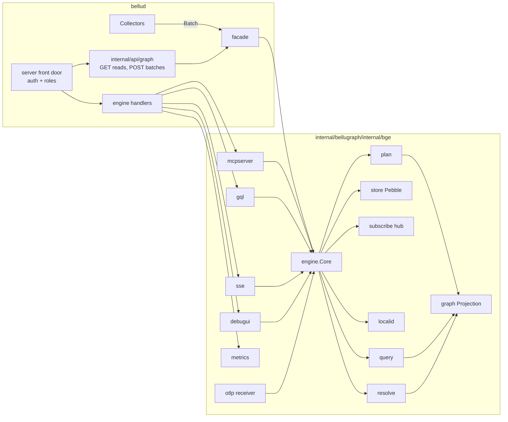

# Design Document: Bellu Graph Engine

## Overview

The Bellu Graph Engine (BGE) is an original, in-process, event-sourced graph store for `bellud`. Collectors hand `facade.Batch` values to `Ingest.Apply`. Each Batch becomes Events in an append-only log in Pebble, and the Engine folds those Events into an in-memory Projection that serves reads. Reads go through the Facade `Query`, the 12 MCP tools, a GraphQL API, SSE subscriptions and a debug page.

This design is clean-room. It is derived only from the Facade API and tests, the Facade's callers, the `go-server-bellu-graph` spec, the requirements document and general knowledge. Storage layout, encodings and algorithms are our own choices. Implementers must not open files of the previous engine (everything under `internal/bellugraph` except `facade/` and `internal/bge/`) or fetch upstream source.

Key decisions:

| Decision | Choice | Rationale |
|---|---|---|
| Location | `internal/bellugraph/internal/bge/*` | Keeps the Facade import path, lets new code live next to the old tree during the swap, and is private to the Facade (Go `internal` rule). |
| Store | Pebble `v1.1.5` (in `go.mod`) at `Config.Dir/default` | The Facade tests expect `default/LOCK`, `CURRENT` and `MANIFEST-*` there. |
| Event encoding | Own versioned binary TLV with CRC-32C | Deterministic, compact, corruption-detecting, no code generation. |
| Identity | SHA-256 over own Canonical_Encoding, 128-bit prefix | Matches the Facade `Hash` contract. The golden vectors are regenerated (Requirement 2.4). |
| Concurrency | One writer (`applyMu`), RW-locked Projection | Simple serializable writes and parallel reads. |
| As-of | Snapshot with max Valid_Time `≤ at`, plus a fold of later Events | Exact, and fast with periodic Snapshots (see Algorithms). |
| MCP | `github.com/modelcontextprotocol/go-sdk v1.6.1` (in `go.mod`) | The Facade tests already use its client. |
| GraphQL | `github.com/99designs/gqlgen v0.17.90` + `gqlparser/v2` (in `go.mod`) | Schema-first, typed resolvers, SSE and websocket transports built in. |
| OTLP | `go.opentelemetry.io/collector/pdata` (in `go.mod`), OTLP/HTTP only | Decodes protobuf and JSON log exports without a gRPC server. |
| Metrics | `prometheus/client_golang` (in `go.mod`), private registry | Standard text format. |
| PBT | `pgregory.net/rapid v1.2.0` (in `go.mod`) | Already used by the Facade tests. |

New modules: none at run time. `go.mod` gains a `tool github.com/99designs/gqlgen` directive so that `go generate` runs the pinned generator (MIT license). Its transitive build-only modules are recorded by `go mod tidy`.

## Architecture



Write path: `Apply` → validate → plan → encode → one synced Pebble batch → fold into the Projection → publish to Subscribers.
Read path: current reads use the Projection under a read lock. As-of reads fold from Snapshots and the log through a Pebble snapshot.

### Package layout

All packages are new, under `services/bellud/internal/bellugraph/internal/bge/`:

| Package | Responsibility |
|---|---|
| `errs` | Sentinel errors (`Validation`, `NotFound`, `Unavailable`, `Locked`, `Corrupt`, `InsecurePermissions`, `Forbidden`). The Facade's exported vars alias them. |
| `codec` | `Value` type, Canonical_Encoding, event and snapshot record codecs. |
| `ident` | Kind registry (16 kinds), `Hash`, relation-type registry with Impact_Direction, secret-name rule. |
| `uri` | `bellugraph://` format and parse. |
| `store` | Pebble open and preflight, keyspace, atomic writes, scans, Snapshots, retention deletes. |
| `graph` | Projection state, `Fold(event)`, indexes, clone, snapshot export and import. |
| `plan` | Pure Batch validation and planning against a read-only graph view. |
| `query` | Cursors, Find, BFS neighbors, path, impact, diff and flapping (pure over graph states). |
| `resolve` | Endpoint_Resolution (pure over the graph). |
| `localid` | Local_ID registry. |
| `subscribe` | Subscriber hub. |
| `engine` | `Core`: wires everything; Apply, Annotate, queries, as-of, maintenance, close. |
| `mcpserver` | MCP tools, resources, prompts, verbosity. |
| `gql` | GraphQL schema, gqlgen-generated executor, resolvers, depth and complexity limits. |
| `sse` | SSE subscribe handler. |
| `debugui` | Embedded templates, CSS and handler. |
| `otlp` | OTLP/HTTP logs receiver. |
| `metrics` | `bellu_graph_*` collectors. |

Import direction: `errs, codec, ident, uri` ← `graph, store` ← `plan, query, resolve` ← `engine` ← `mcpserver, gql, sse, debugui, otlp` ← `facade`. `localid, subscribe, metrics` depend only on `errs`/`codec`.

## Components and Interfaces

### Facade (bellud-owned, rewritten internals)

The Facade keeps every exported identifier. Its files `engine.go`, `ingest.go`, `query.go`, `mcp.go`, `convert.go` and `identity.go` are rewritten to call `engine.Core`. Facade white-box tests constrain the private structure:

- `type engine struct { cfg Config; log *slog.Logger; stack *bgeengine.Core; audit AuditSink; auditFile *fileAudit; ... }`
- `e.stack.Annotations.Get(id string) (Annotation, bool, error)` with `Annotation.Values map[string]string`, and `e.stack.Annotations.Count() (int, error)`.
- `auditFileName = "audit.jsonl"`, `fileAudit`, `TokenIdentity`, and the umask and `tightenFiles` logic stay.

Additive Facade surface (Requirement 2.3):

```go
// Roles and callers.
type Role string
const (RoleRead Role = "read"; RoleIngest Role = "ingest"; RoleWrite Role = "write")
func (r Role) Allows(need Role) bool // write allows all; read and ingest allow only themselves
type Grant struct { Token string; Role Role }
// Config.Grants []Grant is new; a non-empty Config.MCPToken is an implicit RoleWrite grant.
type Caller struct { Role Role; Identity string }
func WithCaller(ctx context.Context, c Caller) context.Context
func CallerFrom(ctx context.Context) (Caller, bool)
var ErrForbidden = errs.Forbidden

// New fields (zero values keep today's behavior).
// Entity.Annotations map[string]string
// Edge.Derived bool           // true for resolves_to edges
// NeighborOpts.Resolve bool   // include Endpoint_Resolution
// Diff.Flapping []Flap
type Flap struct { ID EntityID; Changes int }

// Optional interfaces implemented by the ready engine; helpers return
// (nil, false) or unavailable handlers for disabled or failed engines.
type Extended interface {
    Annotate(ctx context.Context, ref string, set map[string]string, unset []string) (Entity, error)
    Resolve(ctx context.Context, ref string) (EntityID, error)
    Path(ctx context.Context, from, to string, o PathOpts) (PathResult, error)
    Impact(ctx context.Context, ref string, o ImpactOpts) (ImpactResult, error)
    Subscribe(ctx context.Context, o SubscribeOpts) (Subscription, error)
}
func ExtendedOf(e Engine) (Extended, bool)
type Handlers struct { GraphQL, Subscribe, Debug, Metrics http.Handler }
func HandlersOf(e Engine) Handlers // unavailable handlers when not ready
```

`internal/graph` re-exports the new names with type aliases. The Facade `Annotate` writes the audit record through `e.audit` before calling the Engine. Every annotation path (MCP tool, GraphQL mutation) goes through it, so the old JSON-RPC body pre-parse is removed.

Caller resolution, used by the MCP and GraphQL handlers and the OTLP receiver:

1. If `CallerFrom(ctx)` is set (by the bellud front door), use it.
2. If the Facade has grants, require `Authorization: Bearer <token>`, compare it in constant time against each grant (SHA-256 digests, `subtle.ConstantTimeCompare`), and on failure respond `401` with `WWW-Authenticate: Bearer realm="bellu-graph"`. Otherwise the Caller is `{grant.Role, TokenIdentity(token)}`.
3. Otherwise the Caller is `{RoleWrite, "front-door"}`, as today.

### engine.Core

```go
type Core struct {
    Annotations *Annotations // view over the Projection, used by Facade tests
    // private: store *store.DB; mu sync.RWMutex; g *graph.Graph; applyMu sync.Mutex;
    // hub *subscribe.Hub; ids *localid.Registry; met *metrics.Set; clock func() time.Time; ...
}
func Open(dir string, o Options) (*Core, error)               // preflight + load; see Persistence
func (c *Core) Apply(ctx context.Context, b batch.Batch, mode Mode) (Receipt, error) // ModeFull | ModePartial
func (c *Core) Annotate(ctx context.Context, id EntityID, set map[string]string, unset []string, actor string) (EntityView, error)
func (c *Core) Entity(ctx context.Context, id EntityID, at *time.Time) (EntityView, error)
func (c *Core) Find(ctx context.Context, q FindQuery, at *time.Time) (Page[EntityView], error)
func (c *Core) Neighbors(ctx context.Context, id EntityID, o NeighborOpts, at *time.Time) (Page[EdgeView], error)
func (c *Core) History(ctx context.Context, id EntityID, r TimeRange, p Paging) (Page[ChangeView], error)
func (c *Core) Changes(ctx context.Context, r TimeRange, f ChangeFilter, order Order) (Page[ChangeView], error)
func (c *Core) Digest(ctx context.Context, r TimeRange, f ChangeFilter) (Digest, error)
func (c *Core) Diff(ctx context.Context, from, to time.Time) (DiffView, error)
func (c *Core) Path(ctx context.Context, a, b EntityID, o PathOpts) (PathResult, error)
func (c *Core) Impact(ctx context.Context, id EntityID, o ImpactOpts) (ImpactResult, error)
func (c *Core) Resolve(ref string) (EntityID, error)          // Entity_ID | @local | bellugraph:// URI
func (c *Core) LocalID(id EntityID) string                    // mint or refresh
func (c *Core) Subscribe(ctx context.Context, o SubscribeOpts) (*subscribe.Sub, error)
func (c *Core) Schema() SchemaView
func (c *Core) Metrics() http.Handler
func (c *Core) Close(ctx context.Context) error
```

`Core` types mirror the Facade types. The Facade converts at its boundary (`convert.go`).

### plan

```go
type View interface { // read-only graph access, implemented by *graph.Graph
    Entity(id EntityID) (*graph.EntityState, bool)
    Relation(k graph.RelKey) (*graph.RelState, bool)
    Scope(collector string) *graph.Scope
    RelationsOf(id EntityID) []graph.RelKey
}
func Plan(v View, b batch.Batch, mode Mode, now time.Time) (Plan, error)
type Plan struct { Collector string; ObservedAt time.Time; Events []codec.EventBody;
                   Entities, Relations, Removed int }
```

### query, resolve, localid, subscribe

```go
// query
func Neighbors(g Reader, start EntityID, dir string, relType string, depth int, derived DerivedFn) []Edge
func ShortestPath(g Reader, a, b EntityID, maxDepth int, derived DerivedFn) (path []Edge, exhausted bool)
func Impact(g Reader, start EntityID, depth int, dirOf func(relType string) ident.Direction, derived DerivedFn) []Impacted
func DiffStates(from, to StateSet, counts map[EntityID]int) (added, changed []EntityID, removed []EntityID, flapping []Flap)
func EncodeCursor(kind string, qhash uint64, key []byte) string
func DecodeCursor(kind string, qhash uint64, s string) ([]byte, error) // errs.Validation on mismatch

// resolve
func Endpoint(g Reader, endpoint EntityID) []Resolution // {Port EntityID; Processes []EntityID}
func Dependents(g Reader, portOrProcess EntityID) []EntityID
type DerivedFn func(id EntityID) []Edge // nil means stored relations only

// localid
func New(clock func() time.Time, idle, tombstone time.Duration) *Registry // idle 15m, tombstone 24h
func (r *Registry) For(id EntityID) string            // returns live alias (refreshing) or mints
func (r *Registry) Lookup(alias string) (EntityID, error) // refreshes; errs.NotFound when retired/unknown
func (r *Registry) Sweep()                             // retire idle aliases

// subscribe
type Filter struct { Kind ChangeKind; Subject ChangeSubject; EntityKind string; Entity EntityID }
func (h *Hub) Subscribe(f Filter, buf int) *Sub        // buf default 256
func (h *Hub) Publish(evs []ChangeView)                 // non-blocking; overflow closes the Sub
func (s *Sub) C() <-chan ChangeView; func (s *Sub) Err() error; func (s *Sub) Close()
```

### HTTP surfaces and front door

| Route (all under `/api/experimental/graph`) | Owner | Auth | Role |
|---|---|---|---|
| existing GET reads (`/entities…`, `/changes`, `/diff`, `/schema`, `/status`) | `internal/api/graph` | bellud or token | read |
| `POST /batches` (new) | `internal/api/graph` | bellud or token | ingest |
| `* /mcp` | Facade `MCPHandler` | token (as today) | read; `annotate_entity` needs write |
| `* /graphql` (new, stream) | `gql` | bellud or token | read; `annotateEntity` needs write |
| `GET /subscribe` (new, stream) | `sse` | bellud or token | read |
| `GET /debug`, `GET /debug/*` (new) | `debugui` | bellud only | — |
| `GET /metrics` (new) | `metrics` | bellud only | — |

- `internal/server/routes/generate.go` appends the new Go-owned, non-HttpApi routes next to `/mcp`. `routes.yaml` is regenerated with the existing generator, and the TS protocol is not touched. `POST /batches` is a machine ingest interface like `/mcp`.
- `internal/mcptoken` gains:
  - `type Role string` with `read`, `ingest` and `write`;
  - `type Set struct{ Read, Ingest, Write Token }` and `NewSet(write Token) (Set, error)`;
  - `(Set) RoleOf(r *http.Request) (Role, Token, bool)`.

  `New`, `Token`, `Verify`, `Identity` and `Path` keep their behavior.
- `cmd/bellud`:
  - builds the Set, with the existing per-start token as `Write`;
  - passes `Grants` to the Facade;
  - writes `{"read": "...", "ingest": "..."}` to `~/.local/share/bellucode/graph-tokens.json` (0600, via temp file and rename);
  - sets `GoAuth` for token-accepting routes to `set.RoleOf(r) ok || auth.Authorize(r)` (MCP stays token-only);
  - wraps `goHandler` in a role middleware. The middleware derives `Caller` (a token's role, or `write` for bellud credentials) and checks the route's required role (`403 {"code":"graph_forbidden"}`). It stores the Caller with `facade.WithCaller`.
- `internal/api/graph`:
  - `idPattern` widens to accept `@[23456789a-km-np-z]{6}`;
  - the handler calls `Extended.Resolve` before the query;
  - adds `POST /batches` (JSON Batch, 4 MiB limit, `200` with a Receipt, `400` for validation, `503` when unavailable).

### MCP server (`mcpserver`)

- Server: `mcp.NewServer(&mcp.Implementation{Name: "bellugraph", Title: "Bellu Graph Engine", Version: version}, &mcp.ServerOptions{Instructions: "Bellu Graph Engine: an infrastructure graph ..."})`. It is served with `mcp.NewStreamableHTTPHandler`. The Facade wraps it with the 4 MiB body limit (`413`), the readiness check (`503 graph_unavailable`) and caller resolution.
- Tools are typed with `mcp.AddTool` and input structs; the JSON schema is inferred from the structs. Each tool has a description. Every read tool takes `verbosity` (`brief|normal|full`, default `normal`). Entity arguments are named `entity_id` (or `from`/`to`) and accept any Entity_Ref.

| Tool | Arguments | Result |
|---|---|---|
| `describe_schema` | — | kinds with identity attributes and live counts; relation types with Impact_Direction and counts |
| `describe_type` | `kind` | identity attributes, observed descriptive attribute names, relation types in/out |
| `find_entities` | `kind?`, `attributes?`, `page_size?`, `cursor?`, `as_of?` | `Find` page |
| `get_entity` | `entity_id`, `as_of?` | entity view; `full` adds `connected_from` (Dependents) |
| `annotate_entity` | `entity_id`, `annotations` (set), `remove?` | entity after annotation; needs `write` |
| `get_neighbors` | `entity_id`, `direction?`, `relation_type?`, `depth?`, `resolve?` (default true), paging | edges; derived edges marked |
| `find_path` | `from`, `to`, `max_depth?` (default 6, 1–10) | `{connected: true, path}` or `{connected: false, exhausted, depth_searched, shared_neighbors, shared_attributes}` |
| `impact_of` | `entity_id`, `depth?` (default 3, 1–10) | impacted entities with `hops` and `via` relation path |
| `entity_history` | `entity_id`, `from?`, `to?`, paging | `History` page |
| `recent_changes` | `since?` (default 1h), `kind?`, `subject?`, `entity_kind?`, `max_bytes?` (default 16384, max 262144), `cursor?` | `{digest, items (newest first), truncated, next_cursor}` |
| `graph_diff` | `from`, `to` | added, changed, removed, flapping, truncated |
| `telemetry_keys` | `entity_id` | `{entity, keys: {name: value}}` from identity attributes, without secret-named keys |

- Verbosity projection (one function used by every tool):
  - `brief` = `{id: local, identity_fingerprint, kind, label}`;
  - `normal` adds `attributes` (first 32 by key, values cut to 256 bytes with a `truncated_attributes` list) and `annotations`;
  - `full` adds all attributes, `observed_at`, `recorded_at` and `uri`.

  Change items at `brief` carry kind, subject, ids and `observed_at`.
- Resources:
  - `bellugraph://schema` (`application/json`, same body as `describe_schema`);
  - the template `bellugraph://{kind}/{hex}`. It returns the entity view (normal verbosity, 1-hop edges, 10 latest changes); unknown entities return the SDK's resource-not-found error.
- Prompts. Each one returns a user message with step-by-step tool guidance and an embedded resource (`bellugraph://...`) when an entity is given:
  - `investigate_incident(entity_id?, since?)`;
  - `blast_radius(entity_id, depth?)`;
  - `explain_entity(entity_id)`.

  Prompt text includes the "never request secret values" rule.
- Errors: validation and not-found errors return `isError: true` tool results with the message. A missing role returns `isError: true` with "forbidden: needs write role".
- Secret-name rule (`ident.IsSecretName`): a key is secret when it case-insensitively contains `secret`, `token`, `password`, `passwd`, `credential`, `private`, `apikey`, `api_key` or `hash`. Such values are excluded from `telemetry_keys`, `shared_attributes` and prompt text. Stored attributes are already scrubbed by collectors.

### GraphQL (`gql`)

Schema (`internal/bellugraph/internal/bge/gql/schema.graphqls`):

```graphql
scalar Time
scalar JSON
enum Direction { OUT IN BOTH }
enum ChangeKind { ADDED CHANGED REMOVED }
enum Subject { ENTITY RELATION }

type Entity {
  id: ID!                    # Entity_ID
  identityFingerprint: ID!   # same value, explicit name
  localId: String!
  kind: String!
  label: String!
  attributes: JSON!
  annotations: JSON!
  observedAt: Time!
  recordedAt: Time!
  uri: String!
  neighbors(direction: Direction = BOTH, relationType: String, depth: Int = 1, resolve: Boolean = true, first: Int = 100, after: String): EdgePage!
  history(from: Time, to: Time, first: Int = 100, after: String): ChangePage!
  dependents: [Entity!]!
}
type Edge { from: Entity!  to: Entity!  type: String!  direction: Direction!  hops: Int!  derived: Boolean! }
type Change { seq: String!  kind: ChangeKind!  subject: Subject!  entity: ID  from: ID  to: ID  relationType: String  observedAt: Time!  recordedAt: Time! }
type EntityPage { items: [Entity!]!  total: Int!  truncated: Boolean!  nextCursor: String }
type EdgePage   { items: [Edge!]!    total: Int!  truncated: Boolean!  nextCursor: String }
type ChangePage { items: [Change!]!  total: Int!  truncated: Boolean!  nextCursor: String }
type Flap { entity: ID!  changes: Int! }
type Diff { from: Time!  to: Time!  added: [Entity!]!  changed: [Entity!]!  removed: [ID!]!  flapping: [Flap!]!  truncated: Boolean! }
type PathResult { connected: Boolean!  path: [Edge!]!  exhausted: Boolean!  depthSearched: Int!  sharedNeighbors: [Entity!]!  sharedAttributes: JSON! }
type Impacted { entity: Entity!  hops: Int!  via: [Edge!]! }
type Digest { total: Int!  byKind: JSON!  bySubject: JSON!  byEntityKind: JSON!  top: [Flap!]! }
input AttrFilter { key: String!  value: String! }
input ChangeFilter { kind: ChangeKind  subject: Subject  entityKind: String  entity: ID }

type Query {
  entity(id: ID!, asOf: Time): Entity
  find(kind: String, attributes: [AttrFilter!], asOf: Time, first: Int = 100, after: String): EntityPage!
  neighbors(id: ID!, direction: Direction = BOTH, relationType: String, depth: Int = 1, resolve: Boolean = true, asOf: Time, first: Int = 100, after: String): EdgePage!
  history(id: ID!, from: Time, to: Time, first: Int = 100, after: String): ChangePage!
  recentChanges(since: Time, filter: ChangeFilter, first: Int = 100, after: String): ChangePage!
  recentDigest(since: Time, filter: ChangeFilter): Digest!
  diff(from: Time!, to: Time!): Diff!
  path(from: ID!, to: ID!, maxDepth: Int = 6, asOf: Time): PathResult!
  impact(id: ID!, depth: Int = 3, asOf: Time): [Impacted!]!
}
type Mutation { annotateEntity(id: ID!, set: JSON!, remove: [String!]): Entity! }
type Subscription { changes(filter: ChangeFilter, fromSeq: String): Change! }
```

- The `entity` query returns `null` with a `NOT_FOUND` error for unknown IDs. `asOf` on `path` and `impact` folds the state at that instant and traverses that state.
- Handler: `handler.New(executableSchema)` with these transports:
  - `transport.POST{}`;
  - `transport.SSE{}` for subscriptions (`Accept: text/event-stream`);
  - `transport.Websocket{KeepAlivePingInterval: 15s}` (graphql-transport-ws, authenticated by the HTTP upgrade request).

  Extensions: `extension.Introspection{}` and `extension.FixedComplexityLimit(5000)`, plus our `depthLimit{max: 12}`. The `depthLimit` is a `graphql.OperationContextMutator` that walks the selection set and returns a `VALIDATION` error. Query cache: `lru.New[*ast.QueryDocument](256)`.
- Errors: an `ErrorPresenter` maps `errs.*` to `extensions.code` (`VALIDATION`, `NOT_FOUND`, `FORBIDDEN`, `UNAVAILABLE`, otherwise `INTERNAL` with a generic message).
- Code generation: `gql/gqlgen.yml` plus `//go:generate go tool gqlgen generate`. Generated files are committed. The resolvers are hand-written in `gql/resolvers.go`.

### SSE (`sse`)

- `GET /api/experimental/graph/subscribe?kind=&subject=&entity_kind=&entity=`. The start position comes from the `Last-Event-ID` header or the `from` query parameter (decimal Log_Sequence); omitted means live only.
- Response headers: `Content-Type: text/event-stream`, `Cache-Control: no-store`, `X-Accel-Buffering: no`.
- Frames:
  - `id: <seq>\nevent: change\ndata: <json>\n\n`. The JSON has `seq`, `kind`, `subject`, `entity`, `local_id`, `from`, `to`, `relation_type`, `observed_at` and `recorded_at`.
  - `: ping` every 15 s.
  - `event: error` with `{"code":"graph_gone","oldest_seq":N}` (resume before the retained log) or `{"code":"graph_overflow","resume_from":S}`, after which the stream closes.

### Debug UI (`debugui`)

- Built with `html/template` and `go:embed` from `templates/*.html` and `static/style.css`; no JavaScript.
- Routes:
  - `GET /debug` shows a search form (`ref`, `as_of`, `depth` 1–3) and, when `ref` is given, the entity page: attribute table, annotations, neighbor table (links to `/debug?ref=<id>`) and history table (latest 100, `?hp=` cursor).
  - `GET /debug?kind=&q=` lists `Find` results.
  - `GET /debug/style.css`.
- Headers: `Content-Security-Policy: default-src 'none'; style-src 'self'`, `X-Content-Type-Options: nosniff`, `Referrer-Policy: no-referrer`. Other methods get `405`.

### OTLP receiver (`otlp`)

- `http.Server` on `BELLU_GRAPH_OTLP_LISTEN` (`ReadHeaderTimeout` 10 s). It serves `POST /v1/logs` with `Content-Type` `application/x-protobuf` or `application/json`, optional `Content-Encoding: gzip`, and a 4 MiB limit.
- Decoding: `plogotlp.NewExportRequest()` then `UnmarshalProto` or `UnmarshalJSON`.
- Mapping per `ResourceLogs`:
  - resource attribute `bellugraph.collector` (required) → collector `otlp/<value>`, so OTLP producers never share a scope with built-in collectors;
  - `bellugraph.full_observation` (bool) selects `ModeFull`, otherwise `ModePartial`;
  - a record with `bellugraph.record = "entity"` takes `bellugraph.kind`, identity `bellugraph.id.<name>` (string) and descriptive `bellugraph.attr.<name>` (string, bool, int, double, or array of strings);
  - a record with `bellugraph.record = "relation"` takes `bellugraph.relation.type`, `.from` and `.to` (Entity_IDs);
  - Valid_Time is the latest record `Timestamp` (or `ObservedTimestamp`) in the resource, or now.
- Response: `ExportLogsServiceResponse`. A rejected resource adds its record count to `partial_success.rejected_log_records` and its reason to `error_message`. Status codes: `400` for an undecodable body, `401`/`403` per caller resolution, `413`, `503` when not ready.

### Metrics (`metrics`)

Private `prometheus.Registry`, served by `promhttp.HandlerFor`:

| Metric | Type | Labels |
|---|---|---|
| `bellu_graph_batches_applied_total` | counter | `collector` |
| `bellu_graph_batches_rejected_total` | counter | `reason` (`validation`, `store`, `unavailable`) |
| `bellu_graph_events_appended_total` | counter | `type` |
| `bellu_graph_queries_total` | counter | `op` |
| `bellu_graph_entities`, `bellu_graph_relations` | gauge | — |
| `bellu_graph_log_last_sequence` | gauge | — |
| `bellu_graph_subscribers` | gauge | — |
| `bellu_graph_subscriber_overflows_total` | counter | — |
| `bellu_graph_apply_duration_seconds` | histogram | — |
| `bellu_graph_query_duration_seconds` | histogram | `op` |
| `bellu_graph_snapshot_duration_seconds` | histogram | — |
| `bellu_graph_retention_deleted_events_total` | counter | — |
| `bellu_graph_otlp_records_total` | counter | `result` (`accepted`, `rejected`) |
| `bellu_graph_local_ids` | gauge | — |

Labels hold only collector names, operation names, event types and fixed reasons, never attribute values.

### Configuration

- `facade.LoadConfig` is unchanged (five `BELLU_GRAPH_*` variables).
- Engine constants:
  - snapshot interval 5 min and every 10,000 Events, keeping the 8 newest Snapshots plus the base;
  - retention check hourly;
  - Local_ID idle limit 15 min, tombstones 24 h, sweep every minute;
  - subscriber buffer 256;
  - MCP response budget 16 KiB default, 256 KiB maximum;
  - GraphQL depth 12, complexity 5000.

  Tests override them through `engine.Options`.

## Data Models

### Values and Canonical_Encoding (`codec`)

```go
type Value struct { T Tag; S string; B bool; I int64; F float64; L []string }
type Tag byte // 0x01 string, 0x02 bool, 0x03 int64, 0x04 float64, 0x05 list of string
```

- Conversion from `any` at the plan boundary:
  - `string` → string;
  - `bool` → bool;
  - all signed and unsigned integer types → int64 (a `uint` above `MaxInt64` is a validation error);
  - `float32`/`float64` → float64 (NaN and ±Inf are rejected; `-0` becomes `+0`);
  - `[]string` → list;
  - `[]any` whose elements are all strings → list;
  - anything else → `errs.Validation` naming the attribute.
- Read conversion back to `any`: string, bool, int64, float64, `[]string`.
- Primitive encodings:
  - `str(s)` = `u32be(len(s)) || s`;
  - `enc(v)` = `tag || payload`. The payload is `str(S)`, one byte 0/1, `i64be`, `u64be(math.Float64bits)`, or `u32be(n) || str(e1)…`.
- Canonical map encoding: `u32be(n) || for k in keys sorted bytewise: str(k) || enc(v)`.
- Identity (used by `Hash`, Requirement 5.2):

```
id_input = "bellugraph.id.v1" || 0x00 || str(kind) || u32be(n) || for k in sorted(identity keys): str(k) || 0x01 || str(value)
Entity_ID = kind || ":" || lowercase_hex(SHA-256(id_input)[0:16])
```

  Only the kind's registered identity keys are included; all values are strings. Golden vectors (they replace the expected values in `TestIdentityHashGolden`):

| kind | identity | Entity_ID |
|---|---|---|
| `host` | `hostname=web-1` | `host:fe1c72acbf340314776943d30489cf82` |
| `container` | `id=abc123` | `container:519e9b3282adbda5e91413d99f2c5f3c` |
| `listening_port` | `host=web-1, protocol=tcp, address=0.0.0.0, port=443` | `listening_port:96ec1501c61e5d9662f329fe8fccc242` |

### Registries (`ident`)

- Kinds: the 15 Facade kinds with their existing identity attributes, plus `endpoint: [protocol, address, port]`.
- Relation types and Impact_Direction. `reverse` means failure of `to` impacts `from`.

| Type | Typical from → to | Direction |
|---|---|---|
| `runs_on` | process → host | reverse |
| `on` | listening_port → host | reverse |
| `owned_by` | listening_port → process | reverse |
| `uses` | container → image | reverse |
| `attached_to` | container → network | reverse |
| `mounts` | container → volume | reverse |
| `depends_on` | repository → dependency, any → endpoint | reverse |
| `resolves_to` (derived only) | endpoint → listening_port | reverse |
| `found_in` | secret_finding → repository | forward |
| any other | — | reverse (default, reported as `default: true`) |

- `Label(kind, identity, attrs)`: the `name` attribute when it is a non-empty string; otherwise the identity values in registered order joined by `/`.
- State attributes: an update is `state-changed` when the `state` or `status` attribute changed, otherwise `attribute-updated`.

### Events (`codec`)

Envelope (the value at key `e/<seq>`):

```
0x45 'E' | 0x01 version | u64be seq | 16B ULID | i64be valid_ns | i64be recorded_ns
| u8 type | str(collector) | body | u32be CRC-32C(Castagnoli) of all preceding bytes
```

| Type | Code | Body | Change_Event |
|---|---|---|---|
| EntityCreated | 1 | `str(kind) map(identity strings) map(attrs)` | added / entity |
| EntityUpdated | 2 | `str(id) u8 class(1 attr, 2 state) map(set) strlist(unset)` | changed / entity |
| EntityRemoved | 3 | `str(id)` | removed / entity |
| RelationAdded | 4 | `str(type) str(from) str(to)` | added / relation |
| RelationRemoved | 5 | `str(type) str(from) str(to)` | removed / relation |
| Annotated | 6 | `str(id) str(actor identity) strmap(set) strlist(unset)` | changed / entity |
| ScopeDelta | 7 | `strlist(+ent) strlist(-ent) rellist(+rel) rellist(-rel)` | no (internal) |

- An `EntityCreated` Entity_ID is recomputed from kind and identity, so it is not stored twice.
- `Annotated` events carry the collector `""`, and their Valid_Time equals their Recorded_Time.
- Events stay minimal: updates hold only the delta, and removals hold only the ID.

### Projection (`graph`)

```go
type EntityState struct {
    ID EntityID; Kind string; Identity map[string]string
    Attrs map[string]codec.Value; Owner map[string]string // attribute -> collector that last set it
    Live bool; Asserted map[string]struct{}               // collectors asserting the entity
    VT, RT time.Time; Seq uint64                          // latest folded entity event
}
type RelKey struct{ Type string; From, To EntityID }
type RelState struct { Key RelKey; Asserted map[string]struct{}; VT, RT time.Time; Seq uint64 }
type Graph struct {
    ents map[EntityID]*EntityState        // live and removed (removed keep identity for revival and as-of)
    rels map[RelKey]*RelState             // live only
    out, in map[EntityID]map[RelKey]struct{}
    byKind map[string][]EntityID          // sorted live IDs per kind; all = merged view
    ports map[portKey][]EntityID          // (protocol, port) -> live listening_port IDs
    scopes map[string]*Scope              // collector -> {Ents set, Rels set}
    ann map[EntityID]Annotation           // {Values, UpdatedAt, By}
    LastSeq uint64; LastRT time.Time; MaxVT time.Time
}
func (g *Graph) Fold(ev codec.Event) // the only mutator; used by Apply, replay and as-of
```

Fold rules:

- **Created**: set Live, replace Identity and Attrs, set Owner for each attribute to the collector, add the collector to Asserted.
- **Updated**: apply set and unset; the owner of set keys becomes the collector.
- **Removed**: clear Live and Asserted.
- **RelationAdded** and **RelationRemoved**: insert or delete the relation in `rels`, `out` and `in`.
- **Annotated**: apply to `ann`.
- **ScopeDelta**: adjust the collector's scope sets and the Asserted sets.
- Every event updates `LastSeq`, `LastRT` and `MaxVT = max(MaxVT, VT)`.

### Pebble keyspace (`store`, single DB at `Config.Dir/default`)

| Key | Value | Purpose |
|---|---|---|
| `m/format` | `"bellugraph-store/1"` | format version (Requirement 18.9) |
| `m/seq` | `u64be` last seq | fast reopen check |
| `m/base` | `u64be baseSeq i64be horizon_ns` | retention boundary (absent = no trimming) |
| `e/<u64be seq>` | event envelope | the log |
| `x/ent/<id>\x00<u64be seq>` | `i64be valid_ns u8 type` | entity index (entity and annotation events) |
| `x/rel/<id>\x00<u64be seq>` | `i64be valid_ns u8 type` | relation endpoint index (written for from and to) |
| `x/vt/<i64be valid_ns ^ 1<<63><u64be seq>` | `u8 type` | Valid_Time index (sign bit flipped for byte order) |
| `s/<u64be seq>/h` | `magic 'S' v1 u64be seq i64be maxVT_ns i64be lastRT_ns u32be nEnt u32be nRel u32be crc` | Snapshot header, written last in the batch |
| `s/<u64be seq>/e/<id>` | entity record (state, owners, asserted, annotation) | Snapshot entity |
| `s/<u64be seq>/r/<type>\x00<from>\x00<to>` | relation record (asserted, VT, RT, seq) | Snapshot relation |

All keys for one Batch, or for one Snapshot, go in a single `pebble.Batch` committed with `pebble.Sync`. A Snapshot is valid only when its header exists, its counts match and the CRC over the header fields and record bytes in key order is correct.

### Cursors

`base64url(JSON{"v":1,"k":<kind>,"q":<fnv64 of normalized query>,"a":<base64 key>})`. Keyset keys:

- Find: the last Entity_ID;
- Neighbors: `(hops, type, from, to)` of the last edge;
- History and Changes: `(valid_ns, seq)`;
- recent_changes: `(valid_ns, seq)`, descending.

A decode failure, a kind mismatch or a `q` mismatch returns `errs.Validation` "malformed cursor". `Total` is always computed over the full matching set.

## Algorithms

### Apply pipeline

1. **Gate.** Check `ctx.Err()` and that the state is `ready` (otherwise `ErrUnavailable`). Take `applyMu`. Reject the call if `closing` is set.
2. **Validate and plan** (`plan.Plan`, pure, under `mu.RLock`):
   - collector non-empty; ObservedAt defaults to now (UTC);
   - each entity: `ident.Hash` (unknown kind or missing identity → validation); duplicate IDs are rejected. Identity keys outside the registered set become descriptive attributes, and explicit attributes win. Attributes are converted to `codec.Value`;
   - each relation: non-empty type, no attributes (the error names the type, from and to), and endpoints in the Batch or live in the Projection;
   - entity classification against the Projection: absent or removed → Created (full attributes); live → compute `set` (new or changed values) and `unset` (attributes owned by this collector that the observation omits); both empty → unchanged, otherwise Updated (class from the state attributes);
   - relations: not live → RelationAdded;
   - ModeFull removal: for each entity in `scope(collector).Ents` that is absent from the Batch, retract the assertion. If no other collector asserts the entity, emit EntityRemoved, plus RelationRemoved for every live relation touching it, so live relations always have live endpoints. Relations in `scope.Rels` that are absent from the Batch are retracted the same way;
   - a relation that names an entity removed by this Batch → validation error;
   - emit ScopeDelta when the scope sets change.
3. **No-op.** No events → return a Receipt with a fresh ULID and the current time; nothing is written (Requirement 3.10).
4. **Encode and write.** `seq = LastSeq+1…`, ULIDs from `ulid.Monotonic(crypto/rand)`, `recorded = max(clock().UTC(), LastRT)`. Add the events, the index keys and `m/seq` to one `pebble.Batch`, then `Commit(pebble.Sync)`. On failure, return `fmt.Errorf("appending batch: %w", err)`; the Projection is untouched.
5. **Project.** Take `mu.Lock`, `Fold` each event, release.
6. **Publish.** Send the Change_Events to `hub.Publish`, update metrics, and signal the snapshot loop when ≥ 10,000 events have accumulated since the last Snapshot.
7. **Receipt.** `{ID: first event ULID, ObservedAt, RecordedAt, Entities: len(b.Entities), Relations: len(b.Relations), Removed}`.

`Annotate` follows the same steps 1, 4, 5 and 6. The entity must be live (otherwise NotFound). Keys must match `[a-z0-9_.-]{1,64}`, there may be at most 64 keys, and values may be at most 1024 bytes. Collector Batches never touch `ann`.

### Open, replay and Snapshots

- **Open.**
  1. `checkDir`, then umask 077.
  2. If `default/CURRENT` exists, preflight: open Pebble with `ReadOnly: true`. A lock error becomes `ErrLocked` (with the holder path `default/LOCK`); any other error becomes `ErrCorrupt`. Read `m/format`: missing or different → `ErrCorrupt` "store format <found|missing>: written by the previous engine or damaged; delete <dir> and restart, collectors rebuild the graph". Load the Projection (below), fully validating CRCs and seq contiguity; a failure becomes `ErrCorrupt`. Close the read-only handle. No file is written.
  3. Open writable. A fresh store writes `m/format`. If `m/seq` has advanced since the preflight, fold the delta.
  4. Open the audit file, run `tightenFiles`, start the background loop.
- **Load.**
  1. Pick the newest valid Snapshot (`s/` reverse scan, validated), falling back to older ones (Requirement 13.3), or none.
  2. Import it into a new Graph.
  3. Iterate `e/` from `max(snapshotSeq, baseSeq)+1`, decode, verify the CRC, and `Fold`.
- **Snapshot write** (background loop or Close).
  1. Under `mu.RLock`, export every entity, relation, scope and annotation record at `LastSeq` together with `MaxVT`.
  2. Write `s/<seq>/…` in one synced batch.
  3. Delete Snapshots beyond the newest 8, never deleting the base Snapshot.

### As-of fold

`StateAt(at)`:

1. If `m/base` exists and `at < horizon` → `errs.Validation` "before retention horizon <horizon>".
2. Choose the Snapshot `S` with the greatest seq such that `S.maxVT ≤ at`. The base Snapshot always qualifies. If there is none, start empty.
3. Import `S`, then fold every event with `seq > S.seq` and `valid ≤ at`, in seq order, using a Pebble snapshot for a consistent view.

Why this is exact: every event with `seq ≤ S.seq` has `valid ≤ S.maxVT ≤ at`, so the full fold of the prefix equals the filtered fold of the prefix.

Single entity, `Entity(id, at)`:

- start from `S/e/<id>` when a base exists, otherwise from empty;
- fold the `x/ent/<id>` events after `S.seq` with `valid ≤ at`;
- a missing or removed entity → NotFound.

The reported times are the VT and RT of the latest folded entity event (Requirement 4.7).

### Diff and flapping

1. Validate `from ≤ to` and the horizon.
2. Build `A = StateAt(from)` and `B = StateAt(to)`. Entity state equality compares Live, Attrs and annotations.
3. Classify:
   - added = live in B and not live in A;
   - removed = live in A and not live in B;
   - changed = live in both and unequal.

   Each list is sorted by ID and capped at 1000, with `Truncated` set when a cap is hit. Added and changed entities carry B's view.
4. Flapping: count the entity Change_Events with `valid ∈ (from, to]` via the `x/vt` index. An entity is flapping when its count is ≥ 2 and `A(e) == B(e)`, where "absent in both" counts as equal. Flapping entities are sorted by count desc, then by ID.

### Retention

The background loop runs hourly when `Retention > 0`:

1. `cutoff = now − Retention`. Binary-search `e/` (Recorded_Time is monotonic) for the greatest `b` with `recorded < cutoff`. If `b ≤ baseSeq`, stop.
2. Build `state_b`: import the newest Snapshot with `seq ≤ b`, fold events up to `b` (unfiltered), and compute `maxVT_b`.
3. Write the Snapshot `s/<b>` and `m/base = (b, maxVT_b)` in one synced batch.
4. In chunks of 10,000, delete `e/<seq ≤ b>`, their index keys (reconstructed from each decoded event) and Snapshots with seq < b. A crash here is safe: reads ignore `seq ≤ baseSeq`, and the next run resumes the deletes.

As-of queries at or after the horizon (`maxVT_b`) are unchanged by step 4 (Requirement 13.5, Property 7).

### Local_ID registry

- Alphabet `23456789abcdefghjkmnpqrstuvwxyz` (31 symbols); an alias is `@` plus 6 symbols drawn with `crypto/rand`.
- State, behind a mutex: `alias→{id, lastUsed}`, `id→alias`, `retired alias→retiredAt`.
- `For(id)`: return the live alias (refresh `lastUsed`) or mint a fresh one, never live or retired.
- `Lookup`: refresh `lastUsed`; a retired or unknown alias → NotFound "local id @xxxxxx is unknown or expired; use the identity_fingerprint".
- `Sweep`: retire aliases idle for more than 15 min and purge tombstones older than 24 h.
- In memory only; a restart re-mints all aliases.

`Resolve(ref)` dispatches on the prefix:

- `@` → `localid.Lookup`;
- `bellugraph://` → `uri.Parse`, which must be an entity URI;
- otherwise the input is returned unchanged, and the lookup itself yields NotFound.

### Endpoint_Resolution

For an `endpoint` E with protocol P, address A and port N:

- Candidates are `ports[(P, N)]` (live listening ports).
- A listening port L matches when either:
  - `L.address == A`; or
  - `L.address ∈ {0.0.0.0, ::, [::], *}` and A is `L.host`, `localhost`, `127.0.0.1` or `::1`, or A is an element of the `addresses` list attribute of `host:Hash(hostname=L.host)`.
- Processes are the `to` ends of live `owned_by` relations from L.
- `DerivedFn` adds the edges `resolves_to(E → L)`, with `Derived: true`, when traversal reaches E. Reaching L or a process from the other side adds the inverse view, so `in` traversal from L finds E.
- `Dependents(x)`: for a port, the `from` of `depends_on` edges into endpoints resolving to it; for a process, the union over its ports.
- Computed per read, never written.

### Traversal

- **Neighbors.** Level-order BFS from the start node, limited to depth 1–10 (Facade default 1). Each level expands the stored relations (and derived ones when `Resolve`), filtered by direction and type. An edge is recorded at the first level it is seen, and the far endpoint is enqueued if unvisited. The result is sorted by `(hops, type, from, to)`. `Direction` is `out` when the edge was followed from → to, otherwise `in`.
- **ShortestPath.** Undirected BFS with parent pointers. Neighbor expansion is ordered by `(type, other ID)`, so the path is deterministic. `exhausted = frontier empty before maxDepth`.
- **Impact.** BFS where an edge `r` of type t is traversable from `x` only in its impact flow: `forward`: x = from → to; `reverse`: x = to → from. Each impacted entity is reported once at its fewest hops, with the edge path (`via`). The start entity is excluded.

### Subscriptions

- `Subscribe(from)`:
  - under `applyMu`, register the Sub with the hub and capture `LastSeq = L`;
  - release `applyMu`;
  - replay stored Change_Events in `(from, L]` from `e/` into the Sub (outside the lock), then switch the Sub to live delivery. Live events arrive with `seq > L` and are buffered in order during the replay.
- `from < baseSeq` → `errs.Validation` "gone" with the oldest retained seq.
- A full buffer (256) closes the Sub with `ErrOverflow` (carrying the last delivered seq); Publish never blocks.

## Concurrency model

- `applyMu` serializes all writers: Apply, Annotate, subscription registration and retention's state build. As a result, planning always sees the previous commit (Requirement 3.8).
- `mu` (RWMutex) guards the Projection. Readers hold `RLock` for the length of an in-memory query, and writers hold `Lock` only for the fold.
- As-of and history reads use Pebble iterators on a `db.NewSnapshot()` and take no Engine lock.
- `localid.Registry` and `subscribe.Hub` have their own mutexes, and the hub never blocks under `applyMu`.
- Background goroutines (snapshot and retention loop, Local_ID sweep, OTLP server) are tracked by a `sync.WaitGroup` and cancelled on Close.
- **Close.**
  1. Set `closing`; new Apply calls return `ErrUnavailable`.
  2. Acquire `applyMu`, which waits for in-flight writers, or give up at the `ctx` deadline.
  3. Cancel the background work, stop OTLP (`Shutdown`), and close the Subscribers.
  4. Write the final Snapshot, close Pebble and the audit file, and run `tightenFiles`.

  Close is idempotent (`sync.Once`).

## Error model

| Sentinel (`errs`) | Facade var | HTTP | MCP | GraphQL code |
|---|---|---|---|---|
| `Validation` (incl. cursor, retention horizon) | `ErrValidation` | 400 | `isError` result | `VALIDATION` |
| `NotFound` (incl. expired Local_ID) | `ErrNotFound` | 404 | `isError` / resource not found | `NOT_FOUND` |
| `Unavailable` | `ErrUnavailable` | 503 `graph_unavailable` | 503 | `UNAVAILABLE` |
| `Forbidden` | `ErrForbidden` (new) | 403 `graph_forbidden` | `isError` naming the role | `FORBIDDEN` |
| `Locked` / `Corrupt` / `InsecurePermissions` | same names | Open only (engine `failed`) | — | — |

- Errors wrap sentinels with `fmt.Errorf("%w: ...")`. Messages name kinds, attributes, relation types and IDs, never attribute values.
- Store write failures are returned unwrapped from the sentinels, counted as `rejected{reason="store"}` and logged at error level. The Engine stays `ready`.
- Corruption found during a read (CRC mismatch) returns an error wrapping `ErrCorrupt`, logs it, and moves the Engine to `failed` with the reason. The transition is logged (Requirement 20.6).

## Correctness Properties

*A property is a characteristic or behavior that should hold true across all valid executions of a system, essentially a formal statement about what the system should do. Properties serve as the bridge between human-readable specifications and machine-verifiable correctness guarantees.*

Reflection: the prework classified about 45 criteria as properties. Overlapping ones were merged: classification, scopes, revival and the live-relation invariant form one model-based property (6); reopen, snapshot load and concurrency form one replay property (8); flapping joins diff (11); secret filtering covers tools, path and prompts (21). Existing Facade properties (identity, as-of replay, relation constraints) stay and map to Properties 3, 9 and 5.

The reference model used below is `model.Fold`, a deliberately naive in-test interpreter. It keeps the full event list and recomputes every answer by brute force, with no indexes, no Snapshots and no BFS shortcuts.

### Property 1: Event codec round trip and corruption detection

For any valid Event `e`, `Decode(Encode(e)) == e`. For any single-byte change to `Encode(e)`, `Decode` returns an error.

**Validates: Requirements 3.2, 18.6**

### Property 2: Attribute values round trip

For any Go value `v` drawn from supported and unsupported types, conversion succeeds if and only if `v` is a string, bool, in-range integer, finite float or list of strings. When conversion succeeds, `Decode(Encode(Value(v)))` equals `Value(v)` and its canonical bytes are identical across map orders.

**Validates: Requirements 5.12**

### Property 3: Identity hash determinism and injectivity

For any kind and identity map, `Hash` is invariant under map order and extra non-identity keys. It differs when any identity value or the kind differs, and it fails with `ErrValidation` when an identity value is missing or empty.

**Validates: Requirements 5.2, 5.3, 5.4, 5.5, 5.6**

### Property 4: Log ordering

For any sequence of valid Batches, and with a fake clock that may move backwards, the stored Log_Sequences are `1..n` without gaps. ULIDs are unique and increasing, Recorded_Times are non-decreasing, and every Event read after batch `k` is byte-identical when read again after batch `k+m`.

**Validates: Requirements 3.1, 3.2, 4.2, 4.3**

### Property 5: Rejected batches change nothing

For any reachable graph state and any Batch with at least one defect drawn from Requirement 3.5 and 3.6, `Apply` returns an error wrapping `ErrValidation`, and the Event_Log, Projection and Collector_Scopes are unchanged.

**Validates: Requirements 3.4, 3.5, 3.6**

### Property 6: Apply matches the reference model

For any sequence of valid Batches from several collectors (full and partial mode), after each Apply:

- the live entities, their attributes, the live relations, the Collector_Scopes and the emitted Change_Event kinds equal `model.Fold`'s;
- every live relation has live endpoints;
- a removed entity that is observed again is live under the same Entity_ID with an `added` change;
- each entity's `ObservedAt` equals its Batch's `ObservedAt`.

**Validates: Requirements 4.1, 5.7, 5.8, 5.9, 5.10, 5.11, 19.3**

### Property 7: Re-applying a batch is a no-op

For any state and valid Batch `b`, applying `b` a second time right after the first appends no Event and leaves the Projection unchanged.

**Validates: Requirements 3.10**

### Property 8: Replay equality

For any sequence of Batches and annotations, applied serially or from concurrent goroutines, these four Projections are equal:

- the live Projection;
- the Projection after close and reopen;
- the Projection loaded from any valid Snapshot plus the log tail;
- the full replay of the Event_Log from empty.

**Validates: Requirements 3.8, 3.9, 13.2**

### Property 9: As-of equals the naive fold

For any Event_Log with arbitrary (also out-of-order) Valid_Times, any set of Snapshots and any instant `at`, `Entity(id, at)` and `StateAt(at)` equal `model.Fold` over the events with `valid ≤ at` in log order. This includes NotFound before the first event and after removal, and the reported times of the latest folded event.

**Validates: Requirements 4.4, 4.7**

### Property 10: Retention preserves as-of at or after the horizon

For any Event_Log, any retention cut `b` and any instant `t ≥ horizon`, `StateAt(t)` after retention equals `StateAt(t)` before retention. For any `t < horizon`, the call fails with `ErrValidation`.

**Validates: Requirements 13.4, 13.5, 13.6**

### Property 11: Diff and flapping match the model

For any Event_Log and `from ≤ to`, these lists equal the model's comparison of the two as-of states:

- added, changed and removed;
- flapping, the entities with at least two Change_Events in `(from, to]` and equal start and end states.

An entity created and deleted inside the window appears only in flapping.

**Validates: Requirements 4.5, 8.3**

### Property 12: Annotations are operator-owned

For any annotated entity and any later sequence of Batches, the entity's annotations are unchanged, and every entity read includes them while the entity is live.

**Validates: Requirements 5.13**

### Property 13: Find and pagination

For any graph, filter and page size from 1 to 1000, the concatenation of all pages equals the model's filtered list of live entities sorted by Entity_ID. No item is repeated, every page reports the same Total equal to the list length, and `Truncated` is false only on the last page. The same concatenation law holds for `Neighbors`, `History` and `Changes`.

**Validates: Requirements 6.1, 6.2, 6.8**

### Property 14: History and Changes filters

For any Event_Log, time range and filter, `Changes` returns exactly the model's Change_Events matching kind, subject and entity within the range, ordered by `(Valid_Time, Log_Sequence)`. `History(id)` returns exactly the Change_Events about `id` or about relations touching `id`, oldest first.

**Validates: Requirements 6.6, 6.7**

### Property 15: Neighbors equal naive BFS

For any graph, start entity, direction, relation-type filter and depth from 1 to 10, `Neighbors` returns each reachable relation exactly once, at the model's minimal hop count, in `(hops, type, from, to)` order. Without `Resolve`, no derived edge appears.

**Validates: Requirements 6.4, 12.6**

### Property 16: Shortest path and definite non-connection

For any graph and pair of live entities, these hold:

- if `find_path` returns a path, consecutive edges share endpoints, the path joins `from` to `to`, and its length equals the model's undirected BFS distance;
- if it returns `connected: false`, the model distance exceeds `max_depth`, and `exhausted` is true exactly when the whole component of `from` lies within `max_depth`;
- the shared neighbors and shared attributes equal the set intersections, minus secret-named keys.

**Validates: Requirements 8.4, 8.5**

### Property 17: Impact follows declared directions

For any graph whose relation types have random Impact_Directions, `impact_of(x, d)` returns exactly the entities that the model's directed BFS over the impact-flow graph reaches within `d` hops, each at its minimal hop count. Each entity's `via` path is a valid flow path of that length.

**Validates: Requirements 8.6, 8.7**

### Property 18: Endpoint resolution matches the rule and writes nothing

For any set of hosts, listening ports, `owned_by` relations and endpoints, the resolved ports and processes of each endpoint equal the model's evaluation of the matching rule. `Dependents` is the exact inverse. Resolution reads append no Event and leave `m/seq` unchanged.

**Validates: Requirements 12.2, 12.3, 12.4, 12.5**

### Property 19: recent_changes budget and digest

For any set of Change_Events and budget `B` from 1 to 262144, these hold:

- the returned items are the longest newest-first prefix whose serialized size is at most `B`, or the first item alone when it exceeds `B`;
- `truncated` holds exactly when items remain;
- the digest counts by kind, subject and entity kind, and the top-10 churn list, equal the model's over the full matching set.

**Validates: Requirements 8.1, 8.2**

### Property 20: Verbosity shapes

For any entity, these hold:

- the `brief` view has exactly the keys `id`, `identity_fingerprint`, `kind` and `label`;
- the `normal` view has at most 32 attributes, each value at most 256 bytes, every cut value listed, and the annotations;
- the `full` view's attributes equal the entity's attributes exactly.

**Validates: Requirements 10.2, 10.3, 10.4**

### Property 21: Secret-named values are never emitted

For any entity whose attributes include randomly named secret-like keys with sentinel values, no sentinel value appears in the output of `telemetry_keys`, in `find_path` shared attributes, or in any prompt.

**Validates: Requirements 7.9, 8.5, 9.5**

### Property 22: No attribute values in logs or metrics

For any sequence of operations (valid and invalid Batches, annotations and queries) whose attribute and annotation values are random sentinels, the captured log output and the metrics exposition contain no sentinel.

**Validates: Requirements 20.5**

### Property 23: Local_ID lifecycle

For any interleaving of `For`, `Lookup`, `Sweep` and fake-clock advances:

- an alias that was used within the last 15 minutes resolves to its entity;
- an alias idle for more than 15 minutes is retired and `Lookup` returns NotFound;
- `For` then returns a different alias;
- no alias ever maps to two different entities within 24 hours.

**Validates: Requirements 11.3, 11.4, 11.6**

### Property 24: Entity references are interchangeable

For any live entity, `Resolve(EntityID)`, `Resolve(uri.Format(EntityID))` and `Resolve(LocalID(EntityID))` all return the same Entity_ID, and query results through each reference are equal.

**Validates: Requirements 11.5**

### Property 25: Subscriptions deliver exactly the committed changes

For any sequence of Applies running concurrently with a subscription started at a random `from` and a random filter, the delivered sequence equals the Change_Events with `seq > from` that match the filter, in strictly increasing seq order, with no gap or duplicate. No event is delivered before its Apply returns success.

**Validates: Requirements 14.1, 14.2, 14.3**

### Property 26: URI round trip

For any entity, relation or event reference, `uri.Parse(uri.Format(r)) == r`. For any string that does not use the `bellugraph` scheme or is malformed, `uri.Parse` returns an error wrapping `ErrValidation`.

**Validates: Requirements 21.3, 21.4, 21.5**

### Property 27: Cursor integrity

For any cursor kind, query and key, `DecodeCursor(EncodeCursor(k, q, key)) == key`. Any random string, any cursor of another kind and any cursor of another query is rejected with `ErrValidation`.

**Validates: Requirements 6.3**

### Property 28: OTLP conversion round trip

For any valid Batch, encoding it as an OTLP logs export (protobuf or JSON) and converting it back yields an equivalent Batch, with the same entities, attributes, relations and collector, prefixed with `otlp/`.

**Validates: Requirements 19.2**

### Property 29: Debug UI escapes every value

For any entity whose attributes, annotations and IDs contain random strings with HTML metacharacters, the rendered page contains none of those strings unescaped, and the page contains no `<script` tag.

**Validates: Requirements 17.1, 17.5**

### Property 30: API equivalence

For any generated graph, the entities, edges and changes returned by the MCP read tools at `full` verbosity, and by the corresponding GraphQL queries, equal those returned by the Facade `Query` methods for the same arguments.

**Validates: Requirements 7.3, 16.6**

## Error Handling

- **Validation before effects.** Every Batch, annotation, query argument, cursor, URI and OTLP record is validated at the boundary that owns it (`plan`, `query`, `uri`, `otlp`, handlers). Nothing is written before validation passes.
- **Store write failure.** The Projection, scopes and Subscribers are untouched, and the error returns to the caller. Collectors retry on their next tick.
- **Crash mid-Apply.** Pebble's synced atomic batch guarantees all or nothing. Replay ignores nothing because a partial batch cannot exist.
- **Crash mid-retention.** `m/base` is written before any delete, reads skip `seq ≤ baseSeq`, and the next run finishes the deletes.
- **Crash mid-Snapshot.** The header is in the same atomic batch, so a Snapshot is either complete or absent. A Snapshot that fails validation is skipped.
- **Corruption at open.** Read-only preflight returns `ErrCorrupt` and nothing is written. The Facade returns a `failed` engine, and bellud keeps serving non-graph routes.
- **Corruption at run time.** A CRC failure on read moves the Engine to `failed`, logged with the reason. Reads and writes then return `ErrUnavailable`.
- **Audit failure.** The annotation is not applied, and the MCP result or GraphQL error says why.
- **Slow Subscribers.** An overflow closes only that Subscriber with a resumable position.
- **OTLP partial success.** Rejected resources are counted and described, and accepted resources are applied.
- **Timeouts.** `Open` is bounded by `OpenTimeout` (5 s), and a late success releases the lock. `Close` is bounded by its context.

## Testing Strategy

### Clean-room rule for implementers

Tests and code are written only from this spec, the requirements, the Facade package and its callers. Nobody opens files of the previous engine while implementing or testing.

### Property-based tests

- Library: `pgregory.net/rapid`. Every property is one `rapid.Check` test with at least 100 iterations (rapid's default is 100; CI runs with `-rapid.checks=200`).
- Each test carries a tag comment: `// Feature: bellu-graph-native, Property N: <property text>`.
- Generators live in `internal/bellugraph/internal/bge/internal/gen`:
  - kinds and identity maps;
  - attribute values (including edge cases: empty strings, Unicode, `-0`, `MaxInt64`, empty lists);
  - Batch sequences over a small ID universe, so that collisions and removals happen;
  - multi-collector schedules and out-of-order Valid_Times;
  - fake clocks;
  - random relation-type directions;
  - HTML metacharacter strings.
- The reference model (`internal/gen/model`) is independent of `graph` and `query`.
- Store-backed properties use `t.TempDir()` stores. Snapshot and retention cadence is forced through `engine.Options` (for example, a Snapshot after every k events).

### Unit and example tests

- Golden identity vectors (the table in Data Models).
- Every validation message names its kind, attribute or relation.
- Open:
  - format version missing or unknown;
  - a store written by the previous engine (simulated as a Pebble DB without `m/format`) returns `ErrCorrupt` with the delete hint and leaves files byte-identical;
  - lock contention;
  - permissions.
- Snapshot cadence with a fake clock; fallback from a corrupt Snapshot.
- MCP:
  - 12 tools with schemas and titles;
  - resources (`bellugraph://schema`, template, not found);
  - the three prompts;
  - invalid verbosity;
  - 413, 503, 401, 403.
- Token role matrix (exhaustive role × route table) in `cmd/bellud` and `internal/mcptoken`; `graph-tokens.json` mode 0600.
- GraphQL:
  - every query with and without `asOf`;
  - the mutation, audited and forbidden for `read`;
  - the subscription over SSE and websocket;
  - depth and complexity limits;
  - error codes.
- SSE: framing, `Last-Event-ID` resume, `graph_gone`, overflow, keep-alive (fake ticker).
- Debug UI: CSP and nosniff headers, `405` for POST, bellud credentials required and tokens rejected.
- OTLP:
  - protobuf, JSON and gzip;
  - partial success;
  - auth;
  - listener only when configured.
- Metrics: every name starts with `bellu_graph_`, and the expected series exist.
- URIs: examples of each form.

### Crash recovery (Requirement 18.10)

`TestCrashMidApply` re-executes the test binary with `BGE_CRASH_CHILD=1`. The child opens a store and applies a 5,000-entity Batch in a loop. The parent sends `SIGKILL` after a random delay (0–200 ms) and reopens the store. For each attempted Batch, it checks that either all of the Batch's entities are present or none are, and that Property 8's replay equality holds. The test runs 20 rounds and is skipped on Windows and under `-short`.

### Conformance

The existing Facade tests, plus the tests of `internal/graph`, `internal/api/graph`, `internal/server`, `internal/collectors`, `internal/mcptoken`, `internal/agentcfg` and `internal/contract`, run unchanged against the new Engine. The only edit is the expected values in `TestIdentityHashGolden` (Requirement 2.4).

### Final checks

From `services/bellud`, `go build ./...`, `go vet ./...` and `go test ./...` must pass. From the repository root, `script/check-no-upstream-name` must report zero matches.

## Migration

1. The new format version `bellugraph-store/1` lives at `m/format`. A store from the previous engine has no such key, so `Open` fails with `ErrCorrupt`: "store format missing: written by the previous engine or damaged; delete `<Config.Dir>` and restart; collectors rebuild the graph". The graph routes answer `503 graph_unavailable`, and the rest of bellud keeps running.
2. The README documents the upgrade step: stop bellud, run `rm -rf ~/.local/share/bellucode/graph`, then start. Collectors repopulate the graph on their next tick, with no manual step (Requirement 24.4).
3. Entity_IDs change once because the Canonical_Encoding is new. Nothing persists them outside the graph: collectors recompute them through `Hash`, and agent conversations hold them only transiently.
4. The `audit.jsonl` of an old directory is deleted with that directory. Operators who need the file should copy it out first; the README says so.
