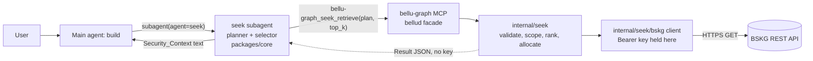
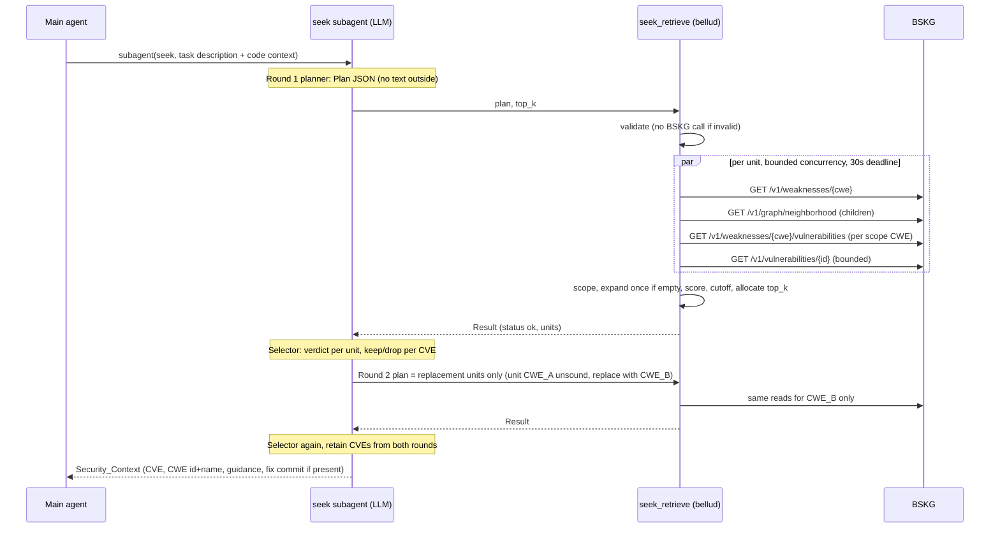

# Design Document: bellu-seek-planner

## Overview

The `seek` subagent reproduces SEEK's online retrieval stage. It has two halves with a hard boundary between them:

- **Core (TypeScript)** always registers the `seek` agent (the `seek_planner` flag was removed). The Build agent's system prompt carries a usage rule that makes it call `seek` before code changes (see Main agent usage rule). The agent runs on the parent session's model. It predicts CWEs (planner), judges the evidence (selector) and writes the Security_Context. It can call exactly one tool.
- **bellud (Go)** serves that tool, `seek_retrieve`, on the existing `bellu-graph` MCP server. The tool validates the Plan, scopes CWEs, fetches CVE evidence from the BSKG, ranks it and allocates Top_K. It makes no LLM call and holds the BSKG key.

The LLM never writes a query. Everything between "Plan JSON" and "ranked candidates" is deterministic Go.

### Verified facts that shape the design

| Fact (file) | Consequence |
|---|---|
| `plugin/agent.ts` registers agents with `ctx.agent.transform` + `editor.update(Agent.ID.make(..))`; `explore` pushes `{action:"*",effect:"deny"}` first, then allows. | `seek` uses the same deny-first ordering. |
| `subagent.ts`: `model = override ?? agent.model ?? parent.model`. | A `seek` agent with no `model` runs on the parent model (R1.5). Do not set `item.model`. |
| `tool/mcp.ts`: MCP tools register with `namespace(server)` and permission action `effectiveName` = `bellu-graph_seek_retrieve`. MCP tools default to `codemode: true`. | Permission action is `bellu-graph_seek_retrieve`. With `*` denied, `execute` (Code Mode) is wholly disabled, so `tool.ts` exposes MCP tools as direct tools (`codeModeEnabled = !whollyDisabled("execute")`). The agent sees `bellu-graph_seek_retrieve` as a plain tool. |
| `handlers/mcp.ts`: `bellu-graph` and `bellu-connectors` are `BUILT_IN_SERVERS`, injected by bellud via `BELLUCODE_CONFIG_CONTENT` (`agentcfg.Build`). | No change in `handlers/mcp.ts`. The tool is added on the Go side. |
| `bellugraph/facade/config.go` has `MCPExtras func(*mcp.Server)`, already used by `lens/lensmcp` for read-only tools. | `seek_retrieve` is added the same way. `Config.MCPExtras` is a single function, so the seek extras and lens extras are composed in `main.go`. |
| `agentcfg.Build(..., enabled, ...)` only injects the `bellu-graph` entry when the graph engine is ready/starting. | `seek_retrieve` is reachable only when the graph engine is up, even if the BSKG is configured. This is a dependency to accept and document. |
| `Agent.Info` has `request.{settings,headers,body}`, `steps`, `hidden`, `mode`, no `temperature` field. | R2.6 (lowest temperature) has no effect until `Agent.Info` has a temperature setting (resolved, see Open Points). |
| `bellud` has no BSKG client yet (`grep -i bskg` is empty). Task 5.31 of the three-graph spec would create `internal/bskg` but is not done. | This feature ships a minimal client in `internal/seek/bskg` behind a small interface, replaceable by `internal/bskg` later. |
| BSKG `GET /v1/weaknesses/{cweID}` returns `{weakness, sources, provenance}`. It has **no** `parents`/`children` (task 5.30 not done). | Children come from `GET /v1/graph/neighborhood` (works today). See decision D1. |
| `GET /v1/weaknesses/{cweID}/vulnerabilities` items are `{cveID, publishedDate, v3baseScore}` only. | Description, KEV, EPSS and fix commits need `GET /v1/vulnerabilities/{id}` per candidate. See decision D3. |

### Design decisions

**D1. Children via `/v1/graph/neighborhood` (works today).** Query: `type=Weakness&id=CWE-79&depth=1&relTypes=CHILD_OF&nodeTypes=Weakness&limit=300`. Edges are `{source: child, target: parent, type: CHILD_OF}` (child to parent), so the children of X are the `source` of edges whose `target` is X. The scoper walks edges directionally from the root downward, so a parent or sibling that appears in the (undirected) neighborhood is never included. Grandchildren use a second call with `depth=2`, made only when expansion is needed. When task 5.30 lands and `/v1/weaknesses/{cweID}` returns `children`, only `bskg.Client.Children` changes; the `Source` interface and scoper stay as they are.
*Requirement:* R9.5 now lists `/v1/graph/neighborhood` (used with `relTypes=CHILD_OF`) among the allowed paths (resolved, see Open Points).

**D2. The tool gates on BSKG config only, not on the flag.** bellud cannot see `experimental.seek_planner` from the config file; it only sees env. Mirroring `BELLUCODE_FLAGS` in Go (as `connectors/flag.go` does) would turn the tool off for users who enabled the flag through config. So bellud registers `seek_retrieve` when base URL and key are valid (R4.7). Update: the flag has since been removed, so Core registers the agent unconditionally and no longer removes the tool (see Flag gating).

**D3. Bounded detail fetch.** Scoring needs the description, KEV, EPSS and fix commits, which exist only in `/v1/vulnerabilities/{id}`. A scope of 50 CWEs with 50 CVEs each would be 2500 requests. The tool pre-orders candidates by `(v3baseScore desc, cveID asc)` and fetches details for at most `MaxDetailFetch = 120` per call, 8 in flight. This cap is deterministic and is specified in R6.12 (resolved, see Open Points).

**D4. Tool errors are structured results.** The tool is registered with the low-level `server.AddTool` and a loose input schema, so the Go SDK does not reject a bad Plan before our validator runs. That lets `invalid_plan` carry the field path. Results use `status` fields in `structuredContent`; only `invalid_plan` sets `isError`.

## Architecture



### Sequence of one invocation with re-planning



Failure paths: `invalid_plan` costs a Round and the agent corrects the named fields; `cve_unavailable` ends the invocation with a no-augmentation answer and no second tool call.

## Components and Interfaces

### Component list

| Path | Role |
|---|---|
| `packages/schema/src/config/flag.ts` | Historical: `seek_planner` was added here and later removed. |
| `packages/core/src/plugin/agent.ts` | Register `seek` in `ctx.agent.transform` unconditionally. Append `PROMPT_SEEK_USAGE` for the Build agent through a `ctx.session.hook("context", ...)` that pushes a `SystemPart` (not through `item.system`). |
| `packages/core/src/plugin/seek-prompt.ts` | `PROMPT_SEEK` constant (planner + selector) and `PROMPT_SEEK_USAGE` (main agent usage rule). |
| `packages/core/test/plugin/agent.test.ts` (extend), `packages/core/test/plugin/seek.e2e.test.ts` (new) | Core tests. |
| `services/bellud/internal/seek/plan.go` | `Plan`, `ParsePlan`, `Marshal`, validation, `Issue`. |
| `services/bellud/internal/seek/scope.go` | `Scope`, `BuildScope`. |
| `services/bellud/internal/seek/rank.go` | `Signals`, `Score`, `Rank`, tokenization. |
| `services/bellud/internal/seek/alloc.go` | `Allocate`. |
| `services/bellud/internal/seek/retrieve.go` | `Retriever.Run`: orchestration, deadline, status model. |
| `services/bellud/internal/seek/mcp.go` | `Register(*mcp.Server, *Retriever)` and `Extras`, input and result schema. |
| `services/bellud/internal/seek/bskg/client.go` | HTTP client, path building, key handling, error categories. |
| `services/bellud/internal/config/seek.go` | `LoadSeek(env)`, following `config/cve.go`. |
| `services/bellud/cmd/bellud/main.go` | Build the client from `config.Seek`, compose `MCPExtras` with lens. |
| `services/bellud/internal/seek/*_test.go`, `internal/seek/testdata/` | Unit, property (`pgregory.net/rapid`) and fake-BSKG tests. |

No Protocol, Server `HttpApi` or SDK change, so no `bun run generate` is needed (R11.3, R11.5). If adding the flag changes the generated config schema, regenerate rather than editing generated files.

### Flag gating (removed)

Superseded: the `seek_planner` flag was removed and `seek` is always registered in `packages/core/src/plugin/agent.ts`. R1.2, R1.7, R11.1, R11.2, R11.6 and R11.7 are removed. The text below is kept as history.

- **Core:** `Flag.enabled("seek_planner")` is read once when the agent plugin builds (the plugin already depends on `Flag.Service` through `internal.ts`). On: register `seek`. Off: no `seek` agent, so `subagent` returns `Unknown agent: seek` and creates no child session (R1.2, R1.7). The `subagent` tool description is built from `agents.list()`, so it lists `seek` only when registered (R1.6). Off also calls `ctx.tool.transform(editor => editor.remove("bellu-graph_seek_retrieve"))`, so the main agent's tool list is identical to a build without the feature (R11.7). `remove` on a missing tool is a no-op, so this is safe when bellud has not registered the tool. Verify at implementation that the agent plugin re-evaluates on config reload; if not, evaluate the flag inside the transform callback.
- **bellud:** gates on BSKG config only (D2). Missing or invalid URL or key means `seek_retrieve` is not in the tool list, and the `seek` agent, with no tool to call, answers "no augmentation" per its prompt.
- When the flag is on, `seek_retrieve` is visible to the main agent too (read-only, same server as the other `bellu-graph` tools). Hiding it from other agents would change `build`'s permission rules, which R11.7 forbids when the flag is off but allows to be decided when on; left visible.

### Agent registration (Core)

```ts
// packages/core/src/plugin/agent.ts (inside ctx.agent.transform, always)
editor.update(Agent.ID.make("seek"), (item) => {
  item.name = Agent.Name.make("Seek")
  item.description =
    "Retrieves CVE-grounded security context for a coding or review task. Use it before writing or reviewing security-sensitive code; it predicts likely CWEs and returns vetted CVE evidence with fix guidance."
  item.system = PROMPT_SEEK
  item.mode = "subagent"
  item.steps = Agent.Steps.make(4) // backstop: plan, replan, final, one invalid_plan fix
  item.permissions.push(
    { action: "*", resource: "*", effect: "deny" },
    { action: "bellu-graph_seek_retrieve", resource: "*", effect: "allow" },
    { action: "subagent", resource: "*", effect: "deny" },
  )
})
```

The description is 187 characters (within 1 to 200). `item.model` stays unset. `steps` uses whatever constructor `Agent.Info.steps` (`PositiveInt`) needs. How the runner ends a session that hits `steps` is not verified; the 2-Round limit is enforced by the prompt, and `steps = 4` is a backstop (R7.4, resolved, see Open Points).

### Seek agent system prompt (`PROMPT_SEEK`)

Wording is paraphrased from the SEEK planner and selector instructions.

````text
You retrieve vulnerability evidence that helps another agent write or review secure code. You work in rounds. You have exactly one tool: bellu-graph_seek_retrieve. You never write queries, URLs or CVE ids of your own.

## Round 1: plan
Read the task and any code in it. Decide the programming language (write "unknown" if you cannot tell; never refuse a task because of its language). Then predict the CWE weaknesses that this specific task could introduce.

Rules for the prediction:
- Predict only distinct risks: do not list a CWE that is a broader or narrower variant of one you already predicted. At most 20 weaknesses (a safety cap, not a target). Each cwe_id is a specific weakness (a Base or Variant level weakness is best), not a Category or View, not a Deprecated entry, and no cwe_id appears twice.
- cwe_id looks like CWE-79 (matches ^CWE-[0-9]{1,5}$).
- root_cause (1 to 1000 characters): explain how the weakness would arise in THIS task. Do not paste the generic CWE definition.
- code_snippet (1 to 2000 characters): show the code shape that would be vulnerable, using identifiers from the task where you can.
- If you cannot predict any weakness with confidence, return an empty list. Then do not call the tool; reply that no augmentation applies.

Call the tool with the plan as the only content of the call. The plan is one JSON object with exactly these fields and nothing else:
{"language": string, "reasoning": string, "weaknesses": [{"cwe_id": string, "root_cause": string, "code_snippet": string}]}
Do not write any text before the call. Do not set top_k unless the task asks for more or less evidence.

## Select
The tool returns, per weakness, a status, the CWE scope it searched and ranked candidate CVEs. For each weakness that has candidates, write a short verdict object as plain text:
{"verdicts":[{"cwe_id":"CWE-..","verdict":"sound"|"unsound","reason":"<=200 chars","candidates":[{"cve_id":"CVE-..","decision":"keep"|"drop","reason":"<=200 chars"}]}]}
- A weakness is sound only if its root_cause describes a weakness really present in the task and fits the definition of that CWE. If it is unsound, give no candidate decisions for it.
- Keep a CVE only if its description shows the same weakness pattern as the root_cause. Otherwise drop it.

## Round 2: re-plan (at most once)
If a weakness is unsound, or the tool reported unknown_cwe or no_candidates for it, and you have used fewer than 2 rounds, call the tool once more. The new plan contains only replacement weaknesses for the affected ones, each with a CWE id you have not predicted before in this run. Keep the candidates you already kept. You may use at most 2 tool calls in total, and a call that fails with invalid_plan counts as one.

## Failure handling
- invalid_plan: fix exactly the fields named in the error and call again, if you still have a round left.
- status cve_unavailable, or the tool is not available: stop. Do not call the tool again. Reply that no augmentation applies.
- A weakness with status unavailable has no evidence; treat it as having no candidates.
- If nothing is kept after the last round, reply that no augmentation applies and mention no CVE, fix commit or CWE guidance.

## Final answer
Reply with the Security_Context as plain text and make no tool call after it. Use only CVE ids, CWE ids and names, and fix commits that appear in tool results of this run. Never invent one.
For each kept candidate give: CVE id; CWE id and name; 1 to 3 sentences (max 500 characters) of fixing guidance derived only from that CVE's description, its fix data and the CWE name; the fix commit and repository only if the tool returned them.
State the predicted cwe_ids of the last plan under "predicted" and the distinct CWE ids of kept candidates under "retained".
Stay within 4000 characters (6000 if you called the tool with top_k above 4). If it is too long, remove whole candidates, lowest score first, and say how many you omitted.
````

Interpretation note: R2.4 ("no text outside the JSON object") applies to the planning turn. Verdict objects are separate text turns between tool calls, which is where R7.1 and R7.2 "record" the verdicts.

### Plan validation (Go)

```go
package seek

const (
    MaxWeaknesses = 20 // safety cap on submitted items, counted before per-unit rejection
    MaxLanguage   = 64
    MaxReasoning  = 4000
    MaxRootCause  = 1000
    MaxSnippet    = 2000
    DefaultTopK   = 4
    MinTopK, MaxTopK = 1, 10
)

type Unit struct {
    CWEID     string `json:"cwe_id"`
    RootCause string `json:"root_cause"`
    Snippet   string `json:"code_snippet"`
}
type Plan struct {
    Language   string `json:"language"`
    Reasoning  string `json:"reasoning"`
    Weaknesses []Unit `json:"weaknesses"` // never nil after parsing; marshals as []
}

// Issue names a field path such as "weaknesses[2].root_cause" or "top_k".
type Issue struct {
    Path   string `json:"path"`
    Reason string `json:"reason"`
}
type Dropped struct {
    Index  int    `json:"index"` // position in the submitted weaknesses list
    Reason string `json:"reason"`
}

// ParsePlan validates raw against the Plan schema before any BSKG call.
// Structural errors, unknown or missing fields, wrong types and length limits
// (counted in Unicode code points) return issues and no plan. The `weaknesses` cap counts submitted items, before per-unit rejection, so 21 items with some malformed is still `invalid_plan` at `weaknesses`. Per-unit cwe_id
// format failures and duplicate cwe_ids (first wins) are returned in rejected
// and the remaining units keep their order.
func ParsePlan(raw []byte) (plan Plan, rejected []Dropped, issues []Issue)

// ParseTopK accepts nil (default 4) or an integer JSON number in [1,10].
func ParseTopK(raw json.RawMessage) (int, []Issue)

// Marshal is the canonical encoding used by the round-trip property.
func (p Plan) Marshal() ([]byte, error)
```

`ParsePlan` decodes with `json.Decoder.DisallowUnknownFields` plus `UseNumber`, so a wrong type or an extra field yields a path-bearing `Issue`. It uses a small hand-written walk over `map[string]json.RawMessage` for exact paths. Model text is never interpolated; only the validated typed values reach the client (R3.7).

### Scoping

```go
const MaxScope = 50

type Source interface { // implemented by bskg.Client; faked in tests
    Weakness(ctx context.Context, cwe string) (WeaknessInfo, error)             // ErrNotFound if absent
    Children(ctx context.Context, cwe string, depth int) ([]Edge, error)         // CHILD_OF edges, child -> parent
    WeaknessVulns(ctx context.Context, cwe string, limit int) ([]VulnRef, error) // EXAMPLE_OF, limit <= 50
    Vulnerability(ctx context.Context, id string) (VulnDetail, error)
}
type Edge struct{ Child, Parent string }

type Scope struct {
    Predicted string   // first element of CWEs
    CWEs      []string // unique, predicted first, then ascending numeric id, len <= MaxScope
    Expanded  bool     // grandchildren added
    Depth     map[string]int // 0 predicted, 1 child, 2 grandchild
}

// BuildScope walks edges downward from predicted (Parent == x => Child is next
// level). Parents, grandparents and siblings are never reachable. A CWE that is
// both child and grandchild keeps depth 1. Edge CWE ids that do not match
// ^CWE-[0-9]{1,5}$ are ignored (upstream data is untrusted).
func BuildScope(predicted string, edges []Edge, maxDepth int) Scope
```

`Retriever` calls `Children(cwe, 1)`, builds the depth-1 scope, fetches candidate refs, and only if no scope CWE has a candidate calls `Children(cwe, 2)` once and rebuilds with `maxDepth = 2` (R5.2). A neighborhood response with `truncated: true` is accepted; the 50-CWE cap applies on top.

### Ranking

```go
type Signals struct {
    IdentMatch float64 // 1 or 0
    Overlap    float64 // Jaccard of token sets, 0..1
    KEV        float64 // 1 or 0
    EPSS       float64 // 0..1, missing = 0
    CVSS       float64 // v3baseScore/10, missing = 0
    Fix        float64 // 1 or 0
}

const (
    WIdent   = 0.30
    WOverlap = 0.25
    WKEV     = 0.15
    WEPSS    = 0.10
    WCVSS    = 0.10
    WFix     = 0.10 // weights sum to 1.0
)
const DefaultMinRelevance = 0.20

func Score(s Signals) float64                // sum of weight*signal, clamped to [0,1]
func Tokens(text string) map[string]struct{} // lowercase [a-z0-9]+ runs, length >= 3
func Jaccard(a, b map[string]struct{}) float64 // 0 when both empty
// IdentMatch is 1 when some identifier-like token (len >= 3) is in both the CVE
// description and the code_snippet or root_cause.
func IdentMatch(desc, snippet, rootCause string) float64
func SignalsFor(u Unit, v VulnDetail) Signals

// Rank orders by rounded (6 dp) score descending, then CVE id ascending.
func Rank(cs []Candidate) []Candidate
// Cutoff drops candidates with Score < min (a score equal to min is kept).
func Cutoff(cs []Candidate, min float64) []Candidate
```

CVSS uses the BSKG `v3baseScore`. A CVE with only a v2 score has signal 0 (the requirement does not define v2 use). Equal-after-rounding means `round(score*1e6)` as an integer.

### Top-K allocation

```go
// Allocate returns the slot count per unit, in Plan order. have[i] is the number
// of candidates unit i has after the cutoff.
// 1. m = number of units with have > 0. If m == 0: all zero.
// 2. If m > topK: the first topK units with candidates get 1.
// 3. Else each unit with candidates gets floor(topK/m); the first topK mod m of
//    them (Plan order) get one more.
// 4. Each quota is capped by have[i]; freed slots are handed out one at a time,
//    cycling in Plan order over units that still have unplaced candidates.
// Invariants: sum == min(topK, sum(have)); 0 <= out[i] <= have[i].
func Allocate(topK int, have []int) []int
```

Cross-unit dedupe (R6.1) happens before the cutoff: a CVE reachable from several units is assigned to the earliest unit in Plan order. Within a unit, a CVE attached to several scope CWEs is attributed to the lowest numeric scope CWE.

### Retriever, deadlines and status model

```go
type Config struct {
    RequestTimeout time.Duration // 10s (R9.6); shorter in tests
    TotalTimeout   time.Duration // 30s (R9.7)
    MinRelevance   float64       // default 0.20, [0,1]
    PerCWEFetch    int           // 50
    MaxDetailFetch int           // 120 (D3)
    Concurrency    int           // 8
}
type Retriever struct { /* src Source, cfg Config, log *slog.Logger */ }

func (r *Retriever) Run(ctx context.Context, plan Plan, topK int) Result
```

`Run` uses a `context.WithTimeout(ctx, TotalTimeout)`. Units run concurrently, but all merging (dedupe, ranking, allocation) happens after fetches complete and in Plan order, so output does not depend on scheduling. A 401/403 from the BSKG cancels all work. Unit and overall status:

| Condition | Unit status | Overall |
|---|---|---|
| Candidates remain after cutoff and allocation | `ok` | `ok` |
| Fetched, none attached or all dropped | `no_candidates` | `ok` |
| BSKG 404 on the weakness | `unknown_cwe` | `ok` |
| BSKG error, timeout or deadline for this unit | `unavailable` | `ok` if some unit finished, else `cve_unavailable` |
| BSKG authentication error | n/a | `cve_unavailable` (category `authentication`), all units `unavailable` |
| Source not configured (handler with nil source) | n/a | `cve_unavailable` (category `unconfigured`) |
| Plan or `top_k` invalid | n/a | error result `invalid_plan` with `issues` |

A unit with `unknown_cwe` counts as "BSKG responded", so a plan with only unknown CWEs returns `ok`. Error categories are `unconfigured | unreachable | timeout | authentication` with fixed messages; raw upstream bodies and URLs are never copied.

### MCP tool schema and result schema

Tool `seek_retrieve`, annotation `ReadOnlyHint: true`, registered with `server.AddTool` (raw arguments):

```json
{
  "type": "object",
  "additionalProperties": false,
  "required": ["plan"],
  "properties": {
    "plan": {
      "type": "object",
      "description": "{language, reasoning, weaknesses:[{cwe_id, root_cause, code_snippet}]}; validated by the server."
    },
    "top_k": { "type": "integer", "minimum": 1, "maximum": 10, "default": 4 }
  }
}
```

The advertised schema is informative. Real validation is in `ParsePlan` and `ParseTopK`, which return path-bearing issues instead of an SDK protocol error. Unknown top-level arguments produce an `invalid_plan` issue at that path.

Result (`structuredContent`, also serialized as text content):

```go
type Result struct {
    Status   string       `json:"status"` // "ok" | "cve_unavailable" | "invalid_plan"
    Error    *ErrInfo     `json:"error,omitempty"`  // {category, message}; category only for cve_unavailable/unavailable
    Issues   []Issue      `json:"issues,omitempty"` // invalid_plan
    TopK     int          `json:"top_k"`
    Rejected []Dropped    `json:"rejected,omitempty"`  // bad cwe_id format, duplicates
    Units    []UnitResult `json:"units"`               // Plan order, accepted units only
}
type UnitResult struct {
    CWEID      string      `json:"cwe_id"`
    Status     string      `json:"status"` // ok | no_candidates | unknown_cwe | unavailable
    Scope      []string    `json:"scope"`
    Expanded   bool        `json:"expanded"`
    Error      *ErrInfo    `json:"error,omitempty"`
    Candidates []Candidate `json:"candidates"` // score desc, CVE id asc on ties
}
type Candidate struct {
    CVEID       string  `json:"cve_id"`
    CWEID       string  `json:"cwe_id"`   // scope CWE it is attached to
    CWEName     string  `json:"cwe_name"` // from GET /v1/weaknesses/{id}, only for CWEs of allocated candidates
    Score       float64 `json:"score"`
    Description string  `json:"description"` // cut to 800 code points
    KEV         bool    `json:"kev"`
    EPSS        *float64 `json:"epss,omitempty"`
    CVSS        *float64 `json:"cvss,omitempty"`
    FixCommit   string  `json:"fix_commit,omitempty"`
    Repository  string  `json:"repository,omitempty"` // present only together with a fix commit
}
```

Plan-empty (R3.6, R4.4) returns `status: ok, units: []` and makes no BSKG call. CWE names cost one cached `Weakness` call per distinct allocated CWE (at most Top_K), so no name appears for a dropped candidate.

### BSKG client (`internal/seek/bskg`)

```go
type Config struct {
    BaseURL string
    Key     Secret // type Secret string; String(), GoString() and MarshalJSON() return "[REDACTED]"
    Timeout time.Duration
}
func Load(env func(string) (string, bool)) (Config, bool, error) // see Configuration
func (c Config) Configured() bool                                // R9.2 rules
func New(cfg Config) (*Client, error)
func (c *Client) Weakness(ctx context.Context, cwe string) (WeaknessInfo, error)
func (c *Client) Children(ctx context.Context, cwe string, depth int) ([]seek.Edge, error)
func (c *Client) WeaknessVulns(ctx context.Context, cwe string, limit int) ([]seek.VulnRef, error)
func (c *Client) Vulnerability(ctx context.Context, id string) (seek.VulnDetail, error)
func (c *Client) Status(ctx context.Context) error // /v1/status, used by tests and an optional startup probe

// Error categories returned by every method; they carry no URL, key or body.
var ErrNotFound, ErrUnconfigured, ErrUnreachable, ErrTimeout, ErrAuth error
```

Rules, following `cveupdate/client.go`:
- Key goes only in `Authorization: Bearer <key>`. No query, body or other header. URLs are built from the validated base plus escaped segments.
- Path building: `path(segs ...string)` joins `url.PathEscape(seg)` and sets both `URL.Path` and `URL.RawPath`, so `/ ? # % space` stay literal (R9.8). Ids are also format-checked first (`^CWE-[0-9]{1,5}$`, `^CVE-[0-9]{4}-[0-9]{4,}$`).
- `CheckRedirect` returns `http.ErrUseLastResponse`; a 3xx is treated as `unreachable`. No redirect is ever followed, so the key cannot reach another host.
- Base URL must be absolute `https`, or `http` only for `localhost` or a loopback IP; no userinfo, query or fragment. `Proxy` is `ProxyFromEnvironment` for https only, never for plain-http loopback.
- Responses are read through `io.LimitReader` (2 MiB) and decoded into typed structs. Error bodies are discarded. 401 maps to `ErrAuth` (the BSKG returns one identical 401 body for all key problems), 404 to `ErrNotFound`, 429/5xx/network to `ErrUnreachable`, context deadline to `ErrTimeout`.
- Allowed endpoints are fixed in code: `/v1/weaknesses/{id}`, `/v1/weaknesses/{id}/vulnerabilities`, `/v1/vulnerabilities/{id}`, `/v1/graph/neighborhood`, `/v1/status`; method is always `GET`.

### Configuration (bellud)

`config.LoadSeek(env)` mirrors `config.LoadCVE`: keys `seek.bskg_url` and `seek.bskg_key` read as `BELLUCODE_SEEK_BSKG_URL` and `BELLUCODE_SEEK_BSKG_KEY`, plus `seek.min_relevance` (`BELLUCODE_SEEK_MIN_RELEVANCE`, float in [0,1], default 0.20). bellud's configuration is environment-only today, so "environment takes precedence over configuration" (R9.1) holds trivially; no config file is added. An invalid `seek.min_relevance` is a startup error; an invalid or missing URL or key means unconfigured and no tool is registered, with one warning log that names the variable, never the value.

### Wiring in `main.go`

```go
seekCfg, seekOn, err := bskg.Load(os.LookupEnv)
// ...
extras := func(s *mcp.Server) {
    lensmcp.Register(s, lensSvc)                     // existing
    if seekOn { seek.Register(s, seek.NewRetriever(client, cfg, logger)) }
}
```

## Data Models

- `Plan`, `Unit`, `Result`, `UnitResult`, `Candidate`: above. JSON field names are snake_case to match the agent prompt.
- BSKG inputs decoded by the client (only the fields used):
  - neighborhood: `edges[]{source, target, type}` filtered to `type == "CHILD_OF"`; `Edge{Child: source, Parent: target}`.
  - weakness: `weakness.{cweID, name}`.
  - weakness vulns: `items[]{cveID, v3baseScore}`; first page only (`limit=50`).
  - vulnerability: `vulnerability.{description, v3baseScore, kev, epssScore}`, `fixCommits[]{sha, repoUrl}`. The first fix commit by `sha` ascending is reported.
- Fixtures: `internal/seek/testdata/` holds recorded-shape JSON for each endpoint, checked into the repo. A test pins the field names against `api/openapi.yaml` shapes from `/home/ubuntu/Bellu-security-knowelege-graph/docs/api-shapes.md`.

## Correctness Properties

*A property is a characteristic or behavior that should hold true across all valid executions of a system-essentially, a formal statement about what the system should do. Properties serve as the bridge between human-readable specifications and machine-verifiable correctness guarantees.*

Reflection on redundancy: 3.1, 3.2, 3.3, 4.2 and 4.5 collapse into one validation property. 5.1, 5.3, 5.6 and 5.8 collapse into one scope property. 6.2 and 6.3 merge into score properties. 6.4, 6.6, 6.7 and 4.3 merge into an ordering/cutoff property. 6.5 and 6.9 merge into the allocation property. 9.3, 9.4 and 10.8 merge into the key-leak property. 3.7, 9.5, 9.8 and 4.6 merge into a request-shape property.

### Property 1: Plan round trip

*For any* valid Plan, `ParsePlan(Marshal(p))` returns a Plan equal to `p` with the same `weaknesses` order, and marshaling that result again produces identical bytes.

**Validates: Requirements 3.8**

### Property 2: Validation rejects out-of-bound input without BSKG calls

*For any* valid Plan with one field replaced by a violating value (wrong type, extra or missing field, a length beyond its limit in code points, more than 20 submitted weaknesses (counted before per-unit rejection), or `top_k` not an integer in 1 to 10), the Retriever returns `invalid_plan` whose `issues` name that field's path, returns no candidates, and the fake BSKG sees zero requests. *For any* valid Plan with `top_k` in 1 to 10 or omitted, validation succeeds.

**Validates: Requirements 3.1, 3.2, 3.3, 4.2, 4.5**

### Property 3: Unit filtering keeps valid units in order

*For any* weaknesses list mixing valid units, units with malformed `cwe_id` and duplicated `cwe_id` values, the accepted units are exactly the valid first occurrences in their original relative order, and every dropped position appears once in `rejected` with a reason.

**Validates: Requirements 3.4, 3.5**

### Property 4: Requests are read-only, allowlisted and injection-safe

*For any* Plan and any BSKG data, every request the fake BSKG receives uses method `GET`, targets one of the five allowed path shapes, has the segment count of that shape, carries no key in URL or body, and *for any* string passed to the path builder (including `/ ? # % ..` and whitespace), the parsed request path has the expected segment count and an empty query.

**Validates: Requirements 3.7, 4.6, 9.3, 9.5, 9.8**

### Property 5: Scope stays within descendants, bounded and ordered

*For any* generated CWE hierarchy (including cycles, shared parents and unrelated nodes) and predicted CWE, `BuildScope` returns a list with no duplicates, the predicted CWE first, then ascending numeric ids, length at most 50, every member a descendant of the predicted CWE within the depth allowed (1, or 2 when `Expanded`), and no ancestor or sibling unless it also qualifies as a descendant.

**Validates: Requirements 5.1, 5.3, 5.6, 5.8**

### Property 6: Expansion happens only when the direct scope has no candidates

*For any* hierarchy and attachment map, `Expanded` is true exactly when no depth-0 or depth-1 CWE has a candidate and at least one grandchild exists, and the grandchild expansion is performed at most once.

**Validates: Requirements 5.2, 5.7**

### Property 7: Score is bounded, monotone in each signal, and treats missing signals as zero

*For any* Signals with each component in its range, `0 <= Score <= 1`; raising any single signal never lowers the score; all-zero signals score 0 and all-one signals score 1.0 (the weights sum to 1).

**Validates: Requirements 6.2, 6.3**

### Property 8: Output is ordered, cut off and tie-broken

*For any* candidate set and cutoff in [0,1], the returned candidates of each unit are sorted by rounded score descending then CVE id ascending, every score is at least the cutoff (a score equal to the cutoff is kept), and a unit whose candidates are all dropped reports `no_candidates`.

**Validates: Requirements 4.3, 6.4, 6.6, 6.7**

### Property 9: Top-K allocation fills the budget fairly without overflow

*For any* `topK` in 1 to 10 and availability vector `have`, `Allocate` returns `out` with `0 <= out[i] <= have[i]`, `sum(out) == min(topK, sum(have))`, and when `m` units have candidates and `m <= topK` and every such unit has at least `ceil(topK/m)` candidates, unit slots differ by at most 1 with the extra slots going to earlier units. The fairness claim needs that precondition: a unit with fewer candidates is capped at `have[i]` and its unused slots go to other units (for example `topK=5`, `have=[1,1,3]` gives `[1,1,3]`, which differs by 2); when `m > topK`, exactly the first `topK` units with candidates get 1.

**Validates: Requirements 6.5, 6.9**

### Property 10: A CVE is returned at most once, in the earliest unit

*For any* Plan whose units attach overlapping CVEs, every CVE id appears at most once across all units, and in the earliest unit in Plan order that could reach it.

**Validates: Requirements 6.1**

### Property 11: Determinism

*For any* valid Plan, `top_k` and BSKG fixture data, running `Run` twice (including with concurrent fetching and different response timing) yields byte-identical marshaled results.

**Validates: Requirements 6.11**

### Property 12: One failing unit does not affect the others

*For any* Plan and any subset of units whose BSKG reads fail, exactly those units are `unavailable` with zero candidates, every other unit's result equals its result in a run with no failures, and the overall status is `ok` unless every unit failed (then `cve_unavailable`).

**Validates: Requirements 5.4, 10.5**

### Property 13: The BSKG key never appears in any output

*For any* generated key string (including strings that occur inside CVE descriptions or URLs) and for a successful run and each failure mode (unreachable, timeout, 401, 5xx with a body echoing the key, redirect to another host), the key is absent from the marshaled Result, from captured log output, from every returned error string, from `fmt` formatting of `Config` and `Secret` values with `%v`, `%+v` and `%#v`, and it is sent only as the `Authorization` header to the configured host.

**Validates: Requirements 9.3, 9.4, 10.8**

### Property 14: Configuration validity decides whether any request is made

*For any* pair of URL and key strings, `Configured()` is true exactly when both are non-blank after trimming and the URL is an absolute `https` URL, or an `http` URL whose host is `localhost` or a loopback address, with no userinfo, query or fragment; when false, the fake server receives zero requests and `seek_retrieve` is absent from the tool list.

**Validates: Requirements 4.7, 9.1, 9.2**

## Error Handling

| Situation | Behavior |
|---|---|
| Plan or `top_k` invalid | `status: invalid_plan`, `isError: true`, `issues[]` with paths. No BSKG call. Costs one Round. |
| Individual `cwe_id` malformed or duplicate | Unit skipped, listed in `rejected`; others processed. |
| Empty `weaknesses` | `status: ok`, `units: []`, no BSKG call. Agent answers "no augmentation". |
| BSKG unconfigured, unreachable, 5xx/429, redirect | Unit `unavailable` with category `unreachable`; all units failing gives `cve_unavailable`. |
| Request exceeds 10s | Request aborted, category `timeout`. |
| Total run reaches 30s | In-flight requests cancelled; finished units returned, others `unavailable` (category `timeout`). |
| 401 from BSKG | All work cancelled, `cve_unavailable`, category `authentication`. |
| BSKG 404 for a predicted CWE | Unit `unknown_cwe`. |
| Malformed or oversized upstream JSON | Treated as `unreachable` for that unit. |
| Detail fetch for one CVE fails | That CVE is skipped; the unit becomes `unavailable` only if its scope or candidate listing failed. |

Logs record unit counts, durations and categories, never request URLs with ids from the model, the key, or response bodies. The Main_Agent receives `cve_unavailable` outcomes as ordinary subagent text; the tool does not turn them into tool errors (R10.7).

## Testing Strategy

**PBT applies** to the Go retrieval core (parsing, scoping, ranking, allocation, path building, redaction). It does not apply to the agent registration, prompt, flag wiring and LLM behavior, which use example-based tests.

### Go (`services/bellud`, run with `go test ./internal/seek/... ./internal/config/...`)

- Library: `pgregory.net/rapid` (already in `go.mod`). Not implemented from scratch.
- Each property above is one `rapid.Check` test, minimum 100 iterations (`-rapid.checks=100` default is 100; set explicitly where lower), tagged with a comment in the repo's existing style, for example `// Feature: bellu-seek-planner, Property 9: Top-K allocation fills the budget fairly without overflow`, followed by `**Validates: Requirements 6.5, 6.9**`.
- Fake BSKG: an `httptest.Server` serving fixture JSON that records method, path, query and headers. It supports per-path failure injection, delay, redirect and a body that echoes the key. No mocks of the code under test.
- Example tests: validation limit boundaries (1000/1001 root_cause, 2000/2001 snippet, 20/21 weaknesses, and 21 submitted with some malformed), grandchild expansion on and off, parent/sibling exclusion, `unknown_cwe`, cutoff at and below the boundary, tie-break by CVE id, remainder split in Plan order, reassignment of unused slots, unreachable, delayed beyond the 10s timeout (test uses a short `RequestTimeout`), 401, one unit failing, a 30s total deadline (short `TotalTimeout`), tool absent when unconfigured.
- A contract test decodes each fixture with the real client and checks the endpoint set against `api-shapes.md` field names.

### Core (`packages/core`, `bun test`, never from repo root)

Read `.bellucode/skills/unit-tests` before writing. No mocks and no `globalThis` overrides.
- `test/plugin/agent.test.ts`: `seek` always exists (the flag-off cases below were removed with the flag), `mode: "subagent"`, description length 1 to 200, rules deny `*`, allow only `bellu-graph_seek_retrieve`, deny `subagent`; flag off (via `-seek_planner` and `experimental.seek_planner: false`): absent from `agents.list()`, `subagent` returns unknown-agent and creates no child session; main agent tool list and permissions unchanged.
- Usage rule (R13): `PROMPT_SEEK_USAGE` names `seek`, the foreground `subagent(agent="seek")` call and the skip list; the Build context hook adds it and the model-family prompt is kept; the `seek` prompt does not include it. E2E: a "fix this feature" prompt calls `seek` before any edit tool, a docs-only prompt does not.
- Prompt checks: contains the JSON contract, the limits (20, 1000, 2000), the distinct-risk rule, the 2-Round rule, and no language allowlist wording.
- E2E with a scripted (stubbed) LLM provider from `test/host.ts`, against a real `seek_retrieve` served by a fake in-process MCP server with the same result schema: (a) round 1 unsound, feedback names another CWE, exactly one re-plan (2 tool calls), final text within 4000 characters with at least one retained candidate (R12.8); (b) `cve_unavailable` leads to a no-augmentation reply and exactly one tool call (R12.9).
- `bun typecheck` from `packages/core` and `packages/schema`.

## Main agent usage rule

Follows SEEK: retrieval runs before code generation on every developer query. Today the Main_Agent sees only the short `seek` description in the `subagent` tool, so it rarely calls it. A rule in the Build agent's system prompt makes the call part of the workflow (R13).

- **Constant:** `PROMPT_SEEK_USAGE` in `packages/core/src/plugin/seek-prompt.ts`, next to `PROMPT_SEEK`.
- **Rule text:** (1) Before editing for any request to fix, change, refactor or add a feature, call `subagent(agent="seek")` in the foreground. (2) Pass the full task, the language and the relevant code in the prompt, because `seek` starts with no context. (3) Use the returned Security_Context as advice while writing the change, and do not call `seek` again for the same task. (4) If `seek` says no augmentation applies, continue normally. (5) Skip `seek` for typos, comments, docs-only changes, renames, tests-only changes and pure questions.
- **Wiring:** in `packages/core/src/plugin/agent.ts`, a `ctx.session.hook("context", ...)` pushes `SystemPart.make(PROMPT_SEEK_USAGE)` onto `event.system` when `event.agent` is the Build agent. `item.system` is not used because an agent `system` replaces the model-family prompts in `packages/core/src/plugin/system-prompt/*.txt`; the hook adds a separate part after them (R13.7). The `seek` agent keeps `system = PROMPT_SEEK` only (R13.8).
- **Rationale:** a prompt rule keeps the agent loop unchanged and needs no new tool or hook. A hard pre-edit gate would be deterministic but is a larger change, so it is not used.

## Open Points (need your decision)

1. **Resolved: BSKG path (R9.5).** R9.5 now allows `/v1/graph/neighborhood`, used with `relTypes=CHILD_OF` to find weakness children (D1).
2. **Resolved: detail-fetch cap (R6.12).** R6.12 caps detail fetches at 120 per run, ordered by CVSS v3 base score descending then CVE id ascending (D3).
3. **Resolved: temperature (R2.6).** R2.6 applies only where the agent configuration exposes a temperature setting. `Agent.Info` has none, so it has no effect until one exists.
4. **Resolved: Round limit (R7.4).** R7.4 states the 2-Round limit is enforced by the prompt, with the `seek` agent step limit of 4 as a backstop.
5. **Graph engine coupling.** `seek_retrieve` is served only when the `bellu-graph` MCP entry is injected (graph engine ready). BSKG configured without the graph engine yields no tool. Accepting this keeps the built-in server list unchanged.
