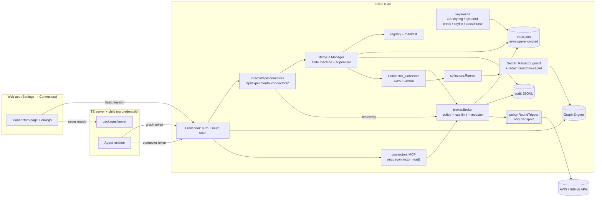
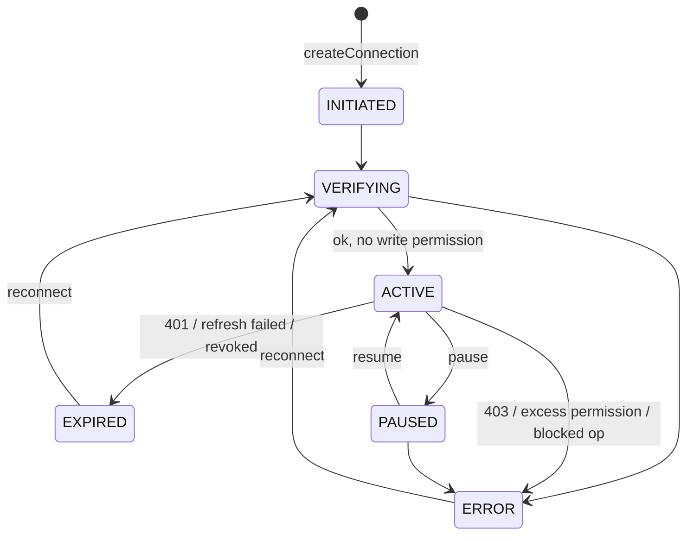

# Design Document: Cloud Connectors

## Overview

Cloud Connectors adds a flag-guarded **Settings → Connectors** page and a Go subsystem inside `bellud` that connects external services read-only and feeds their metadata into the Bellu Graph. AWS and GitHub are implemented; Cloudflare, GitLab, Sentry, MongoDB, Railway, Azure, Google Cloud, Render and Supabase are catalog cards ("Coming soon"). A manifest-driven registry lets Plugin_Connectors join later without changing callers.

### Design decisions (summary)

| # | Decision | Why |
|---|----------|-----|
| D1 | All connector logic, the Credential_Vault, the broker and the collectors are Go in `services/bellud/internal/connectors/*`, served by a new `internal/api/connectors` group. The TS server and child never see a credential. | Req 6.12, 15, 16. The route owner is `go`, so the front door never forwards these routes to the TS child. |
| D2 | One choke point for outbound traffic: `broker.Broker` + a single `policy`-enforcing `http.RoundTripper`. Provider wrappers (`aws`, `github`) receive only an `*http.Client` built on it. Collectors depend on typed wrapper interfaces, never on `net/http` or an SDK. An import-graph test enforces this. | Req 5.4, 16.1. |
| D3 | Envelope encryption: per-credential random 256-bit DEK, AES-256-GCM (96-bit random nonce), AAD binds connector id, connection id, slot and version. The DEK is wrapped by the Master_Key (AES-256-GCM). Stored in `~/.local/share/bellucode/connectors/vault.json` (0600, dir 0700), separate from the Master_Key. | Req 6.1–6.4. No SQLite dependency exists in bellud today, so an atomically replaced JSON file is used. |
| D4 | Master_Key sources, priority order: OS key store (`github.com/zalando/go-keyring`), systemd encrypted credential (`$CREDENTIALS_DIRECTORY`), 0400 key file outside the data dir, Argon2id passphrase (`golang.org/x/crypto/argon2`). **On the headless EC2 host the effective source is systemd-creds** (no D-Bus Secret Service there), with the key file as fallback. | Req 6.3; ops changes in §Ops. |
| D5 | Connection state machine is a pure function (`lifecycle.Next`) with the exact transition table of Req 14.9; every change and every rejected change is audited. | Req 14. |
| D6 | New graph kinds are **connector-scoped**: every identity includes `connection`. Seven kinds: `aws_account`, `aws_resource` (generic, ARN identity), `github_org`, `github_repo`, `github_workflow`, `github_pull_request`, `github_alert`. Existing `repository`/`workflow` are not reused (their identity is a local path). | Disconnect removes exactly one Connection's entities (Req 2.7); no churn in the pinned kind list per AWS service. |
| D7 | Agent live reads use a **separate** Go MCP endpoint `/api/experimental/connectors/mcp` with its own bearer token and one tool `connector_read`, default deny. The vendored graph MCP server is not modified. | Req 16.5, 17. Graph tokens must never open credentialed reads. |
| D8 | Plugin_Connectors: manifest schema, registry and broker contract are MVP. The sandbox runtime is phase 3. Until then plugin manifests can be validated and installed as *declarative* connectors only (HTTP-GET collectors described by the manifest, run in-process by the broker, no plugin code). | Req 8. |
| D9 | Dependencies, exact pins at `go get` time (versions seen on the Go proxy during research, re-verify): `aws-sdk-go-v2 v1.48.0`, `service/sts v1.52.0`, `service/iam v1.65.0`, `service/ec2 v1.346.0`, `service/s3 v1.114.10`, `service/lambda v1.114.4`, `service/rds v1.133.0`, `credentials v1.21.0`; phase 2 `service/sso v1.39.5`, `service/ssooidc v1.44.5`; `github.com/zalando/go-keyring v0.2.8`; `golang.org/x/crypto v0.59.0`; `golang.org/x/time` (rate limiter, pin at add). GitHub uses plain `net/http` through the broker transport, no SDK. | Minimal, well-known. `rapid` is already in `go.mod`. |

### Requirement feedback (gaps found while reading code and provider docs)

1. **Fine-grained PAT permissions cannot be enumerated.** GitHub has no endpoint that returns a fine-grained PAT's granted permissions, so Req 4.4/4.5 cannot be fully met for the PAT method. Installation tokens (GitHub App) return a `permissions` map, and user-to-server tokens of a GitHub App can be checked through the installation object. Design: PAT connections show "Permissions can't be verified; write requests are still blocked by the allowlist", set `permission_check = "unverifiable"`, may become `ACTIVE`, and rely on the broker (no write request is ever sent). Decided: MVP GitHub auth is fine-grained PAT only; the GitHub App paths move to phase 2 (see §Open Points).
2. **OAuth device flow must use a GitHub App, not an OAuth App.** OAuth App scopes such as `repo` include write access, so read-only cannot be guaranteed. The device flow therefore uses a GitHub App client id (public, no secret) with read-only permissions, which yields expiring user-to-server tokens plus a refresh token. A user-registered read-only GitHub App is an external dependency, so the device flow moves to phase 2.
3. **Req 3.9 conflicts with Req 2.5/5.6.** 3.9 lets the user "confirm the warning" to activate a role with write actions; 2.5 and 5.6 forbid it. Design follows the strict reading: write-capable permissions never activate; "confirm" only acknowledges the warning before the user fixes the role and uses Reconnect.
4. **Req 3.1 lists SSO first, but SSO is phase 2.** The SSO option is shown disabled ("Available in a later release") so the order and "recommended" mark of 3.1 hold.
5. **`ReadOnlyAccess` includes data reads** (for example `s3:GetObject`). The test reports a non-blocking `data_read` warning and recommends `SecurityAudit` plus a narrow custom policy. Collectors never read object contents (Req 7.8).

## Architecture



Control and data flow:

- **Connect**: UI → `createConnection` (body validated at the route boundary, ≤1 MiB) → `Manager` creates the Connection `INITIATED`, `vault.Put` stores the Credential (audit first), `VERIFYING`, the provider wrapper runs identity + permission checks through the broker, then `ACTIVE` or `ERROR`.
- **Collect**: on `ACTIVE`, the `Supervisor` starts one `Collector` named `connector:<connector>:<connection_id>` and runs it through the existing `collectors.Runner.RunOnce` (scrub, no-secret guard, `Ingest().Apply`, `collector_status`).
- **Live read**: the agent calls `connector_read` over the connector MCP endpoint; the broker checks Session_Scope, live-read flag and operation allowlist, then executes with the credential injected inside the process.

### Lifecycle state machine



"Removed" is a tombstone flag on the record, not a status. Credential rotation verifies the *candidate* credential without changing status (Req 9.8/9.9). "Expires soon" (Req 4.10) is a derived UI flag; status stays `ACTIVE`.

### Threat model

| Threat | Mitigation | Residual risk |
|--------|-----------|---------------|
| Disk/backup theft, other local users | AES-256-GCM envelope; Master_Key never in the data dir; modes 0600/0700/0400 verified at start (Req 6.8/6.9); excluded from exports and backups (Req 6.20) | None beyond key source strength |
| Credential leak into logs, API, graph, errors | `redactor` removes exact registered values (plain, JSON-escaped, base64, URL-escaped) plus known token patterns; graph batches also pass `redact.Guard`; batch with a credential is discarded (Req 7.7) | Provider-transformed encodings of a secret |
| Agent or plugin uses credentials directly | No credential-returning API anywhere; `vault.Opener` is reachable only from `broker`/`lifecycle`/provider auth packages (import-graph test); plugins get capabilities, never secrets | — |
| Write to provider | Method + operation allowlist in the only transport; fail-closed on unknown operation; permission re-check every 24 h (Req 5.5) | Provider endpoints that mutate on GET |
| Exfiltration to other hosts / SSRF | Host allowlist per Connection (regions, GHES host), `Dialer.Control` blocks loopback, link-local and metadata addresses (except IMDS for the AWS *ambient* source, STS-only), every redirect hop re-checked | DNS rebinding to an allowlisted name is blocked at dial time |
| CSRF / DNS rebinding on credential routes | Basic/session auth, loopback `RemoteAddr`, `Host` allowlist, `Sec-Fetch-Site != cross-site`, required `X-Bellucode-Client` header (forces a CORS preflight; this is CSRF defence, not authentication) | — |
| Graph/MCP tokens used on connector routes | Connector routes are mounted outside `roleMiddleware`; the front door authorizes them with bellud credentials only; the connector MCP route accepts only the connector token | — |
| Agent shell running as the same Unix user reads the vault and key | `PR_SET_DUMPABLE=0` + `mlock` for key pages; `CREDENTIALS_DIRECTORY` and key-file paths scrubbed from the TS child env (extend `tschild` env strip list); the external password is already stripped from the child | **A process running as the bellud Unix user can read `vault.json` and the key file.** The vault does not defend against arbitrary code execution as that user. Passphrase mode (key only in memory) is the stronger option. State this in the Settings warning. |

Go memory limits: strings are immutable and GC may copy buffers; the vault uses `[]byte`, `clear()` plus `runtime.KeepAlive`, `mlock` for the Master_Key. The AWS SDK and `net/http` copy secrets into strings and headers; those copies cannot be zeroed. `memguard` is not added (extra dependency, same limits for SDK-held copies). Req 6.11 is met "wherever the runtime allows".

### Ops: headless EC2 key path (`services/bellud/ops/bellucode.service`)

One-time provisioning (new `ops/bellucode-vault-init.sh`, run with sudo):

```bash
install -d -m 0755 /etc/bellucode
head -c 32 /dev/urandom | systemd-creds encrypt --name=bellucode-master-key - /etc/bellucode/master-key.cred
chmod 0600 /etc/bellucode/master-key.cred
```

`--with-key=auto` uses TPM2 when present and falls back to the host key (`/var/lib/systemd/credential.secret`). Most EC2 types have no TPM2, so this defends against copying the `.cred` file off the box but not against root. Unit changes:

```ini
[Service]
LoadCredentialEncrypted=bellucode-master-key:/etc/bellucode/master-key.cred
NoNewPrivileges=yes
# bellud reads $CREDENTIALS_DIRECTORY/bellucode-master-key at start, then unsets CREDENTIALS_DIRECTORY
```

Requires systemd ≥ 250. Fallback: `BELLUCODE_MASTER_KEY_FILE=/etc/bellucode/master.key` (32 raw bytes, `chown ubuntu`, `chmod 0400`), outside `~/.local/share/bellucode`. The Settings page shows the active key source by name and a warning for key file and passphrase (Req 6.5). If none is available, credentials stay in memory only and the page says they are lost on restart (Req 6.7).

## Components and Interfaces

### Package layout

```
services/bellud/internal/connectors/
  manifest/    Manifest types, embedded JSON Schema, Validate, read-only classifier
  registry/    Registry: built-in + plugin manifests, single contract
  policy/      Policy, Decision, Check(request) – pure, no I/O
  vault/       Vault (store), Opener (use), envelope crypto, rotation
  keysource/   oskeyring, systemd, keyfile, passphrase (+ permission checks)
  audit/       Append-only JSONL log, retention, paging
  redactor/    Secret_Redactor + redact.Guard wrapper
  broker/      Broker, policy RoundTripper, rate limiter, response projection
  lifecycle/   Next(), Manager, Supervisor (collectors), refresh scheduler
  store/       state.json (connections, auth configs, scopes, settings)
  aws/         wrapper client, auth (AssumeRole/static), templates, collector
  github/      wrapper client, auth (PAT/device/App), collector
  plugin/      (phase 3) sandbox runtime, capabilities, signature verify
services/bellud/internal/api/connectors/   HTTP group + MCP handler
```

The name `broker` avoids a clash with the existing `internal/proxy` (TS reverse proxy).

### Manifest and registry

```go
package manifest

type Manifest struct {
    ID          string       `json:"id"`           // 1..64, [a-z0-9-]
    Version     string       `json:"version"`      // semver
    Name        string       `json:"name"`         // 1..64
    Icon        string       `json:"icon"`
    AuthMethods []AuthMethod `json:"auth_methods"` // 1..5
    Permissions []Permission `json:"permissions"`  // 0..50, each ReadOnly=true
    Operations  []Operation  `json:"operations"`   // 0..200
    Egress      []string     `json:"egress"`       // 0..50 host patterns ({region} allowed)
    Entities    []string     `json:"entities"`     // 1..100 graph kinds produced
    Builtin     bool         `json:"-"`
}
type Operation struct {
    Name         string   `json:"name"`            // e.g. "ec2:DescribeInstances", "GET /repos/{o}/{r}/pulls"
    Class        string   `json:"class"`           // "read" | "auth" (auth: lifecycle only, never collectors/agent)
    Method       string   `json:"method"`
    Host         string   `json:"host"`            // pattern
    Path         string   `json:"path"`            // pattern, "" for AWS (operation name decides)
    StripKeys    []string `json:"strip_keys"`      // response keys removed, e.g. ["secret"]
    MaxBytes     int      `json:"max_bytes"`
}
func Validate(m Manifest) []FieldError            // names every invalid field; no values echoed
func IsWrite(op Operation) bool                   // method/verb classifier: POST/PUT/PATCH/DELETE unless class=read query; AWS verb prefix
```

`Validate` rejects an operation classified as write but listed `class: read` (Req 5.8), duplicate ids, and out-of-bound fields (Req 8.2/8.3). The JSON Schema `manifest.schema.json` is embedded, published under `docs/connectors/`, and a test asserts every built-in manifest validates against it (Req 8.14).

```go
package registry

type Registry interface {
    List() []Entry                       // built-ins and plugins, same shape; Entry.Plugin marks plugins
    Get(id string) (Entry, bool)
    Register(m manifest.Manifest) error  // runs Validate, rejects duplicate id
}
```

### Policy and transport

```go
package policy

type Request struct {
    ConnectionID, ConnectorID, Caller string // caller: "collector", "agent:<principal>", "plugin:<id>", "lifecycle"
    Method, Host, Path string
    Operation string                        // provider operation name resolved by the wrapper
    Class      string                        // "read" | "auth"
}
type Decision struct{ Allow bool; Reason Reason; Violated string } // Reason: ok, not_read_only, host_blocked, op_not_listed, scope, rate_limited
type Policy struct{ /* compiled from manifest + Connection selection (regions, GHES host) */ }

func Compile(m manifest.Manifest, sel Selection) (*Policy, error)
func (p *Policy) Check(r Request) Decision // pure; unknown operation => deny (fail closed)
```

```go
package broker

// Broker is the only way to call a provider.
type Broker struct{ /* policy, vault.Opener, audit.Log, redactor, limiter, now */ }

type Call struct {
    Connection store.ConnectionRef
    Caller     string
    Operation  string
    Params     map[string]any
}
type Result struct{ Status int; Header http.Header; Body []byte } // redacted, projected, size-capped

func (b *Broker) Do(ctx context.Context, c Call) (Result, error)           // generic read (REST providers, agent)
func (b *Broker) HTTPClient(ref store.ConnectionRef, caller string) *http.Client // for SDK wrappers; Transport = policy RoundTripper
```

The RoundTripper order: policy check → rate limit (10 req/s/connection via `golang.org/x/time/rate`, honoring `Retry-After` / `X-RateLimit-Reset` / AWS throttling) → credential injection (GitHub: `Authorization` header; AWS: SigV4 by the SDK using a vault-backed `aws.CredentialsProvider`) → dial (blocked-address `Control`) → response redaction and key stripping (`StripKeys`) → audit for blocked/failed. A blocked call sends zero bytes and writes an audit entry before returning (Req 5.2, 16.6). A 30 s per-call context deadline gives the network error of Req 16.8.

AWS operation resolution: the SDK sets the operation name on the request context through its `RegisterServiceMetadata` middleware; the RoundTripper reads it and cross-checks it against the body `Action=` / `X-Amz-Target` / REST path. A mismatch or a missing name is a deny. This must be proven by a spike test before building on it (task 1); fallback is a Smithy `Initialize` middleware that stores the name under our own context key.

```go
package vault

type Ref struct{ Owner OwnerKind; OwnerID, Slot string } // owner: connection | authconfig
type Meta struct{ Last4 string; CreatedAt, ExpiresAt time.Time; Version uint64 }

type Vault interface {                       // store operations, no plaintext out
    Put(ctx context.Context, ref Ref, connectorID string, secret []byte, exp time.Time) error // zeroes secret after sealing
    Delete(ctx context.Context, ref Ref) error
    Meta(ref Ref) (Meta, bool)
    RotateMasterKey(ctx context.Context) error
    ForgetAll(ctx context.Context) error     // deletes records + wrapped keys, drops cached key
    Status() Status                          // key source name, persistent bool, warning
}
type Opener interface {                      // plaintext only inside the callback
    Use(ctx context.Context, ref Ref, fn func(secret []byte) error) error // buffer zeroed on return
}
```

`Use` is callback-style so plaintext never escapes as a return value. An import-graph test allows `vault.Opener` only in `broker`, `lifecycle` and the provider `auth` files.

```go
package keysource

type Source interface {
    Name() string                             // "os-keyring" | "systemd-creds" | "key-file" | "passphrase"
    Available(ctx context.Context) bool
    Load(ctx context.Context) ([]byte, error) // 32 bytes
    Store(ctx context.Context, key []byte, slot string) error // not supported by systemd-creds
}
func Select(ctx context.Context, order []Source) (Source, error) // first available, priority order of Req 6.3
```

Passphrase source: Argon2id with a random 16-byte salt, memory 64 MiB (`m=65536`), time 3, parallelism 4, key length 32; rejects passphrases shorter than 12 characters (Req 6.6). Params and salt are stored in the keysource header (non-secret) beside `vault.json`.

### Audit

```go
package audit

type Entry struct {
    Seq uint64; TS time.Time; ConnectionID, ConnectorID string
    Event, Outcome, Actor string           // outcome: success|failure|blocked
    Detail map[string]string               // sanitized, no credentials
    Prev string                            // sha256 of previous line (tamper evidence)
}
type Log interface {
    Append(ctx context.Context, e Entry) error                  // fsync before returning
    List(connID string, cursor string, limit int) (Page, error) // newest first, 50/page
    Prune(now time.Time, retentionDays int) error
}
```

Files: `connectors/audit/audit-YYYY-MM-DD.jsonl`, dir 0700, files 0600, `O_APPEND`. Retention (default 90, range 1–365) deletes whole day files older than the window at start and every 24 h, and `List` additionally filters by timestamp so entries older than the window are never shown. No update or delete API exists. If `Append` fails, connect, rotate and credential release return an `audit_failed` error and leave the stored credential unchanged (Req 9.3).

### Secret_Redactor and graph guard

```go
package redactor

type Redactor struct{ /* set of registered secret byte strings (>=8 bytes) and derived encodings */ }
func (r *Redactor) Register(secret []byte) (release func())
func (r *Redactor) String(s string) string              // known tokens and registered values -> [REDACTED:credential]
func (r *Redactor) JSON(b []byte) []byte
func (r *Redactor) Guard(base redact.Guard) redact.Guard // Scrub = base.Scrub; Leaks = base.Leaks || contains registered value
```

The guard deliberately does **not** scrub registered values from batches: a hit makes `Leaks` true, so `collectors.Runner.tick` discards the whole batch with `redact.ErrSecretLeak` and records status `leak` (Req 7.7). Pattern-level secrets still go through `redact.Guard.Scrub`. The Runner is built with `collectors.WithGuard(redactor.Guard(redact.New()))`.

### Lifecycle, supervisor and collectors

```go
package lifecycle

type Status string // INITIATED VERIFYING ACTIVE EXPIRED PAUSED ERROR
func Next(from, to Status) error // ErrTransition unless in the Req 14.9 table (pure)

type Manager interface {
    Create(ctx context.Context, in CreateInput) (store.Connection, error)    // INITIATED→VERIFYING→ACTIVE|ERROR
    Test(ctx context.Context, id string) (TestReport, error)                  // identity + permission check, 30 s
    Reconnect(ctx context.Context, id string, in CredentialInput) error
    Rotate(ctx context.Context, id string, in CredentialInput) error          // candidate verified, then swapped
    Pause(ctx context.Context, id string) error
    Resume(ctx context.Context, id string) error
    SyncNow(ctx context.Context, id string) error                            // ErrRunInProgress if running
    Update(ctx context.Context, id string, p ConnectionPatch) error          // alias, interval, live reads, selection
    Disconnect(ctx context.Context, id string) error                         // stop ≤5 s, delete credential, tombstone, empty batch
}
```

`Supervisor` owns one goroutine per `ACTIVE` Connection: it waits the configured interval (1 min–24 h, default 15 min), calls `Runner.RunOnce`, applies the failure backoff `min(1m·2^(n-1), 15m)` reset on success, handles 401 → `EXPIRED`, 403 → `ERROR`, up to 3 retries with increasing delay for network errors, and re-runs the permission check every 24 h (retry within 1 h if the provider is unreachable). It stops within 5 s on any transition out of `ACTIVE`.

Required `collectors.Runner` changes (small, backward compatible):
- optional `interface{ Timeout() time.Duration }` on a Collector so connector runs get 120 s while built-ins keep 30 s (Req 7.4);
- `Runner.Forget(name)` so a removed Connection's `collector_status` entity disappears on the next status write;
- partial failure: a collector may return `PartialError{Types []string}`; the runner records `ok` with `last_error = "partial: ec2,rds"` (Req 10.4).

Disconnect removes entities by applying an **empty full observation** for the collector name (`Ingest().Apply(Batch{Collector: name})`), which the engine diffs into removals (Req 7.3, 2.7).

Collector structure per provider (e.g. AWS):

```go
// aws/client.go – the wrapper; the only file importing aws-sdk-go-v2
type Client interface {
    Identity(ctx context.Context) (Identity, error)
    SimulateWrites(ctx context.Context, principalARN string, actions []string) ([]AllowedAction, error)
    Instances(ctx context.Context, region string) ([]Instance, error) // typed projections, no raw SDK types
    Buckets(ctx context.Context) ([]Bucket, error)
    // SecurityGroups, VPCs, Roles, Functions, DBInstances ...
}
// aws/collector.go – imports only Client, never aws-sdk or net/http
func NewCollector(c Client, conn store.Connection, sel Selection) collectors.Collector
```

### AWS connector specifics

- **Auth methods**: (1) IAM Identity Center via `sso`/`ssooidc` device authorization: phase 2, shown disabled. (2) AssumeRole + external ID (MVP). (3) Static keys (MVP) with a warning and optional 90-day rotation reminder.
- **AssumeRole source identity**: the Auth_Config chooses `ambient` (default SDK chain on the host, e.g. the EC2 instance profile) or `vault` (static keys of a source user stored in the vault). The source identity is used *only* for `sts:AssumeRole`/`GetCallerIdentity` (class `auth`); everything else uses the assumed-role session. A "Detect principal" step calls `GetCallerIdentity` and pre-fills the trust principal (session ARNs are converted to role ARNs) in the generated templates.
- **External ID**: 32 random bytes from `crypto/rand`, base32, prefix `BELLU-`, unique per Connection (≥32 chars). Sent in every `AssumeRole`. CloudFormation (YAML) and Terraform snippets embed it, the trust principal, `ReadOnlyAccess`/`SecurityAudit` (or a narrower policy note) and an inline statement allowing `iam:SimulatePrincipalPolicy` on the role itself. Derived from `bellu-ai-cyber/internal/connector/provider/aws/{auth,templates}.go`.
- **Session credentials**: `DurationSeconds=3600`, refresh at `expiry − 300 s`, three retries with backoff, then `EXPIRED`; in memory only (provider `aws.CredentialsCache`, never persisted).
- **Test**: `GetCallerIdentity` (reject `arn:aws:iam::<id>:root`, discard credential) → `SimulatePrincipalPolicy` for a fixed write list (`ec2:RunInstances`, `ec2:TerminateInstances`, `s3:PutObject`, `s3:DeleteObject`, `s3:DeleteBucket`, `iam:CreateUser`, `iam:CreateAccessKey`, `iam:AttachRolePolicy`, `iam:PutRolePolicy`, `lambda:CreateFunction`, `lambda:UpdateFunctionCode`, `rds:CreateDBInstance`, `rds:DeleteDBInstance`) and a separate non-blocking data-read list (`s3:GetObject`, `secretsmanager:GetSecretValue`, `ssm:GetParameter`, `dynamodb:Scan`). `AccessDenied` on the simulation is a failed check with `insufficient permission`. Simulation is best effort: it does not model every SCP or resource policy; the broker allowlist is the hard guarantee.
- **Hosts** (partition `aws`, MVP): `sts.<r>.amazonaws.com`, `iam.amazonaws.com`, `ec2.<r>.amazonaws.com`, `s3.<r>.amazonaws.com` and `*.s3.<r>.amazonaws.com`, `lambda.<r>.amazonaws.com`, `rds.<r>.amazonaws.com`, for the selected regions only (≥1). Organization scope (account subset) is phase 2.
- **Operations (class read)**: `ec2:DescribeInstances|DescribeSecurityGroups|DescribeVpcs|DescribeRegions`, `s3:ListBuckets|GetBucketLocation`, `iam:ListRoles|SimulatePrincipalPolicy`, `lambda:ListFunctions`, `rds:DescribeDBInstances`, `sts:GetCallerIdentity`. Class `auth`: `sts:AssumeRole`.

### GitHub connector specifics

- **Methods** (decision: MVP is fine-grained PAT only): (1) GitHub App installation (phase 2: user-supplied App id + private key in a custom Auth_Config; JWT → installation token minted on demand, memory only, only the private key is vaulted; `bellu-ai-cyber/internal/connector/provider/ci/github/client.go` is the reference), (2) device flow with a GitHub App client id (phase 2, needs a user-registered read-only GitHub App), (3) fine-grained PAT, prefix `github_pat_` enforced before anything is stored (MVP). The method list keeps the preference order of Req 4.1; entries (1) and (2) are shown disabled ("Available in a later release").
- **PAT permissions UI**: the dialog shows "Permissions can't be verified; write requests are still blocked by the allowlist". The Connection may become `ACTIVE` with `permission_check = "unverifiable"`.
- **Device flow (phase 2)**: `POST https://github.com/login/device/code` and `/login/oauth/access_token` are class `auth`, allowed only to the lifecycle auth layer. The Manager returns `user_code` + `verification_uri`, polls at GitHub's `interval`, adds the `slow_down` increment, stops on `expired_token` or `access_denied` without creating a Connection. Refresh uses the refresh token (stored in the vault) before the 8 h expiry.
- **Hosts**: `api.github.com`, `github.com` (auth ops only), and the configured GHES host (https only, validated, metadata addresses blocked).
- **Operations (GET, class read)**: `/user`, `/user/installations`, `/installation/repositories`, `/orgs/{org}`, `/repos/{o}/{r}`, `/repos/{o}/{r}/pulls`, `/repos/{o}/{r}/actions/workflows`, `/repos/{o}/{r}/code-scanning/alerts`, `/repos/{o}/{r}/dependabot/alerts`, `/repos/{o}/{r}/secret-scanning/alerts` (`StripKeys: ["secret"]`: GitHub returns the secret value in that response, it must be dropped before anything else sees it), `/repos/{o}/{r}/issues` (count only). `POST /graphql` is allowed only if the body parses (via `gqlparser`, already a dependency) to a `query` operation.
- **Permission check**: App tokens return `permissions`; any `write` or `admin` value yields `ERROR` naming each permission. PAT: unverifiable (see Requirement feedback 1). Repository selection is stored on the Connection; at least one is required after a selection event.

### Session scope and `connector_read`

```go
type Scope struct {
    Principal   string              // "agent" in MVP
    Connectors  []string
    Connections []string
    Operations  map[string][]string // connectorID -> operations, each ⊆ manifest read allowlist
}
```

- Default for any principal: empty scope, so graph reads work and every Proxy_Request is denied with an authorization error (Req 17.2).
- `connector_read` inputs: `connection` (alias or id), `operation`, `params`. It runs `broker.Do` with `Caller = "agent:<principal>"`. The decision is `scope ∧ connection.AllowAgentLiveReads ∧ op ∈ allowlist` (Req 17.3/17.4); a denial writes an audit entry (principal, connection, operation, reason). Responses are redacted, projected and capped at 64 KiB.
- Disabling live reads, or changing a scope, takes effect within 5 s: the broker re-reads an atomic snapshot and in-flight not-yet-sent calls check it again before dialing (Req 17.5/17.7).
- MVP has one `agent` principal whose bearer token is minted per start (like `mcptoken`) and injected into the child as a second MCP entry `bellu-connectors` (only while the flag is on). Per-session and per-named-token scopes are phase 2.
- Connector routes use bellud credentials only; neither graph tokens nor the child credential are accepted (they are outside `roleMiddleware`).

### HTTP wiring in bellud

- `cmd/bellud/main.go`: after `openGraph`, build `connectors.Service` when `connectors.Enabled(os.Getenv)` is true. `goHandler` mounts `/api/experimental/connectors/` on a top-level mux *before* the graph `roleMiddleware`, and `graphGoAuth` adds a bearer-only authorizer for `/api/experimental/connectors/mcp` only.
- Flag: `connectors` is added to `packages/schema/src/config/flag.ts` (on in dev/local, off in release). Go cannot read TS config documents, so `connectors.Enabled` mirrors the same grammar for `BELLUCODE_FLAGS` (`connectors`, `-connectors`, `all`) and the build default (`graph.IsRelease()`-style ldflag). A `experimental.connectors` value set only in config files does not reach Go; the UI therefore requires both the resolved TS flag *and* a successful `GET …/status` (404 when disabled). When disabled, no route is registered, no collectors start, and the vault is not opened (Req 11.5).
- `server/routes/generate.go`: add `/api/experimental/connectors/` to `goOwnedPrefixes` and the MCP route to the extra routes; regenerate `routes.yaml` and `testdata/operations.json`.
- `tschild`: extend the stripped env list with `CREDENTIALS_DIRECTORY`, `BELLUCODE_MASTER_KEY_FILE`, `BELLUCODE_VAULT_PASSPHRASE`.

### API routes

All under `/api/experimental/connectors`, bellud credentials only, identifier `experimental.connectors.<name>`, description suffix "Experimental: may change without compatibility guarantees." Credential-bearing writes also require loopback `RemoteAddr`, allowed `Host`, `X-Bellucode-Client`, and are audited on rejection (Req 6.14/6.15). Every request body is size-limited to 1 MiB before parsing and validated against its schema before any other processing (Req 11.10–11.12); validation errors name fields and never echo values.

| name | Method + path | Purpose |
|------|---------------|---------|
| `status` | GET `/status` | flag/offline probe, key source name, persistent bool, warnings |
| `catalog` | GET `/catalog` | manifests with card state inputs (plugin flag, supported methods, permissions, hosts) |
| `listConnections` | GET `/connections` | masked metadata only |
| `createConnection` | POST `/connections` | alias, connector, auth config, method, params, credential |
| `getConnection` | GET `/connections/:id` | masked |
| `updateConnection` | PATCH `/connections/:id` | alias, interval, live reads, selection, rotation interval |
| `deleteConnection` | DELETE `/connections/:id` | disconnect |
| `testConnection` | POST `/connections/:id/test` | identity + permission check |
| `syncConnection` | POST `/connections/:id/sync` | manual run (409 if running) |
| `pauseConnection` / `resumeConnection` | POST `/connections/:id/pause` / `/resume` | |
| `reconnectConnection` | POST `/connections/:id/reconnect` | new credential, → VERIFYING |
| `rotateCredential` | POST `/connections/:id/rotate` | candidate verified first |
| `listAudit` | GET `/connections/:id/audit?cursor=` | 50/page newest first |
| `listAuthConfigs` / `createAuthConfig` / `deleteAuthConfig` | GET/POST `/connectors/:cid/auth-configs`, DELETE `/auth-configs/:id` | |
| `awsSetup` | POST `/aws/setup` | external id + CloudFormation + Terraform + detected principal |
| `startDeviceFlow` / `pollDeviceFlow` | POST `/github/device`, POST `/github/device/:flowId/poll` | |
| `listGithubRepos` | GET `/connections/:id/github/repos` | accessible repositories |
| `getScope` / `putScope` | GET/PUT `/scopes/:principal` | Session_Scope |
| `unlockVault` | POST `/vault/unlock` | passphrase source |
| `rotateMasterKey` | POST `/vault/rotate` | |
| `forgetAll` | POST `/vault/forget` | "Forget all connectors" |
| `listPlugins` / `previewPlugin` / `confirmPlugin` / `removePlugin` | `/plugins…` | phase 2 (manifest-only) |
| (Go-only, not in protocol) | `ANY /mcp` | connector MCP, connector bearer token |

No route returns a credential, wrapped key or Master_Key. A credential-requesting option (query, header, body field or `debug`) is ignored and audited with the caller role (Req 15.3). A route-coverage test enumerates the router and fails if a registered route is not exercised by the no-leak test (Req 15.7).

The protocol package gets `packages/protocol/src/groups/experimental-connectors.ts` (declaration only, no TS handler, like `experimental-graph.ts`) and shared schemas in `packages/schema/src/connectors.ts`; `packages/protocol/test/experimental-identifiers.test.ts` gains a `/api/experimental/connectors/*` ↔ `experimental.connectors.*` both-directions check. After changing the protocol, run `bun run generate` in `packages/client`.

### Web UI (packages/app)

```
packages/app/src/settings/connectors/
  connectors.tsx          page: header, vault status banner, offline state, card grid
  connector-card.tsx      card (icon, name, ≤120-char description, read-only badge, state, count)
  connection-list.tsx     rows: alias, account label, status, last sync, entities, expiry, actions
  connect-dialog.tsx      shell: permissions, hosts, auth method picker, Auth_Config select
  aws-connect.tsx         SSO (disabled) / AssumeRole (external id + CFN/TF tabs, copy) / static keys (warning)
  github-connect.tsx      App (phase 2, disabled) / device flow (phase 2, disabled) / PAT; repository picker
  audit-dialog.tsx        paged list
  scope-panel.tsx         per-connection "Allow agent live reads" + scope
  machine.ts              pure: cardState(), alias validation, device flow UI machine (+ tests)
  connectors.css          tokens only
```

- Integration: `SettingsRootTab` gets `connectors` in `route.ts`, `pages.ts` (icon `plug`, added to the UI icon set if missing), `shell.tsx` (nav item and `Tabs.Content`, rendered only when the flag and status probe pass) and `search-catalog.ts` (entries with keywords "connectors aws github integrations", filtered when the flag is off). Follows the Providers/Extensions page patterns (`SettingsList`, `useDialog`, `ExternalLink`).
- Cards: CSS grid, square-cut corners from the existing `--radius-*` scale (0–2 px), brand tokens (`--surface-brand-*`, `--text-on-brand-*`) for the primary action, semantic tokens only (no hex). Each card is a `<section>` with an accessible name `"<service>, <state>"`; state changes are announced via an `aria-live="polite"` region within 1 s; all actions are buttons reachable by Tab with the shared focus ring. New `ConnectorIcon` in `packages/ui/src/components` uses monochrome `currentColor` SVGs for the 11 services.
- Secrets in the UI: credential `TextInput`s use `type="password"`, `autocomplete="off"`, are cleared in a `finally` within 1 s of the response, never written to stores, URL, localStorage or logs. Non-secret fields are retained on error.
- Offline: poll `status` every 5 s with a 5 s timeout; on failure show the offline banner, disable Connect actions, clear within 10 s of recovery (Req 10.6).
- i18n: all strings are `settings.connectors.*` keys in `packages/app/src/runtime/i18n/en.ts` only. `language.tsx` already falls back to the English dictionary for missing keys (Req 11.2/11.3); a test asserts no non-English catalog defines a `settings.connectors.` key.

## Data Models

All files live in `~/.local/share/bellucode/connectors/` (0700). Files 0600. Writes are temp-file + fsync + rename + directory fsync.

```jsonc
// state.json  (non-secret)
{
  "version": 1,
  "settings": { "audit_retention_days": 90, "default_interval_sec": 900 },
  "authConfigs": [
    { "id": "ac_…", "connectorId": "aws", "name": "default", "builtin": true,
      "method": "assume_role", "scopes": ["ReadOnlyAccess","SecurityAudit"],
      "settings": { "source": "ambient", "roleArn": "arn:aws:iam::…:role/…" } }   // app secrets live in the vault, never here
  ],
  "connections": [
    { "id": "cn_…", "connectorId": "aws", "alias": "prod-eu", "authConfigId": "ac_…",
      "method": "assume_role", "status": "ACTIVE", "statusReason": "",
      "accountLabel": "123456789012", "externalIdRef": "vault:cn_…/external-id",
      "selection": { "regions": ["eu-west-1"], "repos": [] },
      "intervalSec": 900, "allowAgentLiveReads": false,
      "rotationIntervalDays": 90, "credentialCreatedAt": "…", "credentialExpiresAt": null,
      "lastPermissionCheck": "…", "permissionCheck": "ok|excess|unverifiable",
      "lastSync": { "status": "ok", "endedAt": "…", "entities": 214, "partial": [] },
      "removed": false, "createdAt": "…" }
  ],
  "scopes": [ { "principal": "agent", "connectors": [], "connections": [], "operations": {} } ],
  "plugins": [ { "id": "…", "pinnedVersion": "1.2.0", "confirmedPermissions": [], "confirmedHosts": [], "signed": false } ]
}
```

The AWS external ID is a vault slot (it protects against confused deputy, so it is treated as a secret value).

```jsonc
// vault.json
{
  "version": 1, "kid": "9f1c…",                       // key id = first 8 bytes of SHA-256("bellud.kid"||masterKey), hex
  "records": [
    { "owner": "connection", "ownerId": "cn_…", "slot": "primary", "connectorId": "aws",
      "version": 3, "createdAt": "…", "expiresAt": null, "last4": "ab12",
      "wrappedDek": "<b64 nonce||AES-GCM(masterKey, dek; aad=kid|owner|ownerId|slot|version)>",
      "nonce": "<b64 96-bit>", "ciphertext": "<b64 AES-GCM(dek, secret; aad=…)>" }
  ]
}
```

AAD for the credential seal: `"bellud.vault.v1" || len‖connectorId || len‖connectionId(ownerId) || len‖slot || be64(version)` (length-prefixed so fields cannot shift). `last4` is stored in clear (Req 6.13: at most 4 characters). Master-key rotation: (1) write the new key to the source under slot `next`; (2) re-wrap every DEK into `vault.json.new`, fsync; (3) rename over `vault.json`; (4) promote `next` to current. A crash after step 3 is recovered at start by promoting `next` when `kid` matches it. Failure before step 3 leaves the old file untouched (Req 6.17/6.18). Sources that cannot store a key (systemd-creds) require the operator to re-provision the credential, so rotation is offered for os-keyring, key-file and passphrase.

```text
// audit-YYYY-MM-DD.jsonl – one JSON object per line
{"seq":812,"ts":"2026-11-13T07:54:52.123Z","connectionId":"cn_…","connectorId":"aws","event":"status_change",
 "outcome":"success","actor":"system","detail":{"from":"VERIFYING","to":"ACTIVE"},"prev":"sha256:…"}
```

Event types: `connect`, `test`, `disconnect`, `rotate`, `credential_release`, `collect`, `blocked_operation`, `permission_change`, `status_change`, `rejected_transition`, `credential_option_ignored`, `scope_denied`, `decrypt_failed`, `vault_forget`, `master_key_rotate`, `plugin_*`.

Graph entities (registered in `internal/bellugraph/internal/bge/ident/ident.go`; update the pinned count in `ident_test.go` from 16 to 23 and the facade/describe-schema tests). Every kind includes `connection` in its identity:

| Kind | Identity attributes | Descriptive attributes (names avoid `IsSecretName` fragments: secret, token, password, credential, private, hash, apikey) |
|------|--------------------|---------------|
| `aws_account` | connection, account_id | alias, regions |
| `aws_resource` | connection, arn | service, resource_type (`ec2:instance`, `s3:bucket`, `iam:role`, `lambda:function`, `rds:instance`, `ec2:security-group`, `ec2:vpc`), region, name, state, created_at, tag_count |
| `github_org` | connection, login | name, plan |
| `github_repo` | connection, full_name | default_branch, visibility, archived, pushed_at |
| `github_workflow` | connection, repo, path | name, state |
| `github_pull_request` | connection, repo, number | state, author_login, base_branch, created_at, updated_at, draft |
| `github_alert` | connection, repo, alert_type (`code_scanning`\|`dependabot`\|`secret_scanning`), number | state, severity, rule_id, package, detector, locations_count, created_at, url |

Every entity also carries `source = "connector:<connector>:<connection_id>"`. The attribute `detector` replaces any "secret_type" name because the redaction key rule `(?i)secret` would blank it; the alert's `secret` field is stripped at the broker and never mapped. The path rule `data` also means no attribute may be called `data`. Relations reuse registered types: `aws_resource -owned_by-> aws_account`, `instance -attached_to-> security-group`, `instance -runs_on-> vpc`, `github_repo -owned_by-> github_org`, `github_workflow|github_pull_request|github_alert -owned_by-> github_repo` (endpoints are in the same batch). No relation attributes (the batch rule). The collector name `connector:<connector>:<connection_id>` is the batch `Collector` and the `collector_status` key.

Not ingested (Req 7.8): object/file contents, secret values, environment variable values, database records, PR/issue bodies, commit contents.

## Correctness Properties

*A property is a characteristic or behavior that should hold true across all valid executions of a system-essentially, a formal statement about what the system should do. Properties serve as the bridge between human-readable specifications and machine-verifiable correctness guarantees.*

PBT applies: the vault, redactor, policy, manifest validation, lifecycle, rate limiter, scope decisions, collectors' output mapping and the UI state mapping are pure or fake-able logic with large input spaces. Properties are written in the next step, after the acceptance-criteria prework.

#### Reflection on properties

Merged during reflection: 3.8/3.9/4.4/4.5/2.5/5.6 into one *excess permission* property; 3.12/4.12/8.11/5.1/5.2/12.4/16.6 into one *policy decision* property; 6.13/15.1–15.4/15.6 into one *no token export* property; 6.16/12.3/15.5/16.3/16.4 into one *redaction* property; 16.5/17.2–17.4 into one *scope decision* property; 14.1/14.8/14.9/2.3 into one *lifecycle* property; 3.11/4.11 into one *selection confinement* property; 1.13/1.15, 7.10, 9.6, 9.10, 13.x kept as separate validators because their inputs and oracles differ.

### Property 1: Vault round trip

*For any* credential of 1 to 65,536 bytes (including non-ASCII and control bytes), any connector id, connection id, slot and version, sealing it in the Credential_Vault and then opening it with the same identifiers returns bytes identical to the original.

**Validates: Requirements 6.1, 12.1**

### Property 2: Tamper and AAD binding

*For any* stored credential record and any single-bit flip, truncation or appended byte in the ciphertext, nonce or wrapped data key, or any change of connector id, connection id, slot or version used as authenticated data, opening fails with an error, returns zero bytes of plaintext, and appends an Audit_Log entry that contains no key material, ciphertext or plaintext.

**Validates: Requirements 6.2, 10.5, 12.2**

### Property 3: Fresh data key and nonce per seal

*For any* credential sealed N times, all N data keys (observed as distinct wrapped keys), all N nonces and all N ciphertexts are pairwise distinct.

**Validates: Requirements 6.1**

### Property 4: Plaintext buffer is zeroed after use

*For any* stored credential, the byte slice handed to the `Use` callback contains only zero bytes once `Use` returns, whether the callback succeeded or failed.

**Validates: Requirements 6.11**

### Property 5: Secret redaction on every output channel

*For any* credential (8 to 4,096 characters, including non-ASCII and control characters) and any text or JSON payload that embeds it, the redacted log line, error message, Audit_Log entry, graph batch, API response and Proxy_Request result contain neither the verbatim value nor its JSON-escaped, base64 or URL-escaped form, and the non-secret remainder of the payload is unchanged.

**Validates: Requirements 6.16, 12.3, 15.5, 16.3, 16.4**

### Property 6: Leaking batches are discarded

*For any* graph batch that embeds a registered credential value in any key, value or nested position, the collector runner applies nothing to the engine, previously ingested entities are unchanged, `collector_status` records `leak`, and the status text, logs and events do not contain the value.

**Validates: Requirements 7.6, 7.7**

### Property 7: Policy decision equals allowlist membership

*For any* request (method, host, path, operation, class, caller) and any compiled policy, the decision is *allow* if and only if the operation is on the Connection's read allowlist, the method is GET, HEAD or OPTIONS or a listed read query, and the host is in the Egress_Allowlist for the selected regions or GHES host; on *deny* a counting transport observes zero outbound requests and an Audit_Log entry with the Connection id, caller, operation and violated policy is written before the error is returned. An operation that cannot be resolved is denied.

**Validates: Requirements 3.12, 4.12, 5.1, 5.2, 8.11, 12.4, 16.1, 16.6**

### Property 8: Manifest validation

*For any* manifest, validation accepts it if and only if every field is within its bounds (id 1–64, name 1–64, auth methods 1–5, permissions 0–50, operations 0–200, egress 0–50, entities 1–100), the version is semver, the id is not already registered, and no operation classified as write is listed as a read; a rejection names each offending field or operation and does not register the connector. Every built-in manifest is accepted by the published JSON Schema.

**Validates: Requirements 5.8, 8.2, 8.3, 8.14**

### Property 9: Manifest and state serialization round trip

*For any* valid manifest, state document or audit entry, serializing then parsing produces an equivalent value.

**Validates: Requirements 8.2, 9.2**

### Property 10: Lifecycle transitions

*For any* sequence of requested status changes starting from any status, the resulting status after each step is the requested one if and only if the pair is in {INITIATED→VERIFYING, VERIFYING→ACTIVE, VERIFYING→ERROR, ACTIVE→EXPIRED, ACTIVE→PAUSED, ACTIVE→ERROR, PAUSED→ACTIVE, PAUSED→ERROR, EXPIRED→VERIFYING, ERROR→VERIFYING}; otherwise the status is unchanged; every accepted change appends an entry with previous status, new status and timestamp, every rejected change appends a rejection entry, and a Connection is always in exactly one status.

**Validates: Requirements 2.3, 14.1, 14.8, 14.9**

### Property 11: Audit completeness and fail-closed

*For any* connect, test, disconnect, rotation, credential release, collection run, blocked operation or permission change, exactly one entry with UTC millisecond timestamp, Connection id, connector id, event, outcome and actor is appended before the result is returned and contains no credential; if the append fails, connect, rotate and credential release are rejected with an audit error and the stored credential is unchanged.

**Validates: Requirements 9.1, 9.2, 9.3**

### Property 12: Audit paging and retention

*For any* set of entries and retention period of 1 to 365 days, listing pages (50 per page, newest first) concatenate to exactly the entries of that Connection within the retention window in reverse chronological order, and a retention value outside 1 to 365 is rejected.

**Validates: Requirements 9.4, 9.6**

### Property 13: Account alias validation

*For any* alias string and set of existing aliases of one connector, creating or renaming a Connection succeeds if and only if the alias has 1 to 40 characters and is not already used by another Connection of that connector; a rejection names the alias field and keeps the previous alias.

**Validates: Requirements 1.13, 1.15**

### Property 14: Bounded settings validators

*For any* proposed collection interval, rotation interval or retention period, the value is accepted if and only if it is inside its range (interval: whole minutes from 1 minute to 24 hours; rotation: 1 to 365 days; retention: 1 to 365 days); a rejection names the allowed range and keeps the previous value.

**Validates: Requirements 7.10, 9.6, 9.10**

### Property 15: Auth_Config validation and lifecycle

*For any* submitted Auth_Config, creation succeeds if and only if the name has 1 to 40 characters and is unique for the connector, required settings are present, all scopes are in the connector's read-only scope set, and fewer than 10 custom configs exist; a rejection names every invalid field or scope and stores nothing. *For any* failure injected at any vault step during creation or deletion, no orphan app secret remains and no partial Auth_Config exists. Deletion is rejected with the exact count of using Connections if that count is above zero.

**Validates: Requirements 13.2, 13.3, 13.4, 13.6, 13.7, 13.8, 13.9**

### Property 16: No token export across routes

*For any* Connection holding a random credential, every registered Connector route called with valid, invalid and credential-requesting inputs (query parameters, headers, body fields, debug options) returns a body and headers that contain no substring of the credential longer than 4 characters, returns at most the last 4 characters, creation time and expiry time as credential metadata, and records an Audit_Log entry for each credential-requesting option; the set of routes exercised equals the set of registered routes.

**Validates: Requirements 6.13, 15.1, 15.2, 15.3, 15.4, 15.6, 15.7**

### Property 17: Credential write authorization

*For any* combination of authentication state, remote address, `Host`, caller role (user, agent token, graph token) and client header, a credential write is accepted if and only if the request is authenticated with bellud credentials, comes from a loopback address with an allowed host and the client header; otherwise it is rejected with an authorization error, stores nothing and appends an Audit_Log entry.

**Validates: Requirements 6.14, 6.15**

### Property 18: Request body validation

*For any* request body to a Connector route, a body above 1 MiB is rejected before parsing, and a body failing schema validation is rejected with a client error that names the failing fields, does not contain any submitted value, performs no state change, and writes no submitted credential to logs.

**Validates: Requirements 11.10, 11.11, 11.12**

### Property 19: Scope decision

*For any* Session_Scope, principal, Connection, live-read flag and operation, a Proxy_Request from an agent is executed if and only if the Connection and operation are in the scope, the operation is on the connector's read allowlist and live reads are enabled for the Connection; an empty or absent scope denies every request; any denial sends zero provider requests, returns an authorization error and appends an Audit_Log entry with principal, Connection, operation and reason. A scope containing an operation outside the allowlist is rejected naming that operation and leaves the previous scope unchanged.

**Validates: Requirements 16.5, 17.1, 17.2, 17.3, 17.4**

### Property 20: Excess permission classification

*For any* set of granted permissions (AWS simulation results or GitHub permission map), the reported offenders are exactly the write- or admin-capable entries; if the set of offenders is non-empty the Connection does not become ACTIVE (or leaves ACTIVE to ERROR), no collector runs for it, the offenders are named, and during first verification the stored credential is deleted; if it is empty the check passes.

**Validates: Requirements 2.5, 3.8, 3.9, 4.5, 5.6**

### Property 21: AWS root identity rejected

*For any* caller ARN returned by `sts:GetCallerIdentity`, the Connection is rejected and the credential discarded if and only if the ARN is the account root (`arn:aws*:iam::<12 digits>:root`).

**Validates: Requirements 3.10**

### Property 22: GitHub token prefix

*For any* submitted personal access token string, it is accepted for storage only if it starts with `github_pat_`; otherwise nothing is stored, no Connection is created or changed, and the error states that classic tokens are unsupported.

**Validates: Requirements 4.2**

### Property 23: External ID and trust templates

*For any* N generated external IDs, each has at least 32 characters and all are distinct; *for any* role name, principal and external ID, the CloudFormation and Terraform output contains that external ID and parses as valid YAML or HCL; *for any* sequence of session refreshes every `AssumeRole` call carries the Connection's external ID.

**Validates: Requirements 3.2, 3.3**

### Property 24: Credential refresh schedule

*For any* credential expiry and current time, the refresh is scheduled at `expiry − 300 s` or immediately if less time remains, AssumeRole sessions request at most 3600 s, and the "expires soon" flag is true if and only if the GitHub token has fewer than 7 days remaining while the status stays ACTIVE.

**Validates: Requirements 3.4, 4.10, 14.6**

### Property 25: GitHub device flow polling

*For any* sequence of GitHub device-flow responses (pending, slow_down, success, expired_token, access_denied), the poll interval never drops below GitHub's interval, grows on each `slow_down`, polling stops on expiry or denial, and no Connection is created on expiry or denial.

**Validates: Requirements 4.6, 4.7**

### Property 26: Master key rotation atomicity

*For any* set of stored credentials and any failure injected at any step of master key rotation, every credential is decryptable afterwards, under the new key if rotation completed and under the previous key otherwise, no plaintext credential is written to disk during rotation, and a failed rotation reports an error.

**Validates: Requirements 6.17, 6.18**

### Property 27: Master key source selection and passphrase rules

*For any* availability of the four key sources, the selected source is the first available in the order OS key store, systemd credential, key file, passphrase; *for any* passphrase string, it is accepted if and only if it has at least 12 characters, derivation with the same salt is deterministic and derivation with different salts differs, and the Argon2id parameters are at least 64 MiB, 3 iterations, 16-byte salt.

**Validates: Requirements 6.3, 6.6**

### Property 28: Collector output hygiene

*For any* generated provider response fixture (including fields holding object contents, file contents, secret values and environment variables), the collector batch contains only the registered kinds, every entity has the source tag of its Connection and the Connection id in its identity, no attribute name matches the graph's secret-name rule, and no forbidden content field value appears.

**Validates: Requirements 7.8, 7.13**

### Property 29: Full-observation semantics

*For any* two successive observations of a Connection, after the second run the live entities with that source equal the second observation (absent entities are removed); a failed or timed-out run leaves the live entities unchanged; an empty observation on disconnect leaves none.

**Validates: Requirements 2.7, 7.3, 7.5**

### Property 30: Failure backoff

*For any* sequence of collection results, the delay after the n-th consecutive failure is `min(1 min · 2^(n−1), 15 min)` and resets to 1 minute after a success.

**Validates: Requirements 7.5**

### Property 31: Rate limiting

*For any* sequence of request times for one Connection, no sliding window of one second contains more than 10 sent requests, and after a provider response indicating exhaustion or a retry delay no request is sent for that Connection before the indicated time.

**Validates: Requirements 7.12**

### Property 32: Selection confinement

*For any* selected set of regions, accounts or repositories (at least one), every provider call recorded by the collector's fake client targets only members of the selection.

**Validates: Requirements 3.11, 4.11**

### Property 33: Partial failure isolation

*For any* subset of failing resource types in a collection run, the batch still contains the entities of every non-failing type, the run reports exactly the failed types, and the Connection remains ACTIVE.

**Validates: Requirements 10.4**

### Property 34: Typed verification errors

*For any* provider failure (HTTP status, network error, timeout, throttling), verification returns exactly one of {invalid credential, insufficient permission, excess permission, network, rate limited, expired} with a message of at most 200 characters that does not contain the credential, and leaves the Connection state and stored credential unchanged.

**Validates: Requirements 10.1**

### Property 35: Rotation and reconnect outcomes

*For any* outcome of identity and permission checks on a candidate credential, the vault holds the candidate if and only if both checks pass (otherwise the old credential stays and the candidate is discarded); a reconnect never changes the Connection id, alias or graph source tag.

**Validates: Requirements 9.8, 9.9, 14.4, 14.5**

### Property 36: Card state mapping (TypeScript)

*For any* connector implementation flag and list of Connection statuses, the card shows exactly one of Available, Coming soon, Connecting, Connected, Paused, Needs attention, derived by the mapping ACTIVE→Connected, INITIATED/VERIFYING→Connecting, EXPIRED/ERROR→Needs attention, PAUSED→Paused; the page shows exactly one card per catalog connector and installed plugin without duplicates; the connect dialog lists exactly the methods, permissions and hosts of the manifest.

**Validates: Requirements 1.3, 1.4, 1.5, 2.1, 14.2**

### Property 37: Plugin capability and pinning (phase 3)

*For any* issue time and call duration, a plugin capability is valid only until the earlier of 5 minutes after issue and the end of the call and never carries a credential; *for any* pair of installed and updated manifests, the pinned version remains active unless the update is re-confirmed, and an update that adds or changes permissions or egress hosts is not run before confirmation; a package with a tampered byte fails signature/checksum verification and is not loaded.

**Validates: Requirements 8.7, 8.9, 8.12, 8.13**

## Error Handling

Typed error set (Req 10.1) used by every route and mapped to a localized message key `settings.connectors.error.<code>`, each ≤200 characters and credential-free:

| Code | Source | State effect |
|------|--------|--------------|
| `invalid_credential` | 401 on verify, malformed key, bad PAT prefix | verify → `ERROR`; collect → `EXPIRED` |
| `insufficient_permission` | 403 on verify, simulation `AccessDenied`, missing `iam:SimulatePrincipalPolicy` | `ERROR` |
| `excess_permission` | write-capable permission found | `ERROR`, credential deleted at first verify, names offenders |
| `network` | dial failure, DNS, 30 s deadline | none on test; `ERROR` while verifying; collect retries ×3 then data marked stale |
| `rate_limited` | 429 / throttle / local limiter | backoff, no state change |
| `expired` | refresh failure, revoked token | `EXPIRED`, collectors stop ≤5 s, memory credentials dropped |
| Others (non-credential) | `alias_invalid`, `alias_taken`, `blocked_by_policy`, `scope_denied`, `run_in_progress`, `vault_unavailable`, `audit_failed`, `decrypt_failed`, `transition_rejected`, `validation_failed`, `payload_too_large`, `forbidden` | per route |

Rules:
- Error bodies are built from codes and field names only; provider error text passes through `Redactor.String` and is truncated before use. Validation errors name fields, never values.
- Vault failures: decrypt failure → `ERROR` with a "reconnect" prompt and an audit entry that logs only the record ref (Req 10.5); delete failure on disconnect → Connection unchanged, collectors stay stopped, UI shows Retry (Req 2.11); write failure on `Put` → the operation fails and no partial record is kept; unreadable permissions at start → vault refuses to load, reports `store|directory|key-file`, data untouched (Req 6.9).
- No Master_Key source → memory-only mode: `Put` keeps secrets in an in-process map, `status` reports `persistent=false`, UI shows the "lost on restart" notice.
- Audit failure fails closed for connect, rotate and credential release; collection continues to write best-effort entries and logs a sanitized warning.
- Panic safety: broker and collector goroutines recover, convert to `ERROR` with a generic reason, and never print request or credential data.
- Offline UI: any `status` timeout (>5 s) shows the offline banner and disables Connect.

## Testing Strategy

PBT is appropriate: the vault, redactor, policy, validators, lifecycle, limiter, scope decision and collector mappings are pure or fake-able. Not property-tested (example, integration or smoke only): Settings layout and keyboard behavior (Playwright and component tests), systemd/OS key store integration, the plugin OS sandbox, AWS and GitHub live behavior, i18n catalog presence, client regeneration, and route-owner wiring.

**Go (`services/bellud`, `go test ./internal/connectors/... ./internal/api/connectors/...`)**
- Property tests use `pgregory.net/rapid` (already in `go.mod`), minimum 100 iterations (`-rapid.checks=100`), one rapid test per Property 1–35, each tagged `// Feature: cloud-connectors, Property N: <title>`.
- Fakes, no mocks of internals: in-memory `keysource`, counting `http.RoundTripper`, fake provider `Client`s, fake clock, real `facade` engine for Properties 6 and 29, real `collectors.Runner` with `WithGuard`.
- Scan tests (Req 12.5): plant unique credentials, run connect, test, collect and failure flows for AWS and GitHub fakes, then scan `state.json`, `vault.json`, audit files, captured logs, every API response and the bytes sent to the TS child; zero hits required.
- Architecture tests (smoke): `go/packages` import-graph checks that (a) collectors import neither `net/http` clients nor `aws-sdk-go-v2`, (b) only `broker`, `lifecycle` and provider auth use `vault.Opener`, (c) only the `broker` transport is used to build provider clients.
- Spikes before dependent work: AWS operation-name extraction from the request context (Property 7), `systemd-creds` read path, `go-keyring` behavior with no Secret Service (must report unavailable, not hang).
- Failures print the shrunk counterexample with credential values redacted (Req 12.6) via a rapid wrapper that passes output through `Redactor`.

**TypeScript**
- `packages/protocol/test/experimental-identifiers.test.ts`: add the connectors both-directions test (paths under `/api/experimental/connectors/` ↔ identifiers `experimental.connectors.*`, description suffix).
- `packages/app`: `machine.test.ts` with `bun test`; Property 36 uses `fast-check` if it is already a dev dependency of the package, otherwise a generated-table test. Component tests for cards and dialogs, Playwright e2e (`packages/app/e2e`) for keyboard operation, flag off, offline banner and clearing of credential inputs. Follow the repo skills `unit-tests`, `component-tests`, `app-e2e-tests` before writing tests. Run from package directories, never the repo root.
- Gate checks: `bun run generate` in `packages/client` twice with no diff; `bun run check`; `go vet ./... && go test ./...` in `services/bellud`.

## Phasing

**MVP (phase 1)**
- Flag `connectors`, routes, protocol declarations, generated client, Settings → Connectors catalog UI (11 cards, connection list, dialogs, audit view, offline state, English i18n).
- Vault with all four key sources, envelope encryption, rotation, forget-all, permission checks; ops changes for systemd-creds; audit log with retention.
- Lifecycle state machine, supervisor, backoff, 24 h permission re-check, runner extensions (timeout, forget, partial).
- Broker, policy transport, rate limiter, redactor and guard, manifest schema, registry, auth configs.
- AWS: AssumeRole with external ID and templates, static keys, test with simulation, collectors for account, EC2 (instances, security groups, VPCs), S3 buckets, IAM roles, Lambda, RDS.
- GitHub: fine-grained PAT only (`github_pat_` prefix enforced; permissions marked unverifiable, connection may be ACTIVE), collectors for org, repos, workflows, open PRs, code scanning, Dependabot and secret-scanning alert metadata.
- Connector MCP endpoint with `connector_read` (default off, one `agent` principal), scope panel and "Allow agent live reads".

**Phase 2**
- AWS IAM Identity Center (SSO device flow, `GetRoleCredentials`) and organization scope (account subset).
- GitHub OAuth device flow and GitHub App installation (own App id + private key; both need a user-registered read-only GitHub App; shown disabled "Available in a later release"), per-session and per-named-token Session_Scopes, Declarative plugin install flow (manifest preview, confirmation, pinning, update re-confirmation), signature verification, passphrase unlock UI polish, migration of the legacy `credential` table (Req 6.21, separate spec item).

**Phase 3**
- Plugin sandbox runtime (process isolation, filesystem and network confinement, capability tokens ≤5 min), remaining catalog connectors, GitHub Enterprise polish.

Req 8.6/8.7 are fully satisfied only in phase 3; before that only declarative manifest plugins (no plugin code) are installable, so there is nothing to sandbox.

## Open Points for the User

1. Decided: MVP GitHub auth is fine-grained PAT only (`github_pat_` enforced). The UI shows "Permissions can't be verified; write requests are still blocked by the allowlist" and the connection may become ACTIVE with `permission_check = "unverifiable"`.
2. Decided: OAuth device flow and GitHub App installation move to phase 2 (they need a user-registered read-only GitHub App). They appear disabled ("Available in a later release") in the method list, keeping the preference order of Req 4.1.
3. Decided: strict AWS rule. A role with write permissions is never activated; Req 3.9 "confirm" only acknowledges the warning.
4. Confirm SSO as phase 2 with a disabled UI entry.
5. Go cannot see `experimental.connectors` set only in config files. Acceptable to require `BELLUCODE_FLAGS` for Go, or should the TS side pass the resolved flag to bellud at spawn time?
