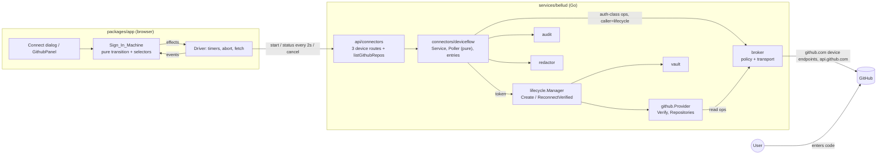
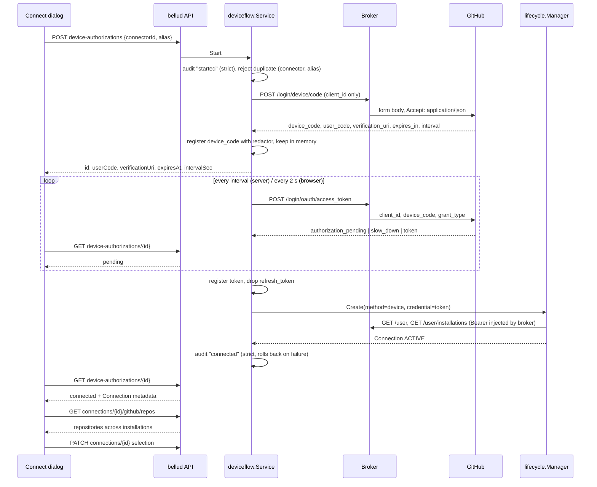
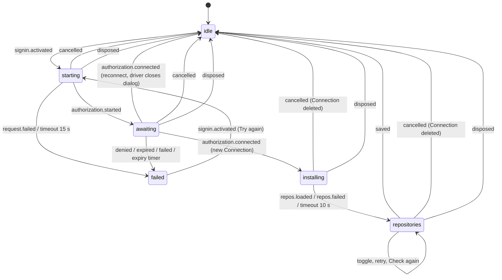

# Design Document

## Overview

This feature replaces the disabled "GitHub App installation" and "OAuth device flow" rows in the GitHub Connect dialog with one working path: **Sign in with GitHub**. The user clicks the button, enters a short code on github.com, and returns to Bellu Code with a verified, read-only Connection. The fine-grained personal access token (PAT) stays under a collapsed Advanced section.

The mechanism is the GitHub **device authorization flow** against one public GitHub App ("Bellu Code"). Bellud holds no secret: only the public Client_ID is compiled in. Device flow needs no callback URL, which matters because bellud is usually reached through an SSH tunnel.

### Design decisions (summary)

| # | Decision | Why |
|---|----------|-----|
| D1 | Device flow, polled **inside bellud**; the browser only reads status | A closed tab does not lose the authorization, and the device code never reaches the browser (Req 2.7, 2.8, 7.1). |
| D2 | A **provider-neutral `deviceflow` package** owns polling, expiry, cancel, audit and redaction. A connector supplies a manifest `device` entry plus the existing `lifecycle.Provider.Verify` | Satisfies Req 16.1 (five inputs) and 16.5 (provider cannot override protocol behavior). |
| D3 | Device-flow HTTP goes through the **existing broker** as manifest operations of class `auth`, callable only by the `lifecycle` caller | Req 8.4 to 8.6, 16.6. No second HTTP path, no new egress hole. |
| D4 | The token response is the one place where the broker's token-pattern redaction must **not** run (`issues_credential` operation flag) | The broker's `value_github_token` rule would replace `ghu_...` in the response with `[REDACTED:credential]` and sign-in could never work. See [Broker changes](#broker-changes). |
| D5 | The device code is held **in process memory only** and never written to the vault | See [Requirement interpretations](#requirement-interpretations-and-conflicts) (Req 7.7). |
| D6 | No `scope` parameter is ever sent. Refresh tokens are discarded on receipt | `scope=offline_access` opts into expiring tokens, which this feature explicitly avoids (Req 9.1, 9.7). |
| D7 | Repository listing for a device Connection uses **`/user/installations` and `/user/installations/{id}/repositories`** | These are the endpoints GitHub documents for user access tokens; they return the intersection of what the user and the App can reach. |
| D8 | The Sign_In_Machine **composes** `github-machine.ts` for the repository phases | Req 15.14. |
| D9 | `device` Connections are created only by the device-flow service. The public `createConnection` route rejects `method: "device"` | A ghu_ token can only enter the vault after a completed, audited flow. |

### Research summary

Sources are GitHub's documentation for [generating a user access token for a GitHub App](https://docs.github.com/en/apps/creating-github-apps/authenticating-with-a-github-app/generating-a-user-access-token-for-a-github-app) (content was rephrased for compliance with licensing restrictions).

- Device flow: `POST https://github.com/login/device/code` with `client_id`, then poll `POST https://github.com/login/oauth/access_token` with `client_id`, `device_code` and `grant_type=urn:ietf:params:oauth:grant-type:device_code`. No client secret is involved. The device flow must be enabled in the App settings.
- Defaults: the codes live 900 seconds and the minimum polling interval is 5 seconds. Answers arrive as HTTP 200 with an `error` field: `authorization_pending`, `slow_down`, `expired_token`, `access_denied`, `device_flow_disabled`, `incorrect_client_credentials`, `incorrect_device_code`, `unsupported_grant_type`. `slow_down` adds 5 seconds and the response carries the new interval.
- Sending `scope=offline_access` yields an expiring token plus a refresh token even if the App has expiration disabled. Bellu Code never sends `scope`. A token without expiry omits `expires_in` and `refresh_token`.
- A user access token holds only the permissions that both the user and the App have, and reaches only repositories that both can access. GitHub names `GET /user/installations` and `GET /user/installations/{installation_id}/repositories` as the way to see which installations and repositories a user token reaches.
- Revoking a token through the API and refreshing it both need the Client_Secret, so this design links to GitHub's authorized-apps page instead (Open Question 2).

### Answers to the requirements' open questions

1. **Refresh without a secret.** Not attempted. The App is registered with expiration disabled, `scope` is never sent, and any `refresh_token` in a response is discarded. If a fork's App still returns `expires_in`, the Connection records the expiry and ends in EXPIRED with Reconnect (Req 9.2, 9.4). A hosted refresh endpoint stays a follow-up spec.
2. **Revocation.** Disconnect deletes the token locally. The disconnect dialog already renders a "revoking is a separate step" note and a revocation link from `REVOCATION_URLS`; this feature adds the GitHub entry `https://github.com/settings/apps/authorizations`. **Verify this URL against github.com before release.**
3. **Installation scope and organization approval.** A user token sees only installations that exist. When an organization requires owner approval, a non-owner's install attempt becomes a *request*, so the installation does not appear in `/user/installations` until an owner approves. The repository step therefore always shows an "Install Bellu Code on GitHub" link and a "Check again" action, and when the list is empty it explains the approval case in text (key `settings.connectors.github.signin.noInstallation.approval`).
4. **Verification calls.** `GET /user` works with a user access token and needs no permission for the public profile. `GET /user/installations` also needs no permission and returns `total_count: 0` for a user with no installation, so it distinguishes "token is fine, nothing installed" from a bad token. Verification for method `device` is therefore `GET /user` (identity, 401 means invalid) plus `GET /user/installations` (page 1 only, proves the endpoint class works). It does **not** call `/user/repos`, which the PAT path uses and which would fail the "no installation yet" case.

## Architecture



### Sign-in sequence



### Sign_In_Machine



Every attempt carries an id. Any result whose id differs from the current state's id is ignored by returning the same state object.

## Components and Interfaces

### Package layout

| Area | New or changed | Responsibility |
|------|----------------|----------------|
| `services/bellud/internal/connectors/deviceflow/` | **new** | Generic service: start, status, cancel, poll loop, expiry, audit, redaction, in-memory entries. Pure `Poller` for the schedule. |
| `.../github/clientid.go` | **new** | The single `ClientID` and `AppSlug` constants and `EffectiveClientID(getenv)`. |
| `.../github/manifest.go` | changed | `Manifest(cfg)` takes the effective client id; `device` auth method; device-flow `auth` operations; `github.com` egress; `/user/installations/{i}/repositories` read operation. |
| `.../github/provider.go`, `client.go` | changed | `Verify` branches on `Connection.Method`; `Installations`, `InstallationRepositories`; token validation by method. |
| `.../manifest/` | changed | `AuthMethod.Device`, `Operation.IssuesCredential`, validation, JSON schema. |
| `.../broker/` | changed | `AuthNone`, auth-class body check, `issues_credential` response handling, `PreConnectionRef`. |
| `.../policy/` | unchanged in logic | Existing class `auth` + caller `lifecycle` rule enforces Req 8.5. |
| `.../lifecycle/` | changed | Method-aware credential validation, `ReconnectVerified`, drop-on-failure for `device`, `PAUSED -> EXPIRED`, non-refreshable expiry enforcement, new error codes. |
| `.../audit/` | changed | Event `device_authorization`. |
| `.../service.go` | changed | Wires `deviceflow`, effective client id, startup reconcile (Req 14.3), `listGithubRepos` for `device`. |
| `services/bellud/internal/api/connectors/` | changed | Three routes, closed body parsers, `retryAfterSec` on errors. |
| `packages/schema/src/connectors.ts`, `packages/protocol/src/groups/experimental-connectors.ts`, `errors.ts` | changed | Schemas, routes, new error codes. Then `bun run generate` in `packages/client`. |
| `packages/app/src/settings/connectors/` | changed and new | `signin-machine.ts`, `signin.ts` (driver), `device-prompt.tsx`, `github-panel.tsx`, `connect-dialog.tsx`, `errors.ts`, `connection-list.tsx`. |
| `docs/connectors/` | new | App registration checklist, master key setup, device-flow connector guide. |

### Client ID resolution

```go
// github/clientid.go
package github

// ClientID is the public Client_ID of the "Bellu Code" GitHub App. It is not a
// secret. The project owner replaces the placeholder after registering the App.
const ClientID = "" // set at registration; empty means "sign-in unavailable" until then

// AppSlug is the App's URL slug, used only to build the installation link.
const AppSlug = "bellu-code"

const (
    EnvClientID = "BELLUCODE_GITHUB_CLIENT_ID"
    EnvAppSlug  = "BELLUCODE_GITHUB_APP_SLUG"
)

// EffectiveClientID applies the environment override (trimmed, non-empty wins).
func EffectiveClientID(getenv func(string) string) string {
    if v := strings.TrimSpace(getenv(EnvClientID)); v != "" {
        return v
    }
    return ClientID
}
```

`connectors.New` reads it once with `Options.Getenv`, passes it to `github.Manifest`, and never reads any `*_SECRET` variable. When the effective id is empty, `github.Manifest` **omits the `device` auth method**. The catalog then lists PAT only, which is the UI's signal for Req 4.7 (sign-in unavailable, Advanced expanded with an explanation). This is also consistent with Req 16.3, because an omitted method is not an invalid one.

`BELLUCODE_GITHUB_APP_SLUG` is a second, optional override (see interpretations): a fork with its own App needs its own install link.

### Manifest changes

```go
// manifest.AuthMethod
type AuthMethod struct {
    ID, Name       string
    Enabled        bool
    DisabledReason string
    Device         *DeviceSpec `json:"device,omitempty"` // only for the device method
}

// DeviceSpec declares four of the five provider inputs (Req 16.2). The fifth,
// the token verification call, is lifecycle.Provider.Verify.
type DeviceSpec struct {
    DeviceCodeURL string   `json:"device_code_url"` // https, host must be in Egress
    TokenURL      string   `json:"token_url"`       // https, host must be in Egress
    ClientID      string   `json:"client_id"`
    Scopes        []string `json:"scopes"`          // 0 to 20 entries; GitHub declares none
}

// manifest.Operation gains one field.
type Operation struct {
    // ...existing fields...
    // IssuesCredential marks an auth operation whose response body carries a
    // credential for the lifecycle caller. The broker skips token-pattern
    // redaction for the body of such an operation (registered values are still
    // redacted) and never audits the body. Only valid for class "auth".
    IssuesCredential bool `json:"issues_credential,omitempty"`
}
```

`manifest.Validate` adds: a `device` method needs non-empty `device_code_url`, `token_url`, `client_id`, both URLs `https` with a host listed in `egress`, at most 20 scopes, and two matching `auth` operations (`POST` + `Query:true`, the precedent of `sts:AssumeRole`). It reports the connector and the field name, never the value. `registry.Register` already rejects an invalid manifest with `InvalidError`; the catalog omits that connector and the error is logged with the connector id and field (Req 16.3). `manifest.schema.json` and the TS `ManifestAuthMethod` gain the optional `device` object.

GitHub's manifest:

```go
{ID: MethodDevice, Name: "Sign in with GitHub", Enabled: true,
   Device: &manifest.DeviceSpec{
     DeviceCodeURL: "https://github.com/login/device/code",
     TokenURL:      "https://github.com/login/oauth/access_token",
     ClientID:      clientID, Scopes: []string{}}},
{ID: MethodPAT, Name: "Fine-grained personal access token", Enabled: true},
// "GitHub App installation" (MethodApp) is removed. No row says "later release".

// operations (class auth, only the lifecycle caller may use them)
{Name: "POST /login/device/code",        Class: auth, Method: "POST", Query: true,
   Host: "github.com", Path: "/login/device/code",        MaxBytes: 16 << 10},
{Name: "POST /login/oauth/access_token", Class: auth, Method: "POST", Query: true,
   Host: "github.com", Path: "/login/oauth/access_token", MaxBytes: 16 << 10, IssuesCredential: true},
// new read operation
get("/user/installations/{i}/repositories", "/user/installations/{i}/repositories"),

Egress: []string{DefaultAPIHost, "github.com", hostPlaceholder},
```

The catalog dialog already prints `manifest.egress`, so `github.com` appears in the same list as the other hosts (Req 8.7). `Query: true` on an auth operation only means "a POST that is not a provider write"; see the broker change that stops it from triggering the GraphQL body check.

### Broker changes

All changes keep the invariant that a blocked call sends zero bytes and is audited first.

1. **`AuthNone`** `AuthKind`: the transport injects no `Authorization` header. Device endpoints are anonymous apart from `client_id`.
2. **Pre-connection ref.** `broker.PreConnectionRef(connectorID, m, pol, authID)` builds a `ConnectionRef` with `Auth: AuthNone` and `ID: "device:" + authID`. The id keys the rate limiter and appears in audit entries for blocked calls.
3. **Body check for `auth` operations.** Today `op.Query && !isAWS` runs the connector's GraphQL validator. That would reject form bodies. The check becomes: `class == read` keeps the GraphQL validator; `class == auth` and not AWS runs `checkAuthBody`: body at most 4 KiB, parsed as `application/x-www-form-urlencoded` or JSON, every key in `{client_id, device_code, grant_type, scope}`, and **any `client_secret` key blocks the request**. An unparseable or oversized body is blocked (fail closed). This is defense in depth for Req 4.4 and 4.6.
4. **`issues_credential` responses.** `readCapped` still caps the body. Step 5 (`Redactor.JSON`) is replaced for such an operation by `Redactor.Registered` (registered needles only), because `redact.ValueRules` contains `gh[pousr]_[A-Za-z0-9]{36,}`. The response header cleaning is unchanged. The operation is reachable only by `CallerLifecycle`, so no collector or agent can receive a token body.
5. **Rate limits.** The existing `notePause` path turns `Retry-After` into `RateLimitedError`. The device-flow service maps it to typed `rate_limited` with `retryAfterSec` clamped to 0 to 3600.

### Policy

No change to `policy.Check`. Req 8.5 already follows from the code: class `auth` requires `Caller == lifecycle` (`Violated: "class"`), an operation listed with another class is `op_not_listed`, and `github.com` matches only the two `auth` operations, so a collector or agent request to a device endpoint is denied with zero bytes sent and one `blocked_operation` audit entry. A new property test pins this.

### The provider-neutral interface (`deviceflow` package)

A connector contributes exactly five inputs (Req 16.1). Four are data in the manifest; the fifth is code the connector already has.

```go
package deviceflow

// Spec is read from the manifest's enabled "device" auth method.
type Spec struct {
    DeviceCodeURL, TokenURL *url.URL
    ClientID                string
    Scopes                  []string
}

// Verifier is the fifth input: the token verification call. It is the existing
// lifecycle.Provider.Verify, called by the manager with a broker-backed client.
type Verifier = lifecycle.Provider

// Clients builds policy-enforcing clients. *broker.Broker satisfies it.
type Clients interface {
    HTTPClient(ref broker.ConnectionRef, caller string) *http.Client
}

type Config struct {
    Clients  Clients
    Registry registry.Registry
    Audit    audit.Log
    Redactor *redactor.Redactor
    Store    *store.Store
    // PreRef builds the pre-connection ref and compiled policy for a connector.
    PreRef   func(connectorID, authID string) (broker.ConnectionRef, error)
    // Connect turns a received token into a Connection (new or reconnect).
    // The Service in package connectors implements it with the lifecycle.Manager.
    Connect  func(ctx context.Context, req ConnectRequest) (store.Connection, error)
    // Abandon deletes a Connection created by this flow (cancel / TTL).
    Abandon  func(ctx context.Context, connectionID string) error
    Now      func() time.Time
    Sleep    func(ctx context.Context, d time.Duration) error
}

type Service struct{ /* entries map, mutex */ }

func (s *Service) Start(ctx context.Context, in StartInput) (Authorization, error)
func (s *Service) Status(id string) (State, error)   // ErrNotFound
func (s *Service) Cancel(ctx context.Context, id string) error // ErrNotFound
func (s *Service) Close(ctx context.Context) error  // cancels all polls
```

Behavior that lives here and that a provider cannot change (Req 16.5): polling interval and `slow_down`, expiry, cancellation within 5 seconds, audit, redaction, the verification-URL host check, duplicate rejection, limits (at most 8 pending authorizations).

Adding a connector therefore needs: a manifest `device` method and two `auth` operations, a `lifecycle.Provider` whose `Verify` handles `Connection.Method == "device"`, and optionally a method-aware `CredentialValidator`. The contributor guide walks through this with a worked example other than GitHub.

**Architecture test.** `arch_test.go` today hard-codes `aws/` and `github/` in `isProviderFile`. It changes to "every directory under `internal/connectors/` that is not infrastructure (`broker`, `vault`, `lifecycle`, `deviceflow`, `manifest`, `registry`, `policy`, `audit`, `redactor`, `store`, `scope`, `keysource`)", and the same rule is applied to `deviceflow`: no `http.DefaultClient`, `http.Get`, `http.Post`, `&http.Client{}` or `http.Transport` construction. A violation reports the package and import path (Req 16.6).

### The poller (pure schedule)

The loop is thin; the decisions are a pure function so they can be tested without time or network.

```go
type Poller struct {
    Interval time.Duration // current minimum spacing between polls
    Failures int           // consecutive network failures
}

type Outcome struct {
    Kind        OutcomeKind // Pending, SlowDown, Token, Expired, Denied, Disabled, Misconfigured, NetworkFailure, RateLimited
    NewInterval time.Duration // from a slow_down response, 0 if absent
    RetryAfter  time.Duration // from RateLimited
}

type Step struct {
    Poller   Poller
    Terminal bool        // stop polling
    Delay    time.Duration // wait before the next poll when not terminal
}

// Next is pure: no clock, no I/O.
func (p Poller) Next(o Outcome, remaining time.Duration) Step
```

Rules:

- `Pending`: delay is `Interval`, failures reset, interval unchanged (Req 3.3).
- `SlowDown`: interval becomes `NewInterval` when GitHub sent one larger than the current, else `Interval + 5 s` (Req 3.2); the new interval applies to every later poll.
- `NetworkFailure`: `Failures++`, delay `min(Interval << (Failures-1), 60 s)`. A later success resets `Failures` to 0 and the delay to `Interval` (Req 3.9).
- `RateLimited`: delay `max(Interval, RetryAfter)`; not counted as a network failure.
- `Token`, `Expired`, `Denied`, `Disabled`, `Misconfigured`: terminal.
- If `delay >= remaining`, the step is terminal with the last failure's code (`network` after consecutive network failures, `rate_limited` after rate limiting), so the loop ends at expiry.
- The first poll waits one `Interval` after the device code is issued.

The default interval is 5 s when GitHub returns none (Req 3.1).

### Authorization entries and lifecycle

```go
type entry struct {
    id, connectorID, alias string
    reconnectID            string
    deviceCode             []byte  // memory only, zeroed on any terminal state
    userCode, verifyURI    string
    expiresAt              time.Time
    mu                     sync.Mutex
    state                  entryState // pending | connecting | connected | expired | denied | failed | cancelled
    errCode                lifecycle.Code
    retryAfterSec          int
    conn                   *store.Connection
    cancel                 context.CancelFunc
    removeAt               time.Time  // retention for terminal entries
}
```

Transitions happen under `entry.mu`:

- `pending -> connecting` is claimed atomically **before** the token is used. A cancel that wins the race moves the entry to `cancelled`, and a token that arrives afterwards is zeroed and dropped, so no Connection is created (Req 3.7).
- `connecting -> connected` after `Connect` returns and the strict `connected` audit entry is written. If the audit write fails, the service calls `Abandon` (deletes the Connection and token) and the entry becomes `failed` with `audit_failed` (Req 6.9).
- `Cancel` on `connecting` sets a flag; the connecting goroutine calls `Abandon` when `Connect` returns.
- `Cancel` on `connected` calls `Abandon` **only if the Connection's selection is still empty** and the entry is not a reconnect (Req 6.6, 6.7, 9.8). If the user already saved a selection, cancel is a no-op that reports success. This makes the DELETE route the single "abandon" operation for the dialog.
- Retention: terminal entries stay for 2 minutes so status polling can read the outcome, then the id returns not-found. `cancelled` entries are removed immediately (Req 17.4, 17.5). A `connected` entry for a new Connection stays 30 minutes; when it expires with an empty selection the service runs the same `Abandon`. This covers a tab that closed before the user saved a selection. It is a small addition to avoid leaving empty Connections behind; remove it if you prefer to keep Connections until the user deletes them.

Audit: one `device_authorization` entry per milestone with `Detail{phase, alias}` and outcome, where phase is `started`, `connected`, `denied`, `expired`, `cancelled` or `failed`. Entries carry the connector id, the synthetic id `device:<authID>` as `ConnectionID`, and never a code or token. `started` is strict: if it cannot be written, no request is sent to GitHub.

### Lifecycle manager changes

1. **Method-aware credential validation.** A new optional interface:

   ```go
   type MethodCredentialValidator interface {
       ValidateCredentialFor(method string, secret []byte) error
   }
   ```
   The manager prefers it over `CredentialValidator` when present. GitHub: method `pat` keeps `github_pat_`; method `device` requires the documented `ghu_` prefix and no whitespace; anything else is `validation_failed`.
2. **`Provider.Verify` for `device`.** `GET /user` then `GET /user/installations?per_page=1`. Account label is the login. 401 maps to `invalid_credential` through the existing `mapError`. `CheckPermissions` stays `Unverifiable` with the existing message (Req 6.3).
3. **Drop the token on any verification failure for `device` (Req 6.4, 6.5).** `finishVerification` gets `dropOnFailure`, true for `device`. The Connection ends ERROR with the typed code and the token is deleted from the vault. For `pat` behavior is unchanged.
4. **`ReconnectVerified(ctx, id, CredentialInput)`** for EXPIRED or ERROR Connections replaced through sign-in. It stages and verifies the candidate **first**, like `Rotate`. On failure nothing changes, so an EXPIRED Connection stays EXPIRED with its old state (Req 9.8). On success it audits, commits the candidate, applies `Method = device` and the new expiry, then moves `EXPIRED/ERROR -> VERIFYING -> ACTIVE`. Id, alias and source tag are kept (Req 9.5). The existing `Reconnect` (PAT form) is untouched.
5. **Expiry enforcement without refresh (Req 9.4, 9.7).** `Provider.Refresh` for `device` never calls GitHub. For a non-refreshable provider the supervisor's tick marks the Connection EXPIRED when `now >= CredentialExpiresAt`, with collectors stopped within 60 seconds. This is implemented as an optional `lifecycle.NonRefreshable` interface (`Refreshable(conn) bool`). **To verify during implementation:** the supervisor tick period must be at most 60 s, and `refreshDue` must not treat a zero return from `Refresh` as permanent for these Connections. The existing HTTP 401 handling (`kindExpired -> StatusExpired`, no retry) already covers Req 9.6.
6. **Startup reconcile (Req 14.3).** In `Service.Start`, before collectors start: for every non-removed GitHub Connection whose method stores a credential (`pat`, `device`) and for which `vault.Meta(credRef)` reports no credential, set status EXPIRED. This needs `PAUSED -> EXPIRED` added to the transition table (today a paused Connection can only go to ACTIVE or ERROR). The transition property tests are updated. It runs synchronously at startup, well inside 5 seconds.
7. **Error codes.** Added to `lifecycle.Code`, `lifecycle.AllCodes`, the TS `ErrorCode`, and the protocol `ConnectorError`: `device_code_expired`, `authorization_denied`, `device_flow_disabled`, `already_pending`. `lifecycle.Error` gains `RetryAfterSec int` (`json:"retryAfterSec,omitempty"`), and the protocol `ConnectorError` gains the same optional field (Req 13.4).

### Repository listing for device Connections

`listGithubRepos` keeps its route. For `Method == device` the provider lists installations, then each installation's repositories, with a 10 s overall deadline (Req 5.1, 5.8), de-duplicates by `full_name`, and caps the response at 2,000 entries (the existing `maxPages * perPage`). The response gains two fields:

```ts
GithubRepoList = Struct({
  items: Array(GithubRepo),
  installations: Int,                  // number of installations reachable by the token
  installUrl: optional(String),        // https://github.com/apps/<slug>/installations/new
})
```

`installations: 0` drives the "Install Bellu Code on GitHub" view. `ValidateSelection` gains a maximum of 500 repositories (Req 5.4) in addition to the existing minimum of 1. The collector already reads only `Selection.Repos` (Req 5.5).

### API routes

Exactly three routes are added, all experimental, all behind the `connectors` flag (404 when off), and all passing the existing guard (`X-Bellucode-Client` header, loopback address, Host check, 1 MiB body limit; Req 17.6). Bodies are closed schemas: a field that looks like a secret (for example `client_secret`) is ignored, never persisted, and recorded through the existing `credential_option_ignored` audit path (Req 4.6). **To verify during implementation:** `parseCreate`'s handling of unknown fields, and reuse it for these parsers.

| Name (`experimental.connectors.<name>`) | Method and path | Request | Success |
|---|---|---|---|
| `startDeviceAuthorization` | `POST /api/experimental/connectors/device-authorizations` | `{connectorId, alias?, reconnectId?}` | `{id, userCode, verificationUri, expiresAt, intervalSec}` |
| `getDeviceAuthorization` | `GET /api/experimental/connectors/device-authorizations/{id}` | | `{status, expiresAt?, intervalSec?, connection?, error?}` |
| `cancelDeviceAuthorization` | `DELETE /api/experimental/connectors/device-authorizations/{id}` | | `{ok: true}` |

- Start requires `alias` unless `reconnectId` is set (the alias is then the Connection's own). It validates the alias with the existing rules, rejects a connector without an enabled `device` method with `validation_failed`, rejects a duplicate `(connectorId, alias)` while one is pending with `already_pending` (the first authorization is untouched), and checks that `verification_uri` is `https` with a host in the connector's egress list before returning it.
- Status `connected` includes the masked Connection. Status `failed` includes `error.code` (and `retryAfterSec` for `rate_limited`). `denied` and `expired` map to `authorization_denied` and `device_code_expired`.
- Unknown or removed ids answer 404 and leave other authorizations alone.
- After editing the protocol, run `bun run generate` from `packages/client`. `packages/protocol/test/experimental-identifiers.test.ts` enforces path and identifier agreement, and `services/bellud/internal/server/routes` regenerates `testdata/operations.json`.

### Web UI (`packages/app/src/settings/connectors`)

#### Sign_In_Machine (`signin-machine.ts`)

One discriminated union with exactly six phases, discriminated by `phase`. Every variant carries `issued`, the monotonic count of attempts started in this dialog, so a new attempt id is always unique (Req 15.7).

```ts
export type SignInState =
  | { readonly phase: "idle"; readonly issued: number }
  | { readonly phase: "starting"; readonly issued: number; readonly attempt: number; readonly reconnectId?: string }
  | { readonly phase: "awaiting"; readonly issued: number; readonly attempt: number; readonly reconnectId?: string
      readonly authorizationId: string; readonly userCode: string; readonly verificationUri: string
      readonly expiresAt: number }
  | { readonly phase: "installing"; readonly issued: number; readonly attempt: number
      readonly authorizationId: string; readonly connectionId: string }
  | { readonly phase: "repositories"; readonly issued: number; readonly attempt: number
      readonly authorizationId: string
      readonly github: Extract<GithubState, { status: "repositories" }> } // composed, not copied
  | { readonly phase: "failed"; readonly issued: number; readonly attempt: number
      readonly error: SignInErrorCode; readonly retryAfterSec?: number }

export type SignInErrorCode = Connectors.ErrorCode | "request_timeout"
```

Events are a closed union: `signin.activated`, `authorization.started`, `authorization.connected`, `authorization.failed`, `expired`, `request.failed`, `repos.loaded`, `repos.failed`, `repos.retried`, `repo.toggled`, `saved`, `cancelled`, `disposed`. Every result event carries the attempt id.

```ts
export type SignInEffect =
  | { type: "authorization.start"; attempt: number; reconnectId?: string; timeoutMs: 15_000 }
  | { type: "status.poll"; attempt: number; authorizationId: string }          // every 2 s, 5 s per request
  | { type: "expiry.schedule"; attempt: number; at: number }                   // fires by at + 1 s
  | { type: "repos.load"; attempt: number; connectionId: string; timeoutMs: 10_000 }
  | { type: "authorization.cancel"; authorizationId: string }                  // also abandons a new Connection
  | { type: "abort"; attempt: number }

export function transition(state: SignInState, event: SignInEvent): { state: SignInState; effects: readonly SignInEffect[] }
```

Rules:

- `transition` is pure: no I/O, timers, signals or clock reads. It returns every combination of phase and event without throwing.
- An event that does not apply, or a result with a stale attempt id, returns `{ state, effects: NONE }` with the **same state object** and a shared frozen empty effects array.
- `signin.activated` in `idle` or `failed` returns `starting` with `attempt = issued + 1` and exactly one `authorization.start` effect. In any other phase it is ignored, so a double click starts at most one request (Req 15.4, 15.5, 1.4).
- `expired` with the current attempt moves `awaiting` to `failed(device_code_expired)`.
- `authorization.connected` for a reconnect goes straight to `idle` (the driver closes the dialog and refreshes the list); for a new Connection it goes to `installing` and emits `repos.load`.
- `repos.loaded` and `repos.failed` from `installing` enter `repositories` by delegating to `transitionGithub` (`connection.created`, then `repos.loaded` or `repos.failed`). `repos.retried` is the "Check again" and "Retry" action; `github-machine.ts` is extended so `repos.retried` is also accepted from `ready` (needed for Check again after the user installed the App). Toggle, save-disabled and required-message logic is reused unchanged.
- `cancelled` and `disposed` return `idle`. From `awaiting`, `installing` and `repositories` they emit `authorization.cancel`, which makes bellud stop polling or delete the unsaved Connection (Req 6.6, 6.7). After `disposed` the state is `idle` with no attempt, so every late result is ignored (Req 15.13).

Selectors, each a pure function of state only; components never read `phase` or other fields directly (Req 15.10, 15.11):

| Selector | Value |
|---|---|
| `selectBusy` | true for `starting` and `installing` |
| `selectDisabled` | true for `starting`, `awaiting`, `installing` (the "Sign in with GitHub" action) |
| `selectError` | non-empty only for `failed` (code and retry seconds) |
| `selectPanel` | exactly one of `signin`, `starting`, `prompt`, `installing`, `repositories`, `failed` per phase |
| `selectPrompt` | user code, verification URL, expiry for `awaiting` |
| `selectRetryable` | false for `device_flow_disabled`, true for other failures |
| `selectAnnouncement` | the one-line state-change text for the live region |
| `selectRemaining(state, now)` | whole seconds left, takes `now` as an argument so it stays pure |

#### Driver (`signin.ts`)

`createGithubSignIn(data)` is the thin edge, built like `createConnectorsData`: it owns one `AbortController` per attempt, the 2 s status interval, the expiry timer, and request timeouts (start 15 s, repository load 10 s). It turns effects into calls on `data` and dispatches results back with the attempt id. It does not poll while a status request is in flight. A failed or timed-out status request leaves the state in `awaiting` and the next interval tries again (Req 3.12). On `disposed` it dispatches the event, aborts all requests and clears all timers within 100 ms, then dispatches nothing more (Req 15.12). Every path ends in a state: timeouts dispatch `request.failed` with `request_timeout`.

The countdown is not machine state. `DevicePrompt` keeps a local one-second `now` signal and renders `selectRemaining(state, now)`; the live region reads only `selectAnnouncement`, so per-second changes are never announced (Req 2.6).

#### Components

- **`device-prompt.tsx` (generic, new).** Props: user code, verification URL, remaining seconds, copied flag, handlers. Shows the code in `<code>` (code font), a visually hidden spelled-out copy for assistive technology, `MM:SS` text, "Open GitHub" as a link with `target="_blank" rel="noopener noreferrer"`, "Copy code", "Cancel", a `Loader` while waiting and no other indicator (Req 18.8). Copy uses `navigator.clipboard` only when available (it is undefined on plain HTTP origins); otherwise, or on rejection, the code stays as selectable text with `user-select: all` and a copy-failed message. After a success the confirmation shows for 2 seconds.
- **`github-panel.tsx` (changed).** Alias validation and sign-in action on top, then a collapsed "Advanced" `<details>` holding the existing token and host form. The two disabled radio rows are removed. It combines three facts only through selectors: `selectDisabled(signIn)`, `connect.busy()` (PAT), and the host selector below.
- **Host selector.** `selectSignInVisible(host)` is true when the trimmed, lowercased host is empty or `github.com`. Otherwise the sign-in control is hidden, the Advanced section is forced open, and a note says sign-in is available for github.com only (Req 12.1 to 12.3). It is derived synchronously, so it is well inside 200 ms. Text typed into the token field is kept because the form stays mounted.
- **PAT submit and sign-in exclusion.** PAT submit is disabled while `selectPanel(signIn) !== "signin"`; sign-in is disabled while `connect.busy()`, and re-enables when the PAT request settles (Req 11.4, 11.5).
- **`connect-dialog.tsx` (changed).** The `manifest.id === "github"` checks are replaced by a small `PANELS` registry keyed by connector id, so a contributor registers a panel instead of editing the shell (Req 16.4). The "coming soon" fallback remains for connectors with no panel. `ManifestSummary` now lists only the methods the manifest declares, so the "later release" rows disappear for GitHub.
- **Memory-only notice (Req 14.1, 14.5).** `GithubPanel` reads `data.status()?.persistent`. When it is `false`, a notice is shown above the sign-in action; when `true` or unknown, none is shown.
- **Reconnect (Req 9.3, 9.5, 9.9, 14.4).** For GitHub Connections `ReconnectForm` offers "Sign in with GitHub" (device flow with `reconnectId`) above the existing token fields. The connection list already shows the EXPIRED badge and a Reconnect action, and `expiresSoon` already uses a 7-day window; tests pin the boundaries (more than 0 and fewer than 168 hours).
- **Disconnect (Req 10).** The existing `DisconnectDialog` already shows the "revocation is a separate step" text and a revocation link, keeps the Connection and shows a Retry when the vault delete fails, and does nothing on Cancel. The change is the `REVOCATION_URLS` entry for GitHub.

#### i18n keys (English only, added to `packages/app/src/runtime/i18n/en.ts`)

New keys under `settings.connectors.`: `github.signin.action`, `github.signin.starting`, `github.signin.advanced`, `github.signin.unavailable`, `github.signin.hostNote`, `github.signin.memoryOnly`, `github.signin.code.copy`, `github.signin.code.copied`, `github.signin.code.copyFailed`, `github.signin.open`, `github.signin.remaining`, `github.signin.cancel`, `github.signin.tryAgain`, `github.signin.announce.codeShown`, `.announce.copied`, `.announce.expired`, `.announce.denied`, `.announce.connected`, `github.signin.installations.check`, `github.signin.noInstallation`, `github.signin.noInstallation.approval`, `github.signin.install`, `github.signin.installMore`, `github.reconnect.failed`, and one key per new error code: `error.device_code_expired`, `error.authorization_denied`, `error.device_flow_disabled`, `error.already_pending`, `error.request_timeout`. The existing `github.device.*` keys are reused where their text fits. `github.method.app` and `github.method.deviceFlow` become unused and are removed with the radio rows.

## Data Models

### Go

```go
// deviceflow
type StartInput struct {
    ConnectorID string
    Alias       string // empty when ReconnectID is set
    ReconnectID string
}

type Authorization struct {
    ID          string
    UserCode    string
    VerifyURI   string
    ExpiresAt   time.Time
    IntervalSec int
}

type State struct {
    Status        string // pending | connected | expired | denied | failed
    ExpiresAt     time.Time
    IntervalSec   int
    Connection    *store.Connection // only when connected; masked by the API layer
    ErrorCode     lifecycle.Code
    RetryAfterSec int
}

type ConnectRequest struct {
    ConnectorID, Alias, ReconnectID string
    Token     []byte    // owned by the callee, zeroed after use
    ExpiresAt time.Time // zero when GitHub sent no expires_in
}

// Wire shape of GitHub's answers, decoded with a 16 KiB cap; unknown fields ignored.
type deviceCodeResponse struct {
    DeviceCode      string `json:"device_code"`
    UserCode        string `json:"user_code"`
    VerificationURI string `json:"verification_uri"`
    ExpiresIn       int    `json:"expires_in"`
    Interval        int    `json:"interval"`
    Error           string `json:"error"`
}
type tokenResponse struct {
    AccessToken string `json:"access_token"`
    TokenType   string `json:"token_type"`
    ExpiresIn   int    `json:"expires_in"`
    Interval    int    `json:"interval"`
    Error       string `json:"error"`
    // refresh_token is deliberately not decoded: it never enters memory as a field.
}
```

Decoding rules: `token_type` must equal `bearer` (case-insensitive); `expires_in` of 0 or absent means no expiry; `interval` below 1 uses 5; `expires_in` for the device code of 0 or absent uses 900. `incorrect_client_credentials`, `incorrect_device_code` and `unsupported_grant_type` become `validation_failed` with offender `client_id`; `device_flow_disabled` becomes `device_flow_disabled`.

The `store.Connection` model is unchanged. A device Connection has `Method: "device"`, `CredentialCreatedAt`, and `CredentialExpiresAt` only when GitHub sent an expiry. The vault slot is the existing `credential`.

### TypeScript (`packages/schema/src/connectors.ts`)

```ts
export const DeviceAuthorizationStatus = Schema.Literals(["pending", "connected", "expired", "denied", "failed"])

export const StartDeviceAuthorizationInput = Schema.Struct({
  connectorId: ConnectorID,
  alias: optional(Alias),
  reconnectId: optional(ConnectionID),
})

export const DeviceAuthorization = Schema.Struct({
  id: Text,
  userCode: Text,
  verificationUri: Text,
  expiresAt: Timestamp,
  intervalSec: Schema.Int,
})

export const DeviceAuthorizationState = Schema.Struct({
  status: DeviceAuthorizationStatus,
  expiresAt: optional(Timestamp),
  intervalSec: optional(Schema.Int),
  connection: optional(Connection),
  error: optional(Schema.Struct({ code: ErrorCode, retryAfterSec: optional(Schema.Int) })),
})

// ManifestAuthMethod gains
device: optional(Schema.Struct({
  device_code_url: Schema.String, token_url: Schema.String, client_id: Schema.String,
  scopes: Schema.Array(Schema.String),
}))
// ManifestOperation gains
issues_credential: optional(Schema.Boolean)
// ErrorCode gains device_code_expired, authorization_denied, device_flow_disabled, already_pending
// GithubRepoList gains installations: Int and installUrl: optional String
```

No schema carries the device code, a token or a refresh token. `userCode` and `verificationUri` are not secrets.

The app maps each code with `CODE_KEYS satisfies Record<Connectors.ErrorCode, Key>` in `errors.ts`, so adding a code without a message fails the type check. `request_timeout` is client-only (`SignInErrorCode`). A code with no key falls back to `settings.connectors.error.unknown`, already in `failureMessage` (Req 13.6).

### Documentation deliverables

- `docs/connectors/github-app.md`: the registration checklist (one line per setting, eight permissions listed by name at read-only: Metadata, Contents, Pull requests, Issues, Actions, Dependabot alerts, Code scanning alerts, Secret scanning alerts), the secret policy (Client_ID public, Client_Secret never committed and generated only if a documented feature needs it), fork setup with `BELLUCODE_GITHUB_CLIENT_ID` (and `BELLUCODE_GITHUB_APP_SLUG`), the note that expiration is disabled, and master key setup for persistence (Req 4.8, 9.1, 14.6, 19).
- `docs/connectors/device-flow-connectors.md`: ordered contributor steps with a worked example that is not GitHub (Req 16.7).

## Requirement interpretations and conflicts

These are places where the requirements conflict, are ambiguous, or collide with existing code or repository rules. Each needs your confirmation or a requirements edit.

1. **Req 7.1/7.7 vs the device code.** 7.1 says the device code is persisted only in the vault and 7.7 handles a failed vault write for it. This design never persists the device code: it lives in memory for at most 15 minutes. Persisting it would put a pending secret in `vault.json` for no gain, since a restart costs the user only a retry. 7.7 therefore applies to the User_Token (and to the refresh token if one were ever kept, which it is not).
2. **Req 3.2 `slow_down`.** The text says to increase the interval by the number of seconds GitHub specifies. GitHub's response carries the *new total* interval, not an increment. The design sets the interval to GitHub's value when it is larger than the current one, else adds 5 s. Adding GitHub's value to the current interval would slow polling more than necessary.
3. **Req 15.9 vs Req 3.12 in `awaiting`.** 15.9 says a request in `awaiting` with no result in 30 s fails with `request_timeout`; 3.12 says a failed or timed-out status request keeps the authorization pending. The design applies 15.9 to `starting` (15 s, from 1.7) and `installing` (10 s, from 5.8) and lets 3.12 win in `awaiting`, whose bound is the code expiry.
4. **Req 15.11 `installing`.** Busy is true for the whole `installing` phase, so `installing` means only "loading installations and repositories". The no-installation view and "Check again" live in `repositories`, where `installations: 0` is rendered as the install prompt.
5. **Req 15.2 return shape.** The repository's state-machine rules allow `{ state, effects }`. "Return the same state" is read as `result.state === state` for inapplicable events.
6. **Req 13.7 vs existing keys.** The existing connector errors use keys such as `settings.connectors.error.authentication`, and `packages/app/AGENTS.md` forbids changing existing English keys. The `settings.connectors.error.<code>` form is used for the new device-flow codes only.
7. **Req 16.4 and the shell.** The dialog shell is not GitHub-free today (`manifest.id === "github"`). This design moves that to a registry and keeps the device prompt generic. The Sign_In_Machine composes the GitHub repository phases (Req 15.14), so it is GitHub-flavored. Another connector reuses `DevicePrompt` and the driver pattern with its own small post-connect step.
8. **Req 4.8 and install links.** An install link needs the App slug, and `/user/installations` cannot supply it when there are zero installations. A second optional override `BELLUCODE_GITHUB_APP_SLUG` is added. Req 4.8 and 19.3 do not mention it.
9. **Unsaved Connections.** Req 6.6 and 6.7 cover cancel and close. A crashed or closed tab sends neither, so the 30-minute abandon timer was added (optional, see Authorization entries).
10. **Req 14.3 and PAUSED.** The transition table does not allow `PAUSED -> EXPIRED`. The design adds it.
11. **Req 5.2 / 5.4 vs `/user/repos`.** The PAT path keeps `/user/repos`. The device path uses the installation endpoints, as described above.

## Correctness Properties

*A property is a characteristic or behavior that should hold true across all valid executions of a system-essentially, a formal statement about what the system should do. Properties serve as the bridge between human-readable specifications and machine-verifiable correctness guarantees.*

### Reflection on overlapping criteria

The prework marked about 60 criteria as properties. Before writing them down, overlapping ones were merged:

- 1.4, 15.4 and 15.5 all say "one activation, one request", so they are one property about start effects. 3.8 is the server-side twin and stays separate because it tests a different component.
- 1.5, 1.6, 11.4 and 11.5 all describe when the sign-in action is enabled, so they are one availability property over (alias, machine state, PAT busy).
- 15.1, 15.2, 15.3 and 15.13 are all facts about `transition` being total, pure and returning the same object for inapplicable events. One property.
- 15.6, 15.7 and 13.5 are all about attempt ids, so they are one property.
- 2.6, 2.11, 13.3, 15.10 and 15.11 are all selector contracts, so they are one property.
- 3.1, 3.2 and 3.3 describe the poll schedule and are one property; 3.9 (backoff) is separate because it has its own formula.
- 3.5, 3.6, 13.2 and 17.3 are all the mapping from a terminal outcome to a status and code. One property.
- 3.7, 17.5 and the server half of 2.10 are all "cancel wins the race". One property.
- 4.4, 8.3 and 9.7 are all about what a device-flow request body may contain. One property.
- 6.4 and 6.5 are the same rule over different failure kinds. One property.
- 6.6 and 6.7 share the abandon path. One property.
- 2.7, 7.1, 7.2, 7.3, 7.8 and 2.8/17.2 overlap on "no secret reaches an output channel". The universal channel scan (7.8) subsumes the others, so only the response-shape property (2.8/17.2) is kept in addition, because it checks the device code specifically and fails earlier and more clearly than a scan.
- 8.1, 8.2, 8.4 and 8.5 are all one allow-list decision over (caller, class, method, host, path). One property.
- 12.1, 12.2 and 12.3 are one host-visibility property.
- 5.6 and 5.7 are one property about the "at least one repository" message.
- 7.5 (no token export) is already enforced by the existing `token_export_property_test.go` once the new routes are added to its route list, so it is covered by extending that test and has no new property.
- 4.3 is subsumed by 4.2.

### Property 1: One activation starts at most one request

*For any* sequence of events applied to the Sign_In_Machine starting from any state, the number of `authorization.start` effects emitted for each activation is exactly one when the activation is applied in `idle` or `failed` and zero in every other phase.

**Validates: Requirements 1.4, 15.4, 15.5**

### Property 2: The sign-in action is enabled exactly when it is allowed

*For any* alias string, any list of existing Connections, any machine state and any PAT-busy flag, the "Sign in with GitHub" action is enabled if and only if the alias has no validation error, the machine is in `idle` or `failed`, and no PAT request is running; otherwise no start effect is emitted. The PAT submit action is enabled only when the machine is in `idle` or `failed`.

**Validates: Requirements 1.5, 1.6, 11.4, 11.5**

### Property 3: Transition is total, pure and identity-preserving

*For any* machine state and any event, `transition` returns a state without throwing, does not mutate its inputs (deep-frozen inputs), and returns the same state object when the event does not apply to the state. After a `disposed` event, every result event returns the same state object.

**Validates: Requirements 15.1, 15.2, 15.3, 15.13**

### Property 4: Attempt ids are unique and stale results are ignored

*For any* sequence of attempts in one dialog, each new attempt id differs from every earlier id in that dialog, and *for any* state carrying an attempt id and any result event carrying a different id, `transition` returns the same state object. Activating "Try again" from `failed` discards the earlier error and enters `starting` with a new id.

**Validates: Requirements 13.5, 15.6, 15.7**

### Property 5: Selectors are a function of state and match the contract

*For any* state of any phase, `selectBusy` is true exactly for `starting` and `installing`, `selectDisabled` is true exactly for `starting`, `awaiting` and `installing`, `selectError` is non-empty only for `failed` and carries the failure code, `selectPanel` returns exactly one panel, `selectRetryable` is false exactly for `device_flow_disabled`, and `selectAnnouncement` does not change when only the clock changes.

**Validates: Requirements 2.6, 2.11, 13.3, 15.10, 15.11**

### Property 6: Countdown formatting round trips

*For any* non-negative whole number of seconds, formatting it as `MM:SS` and parsing the result returns the same number of seconds, and `selectRemaining(state, now)` is never negative.

**Validates: Requirements 2.1**

### Property 7: A pending phase ends in exactly one terminal outcome

*For any* sequence of events from `awaiting`, `installing` or `repositories`, the machine reaches at most one of success (`saved` or reconnect connected), error (`failed`), cancel or dispose, every such transition emits an `abort` effect for the attempt, and `cancelled` or `disposed` from a phase that holds an authorization also emits one `authorization.cancel`.

**Validates: Requirements 2.10, 3.10, 13.8**

### Property 8: The poll schedule never polls faster than the interval

*For any* starting interval, any sequence of `Pending` and `SlowDown` outcomes and any GitHub-reported interval (or none), every non-terminal `Step.Delay` is at least the current interval, the interval never decreases, a `SlowDown` makes the interval strictly larger, and a missing interval defaults to 5 seconds.

**Validates: Requirements 3.1, 3.2, 3.3**

### Property 9: Network backoff is bounded, monotone and resets

*For any* interval and any run of consecutive network failures, the delay after the n-th failure equals `min(interval * 2^(n-1), 60 s)`, is non-decreasing, never exceeds 60 seconds, and returns to the current interval after the next successful poll. When the next delay would pass the expiry, the step is terminal with code `network`.

**Validates: Requirements 3.9**

### Property 10: Terminal outcomes map to exactly one status and code

*For any* terminal GitHub outcome (`expired_token`, `access_denied`, `device_flow_disabled`, misconfiguration, token, exhausted network or rate-limit retries), the service moves the entry to exactly one of `expired`, `denied`, `failed` or `connected`, with the matching code (`device_code_expired`, `authorization_denied`, `device_flow_disabled`, `validation_failed`, `network`, `rate_limited`), zeroes the device code, stops polling, and creates no Connection unless the outcome is a token.

**Validates: Requirements 3.5, 3.6, 13.2, 17.3**

### Property 11: Cancel wins the race with a token

*For any* interleaving of a cancel request and the arrival of a token (including a token that arrives after cancel), when cancel is applied first the number of Connections created is zero, the token is zeroed, polling stops, and status requests for that id never return `pending`.

**Validates: Requirements 3.7, 17.5**

### Property 12: A duplicate start is rejected without disturbing the first

*For any* connector and alias, a second `Start` while the first is pending returns `already_pending`, and the first entry's id, user code and expiry are unchanged. Concurrent starts for the same pair create exactly one entry.

**Validates: Requirements 3.8**

### Property 13: The start response never carries the device code

*For any* GitHub device code response, the start route's body contains only `id`, `userCode`, `verificationUri`, `expiresAt` and `intervalSec`, and neither the body nor the headers contain the device code. A `verification_uri` that is not `https` or whose host is not in the connector's egress list is rejected.

**Validates: Requirements 2.8, 17.2**

### Property 14: The effective client id follows the override rule

*For any* value of `BELLUCODE_GITHUB_CLIENT_ID` including whitespace-only and padded values, `EffectiveClientID` returns the trimmed value when the trimmed value is non-empty and the compiled constant otherwise.

**Validates: Requirements 4.2, 4.3**

### Property 15: Device-flow request bodies contain only allowed keys

*For any* request body sent to a device-flow operation, the broker allows it if and only if every key is in `{client_id, device_code, grant_type, scope}` and the body parses within the size limit. A body with `client_secret`, `refresh_token`, any other key, malformed content or oversized content is blocked with zero bytes sent. Every request the service builds contains `client_id` and no other key outside that set.

**Validates: Requirements 4.4, 8.3, 9.7**

### Property 16: Supplied secrets are ignored and never stored

*For any* start body containing a `client_secret` or similar field with an arbitrary value, the request behaves as if the field were absent, and the value appears in no file, audit entry, log or response.

**Validates: Requirements 4.6**

### Property 17: Device endpoints are reachable only by the lifecycle caller

*For any* caller (`lifecycle`, `collector`, `agent:<p>`, empty), operation class, method, host and path, the policy allows a request to a device-flow endpoint if and only if the caller is `lifecycle` and the request matches an `auth` operation exactly; every other combination is denied with zero bytes sent and one audit entry. A request carrying a User_Token is allowed only for the existing read allowlist, including `/user/installations/{i}/repositories`.

**Validates: Requirements 8.1, 8.2, 8.4, 8.5**

### Property 18: The account label equals the login GitHub returned

*For any* login string returned by `GET /user` for the token, a verified Connection records exactly that login as its account label and `permission_check` `unverifiable` with the required message.

**Validates: Requirements 6.2, 6.3**

### Property 19: A failed verification leaves no token

*For any* verification failure of a `device` Connection (401, 403, 429, 5xx, network failure, 30 s timeout), the Connection ends in ERROR with the matching typed code, the stored token is deleted from the vault, and exactly one verification attempt was made for that token.

**Validates: Requirements 6.4, 6.5**

### Property 20: Abandoning an unsaved Connection removes it

*For any* new Connection created by the device flow, `Cancel` (and the retention timer) leaves no Connection and no vault entry when the selection is still empty, and changes nothing when a selection was already saved or when the flow was a reconnect.

**Validates: Requirements 6.6, 6.7**

### Property 21: Every milestone writes one clean audit entry

*For any* device-flow run (success, denied, expired, cancelled, failed), exactly one `device_authorization` entry is written per milestone reached, naming the connector, alias, phase and outcome, and no entry contains the device code, the token or any planted credential.

**Validates: Requirements 6.8**

### Property 22: An audit failure rolls the attempt back

*For any* milestone at which the audit write fails, no Connection and no vault entry created for that attempt remain, no credential is released to any caller, and the status is `failed` with `audit_failed`. A failure of the `started` entry sends no request to GitHub.

**Validates: Requirements 6.9**

### Property 23: No secret reaches any output channel

*For any* device code, token and refresh token planted in a fake GitHub (including a fake that echoes them in error bodies), after running flows through every outcome, a scan of `state.json`, audit files, captured logs, error messages and every API response finds zero plaintext occurrences, and `vault.json` contains the token only in encrypted form. The refresh token is not stored anywhere.

**Validates: Requirements 2.7, 7.1, 7.2, 7.3, 7.8**

### Property 24: A failed vault write leaves the previous credential intact

*For any* vault write failure while storing a token, the value is discarded, the error text contains no credential, and any previously stored credential for that Connection is unchanged.

**Validates: Requirements 7.7**

### Property 25: Expiry is recorded exactly when GitHub sends one

*For any* `expires_in` value in a token response, a positive value sets `CredentialExpiresAt` to the receipt time plus that many seconds, and an absent or zero value leaves it unset.

**Validates: Requirements 9.2**

### Property 26: "Expires soon" shows inside the open window only

*For any* expiry time and current time, `expiresSoon` is true if and only if the remaining time is greater than 0 and less than 168 hours.

**Validates: Requirements 9.3**

### Property 27: Reconnect preserves identity

*For any* EXPIRED Connection and any verified token, `ReconnectVerified` keeps the id, alias and source tag, replaces the stored token, sets method `device`, and ends in a non-EXPIRED active state.

**Validates: Requirements 9.5**

### Property 28: A failed reconnect changes nothing

*For any* failure point before the commit (denied, expired, cancelled, failed verification, audit failure), the EXPIRED Connection's fields, status and stored token are identical before and after.

**Validates: Requirements 9.8**

### Property 29: Startup reconcile expires exactly the credential-less Connections

*For any* set of Connections (any status including PAUSED, any method) and any vault contents, after reconcile every non-removed GitHub Connection with a credential-bearing method and no stored credential is EXPIRED, and every other Connection is unchanged.

**Validates: Requirements 14.3**

### Property 30: Sign-in visibility follows the host field

*For any* host string, the sign-in control is visible if and only if the trimmed, lowercased host is empty or `github.com`; otherwise it is hidden, the Advanced section is open and the note is shown.

**Validates: Requirements 12.1, 12.2, 12.3**

### Property 31: Repository listing is the union across installations

*For any* set of installations with overlapping repositories, the listing returns each `full_name` exactly once, equal to the union, and `installations` equals the number of installations.

**Validates: Requirements 5.4**

### Property 32: Selection bounds and the required message

*For any* list of repository names, `ValidateSelection` accepts it if and only if it has between 1 and 500 valid `owner/name` entries. *For any* sequence of toggle events, the "select at least one repository" message is shown if and only if at least one event occurred and the selection is empty, and Save is disabled whenever the selection is empty.

**Validates: Requirements 5.4, 5.6, 5.7**

### Property 33: Token prefix validation depends on the method

*For any* byte string, `ValidateCredentialFor("pat", s)` accepts it if and only if it starts with `github_pat_` and has more characters, and `ValidateCredentialFor("device", s)` accepts it if and only if it starts with `ghu_`, has more characters and has no whitespace. Rejection stores nothing and creates no Connection.

**Validates: Requirements 11.2**

### Property 34: The retry time is a clamped whole number of seconds

*For any* retry duration (including negative, fractional and very large), the `rate_limited` error carries `retryAfterSec` as a whole number from 0 to 3600.

**Validates: Requirements 13.4**

### Property 35: Every error code has a message

*For any* string, `failureMessage` returns a key from the closed key set, and an unknown code returns `settings.connectors.error.unknown`. Every member of `Connectors.ErrorCode` and `request_timeout` maps to a key that exists in the English dictionary.

**Validates: Requirements 13.6, 13.7**

### Property 36: Device manifests are validated

*For any* manifest, `Validate` accepts a `device` method only when the device-code URL, token URL and client id are non-empty, both URLs are `https` with a host in `egress`, and there are at most 20 scopes; otherwise it returns a field error naming the connector and field without echoing a value, and registration omits the connector from the catalog. A valid manifest round trips through marshal and parse unchanged.

**Validates: Requirements 16.2, 16.3**

### Property 37: Status lookups are exact and unknown ids are harmless

*For any* set of entries and any id, `Status` returns exactly one of the five status values for a known id and includes the Connection if and only if the status is `connected`; for an unknown or removed id, `Status` and `Cancel` return not-found and leave every entry unchanged.

**Validates: Requirements 17.3, 17.4**

### Property 38: The request guard covers the new routes

*For any* of the three device routes and any request that lacks `X-Bellucode-Client`, comes from a non-loopback address, has a failing Host header, or has a body over 1 MiB, the route rejects it and starts, changes and cancels nothing.

**Validates: Requirements 17.6**

## Error Handling

All failures are typed and credential-free. Messages pass through the redactor and are truncated to 200 characters as today.

| Situation | Where it ends | Code | User sees |
|---|---|---|---|
| Connectors flag off | route not registered | 404 | Connectors page hidden |
| Client id empty | manifest has no `device` method | none | Advanced open with explanation (Req 4.7) |
| Alias invalid or taken | start rejected, nothing sent | `alias_invalid`, `alias_taken` | alias error under the field |
| Duplicate pending start | start rejected | `already_pending` | message; first prompt unchanged |
| Audit `started` fails | nothing sent to GitHub | `audit_failed` | error, sign-in re-enabled |
| Device flow disabled in the App | polling or start stops | `device_flow_disabled` | message, Advanced stays, no Try again |
| GitHub rejects client id or grant | polling stops | `validation_failed` (offender `client_id`) | error with Try again |
| User denies | polling stops | `authorization_denied` | message, Try again |
| Code expires | polling stops, timer in UI | `device_code_expired` | message, Try again |
| GitHub rate limits | wait then continue, or stop at expiry | `rate_limited` + `retryAfterSec` | message with seconds, Try again |
| Network failure while polling | backoff to 60 s, stop at expiry | `network` | message, Try again |
| Start request over 15 s | driver aborts | `request_timeout` | error, alias preserved, Try again |
| Status request fails | ignored, next tick retries | none | prompt stays |
| Token fails verification | Connection ERROR, token deleted | `invalid_credential` or the typed cause | error, Try again |
| Vault write fails | value discarded, old credential kept | `vault_unavailable` | credential could not be stored |
| Audit `connected` fails | Connection and token removed | `audit_failed` | error, Try again |
| Installation or repository listing fails or exceeds 10 s | Connection kept, selection unchanged | typed cause | error with Retry |
| Cancel or close before selection | Connection and token deleted | none | dialog closes |
| 401 during collection | Connection EXPIRED, data kept, no retry | `expired` | Expired badge and Reconnect |
| Token reaches its expiry | Connection EXPIRED within 60 s | `expired` | Expired badge and Reconnect |
| Restart in memory-only mode | credential-less Connections EXPIRED | `expired` | Expired badge and Reconnect |

Failure handling rules in the machine follow `packages/app/AGENTS.md`: every async path ends in a state, a failure, timeout or cancel is a transition, and a result that arrives after the user moved on is ignored by attempt id. One late-result case is deliberate: when the user closes the dialog but bellud has already saved the Connection, the `authorization.cancel` effect asks bellud to abandon it, and the Connection list refreshes either way.

A panic inside the poll goroutine is recovered. The entry moves to `failed` with no typed code (the UI shows `settings.connectors.error.unknown`), the device code is zeroed, and the goroutine exits. This follows the broker, which already recovers into `ErrInternal`.

## Testing Strategy

### Approach

Property-based testing applies: the feature is mostly pure decision logic (a state machine, a poll schedule, a policy decision, validators, parsers, aggregation) with large input spaces. Infrastructure, rendering and documentation criteria use example, integration or smoke tests instead.

### Libraries and configuration

- **Go:** `pgregory.net/rapid` (already used by `policy`, `lifecycle` and `broker` property tests). Each property is one `rapid.Check` test with at least 100 iterations (the rapid default of 100 checks, set explicitly with `-rapid.checks=100` where a test lowers it).
- **TypeScript (`packages/app`):** `fast-check`, which is already a catalog dependency of `packages/server` and `packages/core`. `packages/app` does not list it today, and `machine.test.ts` notes that fact and uses hand-built exhaustive tables. Properties 1 to 7, 26, 30, 32 and 35 are best served by generated event sequences, so this design adds `fast-check` as a `devDependency` of `packages/app` using the catalog version. **This needs your confirmation.** If you decline, those properties become exhaustive tables over bounded sequences (all sequences of length up to 4 over the closed event union), which is feasible because the union is small, but shrinking is lost.
- Each property test carries a tag comment in this form: `// Feature: github-app-signin, Property 8: The poll schedule never polls faster than the interval`.
- Each correctness property is implemented by exactly one property-based test.

### Where each property lives

| Property | Test file |
|---|---|
| 1 to 7, 30, 32 (UI part), 35 | `packages/app/src/settings/connectors/signin-machine.test.ts` (new), `github-machine.test.ts` |
| 6, 26 | `machine.test.ts` (existing `expiresSoon`) and `signin-machine.test.ts` |
| 8, 9 | `services/bellud/internal/connectors/deviceflow/poller_property_test.go` |
| 10, 11, 12, 13, 21, 22, 37 | `deviceflow/service_property_test.go` with a fake `Clients` transport |
| 14 | `github/clientid_property_test.go` |
| 15 | `broker/authbody_property_test.go` |
| 16, 38 | `api/connectors/guard_property_test.go` (extended) |
| 17 | `policy/allowlist_property_test.go` (extended allow-specs) and `broker/deny_property_test.go` |
| 18, 19, 25, 27, 28 | `lifecycle/device_property_test.go` |
| 20 | `deviceflow/abandon_property_test.go` |
| 23, 24 | `api/connectors/token_export_property_test.go` (extended with device routes) and `deviceflow/secrecy_property_test.go` |
| 29 | `connectors/reconcile_property_test.go` |
| 31, 32 (Go part), 33 | `github/provider_property_test.go`, `github/token_prefix_property_test.go` (extended) |
| 34 | `deviceflow/ratelimit_property_test.go` |
| 36 | `manifest/device_property_test.go` (extends the existing manifest properties) |

Requirement 16.5 (the generic code enforces the protocol, a provider cannot override it) is checked by running Properties 8 to 12, 21 and 22 against two fake providers, GitHub and one other, with the same generators.

### Unit and example tests

Unit tests stay small and cover what a property cannot:

- GitHub manifest: no disabled or "later release" method, two device `auth` operations, `github.com` in egress, eight read-only permissions (Req 1.2, 8.6, 8.8).
- `Manifest("")` omits the device method (Req 4.7).
- Token response decoding: `token_type`, missing `expires_in`, `refresh_token` present in the wire body and absent from every result.
- Transition tests for specific bug-shaped sequences, written as regressions: double click, late result after Try again, expiry racing with success, cancel during `installing`.
- Driver tests with `setSystemTime` from `bun:test` and a fake `api` object: status every 2 s with a 5 s timeout, a failing status keeps `awaiting`, start timeout at 15 s, repository timeout at 10 s, `disposed` clears all timers within 100 ms. No production seams are added for time.
- Component tests (`packages/app` component or story tests): Advanced collapsed by default, "Open GitHub" attributes, copy success and clipboard-unavailable paths, spelled-out user code for assistive technology, code font element, one `Loader` while waiting, live region text, keyboard order, memory-only notice shown and hidden, no-installation view with the approval text, reconnect form, disconnect confirmation link. Rendering and layout use component tests, not property tests.
- Credential hygiene in the browser: after a full flow, `localStorage`, `sessionStorage` and `location` contain no token (Req 7.6).

### Integration and smoke tests

- **Integration (Go, fake GitHub transport, real manager and in-memory vault):** end-to-end success and the Connection state (6.1), memory-only sign-in (14.2), 10 s installation deadline (5.1, 5.8), supervisor expiry within 60 s on a fake clock (9.4), existing disconnect tests run against a `device` Connection (10.1 to 10.4).
- **Architecture tests:** the extended import-graph rules (provider HTTP only through the broker, no vault imports in `deviceflow`), plus a fixture package under `testdata` that violates the rule to prove the test fails and names the package and import path (16.6).
- **Smoke:** one compiled client-id constant and no client secret literal in the repository (4.1, 4.5; a CI grep), the three routes and identifiers (`experimental-identifiers.test.ts`), the regenerated client exposes three typed methods (17.7), every new i18n key exists, and the documentation files contain their required headings (4.8, 9.1, 14.6, 16.7, 19). The one-time GitHub App registration is manual; the checklist in `docs/connectors/github-app.md` is the artifact.

### Verification before merge

- Go: `go test ./internal/connectors/... ./internal/api/connectors/...` from `services/bellud`.
- TypeScript: `bun typecheck` from `packages/app`, `packages/protocol`, `packages/schema` and `packages/client`, tests run from each package directory, and `bun run check` from the root.
- After the protocol change, `bun run generate` from `packages/client`; generated files are not edited by hand.
- Per `packages/app/AGENTS.md`, benchmark nothing new on session or timeline paths (this feature does not touch them), and run the Settings connectors e2e keeper suite if one exists.
- Add a `feat(connectors): ...` PR that names the existing `connectors` flag as the guard; no new flag is added because the behavior sits behind it.
