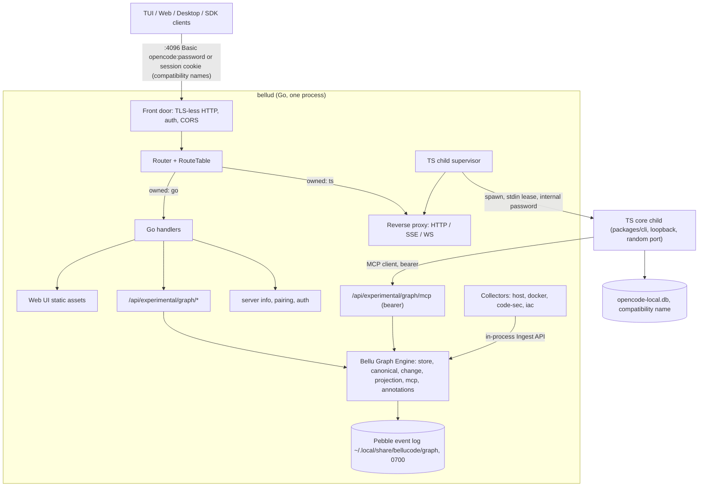
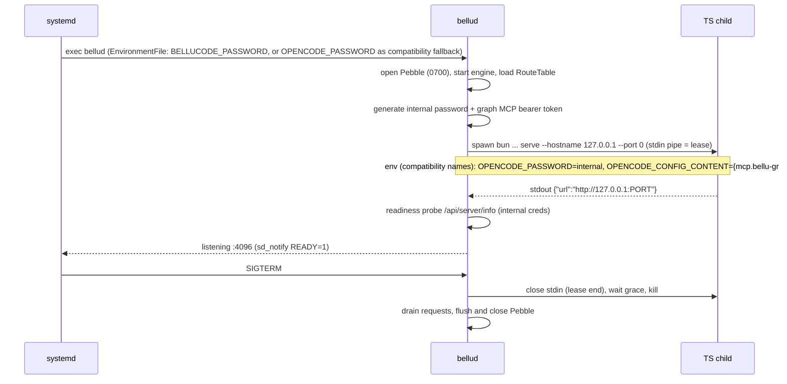
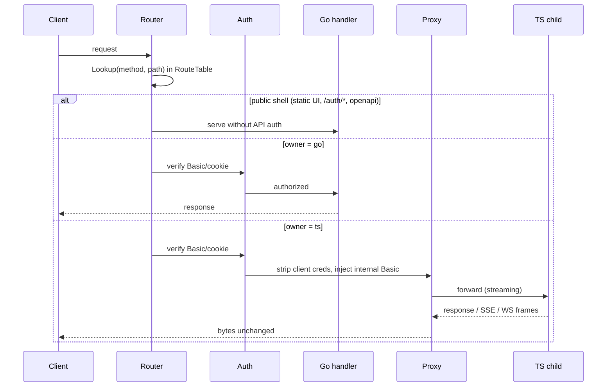

# Design Document: Go Server with Bellu Graph Engine

## Overview

`bellud` is a new Go service (`services/bellud`) that becomes the single externally exposed server process on `:4096` (default `127.0.0.1`). It replaces `packages/cli serve` as the front door. It embeds a vendored, renamed copy of the Toise graph engine, called the **Bellu Graph Engine**, and runs it in-process. Collectors write into it through a Go Ingest API with no network hop.

The existing TypeScript server (`packages/server`, about 37 `HttpApi` groups in `packages/protocol/src/groups`, SQLite via Drizzle) cannot be rewritten at once. `bellud` therefore spawns it as a loopback-only child and reverse-proxies every route it does not yet own, including SSE and WebSocket. Route groups then move from TS to Go in stages. A route ownership table plus contract tests against the `packages/protocol` schemas keep the Go handlers compatible with the generated TS client used by the TUI, web app and desktop app. The end state removes the TS server package.

Toise's engine lives entirely under `internal/`, so it cannot be imported. It is copied. A deterministic sync tool (`script/sync-bellu-graph`) copies a pinned upstream commit and rewrites all names. After the rename, upstream changes arrive by re-running the tool at a new commit, not by git merge. Apache-2.0 obligations are preserved (LICENSE kept, NOTICE added, modified files marked).

### Design decisions

| Decision | Rationale |
|---|---|
| Go front door with TS child behind a proxy | Lets the server migrate incrementally; clients see one origin and one credential. |
| Engine in-process, not a sidecar | No network hop for collectors; one process lifecycle; Pebble is single-writer anyway. |
| Copy plus rename tool, not fork-and-merge | Renaming touches almost every file, so merges would conflict constantly. A deterministic transform is auditable and repeatable. |
| Graph API is `/api/experimental/graph/*` | Repo rule: new endpoints start experimental. |
| Go validates the external password; TS child gets a separate internal credential | The external secret never reaches the child's environment or tools, and child compromise does not leak it. |
| Route ownership table is the single source of routing truth | Totality and disjointness become testable properties. |

### Naming

Everything new this spec introduces uses bellucode naming. Existing opencode names in the repo are not renamed now; they will be renamed gradually later. New bellucode names:

- Go module root `github.com/bellu/bellucode`; bellud module `github.com/bellu/bellucode/services/bellud`; vendored engine `github.com/bellu/bellucode/services/bellud/internal/bellugraph`.
- Data and config dirs: graph data in `~/.local/share/bellucode/graph` (0700); any other config or data bellud generates goes under `~/.config/bellucode/` or `~/.local/share/bellucode/`.
- bellud env vars: `BELLUCODE_PASSWORD`, `BELLUCODE_HOSTNAME`, `BELLUCODE_PORT`, `BELLUCODE_CORS`, `BELLUCODE_WEB_DIST`. Graph engine env stays `BELLU_GRAPH_*`. Compatibility fallback: when `BELLUCODE_PASSWORD` is unset, bellud reads `OPENCODE_PASSWORD`, so the existing systemd `EnvironmentFile` (`~/.config/bellucode/env`, which currently sets `OPENCODE_PASSWORD`) keeps working during the switch.
- Systemd unit stays `bellucode.service`.
- Feature flag `bellu_graph`, MCP server entry `bellu-graph`, skill `security-context`, agent `security`.

Compatibility names (kept because new code must interoperate with existing TS code; each is marked "(compatibility name)" where it appears):

- Env vars passed to the TS child: `OPENCODE_PASSWORD`, `OPENCODE_CONFIG_CONTENT`, `OPENCODE_CONFIG_DIR`.
- Basic-auth username `opencode`.
- Session cookie `opencode_session[_<port>]`.
- HMAC context string `opencode-session-v1`.
- `@opencode/*` package imports and existing files and paths under `packages/*`.
- The TS child's data dir and database (`~/.local/share/opencode/opencode-local.db`).

The rename tool's scope is only Toise to Bellu Graph Engine. It never rewrites opencode names in the existing repo.

### Out of scope

- Rewriting all TS route groups in this spec. The migration mechanism and the first stage are in scope; later stages are tracked as ordered work.
- Network-exposed OTLP ingestion by default (the listener exists but is disabled).
- Windows prebuilt engine binaries from upstream (we cross-compile ourselves).

## Architecture



### Process model



### Request routing



## Components and Interfaces

All code is Go unless noted. Paths are relative to `services/bellud`.

### Component 1: Front door and router (`internal/server`)

**Purpose**: Listen, authenticate, and dispatch every request through the RouteTable.

```go
type Owner string

const (
	OwnerGo Owner = "go"
	OwnerTS Owner = "ts"
)

type Route struct {
	Method  string // "GET", "POST", ... or "*" for any
	Pattern string // path pattern, "{param}" segments, trailing "/*" for prefix
	Group   string // protocol group, e.g. "session", "pty", "graph"
	Owner   Owner
	Public  bool   // served before authentication (web shell)
	Stream  bool   // SSE or WebSocket; proxy must not buffer
}

type RouteTable interface {
	Lookup(method, path string) (Route, bool)
	Routes() []Route
}

type Server struct {
	Table   RouteTable
	Auth    Authenticator
	Go      http.Handler // Go-owned handlers
	Proxy   http.Handler // reverse proxy to TS child
}

func (s *Server) ServeHTTP(w http.ResponseWriter, r *http.Request)
```

**Responsibilities**:
- Resolve ownership via the table. A request with no matching route goes to TS (default owner) so unmigrated or newly added TS routes keep working. The table test (below) still requires every protocol route to be listed explicitly.
- Serve public routes before API auth, matching `packages/cli/src/services/web-ui.ts` (the web shell is served so a signed-out browser gets the sign-in screen; `/api`, `/api/*`, `/auth/*`, `/openapi.json` go to the API side).
- Apply CORS from `--cors` / service config.

### Component 2: Authenticator (`internal/auth`)

**Purpose**: Mirror `packages/server/src/auth.ts` exactly so existing clients keep working. The username, cookie name and HMAC context string below keep their opencode names because existing clients and the TS implementation depend on them (compatibility names). The configured password is read from `BELLUCODE_PASSWORD`, falling back to `OPENCODE_PASSWORD` when unset (compatibility fallback).

```go
type Authenticator interface {
	// Authorize accepts Basic (username "opencode") with the password or a valid session token as the password,
	// or the session cookie named by SessionCookieName(host).
	Authorize(r *http.Request) bool
	IssueSession(now time.Time) (token string, ok bool)
	VerifySession(token string, now time.Time) bool
}

const SessionTTL = 30 * 24 * time.Hour
const Username = "opencode"

// SessionCookieName returns "opencode_session_<port>" when the Host has a port, else "opencode_session".
func SessionCookieName(host string) string
```

Session token format: `"<expiresUnixSec>.<base64url(HMAC(key, expires))>"` where `key = HMAC-SHA256(password, "opencode-session-v1")`. Comparison uses `subtle.ConstantTimeCompare`. Rotating the password revokes all sessions.

### Component 3: TS child supervisor (`internal/tschild`)

**Purpose**: Start, watch and stop the TS core as a loopback-only child.

```go
type Child struct {
	URL      *url.URL // http://127.0.0.1:<port>
	Password string   // internal credential, never logged
}

type Supervisor interface {
	Start(ctx context.Context, cfg ChildConfig) (*Child, error)
	Wait() <-chan error // child exit
	Stop(ctx context.Context) error // close stdin lease, grace, kill
}

type ChildConfig struct {
	Command      []string          // bun run src/index.ts serve --hostname 127.0.0.1 --port 0 (cwd packages/cli)
	Env          map[string]string // compatibility names: OPENCODE_PASSWORD=<internal>, OPENCODE_CONFIG_CONTENT=<graph MCP config>
	StartTimeout time.Duration     // default 30s
}
```

Follows `packages/cli/src/services/standalone.ts`: password in the child env only, stdin pipe as the ownership lease (EOF ends the child), readiness from the `{"url": ...}` stdout line then a probe. Unexpected child exit triggers restart with capped exponential backoff; while restarting, TS-owned routes return `503` with `Retry-After`. Go-owned routes stay available.

### Component 4: Reverse proxy (`internal/proxy`)

**Purpose**: Forward TS-owned routes byte-for-byte, including streaming.

```go
func New(child func() *Child) http.Handler
```

Requirements: `httputil.ReverseProxy` with `FlushInterval = -1` for `Stream` routes and `text/event-stream`; hop-by-hop headers removed; `Authorization` and `Cookie` for the external credential removed and replaced with the internal Basic credential; `X-Forwarded-*` set; WebSocket upgrade handled by hijack-and-splice (bidirectional `io.Copy`) with close frames passed through; bodies are never read or re-encoded; `Content-Encoding` and `Content-Length` untouched. The `Host` header is preserved so the TS side computes the same cookie name and pairing URLs.

### Component 5: Bellu Graph Engine (`internal/bellugraph`)

**Purpose**: Vendored, renamed Toise engine. Same sub-packages as upstream minus `demo`: `annotations, audit, auth, canonical, change, config, debugui, graphql, ingest, logship, mcp, metrics, model, oidc, ops, projection, registry, store, tenant, version`, plus `pkg/emit` and `proto/bellugraph/v1/events.proto`.

bellud-owned facade (the only surface the rest of bellud uses):

```go
package graph

type Engine interface {
	Ingest() Ingest
	Query() Query
	MCPHandler() http.Handler // streamable HTTP MCP; bearer-token protected
	Close(ctx context.Context) error
}

type Ingest interface {
	// Apply appends one observation batch from a collector as a single atomic log append.
	Apply(ctx context.Context, b Batch) (Receipt, error)
}

type Query interface {
	Entity(ctx context.Context, id EntityID, at *time.Time) (Entity, error)
	Find(ctx context.Context, q FindQuery) (Page[Entity], error)
	Neighbors(ctx context.Context, id EntityID, opt NeighborOpts) ([]Edge, error)
	History(ctx context.Context, id EntityID, r TimeRange) ([]Change, error)
	Changes(ctx context.Context, r TimeRange, f ChangeFilter) (Page[Change], error)
	Diff(ctx context.Context, from, to time.Time) (Diff, error)
}

func Open(ctx context.Context, cfg Config) (Engine, error)
```

The facade isolates the vendored packages so a later sync only has to fix this one adapter file. MCP tools exposed (names unchanged from upstream): `describe_schema, describe_type, find_entities, get_entity, annotate_entity, get_neighbors, find_path, impact_of, entity_history, recent_changes, graph_diff, telemetry_keys`.

### Component 6: Collectors (`internal/collectors`)

```go
type Collector interface {
	Name() string
	Interval() time.Duration
	// Collect returns the full current observation for its scope; the engine's change taxonomy derives
	// added/changed/removed by diffing against the projection.
	Collect(ctx context.Context) (graph.Batch, error)
}
```

| Collector | Source | Entities |
|---|---|---|
| `host` | `/proc` (processes, `net/tcp*`, `net/udp*`), `os.Hostname` | `host`, `process`, `listening_port` |
| `docker` | Docker socket (read-only API) | `container`, `image`, `network`, `volume` |
| `codesec` | `package.json`, `bun.lock`, `go.mod`, `requirements.txt`, `.github/workflows/*.yml` | `repository`, `dependency`, `workflow`, `secret_ref` |
| `iac` | Terraform `*.tf`, Kubernetes manifests | `iac_resource`, `k8s_object` |
| `secrets` | file scan with rule set | `secret_finding` (metadata only) |

Constraints driven by Toise: **relations carry no attributes**, so qualifiers (for example a dependency's version range, a workflow permission scope, a port's protocol) live on entities. Where a relation would need a qualifier, the design introduces an intermediate entity (for example `dependency` is keyed by `(repo, name, range)` and relation `repo -> dependency` is plain).

### Component 7: Redaction guard (`internal/redact`)

```go
type Guard interface {
	// Scrub is the final guard applied to every Batch before it reaches the engine.
	Scrub(b graph.Batch) graph.Batch
}
```

Patterns are the `redaction` key patterns from `/home/ubuntu/bellu-ai-cyber/bellu.yaml`, compiled into `internal/redact/patterns.go` by `go generate` (so bellud has no runtime dependency on that repo). Secret findings store only `{path, line, rule_id, hash_prefix}` where `hash_prefix` is the first 8 hex characters of `SHA-256(value)`. The secret value never leaves the scanner function. Any attribute string still matching a pattern after collection is replaced with `[REDACTED:<rule_id>]`.

### Component 8: Graph HTTP API and protocol contract

**Contract** (TS, `packages/protocol/src/groups/experimental-graph.ts`, following the existing `experimental.ts` group conventions):

```ts
// OpenAPI identifiers must be `experimental.graph.<method>` and paths `/api/experimental/graph/...`
// (enforced by packages/protocol/test/experimental-identifiers.test.ts).
// Description of each endpoint: "Experimental: may change without compatibility guarantees."
export const ExperimentalGraphGroup = HttpApiGroup.make("experimental.graph")
  .add(HttpApiEndpoint.get("experimental.graph.entity", "/api/experimental/graph/entities/:id", { ... }))
  .add(HttpApiEndpoint.get("experimental.graph.find", "/api/experimental/graph/entities", { ... }))
  .add(HttpApiEndpoint.get("experimental.graph.neighbors", "/api/experimental/graph/entities/:id/neighbors", { ... }))
  .add(HttpApiEndpoint.get("experimental.graph.history", "/api/experimental/graph/entities/:id/history", { ... }))
  .add(HttpApiEndpoint.get("experimental.graph.changes", "/api/experimental/graph/changes", { ... }))
  .add(HttpApiEndpoint.get("experimental.graph.diff", "/api/experimental/graph/diff", { ... }))
  .add(HttpApiEndpoint.get("experimental.graph.schema", "/api/experimental/graph/schema", { ... }))
  .add(HttpApiEndpoint.get("experimental.graph.status", "/api/experimental/graph/status", { ... }))
```

Wire schemas live in `packages/schema/src/graph.ts` (browser-safe, `Graph.Entity`, `Graph.Change`, ...; optional fields via `optional(...)`, no `Schema.Any`, stable `Graph.*` identifiers; tests per `packages/schema/AGENTS.md`). After the contract change, run `bun run generate` in `packages/client`.

**Go side**: handlers in `internal/api/graph`, owner `go`. The TS server never implements these endpoints; it is not aware of them. Because the TS `Api` is the source of `openapi.json`, `bellud` serves a merged document (see "OpenAPI merge" below). The MCP endpoint `/api/experimental/graph/mcp` is Go-owned and accepts only the graph bearer token (not the user password) so the agent credential has no access to the rest of the API.

A feature flag `bellu_graph` (key and description in `packages/schema/src/config/flag.ts`, read with `Flag.enabled("bellu_graph")` in the TS clients that surface it) gates TS-side surfaces: MCP config injection, the security agent and skill registration. The Go engine itself is controlled by `BELLU_GRAPH_ENABLED` (default on in dev builds, off in release until the flag is deleted).

### Component 9: Agent wiring

bellud builds `OPENCODE_CONFIG_CONTENT` (compatibility name; the TS child reads it) for the child, merged with any inbound `OPENCODE_CONFIG_CONTENT`:

```json
{
  "mcp": {
    "bellu-graph": {
      "type": "remote",
      "url": "http://127.0.0.1:4096/api/experimental/graph/mcp",
      "headers": { "Authorization": "Bearer <generated per start>" },
      "oauth": false
    }
  }
}
```

This matches `Mcp.RemoteConfig` in `packages/schema/src/mcp.ts`. The URL targets bellud's own public listener (so the MCP route stays single-owner Go), and the bearer token is regenerated each start and held in memory. A built-in `security-context` skill (how to query the graph, which tools exist, never request secret values) and a `security` agent definition ship as embedded files that bellud writes to a new generated config directory under `~/.config/bellucode/` (for example `~/.config/bellucode/generated`). That directory is passed to the child through `OPENCODE_CONFIG_DIR` (compatibility name) when the user has not set one; otherwise the definitions are injected via `OPENCODE_CONFIG_CONTENT` (compatibility name).

### Component 10: Web UI serving (`internal/webui`)

Go serves `packages/app/dist` (embedded with `go:embed` for release builds; read from disk in dev via `BELLUCODE_WEB_DIST`). Behavior copies `web-ui.ts`: path to file with fallback to `index.html`, `404` for missing `_assets/` and `icons/`, `no-cache` for HTML/`sw.js`/`registerSW.js`, `immutable` for the rest, brotli precompressed variants when `Accept-Encoding` allows (never for `index.html`), `nosniff`, and the same CSP including the sha256 of the inline `oc-theme-preload-script`. This is migration stage 2.

## Data Models

### Route ownership table (`internal/server/routes.yaml`, embedded)

```go
type RouteFile struct {
	Version int     `yaml:"version"`
	Routes  []Route `yaml:"routes"`
}
```

Rules:
- Every operation in the generated protocol OpenAPI (`openapi.json` from the TS `Api`) appears exactly once, matched by `(method, path)`.
- `Owner` is `go` or `ts`.
- A route is `go` only if a handler is registered and its contract test is green.
- Experimental graph routes are `go` and exist only in the Go-side contract.

### Graph engine configuration

```go
type Config struct {
	Dir          string        // ~/.local/share/bellucode/graph, created 0700
	Retention    time.Duration // 0 = keep forever
	OTLPListen   string        // "" disables the OTLP listener (default)
	MCPToken     string        // bearer for the MCP endpoint
	MetricsAddr  string        // optional
}
```

Environment (renamed from `TOISE_*`): `BELLU_GRAPH_ENABLED`, `BELLU_GRAPH_DIR`, `BELLU_GRAPH_OTLP_LISTEN`, `BELLU_GRAPH_RETENTION`, `BELLU_GRAPH_LOG_LEVEL`.

### Rename map (`services/bellud/script/rename.map.yaml`)

```go
type RenameRule struct {
	Kind    string // "module" | "identifier" | "env" | "proto" | "metric" | "uri" | "binary" | "text" | "path"
	From    string
	To      string
	Scope   string // glob of files the rule applies to; "" = all
	Exact   bool   // whole-token match
}
```

| Kind | From | To |
|---|---|---|
| module | `github.com/toise-dev/toise` | `github.com/bellu/bellucode/services/bellud/internal/bellugraph` |
| proto package | `toise.v1` | `bellugraph.v1` |
| proto path | `proto/toise/v1` | `proto/bellugraph/v1` |
| env | `TOISE_` prefix | `BELLU_GRAPH_` prefix |
| metric | `toise_` prefix | `bellu_graph_` prefix |
| uri scheme | `toise://` | `bellugraph://` |
| identifier | `Toise`, `toise` (Go idents, word-bounded) | `BelluGraph`, `bellugraph` |
| user-facing text | `Toise` | `Bellu Graph Engine` |
| binary | `toise`, `toised` | `bellu-graph` (not shipped separately; engine is linked into bellud) |
| path | `**/toise*` | `**/bellugraph*` |

The rename tool's scope is only Toise to Bellu Graph Engine, applied to the vendored upstream tree. It never rewrites opencode names in the existing repo. User-visible strings (debug UI titles, MCP server `name`/`instructions`, docs) use the human name "Bellu Graph Engine". Code identifiers use `bellugraph`. Rules are ordered and the order is part of the tool's determinism. A leftover check fails the run if any case-insensitive `toise` remains outside `NOTICE`, `UPSTREAM.md` and the license-attribution blocks.

### Provenance (`internal/bellugraph/UPSTREAM.md`)

```go
type Upstream struct {
	Repo    string // https://github.com/toise-dev/toise
	Commit  string // full 40-char SHA
	License string // Apache-2.0
	SyncedAt string // intentionally NOT written; keeps output deterministic
	ToolVersion string
}
```

### Graph event shape (renamed, informative)

Events are bi-temporal: `observed_at` (valid time) and `recorded_at` (transaction time, assigned by the engine at append). Entity identity is `id = H(kind || canonical(identity_attrs))`.

## Algorithmic Pseudocode

### Algorithm A: Route resolution

```go
// Lookup returns the most specific match: exact segments beat "{param}", "{param}" beats "/*" prefix;
// method-specific beats "*". Ties are impossible because Validate rejects overlapping equal-specificity routes.
func (t *table) Lookup(method, path string) (Route, bool) {
	best, found := Route{}, false
	for _, r := range t.byGroupIndex(path) { // trie keyed by path segments
		if !methodMatches(r.Method, method) || !patternMatches(r.Pattern, path) {
			continue
		}
		if !found || moreSpecific(r, best) {
			best, found = r, true
		}
	}
	return best, found
}
```

**Preconditions:**
- Table passed `Validate()` (below).
- `path` is the cleaned request path (no query string).

**Postconditions:**
- Returns at most one route; the result is independent of table iteration order.
- If `found` is false, the dispatcher uses `OwnerTS`.

**Loop invariant:** `best` is the most specific match among candidates examined so far.

```go
// Validate enforces totality against the protocol operation list and disjointness among routes.
func Validate(routes []Route, ops []Operation) error {
	// Disjointness: no two routes may match the same (method, concrete path) at equal specificity.
	for i := range routes {
		for j := i + 1; j < len(routes); j++ {
			if overlapsAtEqualSpecificity(routes[i], routes[j]) {
				return fmt.Errorf("routes %q and %q overlap", routes[i].Pattern, routes[j].Pattern)
			}
		}
	}
	// Totality: every protocol operation resolves to exactly one route.
	for _, op := range ops {
		if _, ok := resolve(routes, op.Method, op.ExamplePath); !ok {
			return fmt.Errorf("operation %s %s has no owner", op.Method, op.Path)
		}
	}
	return nil
}
```

**Loop invariants:** Outer loop: all pairs `(a, b)` with `a < i` are disjoint. Totality loop: all earlier operations have an owner.

### Algorithm B: Authorization

```go
func (a *auth) Authorize(r *http.Request) bool {
	if a.password == "" {
		return false
	}
	if user, pass, ok := r.BasicAuth(); ok {
		return user == Username && (ctEq(pass, a.password) || a.VerifySession(pass, time.Now()))
	}
	if c, err := r.Cookie(SessionCookieName(r.Host)); err == nil {
		return a.VerifySession(c.Value, time.Now())
	}
	return false
}
```

**Preconditions:** `a.password` fixed for the process lifetime.

**Postconditions:** Returns true iff credentials are the password or an unexpired, correctly signed session token for the configured password. No panics on malformed headers. Comparison is constant-time.

### Algorithm C: Proxying a request

```go
func (p *proxy) ServeHTTP(w http.ResponseWriter, r *http.Request) {
	child := p.child()
	if child == nil {
		w.Header().Set("Retry-After", "2")
		http.Error(w, "upstream starting", http.StatusServiceUnavailable)
		return
	}
	out := r.Clone(r.Context())
	out.Header.Del("Authorization")
	out.Header.Del("Cookie") // external session cookie is meaningless to the child
	out.SetBasicAuth(Username, child.Password)
	if isUpgrade(r) {
		p.splice(w, out, child) // hijack both sides, copy until either closes
		return
	}
	p.rp(child).ServeHTTP(w, out) // FlushInterval -1
}
```

**Preconditions:** The caller authorized `r` and the route owner is `ts`.

**Postconditions:**
- Response status, headers (minus hop-by-hop) and body bytes equal the child's.
- Streaming frames are forwarded without waiting for the body to end.
- The external credential never appears in the forwarded request.

### Algorithm D: Child lifecycle with backoff

```go
func (s *supervisor) run(ctx context.Context) {
	delay := 500 * time.Millisecond
	for ctx.Err() == nil {
		child, err := s.start(ctx)
		if err == nil {
			s.publish(child)
			delay = 500 * time.Millisecond
			err = <-s.exitCh(child)
			s.publish(nil)
		}
		select {
		case <-ctx.Done():
			return
		case <-time.After(delay):
		}
		delay = min(delay*2, 15*time.Second)
	}
}
```

**Loop invariant:** `s.current` is non-nil only while a started child has not exited.

### Algorithm E: Scrub and ingest

```go
func (c *runner) tick(ctx context.Context, col Collector) error {
	batch, err := col.Collect(ctx)
	if err != nil {
		return err
	}
	batch = c.guard.Scrub(batch)
	if c.guard.Leaks(batch) { // belt and braces: refuse to append if any pattern still matches
		return ErrSecretLeak
	}
	_, err = c.engine.Ingest().Apply(ctx, batch)
	return err
}
```

**Postconditions:** No string in any appended event matches a redaction pattern. A leak aborts the batch and raises an audit event naming the collector and rule only.

### Algorithm F: Sync and rename tool

`script/sync-bellu-graph <commit>` (Go program `services/bellud/cmd/sync-bellu-graph`; a shell wrapper calls it).

```go
func Sync(commit string, out string, rules []RenameRule) error {
	src := fetchTarball(commit) // pinned SHA, verified against go.sum-style checksum in UPSTREAM.md
	files := walk(src, include, exclude("internal/demo/**", ".git/**", "**/*_test_fixtures_large/**"))
	sort.Strings(files) // deterministic order
	staging := tempDir()
	for _, f := range files {
		b := read(f)
		b = applyRules(rules, f, b)       // ordered rules
		b = markModified(f, b)            // Apache-2.0 §4(b) header comment on source files
		write(staging, renamePath(rules, f), normalizeEOL(b))
	}
	copyVerbatim(src, "LICENSE", staging)
	writeNotice(staging, commit)
	writeUpstream(staging, commit)
	regenerateProto(staging)             // buf/protoc for bellugraph.v1, outputs committed
	regenerateGraphQL(staging)           // gqlgen
	assertNoLeftovers(staging, "toise")
	return atomicReplace(out, staging)   // swap directory; remove files that disappeared upstream
}
```

**Preconditions:** `commit` is a full SHA; network or a local cache of the tarball is available; `rules` validated (no rule's `To` re-matches an earlier rule's `From`).

**Postconditions:**
- Output depends only on `(commit, rules, tool version)`.
- Running again on the same inputs yields a byte-identical tree.
- Output contains no case-insensitive `toise` except in `NOTICE`, `UPSTREAM.md` and attribution comments.
- Output contains LICENSE (unmodified Apache-2.0), NOTICE and `UPSTREAM.md`; each modified source file carries the modification notice.
- Output compiles: `go build ./...` and `go vet ./...` pass (checked by the CI job, not by the tool).

**Loop invariant:** Every file already written to `staging` is fully transformed and has no leftover match.

`markModified` is idempotent: it inserts the header only if the marker line is absent.

### Algorithm G: As-of query

```go
// Entity state at T is a fold over the event log up to T on the valid-time axis (observed_at <= T),
// restricted to events recorded by the requested transaction time (recorded_at <= asOfRecorded, default now).
func (e *engine) EntityAt(id EntityID, t time.Time) (Entity, error) {
	state := Entity{}
	for ev := range e.store.Scan(id, Until(t)) {
		state = projection.Apply(state, ev)
	}
	return state, nil
}
```

**Postcondition:** `Query.Entity(id, &t)` returns the same value as folding `projection.Apply` over `Scan(id, Until(t))` from the empty state. Snapshots or caches are an optimization and must not change the result.

**Loop invariant:** `state` equals the fold of all events with `observed_at <= ` the last event examined.

## Key Functions with Formal Specifications

### `identity.Hash`

```go
func Hash(kind string, identityAttrs map[string]string) EntityID
```

**Preconditions:** `kind` non-empty; keys are the registered identity attributes for `kind`.

**Postconditions:** Pure and deterministic: independent of map iteration order, process, platform and run. Equal inputs give equal IDs; any difference in `kind` or an identity attribute value gives a different ID (modulo hash collision). Attributes not in the identity set do not affect the result.

### `redact.Guard.Scrub`

```go
func (g *guard) Scrub(b graph.Batch) graph.Batch
```

**Postconditions:** Returns a batch with the same entity IDs and structure; no string field matches any pattern; idempotent (`Scrub(Scrub(b)) == Scrub(b)`); does not mutate its input.

### `auth.VerifySession`

```go
func (a *auth) VerifySession(token string, now time.Time) bool
```

**Postconditions:** True iff token is `"<exp>.<sig>"`, `exp` is a safe integer greater than `now`, and `sig` equals the HMAC for the current password. A token issued by the TS implementation verifies in Go and the reverse (cross-implementation compatibility).

### `routes.Validate`

See Algorithm A. **Postcondition:** returns nil iff the table is total over the protocol operations and pairwise disjoint.

### `contract.Check`

```go
// Check replays golden request/response pairs captured from the TS server against a Go handler and
// validates the response against the JSON Schema derived from packages/protocol for that operation.
func Check(op Operation, h http.Handler, fixtures []Fixture) []Violation
```

**Postconditions:** No violations means every fixture yields the same status, content type and a body that validates against the operation's success or declared error schema, and SSE operations emit events whose payloads validate against the event schemas.

## Example Usage

```go
// main.go: wiring
func main() {
	cfg := config.FromEnv() // BELLUCODE_PASSWORD (fallback OPENCODE_PASSWORD), BELLUCODE_HOSTNAME, BELLUCODE_PORT, BELLUCODE_CORS
	eng, _ := graph.Open(ctx, cfg.Graph)
	defer eng.Close(ctx)

	sup := tschild.New(cfg.Child(eng.MCPToken())) // injects mcp.bellu-graph config
	go sup.Run(ctx)

	table := routes.MustLoadEmbedded()
	srv := &server.Server{
		Table: table,
		Auth:  auth.New(cfg.Password),
		Go:    api.New(eng, webui.New(cfg.WebDist), pairing.New(cfg.Password)),
		Proxy: proxy.New(sup.Current),
	}
	runCollectors(ctx, eng, collectors.Default(cfg))
	http.ListenAndServe(cfg.Addr, srv)
}
```

```go
// Collector appends a scrubbed finding (metadata only)
batch.Entities = append(batch.Entities, graph.Entity{
	Kind: "secret_finding",
	Identity: map[string]string{"path": rel, "line": "42", "rule": "aws_access_key"},
	Attrs:    map[string]string{"hash_prefix": hex8(sha256(value))}, // value discarded immediately
})
```

```bash
# Sync the vendored engine to a new upstream commit
script/sync-bellu-graph 3f2a9c1d... && git diff --stat services/bellud/internal/bellugraph
```

```ts
// Client: no change needed after `bun run generate`; the typed client gains the graph namespace
const changes = await client.experimental.graph.changes({ query: { since: "2026-01-01T00:00:00Z" } })
```

## Route Migration Plan

Stage order (each stage flips `Owner` for its groups only after contract tests pass):

1. **Stage 0 (this spec):** bellud as proxy front door; Go owns `experimental.graph.*`, graph MCP, and nothing else. All other routes `ts`.
2. **Stage 1:** auth and pairing (`/auth/*`, session issue/verify), web UI static assets.
3. **Stage 2:** server info, health, event feed (SSE, `event` group).
4. **Stage 3+:** remaining groups, ordered by dependency on the SQLite/Drizzle data and the session runtime: `config`, `project`, `fs`, `vcs`, `shell`, `pty`/`persistent-pty` (WebSocket), `mcp`, `plugin`, `integration`, `credential`, then `session`, `message`, `generate`, and the LLM runtime last.
5. **End state:** all routes `go`; the child supervisor and `packages/server` removed; `packages/cli serve` and `packages/cli/src/services/web-ui.ts` deleted or reduced to launching bellud.

The TS plugin system and the LLM session runtime are the largest unknowns. If they are not ported, the end state "TS removed" is not reachable and the child stays for those groups. That is an explicit open decision, called out in Risks.

Shared state during coexistence: SQLite `opencode-local.db` (compatibility name, in the TS child's `~/.local/share/opencode/` data dir) is owned by the TS child. A Go-owned group that needs session data calls the TS child's HTTP API (internal credential) until its data layer is ported. Go never opens the TS database concurrently, to avoid migration and locking conflicts.

### OpenAPI merge

`/openapi.json` is generated in bellud by fetching the child's document at start (internal credential), then adding Go-owned operations from a build-time-embedded Go contract document (generated from the same TS protocol group via the `packages/client` generator), then removing operations whose owner is `go` but which the child still declares. Result is cached until the child restarts.

## Error Handling

### Child not ready or crashed
**Condition:** TS-owned route requested while child is starting or restarting.
**Response:** `503` with `Retry-After: 2` and a JSON error body in the protocol's error shape.
**Recovery:** Supervisor restarts with backoff (500 ms to 15 s). Go-owned routes continue. `/api/experimental/graph/status` reports child state.

### Child startup failure repeated
**Condition:** More than N consecutive failures within a window.
**Response:** bellud keeps serving Go routes and logs the child's last stderr lines; `status` shows `degraded`.
**Recovery:** Operator fixes the cause; the next successful start clears the state.

### Pebble open failure or corruption
**Condition:** Directory locked by another process, permissions not `0700`, or corrupt log.
**Response:** Engine disabled, graph routes return `503` with `code: "graph_unavailable"`; the rest of bellud starts normally. Lock contention is logged with the holder's path.
**Recovery:** Fix permissions or restore; the engine is opened again on restart. Opening never silently creates a new empty log over a corrupt one.

### Collector failure
**Condition:** A collector errors or times out (for example Docker socket missing).
**Response:** Log once per backoff window, record a `collector_status` entity attribute, continue other collectors.
**Recovery:** Next interval retries; absence of Docker is a normal state, not an error.

### Secret leak detected
**Condition:** `Guard.Leaks` finds a match after scrubbing.
**Response:** Batch dropped, audit event with collector and rule id only.
**Recovery:** Collector bug is fixed; the next batch is evaluated independently.

### Authentication failure
**Condition:** Missing or invalid credentials on a non-public route.
**Response:** `401` with `WWW-Authenticate: Basic`, identical to the TS server. The graph MCP endpoint answers `401` for anything but its bearer token.

### Sync tool failure
**Condition:** Leftover `toise`, rule conflict, build failure.
**Response:** Non-zero exit; the staging directory is discarded and the existing vendored tree is untouched (atomic replace).

## Testing Strategy

### Unit testing approach

- Go: `go test ./...` in `services/bellud`, table-driven. Auth compatibility vectors generated by the TS implementation and committed as fixtures (token and expected result).
- TS: protocol and schema tests per `packages/schema/AGENTS.md` (optional fields omit `undefined`, no `Schema.Any`, stable unique identifiers) and `packages/protocol/test/experimental-identifiers.test.ts`. Run from `packages/schema` and `packages/protocol`, never from the root.
- Vendored upstream tests are renamed and kept; they must pass after each sync.

### Property-based testing approach

**Libraries:** Go `pgregory.net/rapid`; TS `fast-check` (already the usual choice with bun test) for protocol schemas.

### Integration testing approach

- Spawn real bellud with a real TS child in a temp HOME; run the generated TS client smoke tests (`session` list, `server` info, event stream) through it.
- Kill the child during an open SSE stream; assert the client sees a clean close and later requests succeed after restart.
- Run the TUI `dev:live` flow against bellud.
- A cross-implementation contract job runs the same fixture set against the TS server and against Go for every `go`-owned operation.

## Correctness Properties

### Property 1: Rename idempotence and determinism

**Rename idempotence and determinism.** For any commit tree `T` and valid rules `R`: `Sync(T, R)` run twice yields byte-identical output; `rename(rename(x)) == rename(x)` for any text `x` (no rule's output matches any rule's input).

**Validates: Requirements 8.4, 8.5, 8.6, 8.7, 8.8**

### Property 2: No leftover upstream names

**No leftover upstream names.** For all files `f` in the output outside the allow-list, `!containsFold(f, "toise")`; all `TOISE_` env references became `BELLU_GRAPH_`; no `toise_` metric names remain.

**Validates: Requirements 9.1, 9.2, 9.3, 9.4**

### Property 3: License preservation

**License preservation.** Output contains a byte-identical upstream LICENSE; NOTICE names the upstream commit; every transformed `.go` file contains the modification marker exactly once.

**Validates: Requirements 10.1, 10.2, 10.3, 10.4, 10.5**

### Property 4: No secret bytes in stored events

**No secret bytes in stored events.** For any source file content containing generated secrets matching any redaction pattern, after `collect -> Scrub -> Apply`, no stored event (raw log bytes scanned) contains the secret or any substring of it longer than the 8-char hash prefix.

**Validates: Requirements 14.13, 15.6, 15.7, 15.8**

### Property 5: Scrub idempotence

**Scrub idempotence.** `Scrub(Scrub(b)) == Scrub(b)` and `Scrub(b)` preserves entity IDs.

**Validates: Requirements 15.2, 15.3, 15.4, 15.5**

### Property 6: Proxy transparency

**Proxy transparency.** For any request `r` (method, headers excluding hop-by-hop and credentials, body bytes) the child receives the same bytes; for any child response, the client receives the same status, end-to-end headers and body bytes, including chunked bodies of arbitrary split.

**Validates: Requirements 5.1, 5.3, 5.4, 5.5, 5.7**

### Property 7: Streaming preserved

**Streaming preserved.** For an SSE or WebSocket route, every chunk or frame sent by the child is observable at the client before the stream ends (latency bounded by the flush interval, no whole-body buffering); frame order and content are preserved in both directions.

**Validates: Requirements 6.1, 6.2, 6.3, 6.4, 6.5**

### Property 8: Credential isolation

**Credential isolation.** For any proxied request, the child sees the internal credential and never the external one; the external password never appears in the child's env, args or logs.

**Validates: Requirements 7.1, 7.2, 4.2, 4.13**

### Property 9: Identity hash determinism

**Identity hash determinism.** For any `(kind, attrs)`, `Hash` is invariant under attribute map ordering and process; `Hash(k, a) == Hash(k, b)` iff identity attributes equal; non-identity attributes never change the hash.

**Validates: Requirements 13.1, 13.2, 13.3, 13.4**

### Property 10: As-of equals replay

**As-of equals replay.** For any event log and any time `T`, `Query.Entity(id, T)` equals the fold of `projection.Apply` over events with `observed_at <= T` in log order; for `T` beyond the last event it equals the current state. Snapshot/cache on or off yields the same result.

**Validates: Requirements 13.6, 13.7, 13.8, 13.9**

### Property 11: Route table total and disjoint

**Route table total and disjoint.** For the embedded table and the protocol operation list: every operation resolves to exactly one route; no two routes overlap at equal specificity; `Lookup` is invariant under table permutation.

**Validates: Requirements 1.3, 1.4, 1.7, 1.12, 2.1, 2.2, 2.3, 2.4**

### Property 12: Auth parity

**Auth parity.** For any password, time and token, Go `VerifySession` equals TS `verifySession` (fixture-driven); tokens survive password-unchanged restarts and fail after password rotation.

**Validates: Requirements 3.3, 3.4, 3.5, 3.6, 3.7, 3.8, 3.9, 3.10, 3.14**

### Property 13: Contract compatibility

**Contract compatibility.** For every `go`-owned operation and every fixture, the Go response validates against the protocol schema; flipping an operation from `ts` to `go` must not change the status code or schema validity of any recorded fixture.

**Validates: Requirements 22.1, 22.2, 22.3, 22.4, 22.5, 22.9**

### Property 14: Relation constraint

**Relation constraint.** For any batch accepted by the facade, no relation carries attributes.

**Validates: Requirements 11.14, 14.7**


## Performance Considerations

- Proxy adds one loopback hop per TS-owned request. Budget: under 1 ms median added latency for small requests; SSE has no buffering. Measured in a benchmark that gates stage promotion.
- Pebble writes are batched per collector tick; collectors use a minimum interval of 5 s (host), 30 s (docker), and on-change (file watch) for code scanning, with a size cap per file and a skip list (`node_modules`, `.git`).
- Graph queries paginate with a default limit and a hard maximum.
- WebSocket splice uses `io.Copy` with pooled buffers.

## Security Considerations

- Listener default `127.0.0.1`; any other bind requires the existing password and warns when no password is set. Child binds loopback on a random port with its own password; ports are not discoverable by tools because the child's env is scrubbed of the external credential.
- The MCP bearer token is per start, held in memory, compared in constant time, and valid only for the graph MCP route. Tool `annotate_entity` writes are audited with the token identity.
- Graph directory `0700`, files `0600`; refuse to open if group or world bits are set.
- Secret findings are metadata only; the guard runs as the last step before the engine. Debug UI is disabled by default and never exposes raw log contents when enabled.
- Vendored dependencies are pinned in `go.sum`; the sync tool verifies the tarball checksum; `govulncheck` runs in CI.
- Docker collector uses a read-only API subset and never calls exec or inspect-with-env endpoints that return environment variables; container env values are dropped, only keys are retained.

## Operations

- **Systemd:** `/etc/systemd/system/bellucode.service` `ExecStart` changes from `bun run src/index.ts serve --hostname 127.0.0.1 --port 4096` (working dir `packages/cli`) to `/usr/local/bin/bellud serve --hostname 127.0.0.1 --port 4096`; `EnvironmentFile=~/.config/bellucode/env` is unchanged and currently sets `OPENCODE_PASSWORD`, which bellud accepts as a compatibility fallback until the file is switched to `BELLUCODE_PASSWORD`. The unit stays named `bellucode.service`. `Type=notify`; `KillMode=mixed` so the child gets a clean lease close. Rollback is restoring the old `ExecStart`.
- **Build:** Turbo task `build` for `services/bellud` (`go build -trimpath -o dist/bellud ./cmd/bellud`), depends on `packages/app#build` when embedding web assets. Cross-compile targets for linux/darwin/windows via `GOOS`/`GOARCH` because upstream ships no Windows prebuilt. Go toolchain pinned to the engine's required version (1.26.9 or later) in `go.mod` and CI.
- **Config files:** `Makefile` targets `bellud`, `sync-graph`; `.gitignore` covers `services/bellud/dist`.
- **Branching and commits:** per repo rules (base `dev`, no changesets, conventional commits such as `feat(bellud): add go front door`).

## Dependencies

- Go 1.26.9 or later; `github.com/cockroachdb/pebble`, `github.com/99designs/gqlgen`, `github.com/modelcontextprotocol/go-sdk`, OpenTelemetry pdata, `google.golang.org/grpc`, `pgregory.net/rapid` (test), a YAML library for the route table.
- TS: `packages/schema`, `packages/protocol`, `packages/client` (regenerated), existing `Mcp.RemoteConfig`.
- Upstream: Toise (Apache-2.0) at a pinned commit recorded in `UPSTREAM.md`.
- Runtime: Bun and the existing `packages/cli` until the TS child is retired.

## Risks and Open Questions

| Risk | Impact | Mitigation |
|---|---|---|
| Toise is pre-1.0 | Upstream API and storage format changes | Facade isolates the adapter; pin commits; log format version stored in `UPSTREAM.md` and checked at open |
| Two runtimes until migration completes | Higher memory, harder debugging | Single supervisor, unified log prefix, `status` endpoint shows both |
| Proxy hop latency and streaming fidelity | Regressions in TUI/web | Properties 6 and 7, benchmarks gate promotion |
| Rename misses a dynamic string (for example reflection, struct tags, generated code) | Runtime mismatch with `toise` names | Leftover scan plus regenerate proto/gqlgen inside the tool, plus vendored tests |
| Relations carry no attributes | Qualifiers must be modeled as entities | Intermediate entity pattern, property 14 |
| No Windows prebuilt | Windows support needs self-build | Cross-compile in CI; Pebble and Go are portable, but `/proc` collectors are Linux-only (build-tagged, no-op elsewhere) |
| Porting the LLM runtime and plugin system to Go | May not be feasible | Treat as separate decision; the design remains valid with a permanent TS child for those groups |
| Apache-2.0 compliance after heavy renaming | Legal | NOTICE, LICENSE, modification markers, test for property 3 |

Open decisions for the requirements phase: whether to embed web assets or read from disk in release builds, and whether the TS child remains for the plugin and LLM groups at end state.
