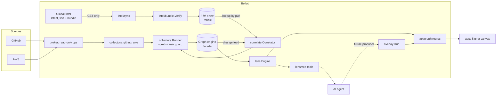

# Design Document: Unified Security Graph

> Note: Requirement 2.7 (relations carry no attributes) is amended by `.kiro/specs/aws-relationship-registry`. Relations may carry `evidence`, `confidence`, and `observed_at`; every other relation attribute is still rejected.

## Overview

Sources feed connectors, connectors feed collectors, collectors feed one graph engine (Bellud), and lenses present the engine to the UI and to AI agents over MCP. Every stage reads from the customer's systems and never writes to them.

Most of the pipeline already exists. This design adds the pieces that are missing and extends two that exist.

| Stage | Today | This feature |
| --- | --- | --- |
| Connections, vault, broker, read-only op allowlist | `internal/connectors/{lifecycle,broker,store,vault}` | no change |
| Collector scheduling | `collectors.Runner` plus `lifecycle.CollectorSupervisor`; one collector per Connection, named `connector:<id>:<connection>` | no new scheduler. The Runner also runs the new Correlator |
| GitHub and AWS collectors | `connectors/github/collector.go`, `connectors/aws/collector.go`. GitHub emits org, repo, workflow, pull request, alert. AWS emits account and resources | GitHub adds `package` entities. AWS adds an internet-exposure attribute |
| Graph engine | `internal/bellugraph/facade`, owned by `cmd/bellud/main.go` (`graph.Open`), fed only through `Ingest().Apply` | register two kinds and three relation types |
| Intel | none | `internal/intel/*` (sync, verify, Pebble store) |
| Matching and score | none | `internal/correlate`, `internal/risk` |
| Lenses, MCP tools, overlay | none | `internal/lens`, `internal/lens/lensmcp`, `internal/overlay` |
| HTTP | `internal/api/graph` serves the read API and `/batches` | new routes in the same handler, under `/api/experimental/graph/` |
| UI | `packages/app/src/security-graph` renders a dummy graph | lens switcher, slice rendering, two new layouts, agent overlay |

The Bellu Cyber code in `global-intel` and `internal/risk` is ported to Go packages inside Bellud. Bellud imports nothing from `github.com/bellu/bellu-ai-cyber`.

### Decisions that depart from the request

- The request suggested `internal/collect/{github,aws}`. Collectors already live in `connectors/github` and `connectors/aws` and are scheduled by the existing supervisor, so the design extends them in place.
- The Correlator is a `collectors.Collector`. That gives it the redaction guard, per-run timeout, `collector_status` entity, and full-observation retirement for free. A change subscription triggers early runs through `Runner.RunOnce`.
- New MCP tools cannot be registered from outside `bellugraph/internal/bge/mcpserver`, and `lens` imports the facade, so importing `lens` from the MCP server would be a cycle. The facade gets one injection point (`Config.MCPExtras`).

### Defaults for open decisions

| Decision | Default |
| --- | --- |
| Intel sync period | 24 h, plus a random jitter of up to 10 %. The first run starts 30 s after boot. |
| Pointer cache lifetime in Bellud | 0. The pointer is fetched once per sync run and revalidated with `If-None-Match`. Bundle URLs are immutable and never revalidated. |
| Pointer URL | Unset. Sync stays idle and reports `not_configured` until `BELLU_INTEL_URL` is set. Bellu Cyber owns the production URL. |
| Pinned key | `BELLU_INTEL_PUBKEY` (base64 ed25519) overrides an embedded key file. No key means sync is disabled and the status says so. |
| Default_Lens | `code-to-cloud` |
| Slice budget | 500 nodes and 1,000 edges for HTTP. 100 nodes (maximum 200) for MCP. |
| Intel store location | `<dir of BELLU_GRAPH_DIR>/intel`, a separate Pebble database, so the engine's own directory checks never see it. `BELLU_INTEL_DIR` overrides. |

## Architecture



Dependency direction (enforced by an import test next to `connectors/arch_test.go`):

- `canonical`, `intel/model`, `risk`, `intel/bundle`, `lens` (pure parts) import no `net/http`, no engine, and no service.
- `lens` reads the graph through a small read-only `Source` interface. It has no write method.
- `overlay` does not import the facade. An Overlay_Event cannot become a graph fact.

### Go package layout

```
services/bellud/internal/
  canonical/            Key normalization (pure)
  intel/
    model/              Vuln, AffectedPackage, SemverRange, Contains, SplitPurl, MatchPackage (port)
    bundle/             Pointer parse, Verify, ExportJSONL + Build (tests only) (port)
    store/              Pebble store: Replace, Get, ByPurl, Meta
    sync/               Syncer: schedule, fetch, import, status
  risk/                 Compute, Bucket (port of internal/risk/score.go)
  correlate/            Plan (pure), Correlator (collectors.Collector + feed trigger)
  lens/                 Def, catalog, Engine, Slice, Prune, Budget, Confidence
  lens/lensmcp/         slice, attack_paths, blast_radius, reachable_vulns
  overlay/              Event, Hub, Replay, Playable (pure filter lives in TS too)
  api/graph/lens.go     lenses, slice, intel/status, overlay handlers (new file in existing package)
```

Wiring in `cmd/bellud/main.go` `openGraph`: open the intel store, create `lens.Service` before `graph.Open` (it is passed to `Config.MCPExtras`), call `Service.Bind(eng)` after open, append the Correlator to `cols`, start the Syncer, and pass the lens service, intel status function, and overlay hub to `apigraph.New` through options. Shutdown order in `stopGraph`: Syncer, Runner, engine, intel store.

## Components and Interfaces

### Graph registry changes (`internal/bellugraph/internal/bge/ident/ident.go`)

New kinds:

| Kind | Identity attributes | Why |
| --- | --- | --- |
| `package` | `connection`, `scope`, `purl` | Connection-scoped like every connector kind, so Disconnect removes it. `scope` is the repo full name for GitHub. `purl` is the versioned purl, for example `pkg:npm/lodash@4.17.21`. |
| `vulnerability` | `id` | Global. One node per canonical id (`CVE-2024-1234`), shared by every package it affects. Owned by the correlator, so no `connection`. |

New relation types (added to `relDirections`):

| Type | Direction | Meaning | Confidence |
| --- | --- | --- | --- |
| `affected_by` | Reverse | from = package, to = vulnerability. Failure of the vulnerability impacts the package, and by the existing `depends_on` edges, what depends on it. | extracted |
| `same_as` | Reverse | from = group member, to = group anchor (the member with the smallest Entity_ID). | extracted |
| `likely_same_as` | Reverse | same shape as `same_as`. | inferred |

`same_as` groups are stars around the anchor, not pairwise cliques, so a group of n members costs n−1 relations. `same_as` is transitive, so path connectivity equals the pairwise relation. The direction is Reverse for all three because that is the only way an anchor failure reaches its duplicates. Path search is undirected and is not affected.

`depends_on` (existing, Reverse) links `github_repo` to `package`: from = repo, to = package. Failure of a package impacts its repo. The existing `owned_by` edges are unchanged.

Existing Entity_IDs do not change (Requirement 2.1). Adding keys to `identityAttrs` does not touch the hash of other kinds. A golden-vector test pins one ID per existing kind.

Attribute names must avoid the redaction guard and `ident.IsSecretName` fragments (`secret`, `token`, `password`, `credential`, `private`, `apikey`, `hash`) and must not be named `data`. Names used here: `canonical_key`, `internet_exposed`, `purl`, `cvss`, `epss`, `kev`, `severity`, `summary`, `fixed_in`.

### Canonical_Key (`internal/canonical`)

Attribute name: `canonical_key`. It is a descriptive attribute, never an identity attribute, so it cannot change an Entity_ID. Collectors set it only when a provider stable identifier exists. The value is a prefixed, normalized string:

| Source identifier | Key | Normalization |
| --- | --- | --- |
| ARN | `arn:<partition>:<service>:<region>:<account>:<resource>` | Trim. Lowercase the first five colon-separated segments. Keep the resource part as is (ARN resources are case-sensitive). Reject a string without six segments. |
| purl | `pkg:<type>/<namespace>/<name>@<version>` | Trim. Drop qualifiers (`?…`) and subpath (`#…`). Lowercase everything before the final `@`. Keep the version as is. |
| CVE or GHSA id | `vuln:<ID>` | Trim and uppercase (same rule as `canonical.NormalizeAlias` in Bellu Cyber). |
| Image digest | `sha256:<64 hex>` | Trim, lowercase. Anything that is not `sha256:` plus 64 hex characters has no key. |
| Git URL | `git:<host>/<owner>/<repo>` | Accept `https://`, `http://`, `ssh://`, `git://`, and `git@host:owner/repo`. Drop user info, port, `.git` suffix, trailing slash, query and fragment. Lowercase all. |

`Key(kind, raw string) (string, bool)` returns false when no key can be derived. `Key(Key(x)) == Key(x)` holds, because a normalized key is a valid input of its own kind. Which collector sets which key:

- GitHub: `github_repo` gets `git:`, `package` gets `pkg:`.
- AWS: `aws_resource` gets `arn:`.
- Correlator: `vulnerability` gets `vuln:`.
- Existing `image` entities (Docker collector) get `sha256:` when their `id` is a digest. This is a one-line change in that collector and is the only code-to-cloud join point in the first release besides `pkg:`.

Known limit: in the first release a `github_repo` and an `aws_resource` share a key only when an operator tags the resource with its repo URL, which the AWS collector does not read today. `code-to-cloud` therefore joins mostly through packages and images. The lens still renders each side as its own group.

### Cross-connection identity (`correlate.PlanSameAs`)

Input: for each entity, `(id, connection, canonical_key)`. Kinds scanned: `github_repo`, `package`, `aws_resource`, `image`.

1. Group entities by `canonical_key`. A group with members from at least two distinct connections yields `same_as` from every member (except the anchor) to the anchor.
2. Entities with no shared key are compared by a heuristic: a `github_repo` and an `aws_resource` whose lowercase `name` equals the repo name, from different connections. A match yields `likely_same_as` to the repo. The heuristic never fires for a pair that already shares a key or for two entities of one connection.

Both relation sets go into the Correlator's batch, so they retire automatically when the inputs change.

### Collectors (extensions)

**GitHub (`connectors/github`).** New API method `SBOM(ctx, owner, repo) ([]Package, error)` reading `GET /repos/{o}/{r}/dependency-graph/sbom`. The manifest gets one more read operation: `get("/repos/{o}/{r}/dependency-graph/sbom", …)`, and the entities list adds `package`. The existing "Contents" permission covers it. Per repo, each SBOM package with a purl becomes a `package` entity (`connection`, `scope` = repo full name, `purl`) with `canonical_key`, `name`, `ecosystem`, and a `depends_on` relation from the repo. SBOM packages are capped at 5,000 per repo to bound the batch. A repo with more sets `packages_truncated=true`. Dependabot alerts remain `github_alert` entities. A new collection type name `sbom` is reported in `PartialError` when the call fails, and a 403 or 404 for one repo counts as a denied scope (below).

**AWS (`connectors/aws`).** `SecurityGroup` gains `OpenToInternet bool` (an ingress rule with `0.0.0.0/0` or `::/0`). `Instance` gains `PublicIP string`. The collector sets `internet_exposed = "true"` on an instance that has a public address and at least one attached group open to the internet, and on the groups themselves when open. Exposure for other resource types (load balancers, public buckets) is out of scope for the first release. The pure function is `exposed(instance, groups) bool`, tested as a property. Every `aws_resource` gets `canonical_key = Key("arn", arn)`.

**Run_Status additions (Requirements 3.6 to 3.8).** `lifecycle.LastSync` already records status and error. Add three fields, written by the supervisor from what the collector reports:

```go
type RunStatus struct {
    RateLimitWaits []RateLimitWait // {Scope, Until time.Time, WaitedMS int64}
    AuthError      string          // set when credentials were rejected; run ended
    DeniedScopes   []string        // access-denied scopes; run continued
}
```

Collectors report through an optional `collectors.StatusReporter` (`RunStatus() RunStatus` after `Collect`), so existing collectors keep compiling. The broker's rate-limit path already waits until the reset time; it now returns the wait so the collector can record it.

### Intel model, bundle, and store

**Model (`intel/model`).** A straight port of `canonical.CanonicalVuln`, `AffectedPackage`, `SemverRange`, `CVSS`, `Severity`, `Contains`, `compareVersions`, plus `SplitPurl`, `MatchPackage` from `correlation/match.go`. The JSON field names must be the Go field names because the bundle's `intel.jsonl` is written by `json.Marshal` on structs with no tags (`ID`, `Aliases`, `Affected`, `Purl`, `Ranges`, `Introduced`, `Fixed`, `KnownExploited`, `EPSS`, …). Do not add tags.

**Bundle (`intel/bundle`).** Port of `release.Verify`, `readTarZst`, `verifyFiles`, and `parseJSONL`. Changes from the original:

- `klauspost/compress/zstd` moves from an indirect to a direct dependency in `go.mod`.
- Hard limits against hostile archives: at most 8 members, 1 GiB decompressed total, 512 MiB per member. A `zstd.WithDecoderMaxMemory` limit is set. Exceeding any limit is an `ErrVerification`.
- Members are only accepted under the three fixed names (`intel.jsonl`, `manifest.json`, `manifest.json.sig`). Verification order is unchanged: signature over the exact `manifest.json` bytes, then size and sha256 of every listed file, then rejection of unlisted members.
- `Build`/`ExportJSONL` are ported into `_test.go` helpers only, so tests can make bundles.
- `Pointer` type, `ParsePointer([]byte) (Pointer, error)`, `Marshal` (tests).

**Pinned key.** `LoadPinnedKey()` returns the key from `BELLU_INTEL_PUBKEY`, else from the embedded file `intel/bundle/pinned_key.txt`. A missing or malformed key returns an error and the Syncer reports `disabled: no pinned key`.

#### The latest.json contract

`latest.json` is a mutable object at the configured URL. Bellu Cyber publishes it outside this scope.

```json
{
  "schema": 1,
  "version": "2026.11.15-0",
  "created_at": "2026-11-15T03:00:00Z",
  "bundle_url": "https://intel.example/releases/intel-2026.11.15-0.tar.zst",
  "bundle_sha256": "9f2c…64 hex…",
  "bundle_size": 48211904
}
```

| Field | Rule |
| --- | --- |
| `schema` | Integer. Bellud accepts `1`. Any other value is a parse failure. |
| `version` | Non-empty string, at most 64 characters. Identifies the corpus. Equal to the current corpus version means "nothing to do". |
| `created_at` | RFC 3339. Informational. |
| `bundle_url` | Absolute `https` URL, or a path relative to the pointer URL. Immutable: the object at this URL never changes. |
| `bundle_sha256` | 64 lowercase hex. Early integrity check on the download. It is not the trust anchor; the ed25519 signature is. |
| `bundle_size` | Positive integer, at most 1 GiB. The download stops at this size. |

Unknown extra fields are ignored. Bellud sends `GET` with `User-Agent: bellud/<version>`, `Accept: application/json`, and `If-None-Match` when it holds an ETag. It sends no cookies, no identifiers, no body, and no query string. HTTP is accepted only for loopback hosts, for tests.

Cache lifetime: Bellud keeps no pointer cache between runs. Each run does one conditional GET (a 304 ends the run as "up to date"). Bundle URLs are fetched at most once per `version`. Bellu Cyber should serve the pointer with `Cache-Control: max-age=300`.

Failure handling. In every row the previous corpus stays active and `last_error` is recorded:

| Failure | Behavior |
| --- | --- |
| Pointer unreachable (DNS, TLS, timeout 15 s, non-2xx other than 304) | Record `pointer_unreachable: <status or error>`. Retry at the next scheduled run, or after 1 h when the previous run failed. |
| Pointer not JSON, wrong schema, bad field | Record `pointer_invalid: <field>`. No download. |
| Bundle download fails or is shorter than `bundle_size` (timeout 10 min) | Record `download_failed`. The partial file is deleted. |
| Download sha256 differs from `bundle_sha256` | Record `download_corrupt`. Bundle discarded. |
| Signature, manifest, member sha256, or archive limit check fails | Record `verification_failed: <reason>`. Bundle discarded. Nothing is imported. |
| Import fails midway | Record `import_failed`. The old generation stays active (see store). |

### Intel store (Pebble, `intel/store`)

One Pebble database, opened with mode 0700. Writes go to a new generation, and a single batch flips the active generation, so a failed import never changes what readers see.

| Key | Value | Purpose |
| --- | --- | --- |
| `meta` | JSON `{gen, version, created_at, records, synced_at, etag, last_error, last_error_at}` | Active generation pointer and status. Read on every lookup. |
| `g<gen>/v/<ID>` | JSON `model.Vuln` | Record by canonical id (CVE preferred, else GHSA or OSV id). |
| `g<gen>/a/<ALIAS>` | canonical id | Alias to id, so a GHSA or CVE alias finds the record. |
| `g<gen>/p/<purl name>\x00<ID>` | empty | Index from versioned-purl-free name (`pkg:npm/lodash`) to vulnerability id. |

`<gen>` is a fixed-width decimal counter. Import: stream `intel.jsonl`, write batches of 5,000 records into `gen+1`, then one batch that rewrites `meta` with the new `gen`, `version`, `records`, and `synced_at`. After the flip, delete the old generation with a range delete. On startup, any generation other than the active one is deleted (cleans up a crash mid-import).

Reads: `Get(id)`, `ByPurl(name)` (prefix scan on `p/<name>\x00`, returns ids then loads records), `Meta()`. All reads resolve `gen` from `meta` once per call. No call loads the corpus (Requirement 5.7).

Status errors from sync (`last_error`) are written to `meta` without touching `gen`.

### Syncer (`intel/sync`)

```go
type Syncer struct {
    cfg   Config        // URL, local bundle path, key, interval, http client
    store *store.Store
    now   func() time.Time
}
func (s *Syncer) Run(ctx context.Context)  // schedule loop
func (s *Syncer) RunOnce(ctx context.Context) error
func (s *Syncer) Status() Status           // from store.Meta + config state
```

`RunOnce` order: if a local bundle path is configured, verify and import it when its modification time or size changed since the last import, with a dialer that is never used. Otherwise fetch the pointer, compare `version`, download to a temp file with `io.LimitReader(bundle_size)`, check sha256, `Verify`, then `store.Replace`. Only one `RunOnce` runs at a time. A successful import calls `onImported`, which wakes the Correlator.

`Status` fields: `state` (`not_configured`, `disabled`, `idle`, `syncing`, `ok`, `error`), `version`, `records`, `last_synced_at`, `last_error`.

### Correlator (`correlate`)

```go
type Lookup interface {                       // read-only, no list-all
    ByPurl(name string) ([]model.Vuln, error)
}
type Pkg struct{ ID, Connection, Scope, Purl string }

// Plan is pure. It returns the full observation the Correlator should apply.
func Plan(pkgs []Pkg, shared []KeyedEntity, l Lookup, ctx RiskInputs) (batch.Batch, error)
```

`Collect(ctx)` (the `collectors.Collector` method), interval 5 min, name `correlator:intel`:

1. If the store has no active generation, return an error (`intel corpus not loaded`). The Runner then applies nothing and keeps the previous vulnerabilities.
2. Read all `package` entities with `Query().Find` in pages of 1,000, and all entities of the keyed kinds.
3. For each package: `SplitPurl(purl)`, `l.ByPurl(name)`, then `MatchPackage(v.Affected, name, version)`. Each match adds a `vulnerability` entity (identity `id`) and an `affected_by` relation. A vulnerability record with an affected entry for the purl name and no ranges matches every version. A version outside every range matches nothing.
4. Build `same_as` and `likely_same_as` relations (above).
5. Return the batch. Because the Runner applies it with full-observation semantics, any vulnerability or relation not in the batch is retired (Requirement 5.6).

Vulnerability attributes: `name` (the id), `canonical_key`, `summary`, `cvss` and `epss` (numbers; entity attributes are `map[string]any`), `kev` (`"true"` or `"false"`), `severity` (the intel record's severity), `fixed_in` (comma-joined, from the matched entry). The risk score is not stored. It depends on reachability, which depends on the rest of the graph, so the lens computes it when it serves a slice.

Triggering: the Correlator opens `Query`'s change feed (`Extended.Subscribe`) without a kind filter, ignores changes whose entity kind (the prefix of the Entity_ID) is not `package`, `github_repo`, `aws_resource`, or `image`, and ignores `vulnerability` and the three correlator relation types. It debounces for 2 s, then calls `Runner.RunOnce`. The Correlator holds a mutex, so a tick and a triggered run never overlap. An imported intel bundle also triggers a run.

### Risk scorer (`risk`)

Port of `internal/risk/score.go`: `Compute` and `Bucket`, with the same constants. The interface type and context parameter are dropped. Severity is a string type local to the package with the same five values. Formula (Requirement 6):

```
base     = clamp(cvss,0,10)/10 * 100
exploit  = max(clamp(epss,0,1), kev ? 0.95 : 0)
exposure = reachable ? 1.0 : 0.4
aiBoost  = 1 + 0.25 * clamp(aiCriticality,0,1)
score    = clamp(base * (0.5 + 0.5*exploit) * exposure * aiBoost, 0, 100)
severity = >=90 critical, >=70 high, >=40 medium, >=10 low, else info; KEV raises below-high to high
```

`NaN` clamps to the lower bound. The first release has no AI entities, so `aiCriticality` is 0.

### Lens engine (`internal/lens`)

```go
type Source interface {                      // read-only; adapter over facade.Engine
    Find(ctx, kind string, attrs map[string]string, p Paging) (Page, error)
    Entity(ctx, id string) (Entity, error)
    Neighbors(ctx, id string, o NeighborOpts) (Page[Edge], error)
    Path(ctx, from, to string, o PathOpts) (PathResult, error)
    Impact(ctx, ref string, o ImpactOpts) (ImpactResult, error)
}

type Def struct {
    ID, Name, Description string
    Layout   string     // "force" | "radial" | "chain"
    Kinds    []string   // entity kinds the lens includes; empty means by Select
    Group    string     // attribute that groups nodes: "connection" | "region"
    Select   Select     // SelectKinds | SelectImpact | SelectAttackPaths | SelectReachableVulns
    Params   []Param    // {Name: "entity"|"target"|"depth", Required bool}
}

func (e *Engine) Catalog() []Def
func (e *Engine) Slice(ctx, id string, p Params) (Slice, error)  // ErrUnknownLens{ID}
```

The adapter turns `facade.Engine` into `Source`. `Path` and `Impact` live on the `facade.Extended` interface, so the adapter type-asserts once at `Bind` and returns `ErrUnavailable` if the engine lacks them.

Catalog:

| ID | Layout | Selection |
| --- | --- | --- |
| `code-to-cloud` (default) | force | Kinds `github_org`, `github_repo`, `github_workflow`, `github_alert`, `package`, `vulnerability`, `aws_account`, `aws_resource`, `image`, plus all relations among them. Grouped by `connection`. |
| `cloud` | force | `aws_account`, `aws_resource`. Grouped by `region`. |
| `blast-radius` | radial | `entity` required. `Impact(entity, depth)` (default 3, max 6). Nodes are the entity and every `Impacted.ID`. Edges come from each item's `Via`. |
| `attack-path` | chain | `target` required. For each entity with `internet_exposed=true` (at most 50, `Find` order), `Path(source, target, MaxDepth 8)`. Connected paths contribute their nodes and edges. |
| `vulnerability-reachability` | force | All `vulnerability` entities with `Impact(vuln)`. A vulnerability is reachable when the impacted set contains an entity with `internet_exposed=true`. Nodes: reachable vulnerabilities, the packages they affect, and the impact chain to the exposed entity. |

`Path` finds a shortest undirected path, so `attack-path` shows connectivity, not a directed exploit route. The slice says so in the lens description.

Confidence: `Confidence(relType)` returns `extracted` for every registered type except `likely_same_as`, and `inferred` for that type. The type is the only carrier (Requirement 2.7). A path's confidence is `inferred` if any hop is inferred, else `extracted`.

Risk on vulnerability nodes: `risk.Compute` with the node's `cvss`, `epss`, `kev`, `reachable` as determined by the lens (`reachable` is `null` in lenses that do not compute it, and the score then assumes not reachable).

**Lens_Slice JSON:**

```json
{
  "lens": "blast-radius",
  "generated_at": "2026-11-15T10:00:00Z",
  "truncated": false,
  "counts": { "nodes": 12, "edges": 14, "omitted_nodes": 0 },
  "nodes": [
    { "id": "package:3f…", "kind": "package", "label": "lodash@4.17.15",
      "group": "connection:github-1", "hops": 1,
      "attrs": { "purl": "pkg:npm/lodash@4.17.15", "internet_exposed": "false" },
      "risk": null },
    { "id": "vulnerability:9a…", "kind": "vulnerability", "label": "CVE-2021-23337",
      "group": null, "hops": 0, "attrs": { "summary": "…", "fixed_in": "4.17.21" },
      "risk": { "score": 72.4, "severity": "high", "cvss": 7.2, "epss": 0.41,
                "kev": false, "reachable": true } }
  ],
  "edges": [
    { "from": "package:3f…", "to": "vulnerability:9a…", "type": "affected_by", "confidence": "extracted" }
  ],
  "groups": [
    { "id": "connection:github-1", "label": "acme (GitHub)", "members": ["package:3f…"] }
  ],
  "paths": [
    { "nodes": ["aws_resource:…", "package:3f…"], "confidence": "inferred" }
  ]
}
```

`attrs` is a per-kind allowlist (label, name, region, state, severity, internet_exposed, purl, canonical_key, summary, fixed_in, visibility). Nothing else leaves the engine, so no unreviewed attribute can reach the UI or an agent. `paths` is present for `attack-path` and `blast-radius`. `group` is an id from `groups` or `null`. `risk` is present only on vulnerability nodes.

Invariants (checked by property tests): node ids are unique; every edge endpoint is a node id in the same slice (`Prune`); `confidence` is `extracted` or `inferred`; `counts` match the arrays; when a limit drops anything, `truncated` is true and `omitted_nodes` is the number dropped.

`Prune(nodes, edges)` keeps an edge only when both endpoints are in the node set (Requirement 7.9). `Budget(slice, maxNodes, maxEdges)` keeps nodes in this order: lens root first, then higher risk score, then lower hop count, then Entity_ID, then prunes edges, so output is deterministic.

### HTTP routes (`internal/api/graph/lens.go`)

`api/graph.New` gets options: `WithLens(*lens.Engine)`, `WithIntel(func() intel.Status)`, `WithOverlay(*overlay.Hub)`. Routes join the existing mux, so `main.go`'s `"/"` handler serves them and `graphTokenRoute` already accepts graph tokens for them (read role).

| Method and path | OpenAPI identifier | Notes |
| --- | --- | --- |
| `GET /api/experimental/graph/lenses` | `experimental.graph.lenses` | `[{id, name, description, layout, default, params:[{name, required}]}]` |
| `GET /api/experimental/graph/slice` | `experimental.graph.slice` | Query: `lens` (optional, default `code-to-cloud`), `entity`, `target`, `depth`, `limit`. Returns a Lens_Slice. Unknown lens: 404 `{"_tag":"NotFoundError","message":"unknown lens \"x\""}`. Missing required param: 400 `InvalidRequestError` with `field`. Engine not ready: 503 `graph_unavailable`. |
| `GET /api/experimental/graph/intel/status` | `experimental.graph.intelStatus` | `{state, version, records, last_synced_at, last_error}` |
| `GET /api/experimental/graph/overlay` | `experimental.graph.overlay` | Server-sent events, `stream: true`. Query `replay` (optional script id). |

Each description ends with "Experimental: may change without compatibility guarantees." The protocol group is `packages/protocol/src/groups/experimental-graph.ts`, and the schemas (`Graph.Lens`, `Graph.LensSlice`, `Graph.IntelStatus`, `Graph.OverlayEvent`) go in `packages/schema/src/graph.ts`, reusing the existing `experimental(name, summary, description)` annotation helper. Go owns the handlers, so the TS server registers none.

Generation steps after the protocol change (from the repo root unless noted):

1. `bun services/bellud/script/gen-operations.ts`
2. `go test ./internal/server/routes -run TestGenerate -update -count=1` (from `services/bellud`), which rewrites `routes.yaml` so the new paths are `owner: go`. The overlay path needs `stream: true`.
3. `bun run generate` (from `packages/client`). Do not edit generated client files.
4. If the contract tests report drift, run `bun services/bellud/script/gen-gocontract.ts`.

`packages/protocol/test/experimental-identifiers.test.ts` already enforces that path and identifier agree.

### MCP tools (`internal/lens/lensmcp`)

Registered through `facade.Config.MCPExtras func(*mcp.Server)`, called by `MCPHandler` after `mcpserver.New`. The `MCPTools` list in `facade/mcp.go` and the tool-list tests gain the four names. The extras use `ReadOnlyHint: true`, no `DestructiveHint`.

| Tool | Input | Output |
| --- | --- | --- |
| `slice` | `lens` (default `code-to-cloud`), `entity?`, `target?`, `depth?`, `limit?` (default 100, max 200) | Lens_Slice (MCP budget) |
| `attack_paths` | `target` (entity ref), `limit?` | `{paths:[{nodes:[{id,kind,label}], edges:[{from,to,type,confidence}], confidence}], truncated}` |
| `blast_radius` | `entity`, `depth?` (default 3, max 6), `limit?` | `{entity, items:[{id,kind,label,hops,confidence}], truncated}` |
| `reachable_vulns` | `limit?` | `{items:[{vulnerability, package, score, severity, kev, epss, path:[ids], confidence}], truncated}` ordered by score |

Every edge and every path carries `confidence`. Each answer is cut to the limit by `Budget`, with `truncated` set. The idea of extracted versus inferred edges, weakest-hop confidence, and bounded subgraph answers comes from Graphify (Apache-2.0, Python). A modified copy of Graphify, licensed under Apache-2.0, is included in `third_party/bellu-graphify/`, and the README says so.

### Overlay (`internal/overlay`)

```go
type Event struct {
    Seq         uint64   `json:"seq"`
    Entity      string   `json:"entity"`                 // Entity_ID
    Action      string   `json:"action"`                 // "focus_node" | "walk_path" | "proposed_change"
    Path        []string `json:"path,omitempty"`         // walk_path only; Entity is the last element
    Explanation string   `json:"explanation"`
}
```

`Hub` has `Publish(Event)` and `Subscribe() (<-chan Event, cancel)`. Each subscriber has a 64-slot buffer. If it overflows, the Hub closes that subscriber instead of dropping events, so order is never violated; the client reconnects. The Hub keeps no history: events are discarded after delivery and a late subscriber sees nothing from before (Requirement 9.7).

SSE framing: `id: <seq>`, `event: overlay`, `data: <json>`, a blank line, and a `:keepalive` comment every 15 s.

Scripted replay (first release): with `?replay=demo`, the handler builds events for that connection only. It takes the default lens slice, picks the highest-risk vulnerability node (else the first node), and emits `focus_node` on it, a `walk_path` along the shortest chain of slice edges to an `internet_exposed` node (if any), and a `proposed_change` on the vulnerable package (explanation: upgrade to `fixed_in`). One event every 1.5 s, then the stream ends with a `done` comment. Explanations are generated English text. They are agent-authored content, not UI chrome, so they are not i18n keys. A future agent producer calls `Hub.Publish`; that producer is out of scope.

## UI design (`packages/app/src/security-graph`)

### State machine (`machine.ts`)

The current machine (`loading`, `ready`, `failed`, `disposed`) gains lens selection, stale-result rejection, and follow mode. It follows the repo rules: one discriminated union, pure `transition` returning `{ state, effects }`, an attempt id on every request, frozen singletons where nothing varies, and a `disposed` event.

```ts
export type GraphState =
  | { type: "loading"; attempt: number; lens: string }                                  // first slice, no graph yet
  | { type: "ready"; attempt: number; lens: string; pending?: { attempt: number; lens: string };
      error?: "slice"; follow: boolean }                                               // `pending` = switching, `error` keeps the old graph
  | { type: "failed"; reason: "webgl" | "layout" }
  | { type: "disposed" }

export type GraphEvent =
  | { type: "lenses-loaded"; stored: string | undefined; lenses: readonly string[]; defaultLens: string }
  | { type: "select"; lens: string }
  | { type: "loaded"; attempt: number }
  | { type: "slice-failed"; attempt: number }
  | { type: "failed"; reason: "webgl" | "layout" }
  | { type: "panned" }
  | { type: "follow"; on: boolean }
  | { type: "disposed" }

export type GraphEffect =
  | { type: "fetch-slice"; attempt: number; lens: string }
  | { type: "persist-lens"; lens: string }
```

Rules:

- `select` while `ready` sets `pending = { attempt: attempt + 1, lens }`, clears `error`, and emits `fetch-slice` in the same transition (claim before the first `await`).
- `loaded` or `slice-failed` whose `attempt` is not the current `pending.attempt` (or `loading.attempt`) returns the same state object.
- `loaded` makes `pending` the current lens, emits `persist-lens`, and clears `error`. `slice-failed` on a pending attempt keeps `lens` and the rendered graph, clears `pending`, and sets `error: "slice"` (Requirement 8.9). On the first load it moves to `failed`.
- `lenses-loaded` resolves the starting lens with `resolveLens(stored, lenses, defaultLens)`: the stored id if it is in the list, else the default (Requirement 8.8). Persisted with `persisted(Persist.global("security-graph.lens"), …)`, the precedent used by other pages.
- `panned` sets `follow` to false only when `ready` and `follow` is true. `follow` toggles it on.
- Every async path ends in a state. The first-slice request has a 20 s fallback that dispatches `slice-failed`.

Selectors: `selectLoading`, `selectFailure` (existing), `selectSwitching` (pending exists), `selectSliceError`, `selectFollow`, `selectActiveLens`.

### Page and driver (`page.tsx`)

- The lens list comes from `sdk.api.experimental.graph.lenses()`; slices from `.slice({ lens, … })`. The Suspense guard from `packages/app/AGENTS.md` applies: reads use `resource.state === "ready" || "refreshing"` and show the previous list until loaded.
- The driver turns `fetch-slice` effects into requests with one `AbortController` per attempt, dispatches the result back, and aborts on cleanup.
- Empty state (Requirement 8.7): when the connections list has no non-removed Connection, the page renders the existing dummy `GRAPH_DATA` and hides the lens switcher.
- The lens switcher is a segmented control in the page header, next to `headerAction`. Labels are i18n keys `security.graph.lens.<id>.name`, with the server's `name` as a fallback for unknown ids. New keys are English only, in `runtime/i18n/en.ts`: lens names and descriptions, `security.graph.error.slice`, `security.graph.follow.on`, `security.graph.follow.off`, `security.graph.node.severity`, `security.graph.node.kev`, `security.graph.node.epss`, `security.graph.kind.package`, `…vulnerability`, `…repository`, `…cloudResource`, `…account`, and `security.graph.edge.<relation type>` for each type.
- Selecting a node opens a details card. For `vulnerability` nodes it shows severity, KEV flag, and EPSS from `risk` (Requirement 8.6).

### Slice to render model (`slice.ts`)

`toGraphData(slice)` maps entity kinds to `NodeKind` (new values: `repository`, `cloud-resource`, `package`, `vulnerability`, `account`; `workflow` and `alert` map to `repository`'s child style) and relation types to `EdgeKind`. Tags come from attributes (`internet_exposed` becomes the existing `internet-exposed` tag). Edge `confidence: "inferred"` renders dashed. `importance` is `risk.score / 100` for vulnerabilities and a per-kind constant otherwise. Node fills extend the existing `KIND_COLOR` map (fills encode type and stay constant across themes). Every other color comes from the theme tokens in `graph.css`, and red stays reserved for risk.

### Layouts (`layout.ts`)

`computeLayout(data, signal, kind)` gets a `kind` argument (`"force" | "radial" | "chain"`). The existing force path is unchanged for `force`.

- `radial`: pure, synchronous. The root (`hops: 0`) sits at the origin. Nodes at hop `h` sit on a ring of radius `h * RING` (RING = 170), spread by angle proportional to subtree leaf count, so the radius is monotone in hops.
- `chain`: pure, synchronous. Nodes are ranked by their longest distance from a source node (a node with no incoming slice edge). `x = rank * COLUMN` (COLUMN = 240), and `y` stacks nodes in one rank with `ROW` (150) spacing. For every path, `x` strictly increases along it.

Both return `boundary: undefined`. The existing service ring and boundary circle only apply to `force`. A lens that changes means a new `mountGraph` call: the page kills the old mount and mounts the new one only after the new layout is ready, so a failed switch keeps the previous canvas visible.

### Overlay client

`overlay.ts` opens `experimental.graph.overlay` with the authenticated fetch the app uses for other streams (look up the existing stream helper in `runtime/server` when implementing) and decodes each `data:` frame with the `Graph.OverlayEvent` schema. Events go through a pure `playable(events, nodeIds)` that keeps, in order, only events whose `entity` is in the rendered slice and trims absent ids from `path` (Requirement 9.5). While `follow` is on, each playable event calls the renderer handle:

- `focus(id)`: animate the camera to the node (`programmatic` counter incremented around the animation) and highlight it.
- `card(id, text)`: shows a tooltip card in the overlay layer with the explanation.
- `walk(path)`: highlights edges in order.

The renderer reports user pans (camera updates while no programmatic animation is running) through `onPan`, which dispatches `panned`. `mountGraph` returns a handle with `focus`, `highlight`, `walk`, `card`, `onPan`, and `kill`.

## Data Models

Go (`internal/lens`, abridged):

```go
type Slice struct {
    Lens        string      `json:"lens"`
    GeneratedAt time.Time   `json:"generated_at"`
    Truncated   bool        `json:"truncated"`
    Counts      Counts      `json:"counts"`
    Nodes       []Node      `json:"nodes"`
    Edges       []SliceEdge `json:"edges"`
    Groups      []Group     `json:"groups"`
    Paths       []Path      `json:"paths,omitempty"`
}
type Node struct {
    ID, Kind, Label string
    Group           *string
    Hops            int
    Attrs           map[string]string
    Risk            *Risk
}
type Risk struct {
    Score     float64
    Severity  string
    CVSS, EPSS float64
    KEV       bool
    Reachable *bool
}
type SliceEdge struct{ From, To, Type, Confidence string }
type Group struct{ ID, Label string; Members []string }
type Path struct{ Nodes []string; Confidence string }
```

Intel store records and the bundle format are the ported `model.Vuln` and `bundle.Manifest` (`{version, created_at, files:[{name,size,sha256}]}`).

## Error Handling

| Situation | Behavior |
| --- | --- |
| Graph engine disabled or failed | New routes answer 503 `graph_unavailable` through the existing `unavailable` helper. MCP extras are not registered. |
| Unknown lens | 404 `NotFoundError` naming the id. |
| Missing or bad `entity`, `target`, `depth`, `limit` | 400 `InvalidRequestError` with `field`. `depth` and `limit` are clamped to their maximums, not rejected, when they are valid integers. |
| `entity` or `target` does not exist | 404 `NotFoundError` (maps `ErrNotFound`). |
| Intel sync failures | Table under "The latest.json contract". The corpus never changes on failure. |
| Correlator run with no corpus | Run returns an error, Runner records `collector_status` `error`, previous vulnerabilities stay. |
| Correlator secret leak (redaction guard) | Runner discards the batch and records `leak`. |
| Overlay subscriber overflow | Stream closes; the client reconnects. |
| Lens engine slice build exceeds 5 s | Context deadline returns 503 `ServiceUnavailableError`. The UI keeps the previous graph (Requirement 8.9). |
| WebGL missing or layout failure | Existing `failed` states and messages. |

## Correctness Properties

*A property is a characteristic or behavior that should hold true across all valid executions of a system-essentially, a formal statement about what the system should do. Properties serve as the bridge between human-readable specifications and machine-verifiable correctness guarantees.*

### Property 1: Entity_ID depends only on kind and identity attributes

For any registered entity kind and any identity attribute map, adding, removing, or changing non-identity attributes (including `canonical_key`) leaves `Hash(kind, attrs)` unchanged, and the pinned golden ID of every pre-existing kind is unchanged by the new registrations.

**Validates: Requirements 2.1, 2.2**

### Property 2: Canonical_Key normalization is idempotent and spelling-invariant

For any identifier string of kind ARN, purl, CVE or GHSA id, image digest, or git URL, `Key(Key(x)) == Key(x)`, and any two spellings of the same identifier (case, surrounding whitespace, `.git` suffix, ssh versus https form, qualifiers) produce the same key.

**Validates: Requirements 2.2**

### Property 3: Relations are planned only across connections, by key

For any set of entities with connections and canonical keys, the planned `same_as` groups are exactly the key groups that span at least two connections, no `same_as` or `likely_same_as` relation joins two entities of one connection, and no pair has both relation types.

**Validates: Requirements 2.5, 2.6**

### Property 4: Confidence is determined by relation type, and a path takes its weakest hop

For any registered relation type, `Confidence` is defined and is `inferred` only for `likely_same_as`. For any path of hops, the path confidence is `inferred` if any hop is `inferred`, otherwise `extracted`. For any planned relation, the attributes map is empty.

**Validates: Requirements 2.7, 2.8**

### Property 5: Internet exposure follows security group rules and public address

For any instance and any set of attached security groups, `exposed` is true if and only if the instance has a public address and at least one attached group allows ingress from `0.0.0.0/0` or `::/0`.

**Validates: Requirements 3.3**

### Property 6: Verification rejects any tampered bundle and leaves the corpus unchanged

For any generated corpus and any single-byte modification of the bundle, a swapped, removed, or added member, or a signature by another key, `Verify` returns an error, and importing the result into a store that already holds a corpus leaves its version, record count, and every record unchanged. The untouched bundle verifies.

**Validates: Requirements 4.2, 4.6, 4.7**

### Property 7: Import then lookup round trips by id and purl

For any valid corpus, after a successful import every record is returned by `Get(id)`, and `ByPurl(name)` returns exactly the records whose affected packages include that purl name.

**Validates: Requirements 4.3**

### Property 8: Pointer parsing round trips and never panics

For any valid pointer, `ParsePointer(Marshal(p))` equals `p`. For any byte string, `ParsePointer` returns either a valid pointer or an error, and never panics.

**Validates: Requirements 4.8**

### Property 9: Package matching follows the half-open range rule

For any affected-package list, purl name, and version, `MatchPackage` is true if and only if some entry has the same purl name and either declares no ranges or declares a range with `introduced <= version < fixed` (empty or `"0"` introduced is unbounded below, empty fixed is unbounded above). `SplitPurl(name + "@" + version)` returns `(name, version)`.

**Validates: Requirements 5.2, 5.4, 5.5**

### Property 10: The correlation plan contains exactly the matching vulnerabilities

For any packages and any corpus, every vulnerability entity in the plan has at least one `affected_by` relation from a package that matches it, every matching package has one, each planned vulnerability's `cvss`, `epss`, and `kev` equal its record, and an empty corpus or no packages yields no vulnerability.

**Validates: Requirements 5.3, 5.6**

### Property 11: Risk score is bounded, deterministic, monotone, and clamps inputs

For any float inputs (including `NaN`, negative, and above range), `0 <= Compute(x) <= 100`, `Compute(x) == Compute(clamp(x))`, repeated calls agree, and raising CVSS, EPSS, AI criticality, setting `Reachable`, or setting `KnownExploited` never lowers the score.

**Validates: Requirements 6.1, 6.2, 6.3, 6.4, 6.5, 6.8**

### Property 12: Severity buckets are monotone and KEV floors at high

For any score in `[0,100]`, `Bucket` maps `>=90` to critical, `>=70` to high, `>=40` to medium, `>=10` to low, and anything lower to info, and a higher score never yields a lower severity. For any risk context with `KnownExploited` set, the severity is high or critical.

**Validates: Requirements 6.6, 6.7**

### Property 13: Pruned slices have no dangling edges

For any set of nodes and edges and any subset of excluded nodes, `Prune` returns only edges whose endpoints are both kept, and keeps every edge whose endpoints are both kept.

**Validates: Requirements 7.2, 7.9**

### Property 14: Blast radius slice equals the impact result

For any impact result, the `blast-radius` slice's node set is the root plus the impacted ids (before budgeting), and every edge comes from a `Via` hop.

**Validates: Requirements 7.3**

### Property 15: Budgeted answers are bounded and tagged

For any slice and any limits, `Budget` returns at most the node and edge limits, leaves no dangling edge, sets `truncated` and `omitted_nodes` whenever it drops a node, gives every edge a confidence of `extracted` or `inferred`, and returns the same output for the same input.

**Validates: Requirements 7.2, 7.11**

### Property 16: Unknown lens ids are rejected by name

For any identifier not in the catalog, the slice request fails with a 404 whose message contains that identifier, and an empty identifier selects `code-to-cloud`.

**Validates: Requirements 7.7, 7.8**

### Property 17: Lens resolution restores the stored lens only when listed

For any stored id and any lens list, `resolveLens` returns the stored id if it is in the list and the default lens otherwise.

**Validates: Requirements 8.8**

### Property 18: Failed or stale slice results never replace the rendered graph

For any ready state and any `slice-failed` event for the pending attempt, the active lens is unchanged and `error` is set. For any `loaded` or `slice-failed` event whose attempt is not current, the transition returns the same state object.

**Validates: Requirements 8.2, 8.9**

### Property 19: Radial layout places nodes by hop count

For any tree-shaped slice, the root is at the origin and a node's distance from the origin is strictly increasing in its hop count.

**Validates: Requirements 8.3**

### Property 20: Chain layout increases left to right along every path

For any acyclic slice with paths, the `x` coordinate strictly increases from each node to the next along every path.

**Validates: Requirements 8.4**

### Property 21: Overlay events round trip and keep order

For any overlay event, decoding its encoding gives the same event, an unknown action is rejected, and for any sequence published to a subscribed hub, the subscriber receives the same sequence in the same order.

**Validates: Requirements 9.1, 9.2**

### Property 22: Playable events are exactly those naming rendered entities

For any event sequence and any set of rendered node ids, `playable` returns the events whose entity is in the set, in their original order, and no `path` contains an absent id.

**Validates: Requirements 9.5**

## Testing Strategy

Pure-logic tests need no network, running service, or cloud credential, and they never start, stop, or restart a service. Property tests run at least 100 iterations. Go uses `pgregory.net/rapid` (already in `go.mod`, with existing `*_property_test.go` files as precedent). TypeScript uses `bun test` with `fast-check` if the app package already depends on it, otherwise table-driven generators. Run Go tests from `services/bellud` and TS tests from `packages/app`, never from the repo root. Before writing tests, read the matching skill under `.bellucode/skills` (`unit-tests`).

Tag format: `Feature: unified-security-graph, Property N: <title>`.

| Package | Test file | Properties |
| --- | --- | --- |
| `canonical` | `key_property_test.go` | 2 |
| `bellugraph/facade` | `identity_property_test.go` (extend) | 1 |
| `correlate` | `plan_property_test.go`, `samekey_property_test.go` | 3, 9 (via model), 10 |
| `lens` | `confidence_property_test.go`, `prune_property_test.go`, `budget_property_test.go`, `blast_property_test.go` | 4, 13, 14, 15, 16 |
| `connectors/aws` | `exposure_property_test.go` | 5 |
| `intel/bundle` | `verify_property_test.go`, `pointer_property_test.go` | 6, 8 |
| `intel/store` | `store_property_test.go` (temp Pebble dir) | 6 (unchanged corpus), 7 |
| `intel/model` | `match_property_test.go` (reference comparator written independently of `compareVersions`) | 9 |
| `risk` | `score_property_test.go` plus golden vectors from the Bellu Cyber tests | 11, 12 |
| `overlay` | `hub_property_test.go` | 21 (ordering, encoding) |
| `security-graph` (TS) | `machine.test.ts`, `layout.test.ts`, `overlay.test.ts` | 17, 18, 19, 20, 22 |

Example-based tests (few, specific):

- Registry: `Kinds` contains `package` and `vulnerability` with the identity lists above. `DirectionOf` returns the declared direction and `isDefault == false` for the three new relation types.
- GitHub collector with a fake `API` and an SBOM fixture: package entities, `canonical_key`, `depends_on`, truncation flag, a 403 recorded as a denied scope while other repos continue.
- Rate-limit: fake clock and a fake API returning a reset time, asserting the wait and `RunStatus.RateLimitWaits`.
- Syncer with an `httptest` loopback server: pointer 304, pointer 500, truncated download, bad sha256, tampered bundle, good bundle. A recording handler asserts the request has no body, no query, no cookies, and only the fixed headers. The local bundle path test fails if any dial happens.
- Scheduler: fake clock, next run within 24 h plus 10 %.
- Handlers: `lenses`, `slice` (default and named), `intel/status`, `overlay` replay, using a fake `Source`.
- MCP: list tools and assert the four names carry `ReadOnlyHint: true`.
- Import-direction test: `lens`, `overlay`, `risk`, `canonical`, `intel/model`, and `intel/bundle` import neither `net/http` (except `sync`) nor the engine, and `overlay` does not import the facade.
- UI: component test for the switcher and the vulnerability details card, `layoutFor("code-to-cloud")` returns the existing layout, empty state shows the dummy graph.

Final checkpoint, run once at the end and not after each task: `go build ./...` and `go vet ./...` from `services/bellud`, `bun typecheck` in each touched package, the app build, and `bun run check` from the repo root. Record the process start time of each running service before and after and confirm they match. The checkpoint never restarts a service.
