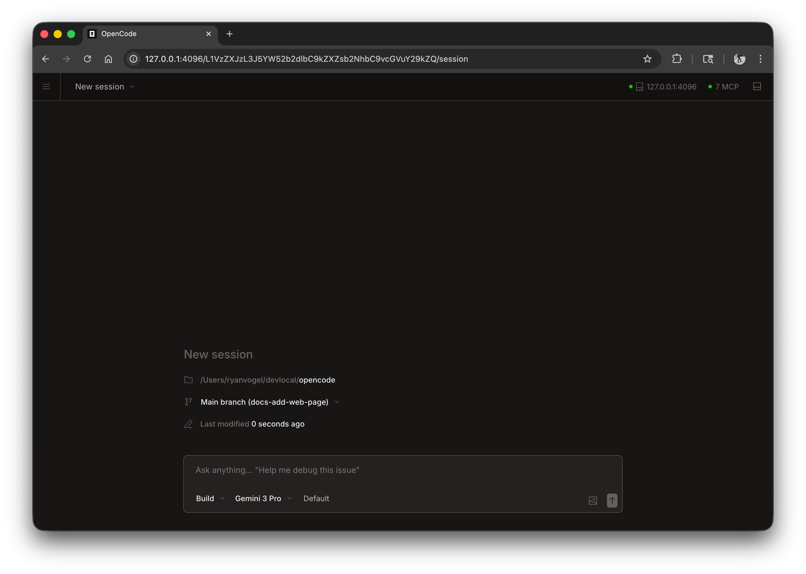
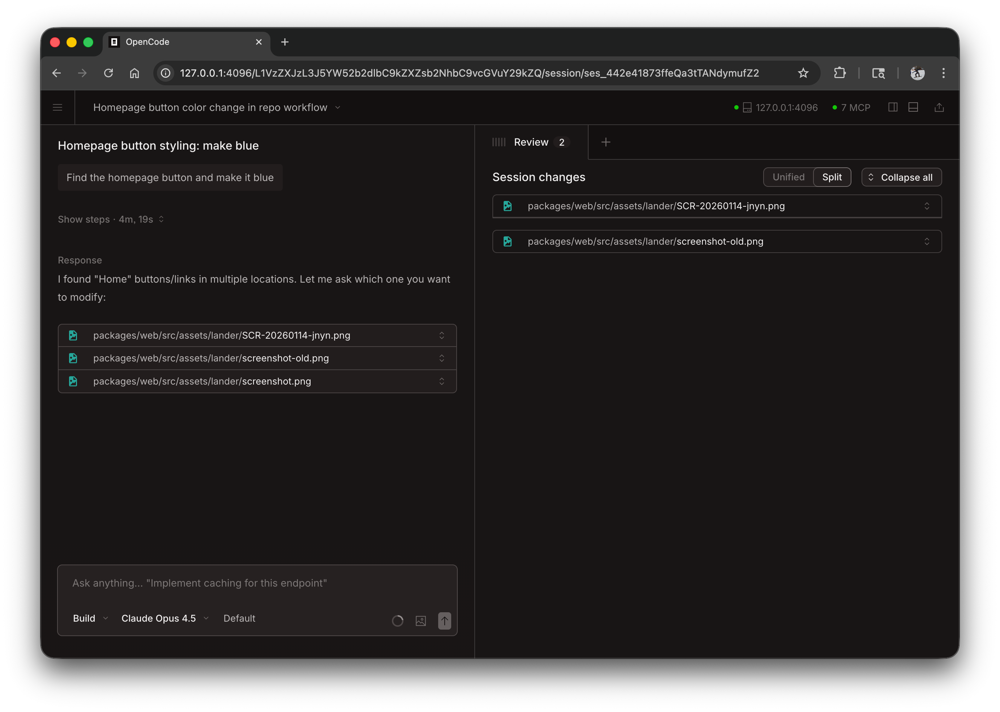
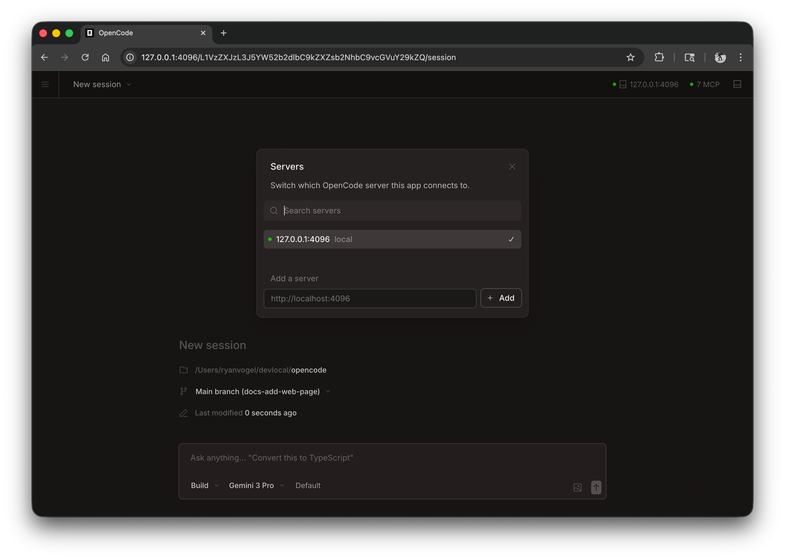

Bellu Code može raditi kao web aplikacija u vašem pretraživaču, pružajući isto moćno iskustvo AI kodiranja bez potrebe za terminalom.



## Početak rada

Pokrenite web interfejs tako što ćete pokrenuti:

```bash
bellucode web
```

Ovo pokreće lokalni server na `127.0.0.1` sa nasumičnim dostupnim portom i automatski otvara Bellu Code u vašem podrazumevanom pretraživaču.

:::caution
Ako `BELLUCODE_SERVER_PASSWORD` nije postavljen, server će biti nezaštićen. Ovo je u redu za lokalnu upotrebu, ali bi trebalo biti postavljeno za pristup mreži.
:::

:::tip[Windows korisnici]
Za najbolje iskustvo, pokrenite `bellucode web` iz [WSL](/docs/windows-wsl) umjesto PowerShell-a. Ovo osigurava pravilan pristup sistemu datoteka i integraciju terminala.
:::

---

## Konfiguracija

Možete konfigurirati web server koristeći oznake komandne linije ili u vašoj [config file](/docs/config).

### Port

Bellu Code podrazumevano bira dostupni port. Možete odrediti port:

```bash
bellucode web --port 4096
```

### Ime hosta

Podrazumevano, server se vezuje za `127.0.0.1` (samo lokalni host). Da biste Bellu Code učinili dostupnim na vašoj mreži:

```bash
bellucode web --hostname 0.0.0.0
```

Kada koristite `0.0.0.0`, Bellu Code će prikazati i lokalne i mrežne adrese:

```
  Local access:       http://localhost:4096
  Network access:     http://192.168.1.100:4096
```

### mDNS Otkrivanje

Omogućite mDNS kako bi vaš server bio vidljiv na lokalnoj mreži:

```bash
bellucode web --mdns
```

Ovo automatski postavlja ime hosta na `0.0.0.0` i oglašava server kao `bellucode.local`.

Možete prilagoditi ime mDNS domene za pokretanje više instanci na istoj mreži:

```bash
bellucode web --mdns --mdns-domain myproject.local
```

### CORS

Da biste omogućili dodatne domene za CORS (korisno za prilagođene frontendove):

```bash
bellucode web --cors https://example.com
```

### Autentifikacija

Da biste zaštitili pristup, postavite lozinku koristeći varijablu okruženja `BELLUCODE_SERVER_PASSWORD`:

```bash
BELLUCODE_SERVER_PASSWORD=secret bellucode web
```

Korisničko ime podrazumevano je `bellucode`, ali se može promeniti sa `BELLUCODE_SERVER_USERNAME`.

---

## Korištenje web sučelja

Jednom pokrenut, web sučelje pruža pristup vašim Bellu Code sesijama.

### Sesije

Pregledajte i upravljajte svojim sesijama sa početne stranice. Možete vidjeti aktivne sesije i započeti nove.



### Status servera

Kliknite "Pogledajte servere" da vidite povezane servere i njihov status.



---

## Povezivanje terminala

Možete priključiti TUI terminala na aktivni web server:

```bash
# Start the web server
bellucode web --port 4096

# In another terminal, attach the TUI
bellucode attach http://localhost:4096
```

Ovo vam omogućava da istovremeno koristite i web sučelje i terminal, dijeleći iste sesije i stanje.

---

## Konfiguracioni fajl

Također možete konfigurirati postavke servera u svom `bellucode.json` konfiguracijskom fajlu:

```json
{
  "server": {
    "port": 4096,
    "hostname": "0.0.0.0",
    "mdns": true,
    "cors": ["https://example.com"]
  }
}
```

Oznake komandne linije imaju prednost nad postavkama konfiguracione datoteke.
